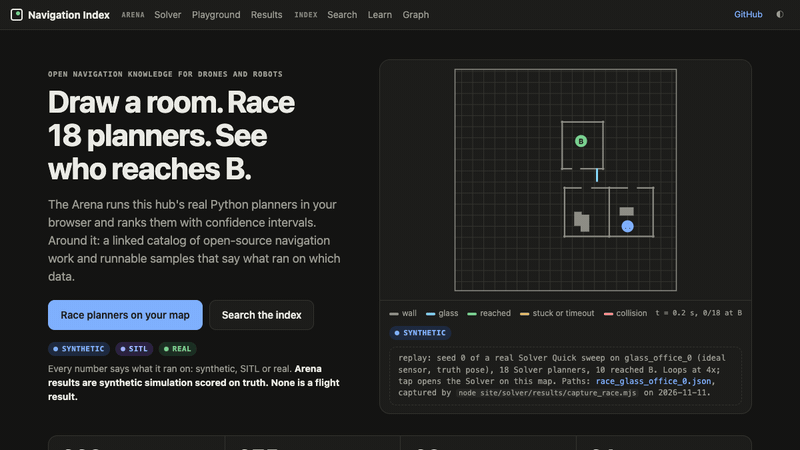
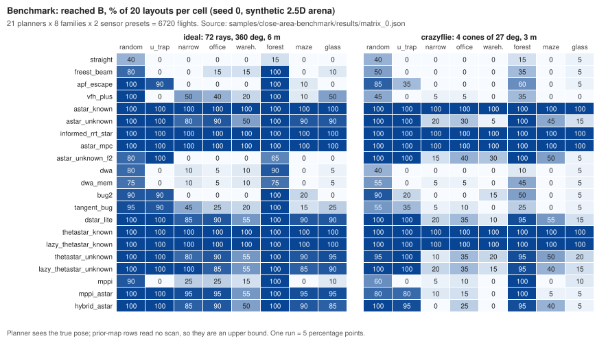

# Navigation Index

**Open navigation knowledge for drones and robots: a linked catalog, honest experiments, and a
browser Arena that races path planners on your map.**

[](https://github.com/tp9imka/navigation-index/actions/workflows/check.yml)
[](LICENSE)
[](LICENSE-docs)
[](https://navigation-index.pages.dev/)



[Try the Solver](https://navigation-index.pages.dev/site/solver/) - [Draw your own room](https://navigation-index.pages.dev/site/playground/) - [Search the index](https://navigation-index.pages.dev/site/)

> Every number says what it ran on: synthetic, SITL or real. Arena results are synthetic
> simulation scored on truth. None is a flight result.

The GIF is the Home page replaying seed 0 of a committed Solver Quick sweep
([race_glass_office_0.json](site/solver/results/race_glass_office_0.json)), captured with
[tools/capture_hero.mjs](tools/capture_hero.mjs). Synthetic.

## Quickstart (no installs)

Python 3 stdlib only.

```sh
git clone https://github.com/tp9imka/navigation-index && cd navigation-index
python3 -m http.server 8000          # then open http://localhost:8000/
python3 tools/query.py search "visual odometry" --kind repo --fit high
```

Use the index from a coding agent over MCP (stdio, stdlib). With Claude Code as the client:

```sh
claude mcp add navigation-index -- python3 "$PWD/tools/mcp_server.py"
```

Other MCP clients: register the command `python3 /abs/path/tools/mcp_server.py`. Tools: `search`,
`decode`, `show`, `concept`, `neighbors`, `read`.

## What is in here

- **The Arena** - Solver, Playground and Results in the browser. The hub's Python planners run
  in your browser via Pyodide on a map you pick or draw.
- **The index** - 923 open-source repos plus 409 papers, 77 datasets, 52 standards and other
  documents, linked in one graph (counts: top line of [INDEX.md](INDEX.md)).
- **63 samples** that say what ran, on which data, with which interpreter ([samples/README.md](samples/README.md)).
- **Templates** - a flight-loop starter, a drone adapter with drivers, an offline kit, a replay dashboard.
- **For coding agents** - [AGENTS.md](AGENTS.md), [llms.txt](llms.txt), an MCP server.

## The Arena

A shared simulator every planner comparison in the hub uses:
[samples/close-area-arena](samples/close-area-arena/README.md), contract in
[CONTRACT.md](samples/close-area-arena/CONTRACT.md). The browser pages run the same Python.

| Part | Model |
|---|---|
| World | 2.5D: vertical prisms (boxes, cylinders), vehicle holds z = 1.0 m. 20 x 20 m with walls; local ENU, origin at A |
| Vehicle | Point mass, 50 Hz double integrator, first-order velocity lag tau = 0.15 s, \|a\| <= 3 m/s^2, \|v\| <= 2 m/s, radius 0.15 m |
| Range sensor | Ray-cast range fan from the true pose. Default 72 beams, 360 deg, 6 m, Gaussian noise 0.02 m, dropout 2 % |
| Sensor presets | `ideal` (the default fan) and `crazyflie` (4 cones of 27 deg, 3 m, range-dependent Gaussian noise, glass and mirrors return nothing) in the benchmark; the Solver also offers `depth_cam_87` and `lidar_2d` |
| VIO faults | Reference estimator (EKF on a 30 Hz VIO-like source, 50 Hz accel, seeded dark zones) with faults `none`, `jump`, `bias`, `dropout`, `overconfident` |
| Scoring | Always on truth: reached = within 0.3 m of B; collision = clearance < 0.15 m; stuck = moved < 0.2 m in 10 s; timeout at 60 s (120 s for warehouse and maze in the benchmark) |

What it is not:

- No contact physics. A collision ends the run.
- No aerodynamics: no attitude, wind, ground effect or motor saturation.
- Not a flight result. Nothing in the Arena is SITL or a real vehicle.

## The benchmark

Every planner in the hub x every arena family x two sensor presets:
[samples/close-area-benchmark](samples/close-area-benchmark/README.md). 21 planners x 8 families x
2 presets x 20 layouts = 6720 runs, seed 0, true pose, synthetic.



Figure: [docs/how-it-was-built/figures/benchmark_heatmap.svg](docs/how-it-was-built/figures/benchmark_heatmap.svg),
written by [make_figures.py](docs/how-it-was-built/make_figures.py) from
[matrix_0.json](samples/close-area-benchmark/results/matrix_0.json).

Reference implementations, untuned. PRs welcome: a planner PR runs the full matrix and commits the JSON.

Cite the benchmark as:

```text
Navigation Index close-area benchmark, samples/close-area-benchmark/results/matrix_0.json,
commit <commit>, https://github.com/tp9imka/navigation-index
(synthetic 2.5D arena, 21 planners x 8 families x 2 sensor presets, 20 layouts, seed 0)
```

## Catalog and deep dives

The catalog is JSON in [data/](data/) (schema: [docs/SCHEMA.md](docs/SCHEMA.md)), built by
`tools/build.py` into [catalog/](catalog/), [INDEX.md](INDEX.md), [graph/](graph/graph.json) and
[index/records.jsonl](index/records.jsonl). A repo page shows the papers, courses and samples that
point at it, and the reverse. Repos are described and linked, not cloned.

| You want | Go to |
|---|---|
| Browse by topic | [INDEX.md](INDEX.md) => `catalog/concepts/` |
| Install, wiring, gotchas and licence per repo | [integration cards](docs/integration-cards/README.md), picks per capability in [reference-stacks.md](docs/reference-stacks.md) |
| Dataset sizes and licences | [dataset cards](docs/dataset-cards/README.md) |
| Papers by section, with numbers | [paper digests](docs/paper-digests/) |
| Learn navigation fast | [docs/primer/](docs/primer/README.md), [docs/learning-paths.md](docs/learning-paths.md) |
| Integrity and timing | [docs/integrity-monitoring.md](docs/integrity-monitoring.md), [docs/timing-resilience.md](docs/timing-resilience.md) |
| What PX4 EKF2 and ArduPilot EKF3 do when GNSS is spoofed or jammed (SITL, source-cited) | [docs/autopilot-gnss-fault-handling.md](docs/autopilot-gnss-fault-handling.md) |
| Model weights vs code licences | [docs/model-weights-licenses.md](docs/model-weights-licenses.md) |
| Vendors, funders, sources in Ukrainian and Russian | [docs/landscape/](docs/landscape/README.md), [overview](docs/landscape/ua-ru-sources-overview.md) |
| One-page cheat sheets | [docs/cheatsheets/](docs/cheatsheets/README.md) |

## Samples

[samples/README.md](samples/README.md) lists every sample by problem. Each one has a
`sample.json` with a fixed contract:

- `verified_status`: `ran` (the documented main path ran and its output is in the README),
  `partial` (main path ran, a shipped part did not) or `sketch` (nothing ran).
- `input`: `real` (recorded public data), `sitl` (real autopilot firmware in simulation),
  `synthetic` (simulated sensors) or `mixed`.
- `verified`: free text, what ran, when, on which interpreter and data.
- `deps` (`stdlib`, `venv`, `docker`) and `first_command`.

Quote numbers from [docs/evidence-matrix.md](docs/evidence-matrix.md), which marks the input type
and labels superseded results. Install convention: a venv inside the sample folder, never the
global interpreter.

## Templates

- [templates/flight-repo](templates/flight-repo/README.md) first: a stdlib flight loop (planner +
  safety filter + estimator faults). `make first-flight` flies it in the Arena and scores the log.
- [templates/drone-adapter](templates/drone-adapter/README.md): one `pose()` / `ranges()` /
  `send_setpoint()` seam, with [drivers](templates/drone-adapter/drivers/README.md) for PX4,
  ArduPilot, Crazyflie and Tello. The drivers are unrun, written from SDK docs.
- More in [templates/](templates/README.md): project skeleton, offline kit, demo dashboard,
  presenting material.

## For coding agents

- [AGENTS.md](AGENTS.md): routing for a task statement, query rules, how to extend the hub.
- [llms.txt](llms.txt): the map of the hub in one file.
- `tools/query.py` (CLI) and `tools/mcp_server.py` (MCP, stdio): `search`, `decode`, `show`,
  `concept`, `neighbors`, `read`. Run `decode` on a pasted problem statement, then search with
  the keywords it prints. Free-text search ranks a paragraph of prose poorly.
- A second MCP server, [samples/llm-mission-agent](samples/llm-mission-agent/README.md), exposes
  vehicle tools behind a geofence and dry-run mode. It was verified against SITL only.

## Honest limits

- Synthetic 2.5D arena; no contact physics, no aerodynamics, no sensor noise models beyond
  Gaussian noise (range-dependent for the `crazyflie` preset), dropout and glass that returns
  nothing. Nothing flew. No SITL run of the Solver pick yet (help wanted).
- Planners are the project's own implementations. Hybrid A* lost to A* (81.9 % vs 91.2 % reached
  on the turn-limited vehicle, synthetic) and is kept as a negative result
  ([close-area-planner-hybrid-astar](samples/close-area-planner-hybrid-astar/README.md)).
- Catalog records were written by coding agents and fact-checked by sampling; measured error
  rates 8.3 % to 32.4 % of checked repo records by tier: 9.0 % for high-fit records
  ([round 3](docs/reports/fact-check-round3.md)), 32.4 % for medium- and low-fit records
  ([round 5](docs/reports/fact-check-round5.md)), 8.3 % in a random sample of 60
  ([round 1](docs/reports/fact-check-2026-11-06.md)). Read the repo's README and LICENSE before
  building on a medium- or low-fit record.
- Integration and dataset cards were read, not run, unless the card says so
  ([round 4](docs/reports/fact-check-round4.md) checked a sample).
- Drone drivers are written from SDK docs and were never executed on a vehicle.
- Dataset licences are mostly non-commercial; the [cards](docs/dataset-cards/README.md) say which.

## How it was built

The hub was built by a human driving coding agents. Each work item was reviewed before merge, and
each merge passed a gate of link, search, decoder and sample checks. Two of its own headline ideas failed
their kill tests and are published as failures. Method, kill tests and fact-check error rates:
[docs/how-it-was-built.md](docs/how-it-was-built.md). Fact-check reports:
[docs/reports/](docs/reports/README.md).

## Find your way

**Got a full task brief** => [docs/problem-statement-decoder.md, full-brief routing](docs/problem-statement-decoder.md#route-a-full-brief-to-rows-and-first-pages).
**Close-area A=>B task** (fly a drone from A to B, maybe with obstacles) =>
[docs/research/close-area-nav/](docs/research/close-area-nav/README.md), then the runnable
[samples/close-area-arena](samples/close-area-arena/README.md).
Network blocks the CDN: `python3 tools/offline_browser_kit.py prepare` then `verify`
([first-three-hours](docs/first-three-hours.md#browser-tools-offline)).

| Need | Open |
|---|---|
| First 20 minutes on a new task | [docs/first-day-intake.md](docs/first-day-intake.md), measured end to end in [docs/cold-start-drill.md](docs/cold-start-drill.md) |
| First hour: clone to a scored first flight and a regression bar | [docs/quickstart-first-flight.md](docs/quickstart-first-flight.md) |
| Which planner for which arena and sensor | [samples/close-area-benchmark](samples/close-area-benchmark/README.md) (21 planners x 8 families x 2 sensor presets) |
| Starter code for your own repo | [templates/flight-repo](templates/flight-repo/README.md) (`make first-flight`), [templates/drone-adapter](templates/drone-adapter/README.md) (PX4, ArduPilot, Crazyflie, Tello) |
| Your room as an arena world | [samples/close-area-arena](samples/close-area-arena/README.md#your-room-in-the-arena-ran-2026-11-10-synthetic) `world_from_room.py` (measured room) or `world_from_image.py` (floor plan image) => world JSON for the Solver |
| Pick and fly a planner for that world | [Solver](site/solver/README.md) Quick, Thorough if tied, Recommend => `make first-flight PLANNER=bench:<id> WORLD=<file>` in flight-repo; F2 cannot pass gaps under ~1.4 m |
| A regression bar for your planner | [close-area-benchmark scenario packs](samples/close-area-benchmark/README.md#scenario-packs) (`pack.py run packs/<name>.json`, PASS / FAIL / NOT PROVEN per planner) |
| People walking through | [samples/close-area-moving-obstacles](samples/close-area-moving-obstacles/README.md) `run_predict.py` (VO gate: 100 of 100 held-out runs reached, 0 collisions, synthetic) |
| B is a marker, position unknown | [samples/close-area-explore](samples/close-area-explore/README.md) (frontier found B in 43.3 % with B unknown, 88.3-100 % with a nominal B within 2 m, synthetic), then [fiducial-goal-apriltag](samples/fiducial-goal-apriltag/README.md) |
| More planners | [Theta*](samples/close-area-planner-thetastar/README.md), [MPPI](samples/close-area-planner-mppi/README.md), [Hybrid A*](samples/close-area-planner-hybrid-astar/README.md) (negative: 81.9 vs 91.2 % reached, synthetic) |
| How the toolkit was built | [docs/how-it-was-built.md](docs/how-it-was-built.md) |
| What we tested as innovation, and what failed | [docs/research/README.md](docs/research/README.md) (decision at the end) |
| Story, demo, hard questions | [templates/presenting/close-area-story.md](templates/presenting/close-area-story.md), [templates/presenting/live-demo-script-close-area.md](templates/presenting/live-demo-script-close-area.md), [templates/presenting/hard-questions.md](templates/presenting/hard-questions.md) |
| Flagship demo: SITL spoof => integrity monitor => source switch => operator dashboard | [samples/golden-demo](samples/golden-demo/README.md) |
| Project ideas, reference architectures, prep checklist | [docs/competition-playbook.md](docs/competition-playbook.md) |
| Record, replay and inspect sensor logs | [recording-replay](samples/recording-replay/README.md), [MCAP](docs/integration-cards/foxglove__mcap.md), [Rosbags](docs/integration-cards/ternaris__rosbags.md), [Rerun](docs/integration-cards/rerun-io__rerun.md) |

### Got a problem statement? Four hops

Before choosing: [filter by the resources you have](docs/practical-readiness.md) (CPU/GPU,
hardware, download/setup budget, tested platform and offline evidence), then prepare one of
the [three starter bundles](docs/starter-bundles.md). Each has a rehearsal path and a fallback.

1. **Decode it.** [docs/problem-statement-decoder.md](docs/problem-statement-decoder.md):
   wording table => 1-3 of the decoder rows, each with approach, stack, data, starting
   sample, risk, one-line summary. Then [docs/first-three-hours.md](docs/first-three-hours.md) for the first three hours.
2. **Pick a sample.** [samples/README.md](samples/README.md): every sample grouped by
   problem, with status (ran / partial / sketch), deps, first command and the key measured
   result.
3. **Cite numbers.** [docs/evidence-matrix.md](docs/evidence-matrix.md): every measured number
   across samples, with input type (real / SITL / synthetic) and caveats.
4. **Build on cards.** [integration card index](docs/integration-cards/README.md) (one card
   per repo: install, wiring, gotchas, license; grouped by capability) and [dataset cards](docs/dataset-cards/README.md)
   (checked sizes and licenses). Picks per capability:
   [docs/reference-stacks.md](docs/reference-stacks.md).

### Tools

All stdlib Python 3. `enrich.py` needs an authenticated `gh` CLI. After a fresh clone, run
`python3 tools/build.py` once: the committed index can lag a feature commit until the regenerate
commit lands.

```sh
python3 tools/query.py decode "Navigate a quadcopter 10 km without GPS under jamming"   # 1-3 decoder rows
python3 tools/query.py concept concept:magnetic-nav
python3 tools/query.py show sample:golden-demo
python3 tools/enrich.py && python3 tools/build.py      # after editing data/ or samples/*/sample.json
python3 tools/check_links.py                           # relative links, as CI runs it
```

Generated quality report: [reports/quality.md](reports/quality.md) (dangling references, archived
repos, merged duplicates). Upstream defects the samples found: [docs/upstream-findings.md](docs/upstream-findings.md).

## Scope

In: navigation, localization, PNT resilience, autonomy, situational awareness, defensive EW and
airspace awareness (counter-UAS detection). Out: weapon terminal guidance, targeting, offensive
payloads, over-the-air GNSS, jamming or spoofing transmission. See [docs/export-control-and-ethics.md](docs/export-control-and-ethics.md).

## Contributing

See [CONTRIBUTING.md](CONTRIBUTING.md). Records go in `data/` as JSON; new samples need a
`sample.json` with the contract above.

## Licence

- Code: Apache-2.0, [LICENSE](LICENSE).
- Docs and data: CC BY 4.0, [LICENSE-docs](LICENSE-docs).
- Exceptions and third-party material: [THIRD_PARTY.md](THIRD_PARTY.md).

## How to cite

See [CITATION.cff](CITATION.cff). For the benchmark, use the block under [The benchmark](#the-benchmark)
with the commit SHA you used.
