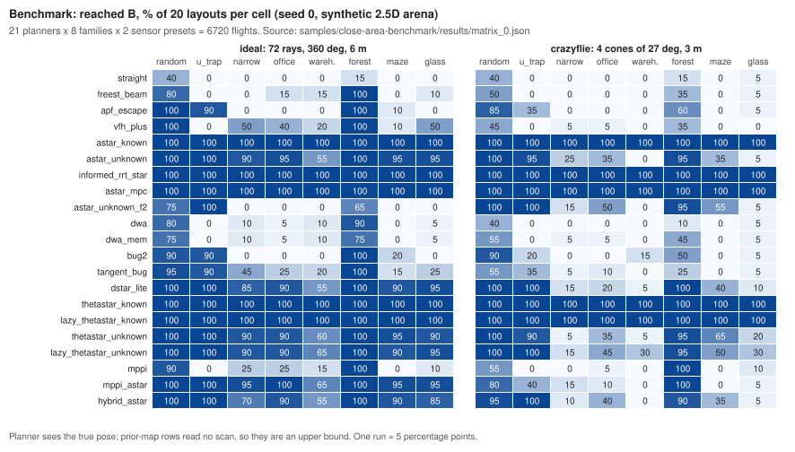
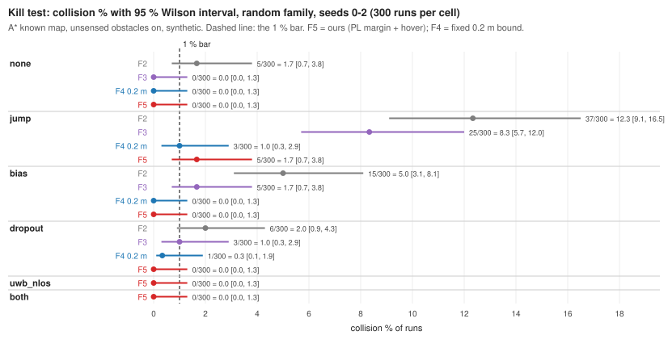
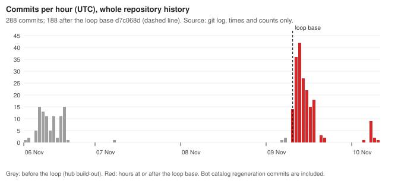

# Two days, 83 items, two headlines killed

A case study of how we built this navigation hub's close-area toolkit for the EDGE internal
hackathon (Challenge 2, 18 Nov 2026) with one driver session and a pool of coding-agent workers.

Every number on this page is printed by [make_figures.py](make_figures.py) into
[figures/numbers.json](figures/numbers.json) (the key is given in brackets), or links the file it
comes from. Every simulation number is **synthetic**: a 2.5D point-mass arena, scored on truth. None
is SITL or flight. Where we have no number we write "not measured".

## Summary (2 minutes)

- **What we built.** Starting from a one-line brief ("fly a drone from A to B in a close area,
  maybe with obstacles"), we built a shared simulated arena, flew 21 planners through 8 room
  families with 2 range sensors (6720 flights), ran two kill tests against our own headline ideas,
  and put the result in a browser page, the [Solver](https://navigation-index.pages.dev/site/solver/),
  that ranks planners for a given map.
  [`benchmark.planners`, `benchmark.families`, `benchmark.runs`]
- **How.** One driver session picked, briefed, reviewed and merged work. Kiro workers did each item
  in its own git worktree through `farmout`. A brainstorm subagent refilled the backlog at re-plan
  points. Every merge passed a gate of link, search, decoder and sample checks.
- **How much.** The backlog has 83 rows (01-84; 66 was never used): 63 done, 10 ready, 3 dropped,
  3 needs-human, 2 parked, 2 in-flight. The journal names 69 landed commits over two dated days
  (2026-11-09 and 2026-11-10). [`backlog.counts`, `journal.landed_commits`, `journal.journal_dates`]
- **What failed.** Both headline ideas failed their own tests. Our integrity-aware safety filter
  collided in 1.7 % [0.7, 3.8] of jump-fault runs against a 1 % bar, while a hand-tuned fixed
  0.2 m bound stayed at 1.0 %. Relocalization after VIO loss worked with 72 beams and failed with
  the 4 beams of a Crazyflie-like sensor (best arm 66-89 % reached against a 90 % bar). Hybrid A*
  reached B less often than plain A*. [`kill_test`, `relocalize_4_beams`, `hybrid_astar`]
- **What we pitch instead.** The measured toolkit, plus a narrow claim only if the real brief fits
  it ([decision](../research/README.md#decision-2026-11-09-evening-what-the-close-area-innovation-claim-is)).

Links: [live Solver](https://navigation-index.pages.dev/site/solver/),
[repository](https://github.com/tp9imka/navigation-index) (the `origin` remote of this checkout).

## The story

### Brief => arena

The brief left platform, sensors, indoor or outdoor, and sim or real open until Day 1. So we did
not pick a drone. We defined one adapter contract (`pose()`, `ranges()`, `send_setpoint()`) and one
simulator every comparison would share: [close-area-arena](../../samples/close-area-arena/README.md),
a 50 Hz double integrator with a ray-cast range fan. Driver stubs for PX4, ArduPilot, Crazyflie and
Tello speak the same contract and are unrun ([drone-adapter](../../templates/drone-adapter/README.md)).

### 21 planners x 8 rooms

Each planner came in as its own sample and was then run through one matrix:
[close-area-benchmark](../../samples/close-area-benchmark/README.md), 20 layouts per cell, seed 0,
true pose. [`benchmark.layouts_per_cell`, `benchmark.seed`]



What the matrix says:

- Five planners with a prior map reached B in every cell with 0 collisions on both sensors:
  `astar_known`, `informed_rrt_star`, `astar_mpc`, `thetastar_known`, `lazy_thetastar_known`. They
  never read the scan, so this is an upper bound. [`benchmark.planners_100_reached_0_collision_every_family`]
- Without a map, 4 beams break the rooms. A* on a map built from range hits reached 95 % of office
  layouts with 72 beams and 35 % with 4; warehouse 55 % and 0 %; glass office 95 % and 5 %.
  [`benchmark.astar_unknown_reached_pct`]

### Kill tests

We wrote each headline idea down with a pass line before building it, then tried to break it on
seeds it was not tuned on. The safety-filter test is in the figure below; the relocalization test
is under "What failed".



### Measured toolkit => Solver

After both headlines narrowed, we turned the shelf into tools a team can use on the day: a starter
flight repo ([flight-repo](../../templates/flight-repo/README.md)), a browser
[playground](../../site/playground/README.md) that runs the same Python arena via Pyodide, and the
[Solver](../../site/solver/README.md), which flies every offered planner on one map for N seeds and
ranks them with Wilson intervals. The journal records its first check as 36 of 36 Quick runs in
12 s on 4 workers ([JOURNAL, 2026-11-10](../../loop/JOURNAL.md)).

## The method



The hub existed before the loop: 92 commits on 2026-11-06 built the catalog and tooling. The loop
starts at base commit d7c068d (2026-11-09T07:26Z). This checkout has 188 commits after it, over
23.9 hours to the last commit, including bot catalog regenerations.
[`git.commits_by_utc_day`, `git.loop_base_utc`, `git.commits_after_loop_base`, `git.loop_span_hours`]

- **Driver loop.** [loop/DRIVER.md](../../loop/DRIVER.md) is the prompt for one Claude Code session.
  It picks up to 7 non-overlapping ready items, briefs each from
  [brief-template.md](../../loop/brief-template.md), launches, reviews, lands and pushes. State lives
  in [BACKLOG.md](../../loop/BACKLOG.md) and [JOURNAL.md](../../loop/JOURNAL.md), not in the
  transcript, so a new session resumes from files.
- **Kiro workers via farmout.** Each item is one `farmout run kiro` job in its own worktree, with a
  fixed list of paths it may touch. Shared files are driver-only; workers list what they need under
  "Driver edits needed".
- **Brainstorm partner.** At re-plan points the driver sent the gap scan, backlog and recent journal
  to a separate subagent and asked for ranked new items. The driver decided what went in. The
  journal has 2 re-plans. [`journal.replans`]
- **Landing gate.** Before a merge the driver read the full diff, checked 2 load-bearing claims
  itself, ran the sample's first command, then ran build, link, search-parity, decoder,
  sample-test, readiness and MCP checks. Where the journal records claim checks, 35 of 35 held.
  [`journal.claims_checked`] Two gate slips are on record in the [journal](../../loop/JOURNAL.md) (broken links pushed once, a README
  pushed before its files once); both were fixed and turned into rules.
- **Honest labelling.** Each sample states `verified_status` (`ran` / `partial` / `sketch`) and the
  input type of every number. A FAIL against the stated threshold counts as a deliverable. The
  backlog's "done" column often reads "done (FAIL ...)".

## What failed and why

### Integrity-aware safety filter (F5)

Pass line: collisions at or below 1 % in every fault case, and reach at least 90 % of the plain
range filter (F2). On the random family, seeds 0-2, 300 runs per cell:
[`kill_test.random_seeds_0_2`, `kill_test.reach_ratio_vs_F2_seeds_0_2`]

| arm | jump collisions | jump reach vs F2 |
|---|---|---|
| F2 range filter as shipped | 37/300 = 12.3 % [9.1, 16.5] | 1.00 |
| F4 fixed 0.2 m bound | 3/300 = 1.0 % [0.3, 2.9] | 0.96 |
| F5 ours | 5/300 = 1.7 % [0.7, 3.8] | 0.56 |

On the held-out seeds alone, F5 jump was 5/200 = 2.5 % [1.1, 5.7]. F5 failed on jump collisions and
on jump reach. The fixed bound was tuned on seed 0 and held on seeds 1-2. Why: in 4 of F5's 7 jump
collisions the run ended in hover, and the hover rule drops the map rows that guard obstacles the
range sensor cannot see ([safety-filter Part e](../../samples/close-area-safety-filter/README.md#what-the-collisions-are)).
The script re-derives the four jump cells from the per-run JSON and finds each string in
[kill_e_tables.md](../../samples/close-area-safety-filter/results/kill_e_tables.md). [`kill_test.cross_check`]

### Relocalization on 4 beams

The scan-to-map matcher needs at least 10 returns per scan (`MIN_RETURNS` in
[sparse_random_0.json](../../samples/close-area-relocalize/results/sparse_random_0.json)); a 4-beam deck gives 4
([relocalize README, loop-54](../../samples/close-area-relocalize/README.md)). With 72 beams the
spin-and-move arm reached 98-100 % with 0 wrong commits. With 4 beams it reached 48 % (dropout) and
64 % (jump) on seed 0. [`relocalize_4_beams.spin_ig_seed0_random_100_layouts`]

A later arm kept a rolling submap of returns while flying. On held-out seed 2 with the Crazyflie-like
preset it reached 66-89 % with 0-6 wrong commits, against a bar of 90 % and 0. An AF-MCL-style
particle filter reached 0-15 % with 77-97 % collisions on the same cells.
[`relocalize_4_beams.submap_fwd_ig_seed2_crazyflie_100_layouts`, `relocalize_4_beams.mcl_seed2_crazyflie_100_layouts`]
The idea also narrowed in other ways (weaker in offices and warehouses, collisions with unmapped
obstacles, and prior art exists); those numbers are in the
[research decision](../research/README.md#decision-2026-11-09-evening-what-the-close-area-innovation-claim-is).

### Hybrid A*

We expected heading-aware paths to help a turn-limited vehicle. Over 8 families x 20 layouts with the
ideal sensor, Hybrid A* reached 81.9 % against 91.2 % for A* on the turn-limited vehicle, and 86.2 %
against 91.2 % on the stock one, with 0 % collisions for both. [`hybrid_astar.ideal_totals`] The
sample attributes most of the gap to runs scored stuck while flying back over their own track
([hybrid-astar INTEGRATION](../../samples/close-area-planner-hybrid-astar/INTEGRATION.md)). It is
our own untuned implementation, without path smoothing.

## What it cost

| item | value |
|---|---|
| landed commits named in the journal | 69 [`cost.landed_commits`] |
| failed job attempts named in the journal | 4 [`cost.failed_job_attempts_named_in_journal`] |
| jobs that timed out after writing results, applied by the driver | 4 [`cost.timed_out_jobs_applied_by_driver`] |
| items blocked on a human decision (Docker image builds) | 3 [`cost.needs_human_items`] |
| benchmark compute, wall seconds on 14 processes | 2598.1 [`cost.benchmark_wall_s`] |
| kill-test compute (seeds 0-2 + 2 families), wall seconds on 14 workers | 739.0 [`cost.kill_test_seeds_0_2_and_families_wall_s`] |
| total jobs launched | not measured (the farmout job log is not committed) |
| Kiro credits or tokens, driver tokens | not measured |
| human hours | not measured |

The job count is a lower bound: 69 landed plus 4 named failures. Retries, discarded jobs and the
read-only audit job are not counted in a committed file.

## Limits of this page

- The page reads the backlog and journal as they are in this checkout. Item 29 still says
  `in-flight` although its audit fed items 31B-31I. Item 10 cites 2ced628 in the backlog and
  bcd1b17 in the journal.
- The landed-commit count comes from regex rules over the journal's free text (see
  `LANDED_RES` in the script). A line written in another shape would be missed.
- Everything quoted from simulation is one 2.5D synthetic arena. Nothing here has flown.

## Rebuild

```sh
python3 docs/case-study/make_figures.py    # stdlib only, about 6 s on an M3 Max; rewrites figures/
```
