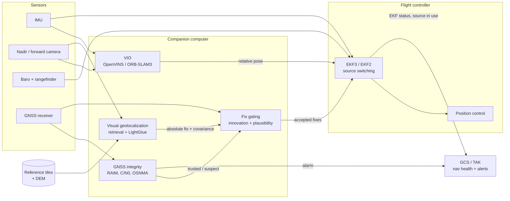
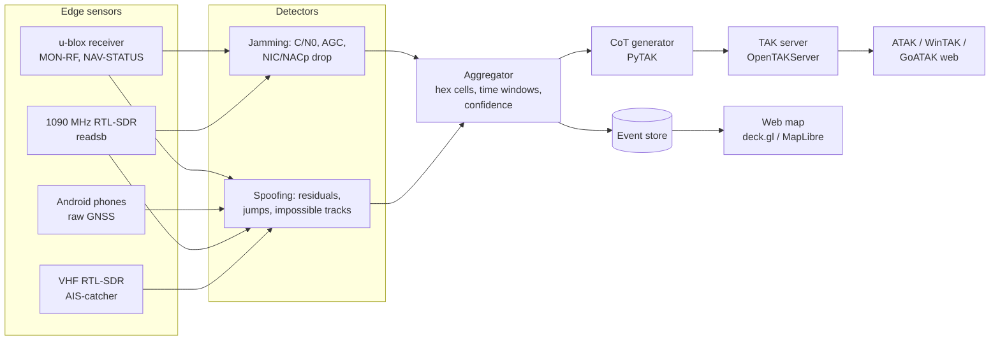
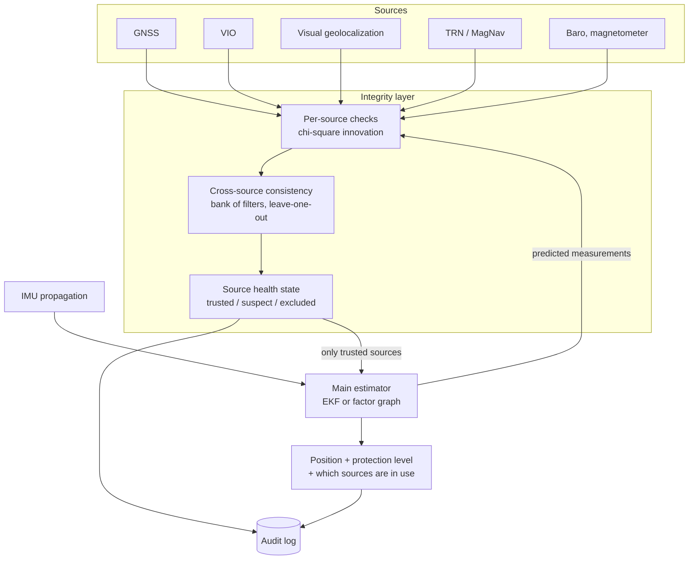
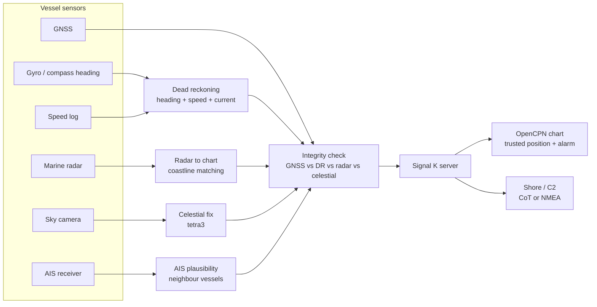
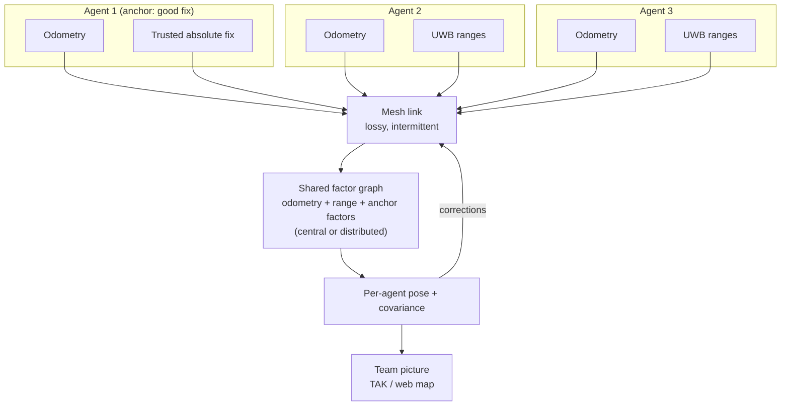

# Hackathon playbook: navigation and PNT under GNSS denial

For a team going into a navigation-themed hackathon that may have a military or defense
track. Everything here is framed as defensive: keeping position, navigation and timing
trustworthy, detecting interference, and giving operators an honest picture. Weapon
terminal guidance and targeting are out of scope (see
[DoDD 3000.09](../catalog/resources/dodd-3000-09-autonomy-weapons-2023.md) for where that
line sits, and [Policy, export control and ethics](../catalog/concepts/policy-ethics.md)).

Version 2, 2026-11-06. New since v1: each project idea links its
[integration cards](integration-cards/) (install, gotchas, license traps) and
[dataset cards](dataset-cards/README.md) (checked sizes); a section on differentiators
(1.1); the prep checklist uses the measured pre-download shortlist; known traps (PX4 v1.17.0
vs `main`, ArduPilot 4.6 vs 4.7 params, `mavsdk` vs `mavsdk-grpc`, non-commercial SuperPoint
weights, Oxford RobotCar withdrawn, EuRoC moved and rate-limited) are folded in where they bite.
Updated 2026-11-06 (v2.1): every idea's "Start" points at the sample that already builds it;
see the quick picker's last column. v2.2 (after review round 2): celestial (15), real UWB (19),
large-area retrieval and the end-to-end VPAIR chain (18), thermal (18 stretch), PX4 golden demo
(10) and the real Jammertest replay (1) added.

Companion docs:

- [reference-stacks.md](reference-stacks.md) - "if you only have X, use Y", with a license column.
- [day0-runbook.md](day0-runbook.md) - the first 3 hours after the problem statement drops.
- [problem-statement-decoder.md](problem-statement-decoder.md) - 26 likely statements => approach, stack, data, sample, risk, pitch. Start here when the statement drops.
- [samples/README.md](../samples/README.md) - every sample by problem: status, deps, first command, key result.
- [evidence-matrix.md](evidence-matrix.md) - every measured number across samples, real vs simulated input.
- [landscape/](landscape/README.md) - what vendors already sell and what funders ask for.
- [templates/](../templates/README.md) - project skeleton, threat model, demo script, pitch outline, self-assessment.

Contents:

1. [What judges reward](#1-what-judges-reward)
   - [1.1 Differentiators judges have not seen](#11-differentiators-judges-have-not-seen)
2. [Problem space map](#2-problem-space-map)
3. [Project ideas (24-48h)](#3-project-ideas-24-48h)
4. [Reference architectures](#4-reference-architectures)
5. [48h execution plan template](#5-48h-execution-plan-template)
6. [Pre-hackathon prep checklist](#6-pre-hackathon-prep-checklist)

---

## 1. What judges reward

Pulled from past challenge designs, funder problem statements and post-mortems in the hub.
The common thread: a working, measured, honest prototype on a realistic scenario beats a
clever slide.

| Judges reward | Evidence in the hub | What it means for your demo |
|---|---|---|
| A working prototype on a realistic simulated system | [ONR HACKtheMACHINE Unmanned](../catalog/resources/onr-hackthemachine-unmanned-2021.md) - Navy judges reward working prototypes on realistic simulated systems | Run against PX4 or ArduPilot SITL, real recorded data, or real hardware. Not a notebook with synthetic sine waves. |
| Measured accuracy, not coverage | [DARPA SubT](../catalog/resources/darpa-subt-challenge.md) scored accurate localization of reported artifacts; [Kelvins SPEC2019](../catalog/resources/kelvins-spec2019-paper.md) shows how ESA scores a nav competition | Show one number with ground truth: ATE in metres via [evo](../catalog/repos/michaelgrupp__evo.md), OSPA via [Stone Soup](../catalog/resources/stone-soup-docs.md), error vs time during an outage. |
| Multi-sensor fusion, not one magic sensor | [EDF-2024 drone navigation challenge](../catalog/resources/edf-2024-drone-navigation-challenge.md) - "multi-sensor fusion, not a single sensor, is the ask"; DARPA [ASPN](../catalog/resources/darpa-aspn-briefing-2019.md) pushes plug-and-play all-source fusion | Architect for sensor dropout and plug-in sources even if you only finish two. Show the filter surviving one source going away. |
| Integrity and plausibility over raw accuracy | [OPSGROUP 2024 report](../catalog/resources/opsgroup-gps-spoofing-final-report-2024.md) - "is my position plausible?" checks matter more than accuracy; [FAA SAFO 24002](../catalog/resources/faa-safo-24002-gnss-disruptions.md) - hybrid GPS/INS can also be corrupted by spoofing | Detect and flag before you fuse. A spoofing alarm that fires and a filter that refuses the bad fix is the strongest 30-second demo moment. |
| Detect, respond, recover vocabulary | [DHS Resilient PNT Conformance Framework](../catalog/resources/dhs-resilient-pnt-conformance-framework.md) (four resilience levels), [NISTIR 8323](../catalog/resources/nist-ir-8323-pnt-profile.md) (identify/protect/detect/respond/recover, GNSS as untrusted input) | Put your features on a slide mapped to these words. Judges from government recognise them. |
| Holdover time as the value metric | [DIU Transition of Quantum Sensing](../catalog/resources/diu-transition-quantum-sensing-2024.md) - value is reduced drift and longer holdover without GPS | Report "minutes until error exceeds N metres" with and without your aid. |
| Deployable, testable, dual-use | [NATO DIANA challenges](../catalog/resources/nato-diana-10-challenges-2025.md), [DIANA cohort feature](../catalog/resources/nato-diana-secure-comms-navigation.md) - selection favors deployable, testable dual-use products | Name the civil use (aviation, shipping, timing) next to the defense one. Show it runs on hardware a unit could buy. |
| Rapid field relevance, frontline users | [Brave1-NATO competition](../catalog/resources/brave1-nato-counter-drone-ew-competition.md), [Ukrainian anti-drone hackathon](../catalog/resources/militarnyi-anti-drone-hackathon-ukraine.md), [Kyiv Independent on EW cycles](../catalog/resources/kyiv-independent-invisible-war-ew.md) - adaptation cycles measured in weeks | Show reconfigurability: config-driven sources, thresholds, frequency plans. Say how a field user retunes it. |
| Sim-to-real honesty | [Kelvins SPEED+](../catalog/resources/kelvins-pose-estimation-2021.md) scored the synthetic-to-hardware gap; [Swift](../catalog/resources/swift-champion-drone-racing-nature.md) used residual models from real data | If you only ran in sim, say so and show what breaks on real data. |
| Operator workflow and interop | [CERBERUS SubT win](../catalog/resources/cerberus-subt-final-paper.md) - field-hardening and operator workflow mattered as much as algorithms; [NeBula](../catalog/resources/nebula-costar-subt-paper.md) - reasoning over localization uncertainty improves decisions | Put the output on a map operators already use (TAK via CoT). Show uncertainty, not just a dot. |
| Lightweight onboard beats heavy | [MAVLab AlphaPilot win](../catalog/resources/mavlab-alphapilot-win-2019.md), [A2RL 2025](../catalog/resources/a2rl-2025-season.md) - university labs beat well-funded teams | Measure latency and compute. A CPU-real-time pipeline is a feature. |
| Governable, traceable AI | [DoD AI principles](../catalog/resources/dod-ai-ethical-principles-2020.md), [NATO AI principles](../catalog/resources/nato-ai-strategy-principles-2021.md) - judges ask how an AI component can be disengaged | Any learned or LLM component needs a log, a confidence, and an off switch with a safe fallback. |
| Compliance awareness | [Stony Brook ITAR/EAR guide](../catalog/resources/stonybrook-export-publicly-available.md), [EAR and open source](../catalog/resources/linux-foundation-ear-open-source.md), [EU 2021/821](../catalog/resources/eu-dual-use-regulation-2021-821.md) | Stay on public civil signals and published methods. Never radiate GNSS signals; cabled or shielded only. One slide line on this pre-empts the question. |
| Skepticism toward unverified claims | [Vermeer optical navigation report](../catalog/resources/militarnyi-vermeer-optical-nav-2025.md) - vendor claims not independently tested; [RUSI Meatgrinder](../catalog/resources/rusi-meatgrinder-2023.md) - loss figures are contested | Cite numbers with their caveat. Overclaiming in front of practitioners loses points. |

Pitch framing sources: [CSIS Space Threat Assessment 2025](../catalog/resources/csis-space-threat-assessment-2025.md),
[EASA SIB 2022-02](../catalog/resources/easa-sib-2022-02-gnss-outages.md),
[EASA/IATA plan 2025](../catalog/resources/easa-iata-gnss-interference-plan-2025.md),
[UK PNT growth response](../catalog/resources/uk-pnt-growth-government-response-2025.md),
[GAO-21-320SP](../catalog/resources/gao-21-320sp-gps-alternatives.md). Recent hackathon
framing: [EUDIS Defence Hackathon 2025](../catalog/resources/eudis-defence-hackathon-2025.md),
[DASA RF sensing and PNT](../catalog/resources/dasa-advanced-rf-sensing-pnt-2022.md).
2026: [EUDIS Defence Hackathon 5th edition](../catalog/resources/eudis-defence-hackathon-2026.md)
made GNSS-denied navigation one of two common challenges across eight sites; funder problem
statements are collected in [programs and challenges](landscape/programs-and-challenges.md).

### 1.1 Differentiators judges have not seen

Judges at a defense hackathon will have seen camera-to-satellite-map matching (at least ten
vendors sell it, and one started at a 2024 hackathon), plain VIO, and GNSS+IMU boxes with a
jamming flag ([landscape](landscape/README.md), [products](landscape/gnss-denied-nav-products.md)).
Expect other teams to bring the same satellite-matching demo. What is rare, ordered by how
reachable it is in 48h:

| Differentiator | Why it is rare | How to show it in 48h | Kit |
|---|---|---|---|
| **Integrity monitoring: know when the fix is wrong** | No vendor publishes how its visual or magnetic fix fails, or a false-alarm / missed-detection rate ([landscape](landscape/README.md#where-a-hackathon-team-can-still-add-something)). DASA asks for "AI for spoofing detection and multi-source fusion" ([programs](landscape/programs-and-challenges.md)). | A monitor in front of the filter that rejects a spoofed GNSS fix or a wrong visual match, with time-to-detect, false alarms and "misleading %" measured on recorded data. Show the rejected input on screen. | [golden-demo](../samples/golden-demo/), [altpnt-integrity](../samples/altpnt-integrity/), [project-repo](../templates/project-repo/) (`IntegrityMonitor`, metrics incl. misleading %), [gnss-ins-ekf-outage](../samples/gnss-ins-ekf-outage/), [gnss_lib_py card](integration-cards/stanford-navlab__gnss_lib_py.md) (FDE), [OSNMAlib card](integration-cards/algafix__osnma.md) |
| **Honest uncertainty, not just a dot** | Filters under slow spoofing report a confidence radius smaller than the true error. The template's own synthetic run shows it: a 95% radius of 8.2 m against a true error of 10.1 m ([templates README](../templates/README.md)). | Plot reported uncertainty vs true error over the attack; push it to TAK as CoT `ce`/`le` so operators see it grow. | [PyTAK card](integration-cards/snstac__pytak.md), [evo card](integration-cards/michaelgrupp__evo.md) |
| **Measured numbers on open data, failure cases included** | Vendors quote RNP levels or "x times better than INS", never error on a shared dataset ([products](landscape/gnss-denied-nav-products.md#reading-the-table)). | Error vs distance on a public set from the [shortlist](#63-datasets-to-pre-download), plus the case where it breaks (night, water, flat terrain, map age). | [dataset cards](dataset-cards/README.md), [evo card](integration-cards/michaelgrupp__evo.md) |
| **GNSS loss and link loss together** | Ukrainian sources treat EW as layered: control uplink, video downlink and GNSS are jammed together, so most fielded designs assume no GNSS *and* no link ([UA/RU overview](landscape/ua-ru-sources-overview.md)). English demos usually keep a perfect datalink. | Cut the GCS link in SITL at the same time as GNSS; show the vehicle keeps a bounded estimate and a defined behaviour (RTH, loiter) onboard. | [ArduPilot card](integration-cards/ardupilot__ardupilot.md), [sitl-docker](../samples/sitl-docker/) |
| **Route for navigability** | Planners route for distance and threat. Coupling the planner to where the matcher or TRN works shows up in Russian/Belarusian papers, rarely in English VPS work ([UA/RU overview](landscape/ua-ru-sources-overview.md)). | Idea 14: navigability cost map (texture, terrain roughness, interference cells) => two routes flown in SITL with GNSS off => error at goal. | [Rasterio card](integration-cards/rasterio__rasterio.md), [GDAL card](integration-cards/osgeo__gdal.md) |
| **Drop-in integration, not a new autopilot** | Funders ask for "plug-in replacement for COTS GNSS" (DASA). A working SITL loop beats a slide. | Feed your estimate as `GPS_INPUT`, external vision or PX4 aux global position; show the EKF accepting it and the GCS showing the source in use. | [MAVProxy card](integration-cards/ardupilot__mavproxy.md) (`GPSInput`), [px4-ros2-interface-lib card](integration-cards/auterion__px4-ros2-interface-lib.md), [vio-to-mavlink-bridge](../samples/vio-to-mavlink-bridge/) |
| **A labelled replay set as a deliverable** | No open, labelled, multi-constellation spoofing dataset with raw observables (not IQ) turned up beyond Jammertest participant releases ([dataset gaps](dataset-cards/README.md#gaps)). | Label onset and end of each event in the Jammertest data you used, publish the labels with your detector. | [Jammertest card](dataset-cards/jammertest-data.md) |
| **Detect-and-warn for others** | Fits UK GNSS-warning and Jammertest themes; needs no special hardware. | Ideas 1-3: fleet or crowd interference map from receivers, phones, ADS-B or AIS, with "no data" shown differently from "no interference". | [readsb card](integration-cards/wiedehopf__readsb.md), [gnss-interference-monitor](../samples/gnss-interference-monitor/), [jammer-sensor-network](../samples/jammer-sensor-network/), [maritime-ais-spoofing](../samples/maritime-ais-spoofing/) |

Avoid: claiming accuracy you did not measure; depending on quantum sensors, FOG IMUs or LEO
PNT signals you cannot access; any live GNSS transmission; targeting framing.

---

## 2. Problem space map

### 2.1 Threat model: GNSS denial and deception

| Threat | What happens | Observable symptoms | Detection cues you can compute in a hackathon | Sources |
|---|---|---|---|---|
| Jamming (denial) | Noise swamps the signal; receiver loses lock | C/N0 drops across all satellites, AGC changes, fix lost, ADS-B NIC/NACp falls | u-blox MON-RF jamming indicator via [pyubx2](../catalog/repos/semuconsulting__pyubx2.md); C/N0 statistics ([GPSSpy](../catalog/repos/hoverflyhampton__gpsspy.md)); ADS-B integrity ([GPSJam](../catalog/resources/gpsjam-org.md)) | [SKYbrary](../catalog/resources/skybrary-gnss-jamming-spoofing.md), [EASA SIB](../catalog/resources/easa-sib-2022-02-gnss-outages.md) |
| Spoofing (deception) | Counterfeit signals capture the receiver; position or time is pushed | Fix stays "good" but is wrong; jumps; time offsets; all satellites with similar C/N0; disagreement with INS or second receiver | Pseudorange residual / RAIM checks ([gnss_lib_py](../catalog/repos/stanford-navlab__gnss_lib_py.md), [RAIM](../catalog/repos/michaelbeechan__raim.md)); INS innovation gating; OSNMA auth failure ([OSNMAlib](../catalog/repos/algafix__osnma.md)); u-blox NAV-STATUS spoof flag | [Psiaki and Humphreys survey](../catalog/resources/psiaki-humphreys-2016-gnss-spoofing-detection.md), [Rados 2024 review](../catalog/resources/rados-2024-jamming-spoofing-detection-review.md), [Kriezis ION ITM 2025](../catalog/resources/kreizis-ion-itm-2025-spoofing.md) |
| Meaconing (rebroadcast) | Real signals re-transmitted with delay | Consistent but offset position/time | Same as spoofing; multi-receiver geometry ([Hendeby talk](../catalog/resources/ion-webinar-hendeby.md), [Rothmaier talk](../catalog/resources/ion-webinar-rothmaier.md)) | [Jammertest](../catalog/resources/jammertest-norway.md) test catalogue |
| Hybrid-solution corruption | GPS/INS blend absorbs spoofed fixes | INS "agrees" with spoofer after slow drag-off | Innovation tests with tight gates, independent heading/velocity source | [FAA SAFO 24002](../catalog/resources/faa-safo-24002-gnss-disruptions.md) |
| After-effects | Downstream functions stay wrong after GNSS returns | Terrain warning, clocks, logs remain corrupted | Re-validation logic on GNSS recovery, not just on loss | [OPSGROUP 2024](../catalog/resources/opsgroup-gps-spoofing-final-report-2024.md) |
| Collateral from defensive spoofing | Own-side protection spoofing hits civilian devices | Phones show wrong location and time | Any consumer-grade stack must tolerate wrong GNSS | [The Record](../catalog/resources/therecord-ukraine-spoofing-civilian-phones.md) |
| Timing attacks | Time push breaks networks and crypto that depend on GNSS time | Clock steps, PPS jumps | Holdover clock comparison, [gpsd](../catalog/repos/gitlab.com__gpsd__gpsd.md) PPS monitoring | [Timing concept](../catalog/concepts/timing.md), [TPN talk](../catalog/resources/ion-webinar-tpn.md) |

Geography and scale for the pitch: Baltic / Kaliningrad ([Spire](../catalog/resources/spire-gnss-interference-russia-kaliningrad.md),
[Defense News](../catalog/resources/defensenews-baltic-jamming-origins-2025.md), [39C3 talk](../catalog/resources/39c3-baltic-jammer-r-mode.md)),
Gulf and Hormuz at sea ([Windward 2025](../catalog/resources/windward-2025-maritime-stress-test.md)),
Russia and Syria via AIS ([C4ADS](../catalog/resources/c4ads-above-us-only-stars.md)),
Ukraine front ([RUSI](../catalog/resources/rusi-meatgrinder-2023.md), [IEEE Spectrum 2025](../catalog/resources/ieee-spectrum-ukraine-drones-ew-2025.md)).

### 2.2 Platforms

| Platform | Typical constraints | Best alt-PNT fits | Weak fits | Sim / test bed |
|---|---|---|---|---|
| Small UAS (multirotor, low altitude) | Low SWaP, MEMS IMU drifts in seconds, camera available, short flights | VIO, optical flow + rangefinder, visual geolocalization against orthophoto, radio ranging to beacons | MagNav (platform noise), TRN (flat terrain at low altitude, no radar altimeter) | [PX4](../catalog/repos/px4__px4-autopilot.md) / [ArduPilot](../catalog/repos/ardupilot__ardupilot.md) SITL + [Gazebo](../catalog/repos/gazebosim__gz-sim.md) |
| Fixed-wing (medium/high altitude, long range) | Long legs, higher speed, better IMU possible, altitude for imagery | Visual geolocalization, TRN with radar/laser altimeter, MagNav, celestial, LEO SoOp | VIO alone (scale and drift over long distance), UWB (range) | ArduPlane SITL ([golden-demo-fixedwing](../samples/golden-demo-fixedwing/)), [terrain PF sample](../samples/terrain-relative-nav-pf/) |
| UGV | Wheel odometry, lidar, slow, cluttered | Wheel+IMU dead reckoning ([DRIFT](../catalog/repos/umich-curly__drift.md)), LiDAR SLAM / LIO, radar odometry in dust, map-matching to roads | Visual geolocalization from nadir (no nadir view), MagNav from vehicle noise | [Nav2](../catalog/repos/ros-navigation__navigation2.md), [CARLA](../catalog/repos/carla-simulator__carla.md), [CMU exploration env](../catalog/repos/hongbiaoz__autonomous_exploration_development_environment.md) |
| USV (surface) | GNSS spoofing heavy at sea, AIS is the public signal, radar common | Radar + chart matching, celestial, IMU + speed log dead reckoning, eLoran / R-Mode where available | Visual features over open water | [VRX](../catalog/repos/osrf__vrx.md), [MOOS-IvP](../catalog/repos/moos-ivp__moos-ivp.md), [OpenCPN](../catalog/repos/opencpn__opencpn.md) |
| UUV (underwater) | No GNSS at all below surface, acoustic comms only | DVL + IMU + depth, USBL/LBL acoustic fixes, sonar SLAM, terrain (bathymetry) matching | Anything RF or optical over range | [Stonefish](../catalog/repos/patrykcieslak__stonefish.md), [HoloOcean ROS](../catalog/repos/byu-holoocean__holoocean-ros.md), [DAVE](../catalog/repos/field-robotics-lab__dave.md) |
| Dismounted (person) | Phone or body-worn IMU, irregular motion, indoor/outdoor | Foot-mounted ZUPT INS ([PyShoe](../catalog/repos/utiasstars__pyshoe.md)), learned inertial odometry ([RoNIN](../catalog/repos/sachini__ronin.md), [TLIO](../catalog/repos/cathias__tlio.md)), UWB ranging, phone GNSS integrity checks | High-grade INS, camera-only (pocket) | [Android raw GNSS](../catalog/resources/android-raw-gnss-developer-guide.md), [GnssLogger](../catalog/repos/google__gps-measurement-tools.md) |
| Team / swarm | Many low-cost agents, intermittent comms | Inter-agent ranging (UWB), shared maps, one well-localized "anchor" agent | Anything needing reliable high-bandwidth comms | [Crazyswarm2](../catalog/repos/imrclab__crazyswarm2.md), [gym-pybullet-drones](../catalog/repos/learnsyslab__gym-pybullet-drones.md) |

### 2.3 Alt-PNT methods: which fits when

Maturity uses the hub's own labels (production / active-research / research-prototype /
educational) for the best open implementation, not the field as a whole.

| Method | Works when | Fails when | Sensors | Open maturity | Repos |
|---|---|---|---|---|---|
| INS dead reckoning (holdover) | Short outages; good IMU; fresh calibration | Long outages with MEMS IMU (error grows fast); poor bias estimate | IMU (+ baro, magnetometer) | production | [pyins](../catalog/repos/nmayorov__pyins.md), [gnss-ins-sim](../catalog/repos/aceinna__gnss-ins-sim.md), [KF-GINS](../catalog/repos/i2nav-whu__kf-gins.md), [allan_variance_ros](../catalog/repos/ori-drs__allan_variance_ros.md) |
| Visual(-inertial) odometry | Textured scenes, good light, low-medium altitude | Night, fog, smoke, water, featureless terrain, fast rotation; drifts over km | Camera + IMU | production / active-research | [OpenVINS](../catalog/repos/rpng__open_vins.md), [ORB-SLAM3](../catalog/repos/uz-slamlab__orb_slam3.md), [VINS-Fusion](../catalog/repos/hkust-aerial-robotics__vins-fusion.md), [Basalt](../catalog/repos/vladyslavusenko__basalt.md) |
| Optical flow + rangefinder | Low altitude hover and slow flight over ground | Above rangefinder range, over water, low light | Flow sensor, lidar rangefinder | production (in autopilots) | [ArduPilot optical flow](../catalog/resources/ardupilot-optical-flow-setup.md), [PX4 optical flow](../catalog/resources/px4-optical-flow-docs.md) |
| Visual geolocalization (image-to-map) | Nadir/oblique camera, up-to-date reference imagery, distinctive terrain | Seasonal change, night (unless thermal), clouds, repetitive terrain, stale maps | Camera (RGB or thermal), reference orthophoto | research-prototype / active-research | [WildNav](../catalog/repos/tiers__wildnav.md), [AnyLoc](../catalog/repos/anyloc__anyloc.md), [LightGlue](../catalog/repos/cvg__lightglue.md), [UAV-VisLoc](../catalog/repos/intellisensing__uav-visloc.md), [satellite-thermal](../catalog/repos/arplaboratory__satellite-thermal-geo-localization.md) |
| Terrain-relative navigation (TERCOM/TRN) | Rough terrain, altitude above ground available, good DEM | Flat terrain or sea, poor DEM resolution, altimeter noise over forest canopy | Radar/laser altimeter + baro + DEM | educational / research-prototype | [python-tercom](../catalog/repos/alti3__python-tercom.md), [tercom_nav](../catalog/repos/mzahana__tercom_nav.md), [TRN PF sample](../samples/terrain-relative-nav-pf/) |
| Magnetic anomaly navigation | Aircraft with compensated magnetometer, anomaly map coverage, higher altitude flight lines | Uncompensated platform noise, small drones near motors, poor map | Magnetometer(s) + INS | active-research | [MagNav.jl](../catalog/repos/mit-ai-accelerator__magnav.jl.md), [MagNavPy](../catalog/repos/manasp21__magnav.py.md), [AFIT data](../catalog/repos/afit-eeng-magnav__example-data.md) |
| LiDAR odometry / SLAM | Structured environments, UGV, low-altitude UAS | Open fields, fog/dust (degrades), long featureless corridors | Lidar + IMU | production | [FAST-LIO](../catalog/repos/hku-mars__fast_lio.md), [KISS-ICP](../catalog/repos/prbonn__kiss-icp.md), [LIO-SAM](../catalog/repos/tixiaoshan__lio-sam.md) |
| Radar odometry | Dust, smoke, fog, darkness | Sparse returns, multipath in clutter; fewer open tools | FMCW / 4D mmWave radar + IMU | research-prototype | [RIO](../catalog/repos/christopherdoer__rio.md), [CFEAR](../catalog/repos/dan11003__cfear_radarodometry.md), [MIMOSA](../catalog/repos/ntnu-arl__mimosa.md) |
| Celestial / star tracker | Clear night sky (or sky polarization by day), stable platform | Cloud cover, daylight for star cameras, vibration | Camera + level sensor + clock | production (attitude) | [tetra3](../catalog/repos/esa__tetra3.md), [cedar-solve](../catalog/repos/smroid__cedar-solve.md), [ccompass](../catalog/repos/benjaminpotter__ccompass.md) |
| Signals of opportunity (LEO Doppler, cellular) | Receiver can see LEO downlinks or cell towers; good ephemeris (TLE) | Hardware for Ku-band; signal structure unknown; TLE errors | SDR + antenna/LNB | research-prototype | [Starlink LEO-PNT](../catalog/repos/przemyslawpiekarski__starlink-leo-pnt.md), [LEOSPINE](../catalog/repos/xyangll__leospine.md), [UT Starlink sim](../catalog/repos/gitlab.com__radionavlab__public__ut-starlink-signal-simulator.md) |
| Radio ranging to beacons (UWB, LoRa) | You control the area: base, landing zone, indoor | Beacons jammed or not deployed; geometry poor with one beacon | UWB / LoRa radios | production (UWB indoor) | [Crazyflie firmware](../catalog/repos/bitcraze__crazyflie-firmware.md), [LPS node firmware](../catalog/repos/bitcraze__lps-node-firmware.md), [Hyams LoRa RTH](../catalog/resources/hyams-gps-denied-rth-lora-ranging.md) |
| GNSS authentication (OSNMA) | Galileo E1 visible; receiver outputs nav bits | Jamming (no signal at all); replay within key latency | Galileo-capable receiver | active-research | [OSNMAlib](../catalog/repos/algafix__osnma.md), [galileo-osnma (Rust)](../catalog/repos/daniestevez__galileo-osnma.md), [OSNMA-SDR-SIM](../catalog/repos/haiyang-wong__osnma-sdr-sim.md) |
| Cooperative localization | Several agents, inter-agent ranging or shared landmarks, some comms | Comms denied, all agents lose absolute reference at once | UWB / camera / lidar on each agent | research-prototype / active-research | [Swarm-SLAM](../catalog/repos/mistlab__swarm-slam.md), [CSLAM](../catalog/repos/lajoiepy__cslam.md), [swarm relative localization](../catalog/repos/eth-pbl__swarm-relative-localization.md), [UVDAR](../catalog/repos/ctu-mrs__uvdar_core.md) |
| Underwater DVL + acoustic fixes | Seabed in DVL range; USBL from surface vessel | Mid-water column (no bottom lock); acoustic multipath | DVL, IMU, depth, USBL | research-prototype | [dvl-python](../catalog/repos/waterlinked__dvl-python.md), [USBL simulator](../catalog/repos/maximilian-nitsch__usbl-simulator.md), [Stonefish](../catalog/repos/patrykcieslak__stonefish.md) |

Fusion frameworks underneath most of these: [GTSAM](../catalog/repos/borglab__gtsam.md),
[robot_localization](../catalog/repos/cra-ros-pkg__robot_localization.md),
[MINS](../catalog/repos/rpng__mins.md), [MaRS](../catalog/repos/aau-cns__mars_lib.md),
autopilot EKFs ([ArduPilot EKF3 source switching](../catalog/resources/ardupilot-ekf3-sources.md),
[PX4 EKF2](../catalog/resources/px4-ekf2-tuning-guide.md)).

---

## 3. Project ideas (24-48h)

Ordered roughly from safe to ambitious. Each idea says what runs, what you measure, and
what could sink it. "Cabled only" means any GNSS signal generation goes into a receiver
through a cable or shielded enclosure, never over the air.

### Quick picker

| # | Idea | Risk | Hardware needed | Platform | Start from (sample) |
|---|---|---|---|---|---|
| 1 | GNSS interference monitor => TAK overlay | low | u-blox receiver or Android phone | any | [gnss-interference-monitor](../samples/gnss-interference-monitor/), [real-attack-replay](../samples/real-attack-replay/), [jammer-sensor-network](../samples/jammer-sensor-network/) |
| 2 | ADS-B-derived interference map for your region | low | RTL-SDR (optional) | air picture | [osint-jamming-map](../samples/osint-jamming-map/), `adsb_area_map.py` |
| 3 | AIS track-plausibility spoofing detector | low | none (RTL-SDR optional) | USV / maritime | [maritime-ais-spoofing](../samples/maritime-ais-spoofing/) |
| 4 | Android raw GNSS spoofing detector | low-medium | Android phone (optional) | dismounted | [gnss-rinex-processing](../samples/gnss-rinex-processing/) (baseline only) |
| 5 | INS holdover budget calculator | low | none | any | [gnss-ins-ekf-outage](../samples/gnss-ins-ekf-outage/), [timing-holdover](../samples/timing-holdover/) |
| 6 | Nav-integrity incident reporter (LLM over flight logs) | low | none | UAS | [llm-mission-agent](../samples/llm-mission-agent/) (`nav_health.py`) |
| 7 | MAVLink MCP server with guardrails | low-medium | none (SITL) | UAS | [llm-mission-agent](../samples/llm-mission-agent/) |
| 8 | Authenticate-or-alarm pipeline with OSNMA | medium | none (u-blox optional) | any | [osnma-authentication](../samples/osnma-authentication/) |
| 9 | Spoof-aware source switching in ArduPilot SITL | medium | none (SITL) | small UAS / fixed-wing | [golden-demo](../samples/golden-demo/), [golden-demo-fixedwing](../samples/golden-demo-fixedwing/), [autopilot-spoof-response](../samples/autopilot-spoof-response/) |
| 10 | VIO => PX4 GPS-free flight with measured drift | medium | none (SITL) | small UAS | [relative-nav-benchmark](../samples/relative-nav-benchmark/), [vio-to-mavlink-bridge](../samples/vio-to-mavlink-bridge/), [golden-demo-px4](../samples/golden-demo-px4/) |
| 11 | Terrain-relative navigation over a real DEM | medium | none | fixed-wing | [terrain-heightmap-pf](../samples/terrain-heightmap-pf/), [blind-flight-bench](../samples/blind-flight-bench/), [two-source-integrity-vpair](../samples/two-source-integrity-vpair/) |
| 12 | Maritime multi-source position integrity in Signal K | medium | none | USV | [usv-gnss-denied-nav](../samples/usv-gnss-denied-nav/) |
| 13 | Radio-ranging return-to-home | medium | UWB or LoRa radios (optional) | small UAS | [ardupilot-ekf3-source-switch](../samples/ardupilot-ekf3-source-switch/) (no ranging yet) |
| 14 | LLM agent that plans GNSS-denied routes | medium | none | UAS / UGV | [llm-mission-agent](../samples/llm-mission-agent/) (`plan_survey`) |
| 15 | Celestial heading and attitude backup | medium | camera (optional) | USV / fixed-wing | [celestial-star-tracker](../samples/celestial-star-tracker/) |
| 16 | MagNav compensation sprint | medium-high | none | fixed-wing | [magnav-quickstart](../samples/magnav-quickstart/) |
| 17 | UUV DVL + USBL navigation in sim | medium-high | none | UUV | none ([gnss-ins-ekf-outage](../samples/gnss-ins-ekf-outage/) pattern) |
| 18 | Visual geolocalization fused with VO | high | laptop GPU | fixed-wing / UAS | [e2e-visual-nav-vpair](../samples/e2e-visual-nav-vpair/), [vpr-large-area](../samples/vpr-large-area/), [geoloc-license-clean](../samples/geoloc-license-clean/), [golden-demo](../samples/golden-demo/) v2 |
| 19 | Cooperative localization for a small team | high | none (sim) or Crazyflies | swarm | [swarm-coop-localization](../samples/swarm-coop-localization/), [swarm-coop-real-uwb](../samples/swarm-coop-real-uwb/) |
| 20 | Real-time visual geolocalization on Jetson | high | Jetson + camera | UAS | [geoloc-license-clean](../samples/geoloc-license-clean/) (CPU timings) |

---

### 1. GNSS interference monitor => TAK overlay (safe)

- **Pitch:** A low-cost box (receiver + Pi) that watches GNSS health and drops a jamming/spoofing alert onto the team's TAK map within seconds.
- **Why it matters:** Interference awareness is the first layer of resilience ([NAVGUARD](../catalog/resources/edf21-navguard-factsheet.md) funds exactly this; [EASA/IATA plan](../catalog/resources/easa-iata-gnss-interference-plan-2025.md) calls for better civil-military sharing of interference data). Units need to know "GNSS here is not trustworthy" before they rely on it.
- **Stack:** [pyubx2](../catalog/repos/semuconsulting__pyubx2.md) (MON-RF jamming indicator, NAV-STATUS spoof flags, C/N0), [PyGPSClient](../catalog/repos/semuconsulting__pygpsclient.md) for bench viewing, [PyTAK](../catalog/repos/snstac__pytak.md) for CoT, [OpenTAKServer](../catalog/repos/brian7704__opentakserver.md) or [GoATAK](../catalog/repos/kdudkov__goatak.md) web client, [milsymbol](../catalog/repos/spatialillusions__milsymbol.md). Phone alternative: [Android detection APIs](../catalog/resources/android-gnss-spoof-jam-detection.md). Sample: [gnss-interference-monitor](../samples/gnss-interference-monitor/) (`ubx_monitor.py`, plus a scorer); CoT plumbing: [mavlink-to-tak-cot](../samples/mavlink-to-tak-cot/).
- **Data:** [Jammertest](../catalog/resources/jammertest-norway.md) participant recordings for replay; [multi-frequency spoofing dataset](../catalog/repos/s7am1na__gnss-spoofing-dataset.md).
- **Kit:** Cards [pyubx2](integration-cards/semuconsulting__pyubx2.md) (MON-RF / NAV-STATUS / NAV-PVT flags), [PyTAK](integration-cards/snstac__pytak.md) (`ce`/`le` for uncertainty), [OpenTAKServer](integration-cards/brian7704__opentakserver.md), [GoATAK](integration-cards/kdudkov__goatak.md), [milsymbol](integration-cards/spatialillusions__milsymbol.md). Data [Jammertest](dataset-cards/jammertest-data.md) (VAARA 1.57 GB + one Fraunhofer chunk pair 2.9 GB), [TEXBAT](dataset-cards/texbat.md) (cleanStatic80 8.0 GB). Start: [gnss-interference-monitor](../samples/gnss-interference-monitor/) (scorer with latched alarm and reasons, pyubx2 replay) for one node, and [real-attack-replay](../samples/real-attack-replay/) to show it on real Jammertest 2024 jamming and spoofing; [jammer-sensor-network](../samples/jammer-sensor-network/) for many nodes => map + CoT. Fill [threat-model](../templates/threat-model.md) on day 0.
- **Demo plan:** Replay a Jammertest log (or cabled GPS-SDR-SIM into the receiver) => monitor flags jamming, then spoofing => a hazard polygon with timestamp and confidence appears in TAK.
- **Stretch:** Several monitors => coarse emitter area by intersecting affected regions ([Defense News](../catalog/resources/defensenews-baltic-jamming-origins-2025.md) shows distributed monitors work).
- **Risk:** Live jamming not available at the venue; mitigate with replay. Thresholds tuned on one receiver model do not transfer.

### 2. ADS-B-derived interference map for your region

- **Pitch:** Reproduce [GPSJam](../catalog/resources/gpsjam-org.md) for a local area in near real time from your own 1090 MHz receiver plus open feeds, and push degraded cells to TAK.
- **Why it matters:** ADS-B is a free, existing sensor network for interference awareness ([Inside GNSS](../catalog/resources/insidegnss-adsb-interference-mapping.md), [Bellingcat toolkit](../catalog/resources/bellingcat-toolkit-gpsjam.md)); aircraft integrity reports reveal denial areas around conflict zones.
- **Stack:** [readsb](../catalog/repos/wiedehopf__readsb.md) on an RTL-SDR, [pyModeS](../catalog/repos/junzis__pymodes.md) for NIC/NACp, [OpenSky API](../catalog/repos/openskynetwork__opensky-api.md) for wider coverage, [ADSBCOT](../catalog/repos/snstac__adsbcot.md), [deck.gl](../catalog/repos/visgl__deck.gl.md) hex layer or [tar1090](../catalog/repos/wiedehopf__tar1090.md) colored by NIC. Sample: `adsb_area_map.py` in [gnss-interference-monitor](../samples/gnss-interference-monitor/) bins readsb snapshots with the GPSJam formula.
- **Data:** OpenSky historical state vectors; [Flightradar24 jamming map](../catalog/resources/fr24-gps-jamming-map.md) and GPSJam as cross-check.
- **Kit:** Cards [readsb](integration-cards/wiedehopf__readsb.md) (`aircraft.json` NIC/NACp/SIL and `gpsOkBefore`), [PyTAK](integration-cards/snstac__pytak.md), [Stone Soup](integration-cards/dstl__stone-soup.md) (ADS-B readers). No dataset card: OpenSky historical states are the data, and OpenSky dropped basic auth for OAuth2 client credentials in March 2026. Start: [osint-jamming-map](../samples/osint-jamming-map/) (ADS-B NACp hexes, ran on a real day over the Baltic) and `adsb_area_map.py` in [gnss-interference-monitor](../samples/gnss-interference-monitor/).
- **Demo plan:** Pick a known day of Baltic interference ([Spire report](../catalog/resources/spire-gnss-interference-russia-kaliningrad.md)) => your map vs GPSJam side by side => live local feed running at the table.
- **Stretch:** Distinguish jamming (NIC drops) from spoofing (position jumps, impossible velocities) per aircraft.
- **Risk:** Empty cells mean no data, not no jamming (GPSJam FAQ point). Say so on the map legend. OpenSky anonymous access is rate-limited.

### 3. AIS track-plausibility spoofing detector

- **Pitch:** Flag ships whose AIS tracks are physically impossible (teleports, circles, many vessels at one point) as likely GNSS manipulation zones.
- **Why it matters:** At sea, AIS anomalies are the main public signal of GNSS manipulation ([Windward 2025](../catalog/resources/windward-2025-maritime-stress-test.md)); [C4ADS](../catalog/resources/c4ads-above-us-only-stars.md) mapped thousands of spoofing events this way.
- **Stack:** [pyais](../catalog/repos/m0r13n__pyais.md), [AIS-catcher](../catalog/repos/jvde-github__ais-catcher.md) for live RF, [Stone Soup](../catalog/repos/dstl__stone-soup.md) gating for "impossible given motion model", [OpenCPN](../catalog/repos/opencpn__opencpn.md) or [MapLibre](../catalog/repos/maplibre__maplibre-gl-js.md) display, [PyTAK](../catalog/repos/snstac__pytak.md) for CoT.
- **Data:** Public AIS TCP feeds or recorded NMEA; message definitions in [ITU-R M.1371](../catalog/resources/itu-r-m1371-ais.md).
- **Kit:** Cards [Stone Soup](integration-cards/dstl__stone-soup.md) (AIS readers, gating), [PyTAK](integration-cards/snstac__pytak.md). No AIS dataset card; [maritime-ais-spoofing](../samples/maritime-ais-spoofing/) pulls Danish Maritime Authority AIS by HTTP range request. Start: [maritime-ais-spoofing](../samples/maritime-ais-spoofing/) (detectors, injected episodes, recall / TTD on real AIS).
- **Demo plan:** Replay a recorded feed => rule-based and motion-model detectors fire => clustered "suspected interference area" polygons with counts.
- **Stretch:** Separate AIS falsification by the vessel from GNSS spoofing of many vessels (clusters with common displacement point to spoofing).
- **Risk:** Finding a public feed with a known event inside 48h; pre-download one before the event.

### 4. Android raw GNSS spoofing detector

- **Pitch:** A notebook-then-app that flags spoofing on a phone from raw measurements: pseudorange residuals, clock jumps, C/N0 uniformity, GNSS vs IMU disagreement.
- **Why it matters:** Dismounted users carry phones; defensive spoofing already affects civilian devices ([The Record](../catalog/resources/therecord-ukraine-spoofing-civilian-phones.md)). Phone sensing needs no custom hardware ([Akos ION talk](../catalog/resources/ion-webinar-akos.md)).
- **Stack:** [gnss_lib_py](../catalog/repos/stanford-navlab__gnss_lib_py.md) (fault detection examples), [GnssLogger](../catalog/repos/google__gps-measurement-tools.md), [laika](../catalog/repos/commaai__laika.md) for corrections, [RAIM](../catalog/repos/michaelbeechan__raim.md) as reference logic. Sample for the RINEX/SPP baseline: [gnss-rinex-processing](../samples/gnss-rinex-processing/).
- **Data:** [GSDC 2023](../catalog/resources/google-gsdc-2023.md) for clean baselines; phone logs from [Jammertest](../catalog/resources/jammertest-norway.md) for real interference. The [multi-frequency spoofing dataset](../catalog/repos/s7am1na__gnss-spoofing-dataset.md) is useful for the log format only (see Risk).
- **Kit:** Cards [gnss_lib_py](integration-cards/stanford-navlab__gnss_lib_py.md) (Android parsers, FDE on one `NavData` table), [laika](integration-cards/commaai__laika.md). Data [GSDC](dataset-cards/gsdc.md) (taroz preprocessed 2.76 GB), [UrbanNav](dataset-cards/urbannav.md) (GT + IMU CSV 0.11 GB), phone logs inside [Jammertest](dataset-cards/jammertest-data.md); [S7AM1NA](dataset-cards/gnss-spoofing-s7am1na.md) is format-only (see Risk). Start: [project-repo](../templates/project-repo/) with a GnssLogger `PoseSource`; [gnss-rinex-processing](../samples/gnss-rinex-processing/) for the SPP / RTK baseline.
- **Demo plan:** Clean drive log => no alarms; spoofed log => alarm at the onset with time-to-detect and false-alarm rate on a plot.
- **Stretch:** Run live on a phone via the Android APIs and post an alert to TAK.
- **Risk:** Labelled phone spoofing data is scarce: the S7AM1NA full release its README points to does not exist, and the public 23.7 MB sample is not a labelled attack ([card](dataset-cards/gnss-spoofing-s7am1na.md)). Plan on Jammertest phone logs or on spoofing injected into clean GSDC logs, and say which. Phone raw-measurement quality varies by handset.

### 5. INS holdover budget calculator

- **Pitch:** "How long can we fly after GNSS goes away?" A tool that takes an IMU's noise figures and a mission profile and gives minutes-until-error-exceeds-N metres, with and without an aid (flow, baro, magnetometer, visual fixes every K seconds).
- **Why it matters:** Holdover time is the stated value metric for alt-PNT funding ([DIU quantum sensing](../catalog/resources/diu-transition-quantum-sensing-2024.md)). Planners need an honest number per IMU grade.
- **Stack:** [pyins](../catalog/repos/nmayorov__pyins.md), [gnss-ins-sim](../catalog/repos/aceinna__gnss-ins-sim.md), [allan-variance](../catalog/repos/nmayorov__allan-variance.md) for your own IMU, [KF-GINS](../catalog/repos/i2nav-whu__kf-gins.md) for real-data comparison. Sample: [gnss-ins-ekf-outage](../samples/gnss-ins-ekf-outage/).
- **Data:** KF-GINS bundled demo dataset; your own static IMU recording (record hours before the event).
- **Kit:** Cards [gnss-ins-sim](integration-cards/aceinna__gnss-ins-sim.md) (per-segment GNSS visibility), [KF-GINS](integration-cards/i2nav-whu__kf-gins.md), [FilterPy](integration-cards/rlabbe__filterpy.md) (2.0.0 changes the API). Data [KITTI](dataset-cards/kitti.md) one raw drive with OXTS (1.2 GB), [NCLT](dataset-cards/nclt.md) one session (0.24 GB), [TUM-VI](dataset-cards/tum-vi.md) room1_512 (1.71 GB). Start: [gnss-ins-ekf-outage](../samples/gnss-ins-ekf-outage/) (outage and drift tables), [timing-holdover](../samples/timing-holdover/) for clocks, [relative-nav-benchmark](../samples/relative-nav-benchmark/) for drift rates measured on real data; `eval/metrics.py` in [project-repo](../templates/project-repo/) reports `time_to_exceed_al_s`.
- **Demo plan:** Pick MEMS vs tactical-grade profile => sliders for outage length and aiding rate => error envelope plot; validate one curve against KF-GINS with masked GNSS epochs.
- **Stretch:** Export the result as a mission-planning constraint ("re-acquire an absolute fix every X km").
- **Risk:** Low. Main trap is presenting simulated numbers as measured; label them.

### 6. Nav-integrity incident reporter (LLM over flight logs)

- **Pitch:** Feed an ArduPilot/PX4 log in; get a plain-language incident report: when GNSS degraded, what the EKF did, which sources it switched to, and a timeline mapped to NIST IR 8323 detect/respond/recover.
- **Why it matters:** Post-incident analysis is slow and expert-bound; reporting is the first pillar of the [EASA/IATA plan](../catalog/resources/easa-iata-gnss-interference-plan-2025.md). Traceability is a stated AI principle ([DoD](../catalog/resources/dod-ai-ethical-principles-2020.md)).
- **Stack:** [pymavlink](../catalog/repos/ardupilot__pymavlink.md) for DataFlash/tlog parsing, deterministic extractors for GPS status, EKF innovations and source changes, then an LLM that only narrates extracted facts with citations to log timestamps. Hub MCP template: [llm-agent-usage](../samples/llm-agent-usage/).
- **Data:** Logs from SITL runs with injected GPS faults (ideas 9 and 10 produce them; the [px4-sitl-gps-denial](../samples/px4-sitl-gps-denial/) and [ardupilot-ekf3-source-switch](../samples/ardupilot-ekf3-source-switch/) samples log GPS cuts).
- **Kit:** Cards [pymavlink](integration-cards/ardupilot__pymavlink.md) (log tools), [ArduPilot](integration-cards/ardupilot__ardupilot.md), [PX4](integration-cards/px4__px4-autopilot.md). Data: logs from the [sitl-docker](../samples/sitl-docker/) stack with a GPS cut. Start: `nav_health.py` in [llm-mission-agent](../samples/llm-mission-agent/) as the deterministic extractor; keep it tested, the LLM only narrates.
- **Demo plan:** Two logs (clean, spoofed) => two reports; every claim links to a log line; a plot generated from the same extracted events.
- **Stretch:** Aggregate many logs into a fleet-level "where and when did we lose GNSS" map.
- **Risk:** LLM inventing events. Mitigate by making the LLM summarise a structured event list only, and checking every timestamp it cites exists.

### 7. MAVLink MCP server with guardrails

- **Pitch:** An MCP server that lets an LLM agent read vehicle state (position, EKF status, GNSS health, active nav sources) and propose missions, while any command that moves the vehicle requires explicit human confirmation and passes a geofence check.
- **Why it matters:** Operators will use language interfaces to C2 tools; governability ([NATO AI principles](../catalog/resources/nato-ai-strategy-principles-2021.md)) means the agent can be disengaged and cannot act on its own. Showing the guardrails is the point.
- **Stack:** [pymavlink](../catalog/repos/ardupilot__pymavlink.md) or [MAVSDK-Python](../catalog/repos/mavlink__mavsdk-python.md) (`pip install mavsdk-grpc`; plain `mavsdk` is now a different API), [mavlink-router](../catalog/repos/mavlink-router__mavlink-router.md) to share the link with a GCS, [MAVLink signing](../catalog/resources/mavlink-2-signing.md), [mission protocol](../catalog/resources/mavlink-mission-protocol.md). MCP server pattern: the hub's own stdlib server in [llm-agent-usage](../samples/llm-agent-usage/).
- **Data:** ArduPilot SITL ([docs](../catalog/resources/ardupilot-sitl-docs.md)).
- **Kit:** Cards [MAVLinkMCP](integration-cards/ion-g-ion__mavlinkmcp.md) (prior art: MCP over MAVSDK with a reviewable plan pipeline - show what you add on top), [mavlink-router](integration-cards/mavlink-router__mavlink-router.md) (per-endpoint msg-id filters give the agent a read-only link), [MAVSDK-Python](integration-cards/mavlink__mavsdk-python.md) (`pip install mavsdk-grpc`), [QGroundControl](integration-cards/mavlink__qgroundcontrol.md). For ROS robots: [ros-mcp-server](integration-cards/robotmcp__ros-mcp-server.md) and [ROSA](integration-cards/nasa-jpl__rosa.md) both keep write access by default. Data: [sitl-docker](../samples/sitl-docker/). Start: [llm-mission-agent](../samples/llm-mission-agent/) already is this idea (geofence, altitude band, mode allowlist, dry run; flew SITL; the LLM loop was not run against the API). Add on top, do not rebuild.
- **Demo plan:** In Claude Code or another MCP client: "what is the nav health?" => tool reads EKF/GNSS => agent proposes a return-to-launch on degraded GNSS => human approves in [QGroundControl](../catalog/repos/mavlink__qgroundcontrol.md) or a confirm prompt => vehicle executes in SITL. Show a refused command outside the geofence.
- **Stretch:** Tool that explains nav source configuration (EK3_SRC sets) in plain language and suggests a safer config, applied only on approval.
- **Risk:** Scope creep into autonomy. Keep write tools to an allowlist (mission upload, RTL, mode change) and log every tool call.

### 8. Authenticate-or-alarm pipeline with Galileo OSNMA

- **Pitch:** A receiver-side pipeline that marks each fix as authenticated, unauthenticated or failed, and refuses to pass failed fixes downstream.
- **Why it matters:** Authentication turns "trust GNSS" into "trust authenticated GNSS"; [NISTIR 8323](../catalog/resources/nist-ir-8323-pnt-profile.md) treats GNSS as an untrusted input.
- **Stack:** [OSNMA-SDR-SIM](../catalog/repos/haiyang-wong__osnma-sdr-sim.md) (file sink) => [GNSS-SDR](../catalog/repos/gnss-sdr__gnss-sdr.md) => [OSNMAlib](../catalog/repos/algafix__osnma.md). Live path: u-blox SFRBX into OSNMAlib. Specs: [OSNMA receiver guidelines](../catalog/resources/galileo-osnma-receiver-guidelines.md), [OSNMA SIS ICD](../catalog/resources/galileo-osnma-sis-icd.md).
- **Data:** Simulated IQ files; GSC public key and Merkle root ([GSC documents](../catalog/resources/gsc-programme-reference-documents.md)).
- **Kit:** Cards [OSNMAlib](integration-cards/algafix__osnma.md) (EUPL-1.2), [GNSS-SDR](integration-cards/gnss-sdr__gnss-sdr.md) (has built-in Galileo OSNMA), [GPS-SDR-SIM](integration-cards/osqzss__gps-sdr-sim.md) (archived, file output only), [pyubx2](integration-cards/semuconsulting__pyubx2.md). Data [TEXBAT](dataset-cards/texbat.md) for a GPS L1 signal-level spoof leg; OSNMA test signals come from simulation. Start: [osnma-authentication](../samples/osnma-authentication/) (OSNMAlib on a real recording under 10 manipulations, adapter into the scorer).
- **Demo plan:** Authentic file => green; tampered navigation message file => MAC failure => red alarm and downstream fix dropped.
- **Stretch:** Combine with a C/N0 jamming detector so the output distinguishes "denied" from "deceived".
- **Risk:** Toolchain plumbing (GNSS-SDR configs). Cabled or file-only: radiating GNSS signals is illegal in most jurisdictions. OSNMA does not help against jamming or all forms of replay; say so.

### 9. Spoof-aware source switching in ArduPilot SITL

- **Pitch:** A Lua script or companion process that detects spoofing (GNSS vs IMU/flow innovation, position jump vs plausible velocity) and switches EKF3 to a non-GNSS source set, then re-validates GNSS before switching back.
- **Why it matters:** Hybrid GPS/INS can be dragged off by a spoofer ([FAA SAFO 24002](../catalog/resources/faa-safo-24002-gnss-disruptions.md)); after-effects persist when GNSS returns ([OPSGROUP](../catalog/resources/opsgroup-gps-spoofing-final-report-2024.md)). Detect, respond and recover in one demo.
- **Stack:** [ArduPilot](../catalog/repos/ardupilot__ardupilot.md) with [EKF3 source selection](../catalog/resources/ardupilot-ekf3-sources.md) and [GPS / non-GPS transitions](../catalog/resources/ardupilot-gps-non-gps-transitions.md), [MAVProxy](../catalog/repos/ardupilot__mavproxy.md) module for operator alert, [pymavlink](../catalog/repos/ardupilot__pymavlink.md). Optionally a custom [MAVLink](../catalog/repos/mavlink__mavlink.md) dialect message for "spoofing detected". Sample: [ardupilot-ekf3-source-switch](../samples/ardupilot-ekf3-source-switch/) already flies a SITL source-set switch around a GPS cut - add the detector in front of it.
- **Data:** SITL with injected GPS faults. Parameter names depend on the version: `SIM_GPS1_ENABLE 0`, `SIM_GPS1_JAM 1`, `SIM_GPS1_GLTCH_X/Y` on 4.7 / master; `SIM_GPS_DISABLE 1`, `SIM_GPS_JAM`, `SIM_GPS_GLITCH_X/Y` on 4.6.x ([card](integration-cards/ardupilot__ardupilot.md)).
- **Kit:** Cards [ArduPilot](integration-cards/ardupilot__ardupilot.md) (EKF3 source sets from Lua or MAVLink, SITL ExternalNav recipe), [MAVProxy](integration-cards/ardupilot__mavproxy.md) (`GPSInput` module: UDP JSON => `GPS_INPUT`), [pymavlink](integration-cards/ardupilot__pymavlink.md). Data: [sitl-docker](../samples/sitl-docker/) (Copter 4.6.3) and [Jammertest](dataset-cards/jammertest-data.md) for real signatures. Start: [golden-demo](../samples/golden-demo/) is this idea built and measured (SITL spoof drag => solution separation + velocity test => `MAV_CMD_SET_EKF_SOURCE_SET` => dashboard, 52-flight Monte Carlo). Add a jamming phase and a longer route; take protection levels from [altpnt-integrity](../samples/altpnt-integrity/).
- **Demo plan:** Mission in progress => slow position drag starts => detector fires within N seconds => source switch => vehicle holds course on flow/VIO => GNSS re-validated => switch back. Plot true vs estimated vs spoofed track.
- **Stretch:** Run the same detector against PX4 EKF2 ([tuning guide](../catalog/resources/px4-ekf2-tuning-guide.md)) to show it is autopilot-agnostic.
- **Risk:** Tuning thresholds so slow drag-offs are caught without false alarms. Pre-record a few fault scenarios before the event.

### 10. VIO => PX4 GPS-free flight with measured drift

- **Pitch:** Fly a PX4 SITL quad on a VIO pose feed with GPS disabled and report the drift per 100 m flown, versus GPS-aided baseline.
- **Why it matters:** VIO is the workhorse for small UAS in denied areas; vision-inertial estimation won GPS-free racing ([AlphaPilot UZH](../catalog/resources/alphapilot-uzh-paper.md)).
- **Stack:** [PX4](../catalog/repos/px4__px4-autopilot.md) + [Gazebo](../catalog/repos/gazebosim__gz-sim.md), [OpenVINS](../catalog/repos/rpng__open_vins.md) (has its own simulator), [MAVROS](../catalog/repos/mavlink__mavros.md) or the uXRCE-DDS bridge (pin PX4 v1.17.0 or `main`; SIH target and aux-position params differ), [evo](../catalog/repos/michaelgrupp__evo.md). Docs: [PX4 external position](../catalog/resources/px4-external-position-estimation.md), [PX4 VIO](../catalog/resources/px4-visual-inertial-odometry.md). Samples: [px4-sitl-gps-denial](../samples/px4-sitl-gps-denial/) gives the no-aiding drift baseline (GPS cut via MAVSDK failure injection, drift numbers per phase); [vio-to-mavlink-bridge](../samples/vio-to-mavlink-bridge/) handles ENU/NED frames.
- **Data:** [EuRoC](../catalog/resources/ethz-euroc-mav-dataset.md) to validate VIO before closing the loop - it moved to the ETH Research Collection and the host rate-limits (HTTP 429), so pull it days ahead ([card](dataset-cards/euroc-mav.md)); [UZH-FPV](../catalog/resources/uzh-fpv-drone-racing-dataset.md) for aggressive motion.
- **Kit:** Cards [PX4](integration-cards/px4__px4-autopilot.md) (v1.17.0 vs `main` naming), [OpenVINS](integration-cards/rpng__open_vins.md) (GPL-3.0, built-in simulator), [MAVROS](integration-cards/mavlink__mavros.md), [px4_ros_com](integration-cards/px4__px4_ros_com.md) (`frame_transforms.h`), [evo](integration-cards/michaelgrupp__evo.md). Data [EuRoC](dataset-cards/euroc-mav.md) vicon_room1 (6.04 GB), [UZH-FPV](dataset-cards/uzh-fpv.md) indoor_forward_3 (0.84 GB), [TUM-VI](dataset-cards/tum-vi.md) room1_512 (1.71 GB). Start: [relative-nav-benchmark](../samples/relative-nav-benchmark/) (OpenVINS on UZH-FPV, scored with evo), [vio-to-mavlink-bridge](../samples/vio-to-mavlink-bridge/) (ODOMETRY into EKF2, stationary pose only) and [golden-demo-px4](../samples/golden-demo-px4/) (PX4 SIH flight with external vision taking over from a spoofed GNSS).
- **Demo plan:** Square mission with GPS => same mission with GPS off and VIO in => ATE plot and number, plus a failure case (low texture world).
- **Stretch:** Add periodic absolute fixes (idea 18) to bound drift.
- **Risk:** Frame conventions (ENU/NED, body frames) eat hours. Use the sample's frame tests.

### 11. Terrain-relative navigation over a real DEM

- **Pitch:** Particle-filter TRN for a fixed-wing over real Copernicus terrain: biased INS plus radar altimeter profile => corrected position with uncertainty.
- **Why it matters:** Terrain does not jam. TRN is a classic aviation answer for long legs where imagery may fail (night, cloud).
- **Start:** [terrain-heightmap-pf](../samples/terrain-heightmap-pf/) (real GLO-30 terrain, PF vs TERCOM, information gate) and [blind-flight-bench](../samples/blind-flight-bench/) (radar-altimeter-only brief from a real 2026 hackathon; read [the teardown](landscape/blind-flight-teardown.md) first: beam footprint, flat terrain and turns sink most entries).
- **Stack:** [TRN PF sample](../samples/terrain-relative-nav-pf/) (stdlib simulation; its rasterio DEM loader is an unrun sketch), [Rasterio](../catalog/repos/rasterio__rasterio.md), [elevation](../catalog/repos/bopen__elevation.md) for tiles, [python-tercom](../catalog/repos/alti3__python-tercom.md) for batch correlation comparison, [tercom_nav](../catalog/repos/mzahana__tercom_nav.md) for ROS 2 + SITL.
- **Data:** [Copernicus DEM on AWS](../catalog/resources/copernicus-dem-aws.md) (no account needed).
- **Kit:** Cards [Rasterio](integration-cards/rasterio__rasterio.md), [elevation](integration-cards/bopen__elevation.md) (2.0 breaks 1.x commands; products use different vertical datums), [GDAL](integration-cards/osgeo__gdal.md), [tercom_nav](integration-cards/mzahana__tercom_nav.md) (ROS 2 Humble + PX4 SITL; no LICENSE file), [python-tercom](integration-cards/alti3__python-tercom.md) (no license - read, do not copy). Data: Copernicus DEM; [AFIT example data](dataset-cards/afit-magnav-example-data.md) if you want real flight altitudes. Prior hackathon: the 2026 Russian "Blind flight" TERCOM task and its public solutions ([UA/RU overview](landscape/ua-ru-sources-overview.md)).
- **Demo plan:** Fly the same route over rough and flat terrain => error stays bounded over rough, diverges over flat => show the correlation surface. The failure case is part of the honest pitch.
- **Stretch:** Feed the TRN fix into ArduPlane SITL as an external position: [golden-demo-fixedwing](../samples/golden-demo-fixedwing/) has the ExternalNav loop and frame conversion; [two-source-integrity-vpair](../samples/two-source-integrity-vpair/) fuses a TRN with visual fixes and measures the PL.
- **Risk:** Low for the sim; moderate for the SITL integration. Altimeter noise model choice changes results a lot; state it.

### 12. Maritime multi-source position integrity in Signal K

- **Pitch:** A Signal K plugin that compares GNSS position against dead reckoning (heading + speed log), radar/chart cues or celestial fixes and raises a "GNSS suspect" alarm on the chart display.
- **Why it matters:** Hundreds of ships per day affected at peak in the Gulf ([Windward](../catalog/resources/windward-2025-maritime-stress-test.md)); terrestrial backups like R-Mode are being revived in the Baltic ([39C3 talk](../catalog/resources/39c3-baltic-jammer-r-mode.md), [MarRINav talk](../catalog/resources/ion-webinar-marrinav.md)).
- **Stack:** [Signal K Server](../catalog/repos/signalk__signalk-server.md) (sample data playback), [OpenCPN](../catalog/repos/opencpn__opencpn.md), [radar_pi](../catalog/repos/opencpn-radar-pi__radar_pi.md) for radar overlay, [pynmeagps](../catalog/repos/semuconsulting__pynmeagps.md) to inject a spoofed NMEA stream, [VRX](../catalog/repos/osrf__vrx.md) or [MOOS-IvP](../catalog/repos/moos-ivp__moos-ivp.md) for a simulated vessel.
- **Data:** Signal K sample data; your own spoofed NMEA generated with pynmeagps.
- **Kit:** Data [Maritime sets](dataset-cards/maritime-datasets.md) (Pohang `navigation.zip`, about 20 MB, GPS and AHRS). Cards [Stone Soup](integration-cards/dstl__stone-soup.md), [PyTAK](integration-cards/snstac__pytak.md) for shore C2. Start: [usv-gnss-denied-nav](../samples/usv-gnss-denied-nav/) (compass + speed-log DR, radar-to-chart fixes, monitor; Signal K / OpenCPN mapping in its README).
- **Demo plan:** Normal voyage => spoofed position drift injected => divergence from DR grows => alarm and DR position shown as the trusted one on the chart.
- **Stretch:** Add a celestial fix from [tetra3](../catalog/repos/esa__tetra3.md) (idea 15) as an independent absolute check.
- **Risk:** Low; the integration is mostly JSON plumbing. DR quality depends on the current/leeway model; keep it simple and say so.

### 13. Radio-ranging return-to-home

- **Pitch:** Two or three ground beacons and range measurements let a UAS get home when GNSS is jammed.
- **Why it matters:** Getting the platform back is the minimum resilience requirement; radio ranging is a cheap GNSS backup ([Hyams LoRa RTH](../catalog/resources/hyams-gps-denied-rth-lora-ranging.md)).
- **Stack:** ArduPilot EKF3 range-beacon fusion ([ArduPilot](../catalog/repos/ardupilot__ardupilot.md), [non-GPS navigation docs](../catalog/resources/ardupilot-non-gps-navigation-docs.md)) or Crazyflie UWB ([firmware](../catalog/repos/bitcraze__crazyflie-firmware.md), [Loco Positioning](../catalog/resources/bitcraze-loco-positioning.md)); [FilterPy](../catalog/repos/rlabbe__filterpy.md) for a standalone multilateration EKF.
- **Data:** [UTIL UWB TDoA dataset](../catalog/resources/util-uwb-dataset.md) with [tools](../catalog/repos/williamwenda__uwb_tdoa_dataset.md).
- **Kit:** Cards [GTSAM](integration-cards/borglab__gtsam.md), [FilterPy](integration-cards/rlabbe__filterpy.md), [ArduPilot](integration-cards/ardupilot__ardupilot.md). Data [UTIL UWB TDoA](dataset-cards/util-uwb-tdoa.md) (1.86 GB), [NTU VIRAL](dataset-cards/ntu-viral.md) eee_03 (2.0 GB), [MCD](dataset-cards/mcd.md) UWB + IMU + GT (under 100 MB). Prior art: LoRa two-way ranging + INS ESKF in the MIPT diploma and Vyriy beacons ([UA/RU overview](landscape/ua-ru-sources-overview.md)).
- **Demo plan:** Offline: multilateration EKF on UTIL with error vs ground truth. Online: SITL with simulated beacons => GPS off => RTH lands within X m.
- **Stretch:** Beacon geometry planner that tells the team where to place beacons for best accuracy along the return corridor.
- **Risk:** Beacons are RF and can be jammed too; frame it as one layer, not the answer.

### 14. LLM agent that plans GNSS-denied routes

- **Pitch:** An agent that takes an area, a known interference map and terrain, and proposes a route that keeps the vehicle where its alt-PNT works: textured ground for VIO and visual fixes, rough terrain for TRN, beacon coverage for ranging. It explains each choice and hands a MAVLink mission to a human for approval.
- **Why it matters:** Reasoning over localization uncertainty improves mission decisions ([NeBula](../catalog/resources/nebula-costar-subt-paper.md)). Planners today route for distance and threat; few route for navigability.
- **Stack:** Deterministic tools the agent calls: [Rasterio](../catalog/repos/rasterio__rasterio.md) terrain roughness, image texture score from orthophoto tiles ([pystac-client](../catalog/repos/stac-utils__pystac-client.md)), interference cells (idea 2 output or [GPSJam](../catalog/resources/gpsjam-org.md)), [OMPL](../catalog/repos/ompl__ompl.md) or a grid A* from [PythonRobotics](../catalog/repos/atsushisakai__pythonrobotics.md) for air, [Valhalla](../catalog/repos/valhalla__valhalla.md) / [OSMnx](../catalog/repos/gboeing__osmnx.md) for ground; output via [pymavlink](../catalog/repos/ardupilot__pymavlink.md) mission upload. MCP plumbing: [llm-agent-usage](../samples/llm-agent-usage/).
- **Data:** [Copernicus DEM](../catalog/resources/copernicus-dem-aws.md), Sentinel-2 or other open imagery via STAC.
- **Kit:** Cards [Rasterio](integration-cards/rasterio__rasterio.md), [GDAL](integration-cards/osgeo__gdal.md), [pymavlink](integration-cards/ardupilot__pymavlink.md), [MAVLinkMCP](integration-cards/ion-g-ion__mavlinkmcp.md) (reviewable plan pipeline). Prior art: planning routes over feature-rich terrain so the visual fix holds (Rulko, Konovalov in the [UA/RU overview](landscape/ua-ru-sources-overview.md)).
- **Demo plan:** Same start/goal => shortest route vs navigability-aware route => fly both in SITL with GNSS off => compare position error at the goal.
- **Stretch:** Replan in flight when the monitor (idea 1) reports a new interference area.
- **Risk:** The LLM is decoration if the cost map does the work. Make the cost map the core, let the agent compose tools and explain, and keep the planner deterministic and testable.

### 15. Celestial heading and attitude backup

- **Pitch:** A sky camera plus [tetra3](../catalog/repos/esa__tetra3.md) gives jam-proof attitude and heading at night; with a level sensor and clock, a coarse position fix.
- **Why it matters:** No RF dependency at all; useful for ships and long-endurance aircraft as a cross-check on spoofed GNSS heading and position.
- **Stack:** [tetra3](../catalog/repos/esa__tetra3.md) ([docs](../catalog/resources/tetra3-docs.md)) or [cedar-solve](../catalog/repos/smroid__cedar-solve.md), [celestial-navigation](../catalog/repos/alinnman__celestial-navigation.md) for sight reduction, [ccompass](../catalog/repos/benjaminpotter__ccompass.md) for daytime polarization heading.
- **Data:** tetra3 sample images; your own night sky photos.
- **Kit:** Cards [cedar-solve](integration-cards/smroid__cedar-solve.md) (install git tag v0.6.0 with `--no-deps`; it runs on NumPy 2 although its pyproject pins `numpy<2`), [tetra3](integration-cards/esa__tetra3.md) (not on PyPI, breaks on NumPy 2, ESA repo dormant), [Skyfield](integration-cards/skyfielders__python-skyfield.md).
- **Start:** [celestial-star-tracker](../samples/celestial-star-tracker/): cedar-solve solved 40 of 40 real star images (pointing 5.2 arcsec median at 12 deg FOV, ~30 ms per frame) and a stdlib sight-reduction solver with an error budget. The budget is the pitch's honesty slide: 1 arcmin of level error = 1.85 km, 1 mg accelerometer bias = 6.4 km, so on a moving platform heading is the easy win and position needs a good INS vertical.
- **Demo plan:** Solve sample images => attitude; combine with timestamp and level => fix with error ellipse vs truth.
- **Stretch:** Feed heading into the Signal K integrity check (idea 12).
- **Risk:** Cloudy venue; bring pre-shot images. Position accuracy from a phone-grade level sensor is coarse; quote it honestly.

### 16. MagNav compensation sprint

- **Pitch:** Remove the aircraft's own magnetic field from magnetometer data (Tolles-Lawson plus a small learned residual) and show the improvement in map-matched navigation error.
- **Why it matters:** Magnetic anomaly navigation is a funded transition path ([DIU](../catalog/resources/diu-transition-quantum-sensing-2024.md)), and platform noise is the barrier ([DARPA RoQS](../catalog/resources/darpa-roqs-2024.md)). The challenge problem is compensation ([AFRL/MIT paper](../catalog/resources/afrl-magnav-challenge-2020.md)).
- **Stack:** [MagNav.jl](../catalog/repos/mit-ai-accelerator__magnav.jl.md) ([docs](../catalog/resources/magnav-jl-docs.md)), [MagNavPy](../catalog/repos/manasp21__magnav.py.md) for Python teams (verify against MagNav.jl), [lw-kong submission](../catalog/repos/lw-kong__magnav.md) as a reference. Sample: [magnav-quickstart](../samples/magnav-quickstart/).
- **Data:** [MagNav challenge data](../catalog/resources/magnav-challenge-site.md), [SGS flight data on Zenodo](../catalog/resources/magnav-sgs-flight-data.md), [AFIT example data](../catalog/repos/afit-eeng-magnav__example-data.md).
- **Kit:** Card [MagNav.jl](integration-cards/mit-ai-accelerator__magnav.jl.md): the AFRL data agreement allows only non-profit research, education or US-government use - say so on the slide. Data [MagNav challenge data](dataset-cards/magnav-challenge-data.md) (1.87 GB with Ottawa maps), [AFIT example data](dataset-cards/afit-magnav-example-data.md) (0.28 GB).
- **Demo plan:** Baseline Tolles-Lawson => + residual model => compensation RMSE and navigation error along a held-out flight line.
- **Stretch:** Explain why this does not transfer to a small multirotor (motor currents) and what sensor placement would change.
- **Risk:** Julia compile time and data download; do both before the event. Physics plus ML beats either alone, so do not skip the physics baseline.

### 17. UUV DVL + USBL navigation in sim

- **Pitch:** An EKF fusing DVL velocity, IMU and depth with sparse USBL fixes from a surface vessel; show drift growth between fixes and the effect of losing bottom lock.
- **Why it matters:** Underwater there is no GNSS at all; the same holdover-and-correct pattern applies to every denied domain.
- **Stack:** [Stonefish](../catalog/repos/patrykcieslak__stonefish.md), [USBL simulator](../catalog/repos/maximilian-nitsch__usbl-simulator.md), [dvl-python](../catalog/repos/waterlinked__dvl-python.md) message formats, [FilterPy](../catalog/repos/rlabbe__filterpy.md) or [GTSAM](../catalog/repos/borglab__gtsam.md); [ArduSub docs](../catalog/resources/ardusub-docs.md) and [BlueOS](../catalog/repos/bluerobotics__blueos.md) if you want an autopilot in the loop.
- **Data:** Simulated; [Water Linked docs](../catalog/resources/waterlinked-docs.md) for realistic noise and rates.
- **Kit:** Data [Underwater sets](dataset-cards/underwater-datasets.md) (SubPipe Mini2 4.9 GB for a real-data leg; LBL-AQUALOC 56.2 GB). No integration card yet for Stonefish or the USBL simulator.
- **Demo plan:** Lawnmower survey => error vs time with fixes every N seconds => same with bottom-lock loss mid-run.
- **Stretch:** USBL fix scheduling: when should the surface vessel ping to keep error under X m.
- **Risk:** Simulator setup time (GPL build of Stonefish, or heavy HoloOcean install). Pick one before the event.

### 18. Visual geolocalization fused with VO

- **Pitch:** "Visual GPS": match downward camera frames against satellite tiles to get absolute fixes, and fuse them with visual odometry so drift stays bounded between fixes.
- **Why it matters:** Vision-based absolute positioning against reference imagery is being fielded on drones under jamming ([Militarnyi on Vermeer](../catalog/resources/militarnyi-vermeer-optical-nav-2025.md), with the caveat that vendor claims are untested).
- **Stack:** Retrieval with [AnyLoc](../catalog/repos/anyloc__anyloc.md) or [SALAD](../catalog/repos/serizba__salad.md) => verification with [LightGlue](../catalog/repos/cvg__lightglue.md) (ALIKED or DISK extractor; SuperPoint weights are non-commercial) + RANSAC homography => fusion with VO, following [GeoAnchor](../catalog/repos/yusufgunel__geoanchor.md) as a blueprint. Compare matchers fast with [vismatch](../catalog/repos/gmberton__vismatch.md). Samples: [e2e-visual-nav-vpair](../samples/e2e-visual-nav-vpair/) (this whole idea on one real 8.5 km flight: VO RMS 156 m => 4.8 m with gated fixes; without a filter gate 15 false fixes got fused), [vpr-large-area](../samples/vpr-large-area/) (the retrieval stage over 49 km2 with no prior; map age dominates), [geoloc-license-clean](../samples/geoloc-license-clean/) (permissive weights only; real eBee frames fixed 1 of 5) and [visual-geolocalization-lightglue](../samples/visual-geolocalization-lightglue/) (SuperPoint, non-commercial weights; see [weights licenses](model-weights-licenses.md)). Background: [WildNav paper](../catalog/resources/wildnav-gnss-free-uav-localization-2022.md), [AnyVisLoc benchmark](../catalog/repos/uav-avl__benchmark.md).
- **Data:** [UAV-VisLoc](../catalog/repos/intellisensing__uav-visloc.md) (pick one flight and its map), [VPAIR](../catalog/repos/aervisloc__vpair.md), [ALTO](../catalog/repos/metaslam__alto.md).
- **Kit:** Cards [AnyLoc](integration-cards/anyloc__anyloc.md) (hardcoded CUDA), [LightGlue](integration-cards/cvg__lightglue.md) (use ALIKED or DISK - SuperPoint weights are non-commercial), [RoMa](integration-cards/parskatt__roma.md) (verifier), [vismatch](integration-cards/gmberton__vismatch.md), [VPR-methods-evaluation](integration-cards/gmberton__vpr-methods-evaluation.md), [hloc](integration-cards/cvg__hierarchical-localization.md), [WildNav](integration-cards/tiers__wildnav.md). Data [UAV-VisLoc](dataset-cards/uav-visloc.md) site 03 (2.0 GB), [VPAIR](dataset-cards/vpair.md) sample (0.86 GB), [AerialVL](dataset-cards/aerialvl.md), [DenseUAV](dataset-cards/denseuav.md) (16.7 GB, two satellite epochs for map age), [AnyVisLoc](dataset-cards/anyvisloc.md) (no redistribution), [thermal sets](dataset-cards/thermal-datasets.md). Landscape: at least ten vendors sell this ([products](landscape/gnss-denied-nav-products.md)), so lead with the rejected bad match and the error-vs-distance curve, not the match itself.
- **Demo plan:** VO-only track drifts => add geolocalization fixes => error vs ground truth plot drops and stays bounded; show one rejected bad match.
- **Stretch:** Night mode: [thermal-geolocalization](../samples/thermal-geolocalization/) runs the same gated matcher on real thermal frames (18 of 111 fixed with the best config, 0 false); [satellite-thermal geo-localization](../catalog/repos/arplaboratory__satellite-thermal-geo-localization.md) for learned retrieval (gated Hugging Face dataset; request access early).
- **Risk:** Brute-force tile search is slow - use retrieval to prune. Seasonal and altitude mismatch between drone frames and tiles; pick a flight with a matching map.

### 19. Cooperative localization for a small team

- **Pitch:** Three to five agents share inter-agent ranges and odometry; one agent with a good fix (or a known start) anchors the rest. Show team error stays bounded while individual dead reckoning drifts.
- **Why it matters:** Heterogeneous teams won SubT ([SubT](../catalog/resources/darpa-subt-challenge.md)); cooperative ranging reduces drift in UAV-UGV teams ([Gross ION talk](../catalog/resources/ion-webinar-gross.md)).
- **Stack:** [Crazyswarm2](../catalog/repos/imrclab__crazyswarm2.md) (sim works without hardware) or [gym-pybullet-drones](../catalog/repos/learnsyslab__gym-pybullet-drones.md); [swarm relative localization](../catalog/repos/eth-pbl__swarm-relative-localization.md) and [UWB software library](../catalog/repos/vladniculescu__uwb-software-library.md) for ranging; [GTSAM](../catalog/repos/borglab__gtsam.md) for a shared factor graph; [Swarm-SLAM](../catalog/repos/mistlab__swarm-slam.md) or [CSLAM](../catalog/repos/lajoiepy__cslam.md) if you have lidar/camera agents.
- **Data:** [NTU VIRAL](../catalog/repos/ntu-aris__ntu_viral_dataset.md) (drone with UWB), [MCD](../catalog/resources/mcd-multi-campus-dataset.md) (UWB + lidar), [SubT-MRS](../catalog/resources/cmu-subt-mrs-dataset.md) for multi-robot.
- **Kit:** Cards [GTSAM](integration-cards/borglab__gtsam.md), [gym-pybullet-drones](integration-cards/learnsyslab__gym-pybullet-drones.md) (ground-truth state only, no sensor models). Data [MILUV](dataset-cards/miluv.md) one 3-robot run with inter-robot UWB (3.2 GB), [UTIL](dataset-cards/util-uwb-tdoa.md), [NTU VIRAL](dataset-cards/ntu-viral.md).
- **Start:** [swarm-coop-localization](../samples/swarm-coop-localization/) (centralized vs covariance-intersection, spoofed-anchor detection, 10-seed tables) and [swarm-coop-real-uwb](../samples/swarm-coop-real-uwb/) (the same filters on real MILUV inter-drone UWB: denied drone 0.48 m DR => 0.20 m centralized; real ranges have a much lighter tail than the sim).
- **Demo plan:** Sim swarm with GNSS off => independent DR vs cooperative estimate => error per agent over time; then cut comms to one agent and show graceful degradation.
- **Stretch:** Comms-aware: degrade the link (packet loss) and show which agents to keep within range.
- **Risk:** Multi-robot SLAM stacks are heavy; a 2D range-plus-odometry factor graph in GTSAM is enough for 48h.

### 20. Real-time visual geolocalization on Jetson (ambitious)

- **Pitch:** Idea 18 running onboard: Jetson-class board, nadir camera, CPU/GPU-light matcher, fixes at a usable rate into the autopilot as an external position.
- **Why it matters:** Onboard and lightweight is what fields ([MAVLab](../catalog/resources/mavlab-alphapilot-win-2019.md) lesson); dependence on a datalink is itself a vulnerability under EW.
- **Stack:** [XFeat](../catalog/repos/verlab__accelerated_features.md) (real time on CPU) or [LightGlue](../catalog/repos/cvg__lightglue.md) exported for the edge via [LightGlue-ONNX](integration-cards/fabio-sim__lightglue-onnx.md) (`raco_aliked`), tiles pre-cut with [GDAL](../catalog/repos/osgeo__gdal.md) and [PMTiles](../catalog/repos/protomaps__pmtiles.md), retrieval with a small descriptor ([MixVPR](../catalog/repos/amaralibey__mixvpr.md)), VIO from [Isaac ROS Visual SLAM](../catalog/resources/isaac-ros-visual-slam-docs.md), injection via [MAVROS](../catalog/repos/mavlink__mavros.md) or the [ArduPilot non-GPS MAVLink messages](../catalog/resources/ardupilot-dev-mavlink-nongps-position.md).
- **Data:** [UAV-VisLoc](../catalog/repos/intellisensing__uav-visloc.md) replayed from disk as a fake camera; [OpenDroneMap](../catalog/repos/opendronemap__odm.md) to build your own reference orthophoto if you fly a survey.
- **Kit:** Cards [LightGlue-ONNX](integration-cards/fabio-sim__lightglue-onnx.md) (use `raco_aliked`, not the SuperPoint default), [XFeat](integration-cards/verlab__accelerated_features.md) (Apache-2.0 incl. weights), [cuVSLAM](integration-cards/nvidia-isaac__cuvslam.md) (NVIDIA hardware only), [jetson-inference](integration-cards/dusty-nv__jetson-inference.md), [DepthAI](integration-cards/luxonis__depthai.md), [px4-ros2-interface-lib](integration-cards/auterion__px4-ros2-interface-lib.md) (`GlobalPositionMeasurementInterface` for map-matching fixes into EKF2), [vision_to_mavros](integration-cards/thien94__vision_to_mavros.md) (ArduPilot template). Data [UAV-VisLoc](dataset-cards/uav-visloc.md) site 03 replayed as a fake camera.
- **Demo plan:** Board on the table running replayed frames => fixes per second, latency and error on screen => fixes feeding PX4/ArduPilot SITL over serial or UDP.
- **Stretch:** Hardware flight with a pre-surveyed reference map.
- **Risk:** Highest. JetPack/CUDA/ROS version mismatches can eat a day. Flash and test the board image before the event, or fall back to laptop.

---

## 4. Reference architectures

Per-capability picks (default, alternative, what to avoid, license) are in
[reference-stacks.md](reference-stacks.md); the diagrams below show how the picks connect.

### 4.1 GNSS-denied UAV navigation stack

Built examples: [golden-demo](../samples/golden-demo/) (SITL, geoloc, integrity, source switch, dashboard), [relative-nav-benchmark](../samples/relative-nav-benchmark/) (measured VIO / VO drift), [geoloc-license-clean](../samples/geoloc-license-clean/) (absolute fixes), [vpr-large-area](../samples/vpr-large-area/) (retrieval when there is no prior), [golden-demo-px4](../samples/golden-demo-px4/) (the same loop on PX4).

Repos: [PX4](../catalog/repos/px4__px4-autopilot.md) / [ArduPilot](../catalog/repos/ardupilot__ardupilot.md),
[OpenVINS](../catalog/repos/rpng__open_vins.md), [LightGlue](../catalog/repos/cvg__lightglue.md),
[MAVROS](../catalog/repos/mavlink__mavros.md), [gnss_lib_py](../catalog/repos/stanford-navlab__gnss_lib_py.md).
Key design rule: integrity checks sit before the EKF, not after.

### 4.2 Interference detection to C2 picture

Built examples: [jammer-sensor-network](../samples/jammer-sensor-network/) (nodes => aggregator => localization => CoT), [gnss-interference-monitor](../samples/gnss-interference-monitor/) (per-node scorer), [real-attack-replay](../samples/real-attack-replay/) (that scorer on real Jammertest logs), [interference-geolocation-to-tak](../samples/interference-geolocation-to-tak/) (DF), [osint-jamming-map](../samples/osint-jamming-map/) (context layer).

Repos: [pyubx2](../catalog/repos/semuconsulting__pyubx2.md), [readsb](../catalog/repos/wiedehopf__readsb.md),
[pyModeS](../catalog/repos/junzis__pymodes.md), [AIS-catcher](../catalog/repos/jvde-github__ais-catcher.md),
[PyTAK](../catalog/repos/snstac__pytak.md), [OpenTAKServer](../catalog/repos/brian7704__opentakserver.md),
[deck.gl](../catalog/repos/visgl__deck.gl.md). Label "no data" cells differently from "no interference".

### 4.3 Multi-sensor fusion with integrity monitoring

Built examples: [altpnt-integrity](../samples/altpnt-integrity/) (solution separation, PL, Stanford diagram, MI/HMI over 20 seeds; v2 recalibrates on measured error models and is the one to quote), [golden-demo](../samples/golden-demo/) v2 (the same monitor in a SITL loop).

Repos: [GTSAM](../catalog/repos/borglab__gtsam.md), [MaRS](../catalog/repos/aau-cns__mars_lib.md),
[MINS](../catalog/repos/rpng__mins.md), [navlie](../catalog/repos/decargroup__navlie.md),
[RAIM](../catalog/repos/michaelbeechan__raim.md). Background: [Gipson ION talk on multi-filter all-source monitoring](../catalog/resources/ion-webinar-gipson.md),
[Groves textbook](../catalog/resources/groves-pnt-book-2e.md).

### 4.4 Maritime GNSS-denied navigation

Built examples: [usv-gnss-denied-nav](../samples/usv-gnss-denied-nav/) (own ship), [maritime-ais-spoofing](../samples/maritime-ais-spoofing/) (shore side).

Repos: [Signal K Server](../catalog/repos/signalk__signalk-server.md), [OpenCPN](../catalog/repos/opencpn__opencpn.md),
[radar_pi](../catalog/repos/opencpn-radar-pi__radar_pi.md), [tetra3](../catalog/repos/esa__tetra3.md),
[pyais](../catalog/repos/m0r13n__pyais.md), [MOOS-IvP](../catalog/repos/moos-ivp__moos-ivp.md). Context: [Maritime navigation](../catalog/concepts/maritime-nav.md), [NMEA 0183](../catalog/resources/nmea-0183-standard.md).

### 4.5 Team / swarm cooperative localization

Built examples: [swarm-coop-localization](../samples/swarm-coop-localization/) (simulation), [swarm-coop-real-uwb](../samples/swarm-coop-real-uwb/) (the same filters on real MILUV UWB).

Repos: [GTSAM](../catalog/repos/borglab__gtsam.md), [Crazyswarm2](../catalog/repos/imrclab__crazyswarm2.md),
[swarm relative localization](../catalog/repos/eth-pbl__swarm-relative-localization.md),
[Swarm-SLAM](../catalog/repos/mistlab__swarm-slam.md), [Kimera-RPGO](../catalog/repos/mit-spark__kimera-rpgo.md) for robust outlier rejection,
[DPGO](../catalog/repos/mit-acl__dpgo.md) for distributed optimisation.

---

## 5. 48h execution plan template

Assumes 4-5 people. For a 24h event, compress each block by half and cut the stretch goal
at H+0. The first three hours are scripted minute by minute in [day0-runbook.md](day0-runbook.md).

Fill-in versions of this plan and its artifacts live in [templates/](../templates/README.md):
[team roles and 48h plan](../templates/team-roles-and-48h-plan.md),
[threat model](../templates/threat-model.md), [risk register](../templates/risk-register.md),
[ADR](../templates/adr.md), [demo script](../templates/demo-script.md),
[pitch deck outline](../templates/pitch-deck-outline.md),
[judging self-assessment](../templates/judging-self-assessment.md),
[submission checklist](../templates/submission-checklist.md). Start the code from
[templates/project-repo](../templates/project-repo/): `make test eval` gives a working
PoseSource => NavFilter => IntegrityMonitor => Publisher pipeline with metrics on synthetic
clean / jam / spoof scenarios.

Roles: **Lead/integrator** (owns the demo path and the repo), **Nav/estimation** (filter,
detector, metrics), **Platform** (SITL, autopilot, hardware), **Viz/C2** (TAK, map, UI),
**Pitch/evidence** (slides, plots, judge questions; also tests).

| Window | Goal | Exit criterion |
|---|---|---|
| H+0 to H+2 | Lock the problem statement against the challenge text. Pick one idea and one fallback. Write the demo script in five lines. | Demo script agreed; one metric named (ATE, time-to-detect, holdover minutes, false-alarm rate). |
| H+2 to H+6 | Walking skeleton: data in => dumb algorithm => output on the map. Everything end to end, nothing good. | A fake detection or a raw position shows up in TAK / the web map. |
| H+6 to H+12 | Real core algorithm on real or recorded data. Metric computed automatically. | First honest number on a plot, committed with the script that made it. |
| H+12 to H+14 | Checkpoint: is the core working? If not, switch to the fallback idea now. | Go / switch decision written down. |
| H+14 to H+22 | Sleep in shifts. Integration into SITL or hardware. Failure case found and recorded. | Full demo runs once without manual fixes. |
| H+22 to H+30 | Improve the metric; add the integrity/alarm layer; add the "what we did not verify" list. | Before/after comparison plot. |
| H+30 to H+36 | Feature freeze. Record a backup demo video. Rehearse the live run three times. | Video saved locally and on a second laptop. |
| H+36 to H+42 | Pitch: problem (cite one incident source), approach, live demo, number, limits, next steps, compliance line. | 3-minute pitch timed. |
| H+42 to H+48 | Buffer, judge Q&A prep, clean README with run instructions. | README reproduces the demo on a clean machine. |

Pitch skeleton (map to Section 1):

1. Threat in one sentence with a real source.
2. Who uses this and on what platform.
3. What it does, mapped to detect / respond / recover.
4. Live demo or video, with the failure case.
5. The number, with ground truth and how it was measured.
6. What is not verified yet. What breaks it.
7. Dual-use line and compliance line (civil signals, cabled-only signal generation, human in the loop for any AI action).

Judge questions to rehearse: How is it tested? What happens when your sensor fails too?
How does a field user retune it? How do you turn the AI part off? What is the hardware
class and power draw? What data did you train or tune on, and does it transfer?

---

## 6. Pre-hackathon prep checklist

The [offline kit](../templates/offline-kit/README.md) automates most of 6.2 and 6.3 (datasets,
wheel caches, Docker image tarballs, git bundles into one cache directory). This checklist is
the manual view and the parts the kit cannot do (accounts, hardware, rules).

### 6.1 Accounts and access (request a week ahead)

- [ ] GitHub org or shared repo, with branch protection off for speed.
- [ ] Kaggle account (GSDC data: [2023](../catalog/resources/google-gsdc-2023.md), [2022](../catalog/resources/google-gsdc-2022.md)).
- [ ] NASA Earthdata login (CDDIS corrections used by [laika](../catalog/repos/commaai__laika.md)).
- [ ] Hugging Face account; request the gated [satellite-thermal dataset](../catalog/repos/arplaboratory__satellite-thermal-geo-localization.md) early.
- [ ] OpenSky Network registration and OAuth2 client credentials ([API clients](../catalog/repos/openskynetwork__opensky-api.md); basic auth was dropped in March 2026; anonymous access is rate-limited).
- [ ] KITTI registration if you plan to use it ([KITTI odometry](../catalog/resources/kitti-odometry-benchmark.md), [card](dataset-cards/kitti.md)). Do not plan on [Oxford RobotCar](dataset-cards/oxford-robotcar.md): withdrawn since 2026-10-22; use [Boreas](dataset-cards/boreas.md).
- [ ] Request-form and Baidu datasets take days: University-1652, AnyVisLoc, MulRan, Complex Urban, Mid-Air ([dataset cards](dataset-cards/README.md#do-not-plan-on-these-without-a-fallback)).
- [ ] Cesium ion token, or plan offline terrain ([CesiumJS](../catalog/repos/cesiumgs__cesium.md)).
- [ ] [TAK.gov](../catalog/resources/tak-gov.md) account for ATAK-CIV and plugin SDK, if you go beyond stock clients.
- [ ] Galileo OSNMA public key and Merkle root from [GSC](../catalog/resources/gsc-programme-reference-documents.md).
- [ ] An LLM API key or Claude Code / MCP client set up, if doing ideas 6, 7 or 14. Register the hub as an MCP server ([llm-agent-usage](../samples/llm-agent-usage/)).

### 6.2 Software images to build and test before the event

- [ ] Headless SITL from the [sitl-docker](../samples/sitl-docker/) compose file (ArduCopter 4.6.3, PX4 v1.17.0 SIH, a client with pymavlink and mavsdk-grpc). Build the images at home; they are large downloads.
- [ ] PX4 SITL with Gazebo (`make px4_sitl gz_x500`) - [PX4](../catalog/repos/px4__px4-autopilot.md) ([card](integration-cards/px4__px4-autopilot.md)), [PX4 simulation docs](../catalog/resources/px4-simulation-docs.md). Pick v1.17.0 or `main` and read docs for that tag only.
- [ ] ArduPilot SITL (`sim_vehicle.py`) with MAVProxy - [ArduPilot SITL docs](../catalog/resources/ardupilot-sitl-docs.md) ([card](integration-cards/ardupilot__ardupilot.md)), [ardupilot_gazebo](../catalog/repos/ardupilot__ardupilot_gazebo.md). Note your tag: 4.6.x uses `SIM_GPS_*`, 4.7 / master `SIM_GPS1_*`.
- [ ] ROS 2 Docker image matching your Gazebo release and [ros_gz](../catalog/repos/gazebosim__ros_gz.md) branch.
- [ ] [OpenTAKServer](../catalog/repos/brian7704__opentakserver.md) on a laptop or Pi, with one ATAK/iTAK/GoATAK client connected.
- [ ] [GNSS-SDR](../catalog/repos/gnss-sdr__gnss-sdr.md) from distro packages; one IQ file processed end to end.
- [ ] Python venv (3.11+: Stone Soup needs it; gnss-lib-py needs below 3.15) with `pyubx2 pynmeagps pytak pymavlink mavsdk-grpc gnss-lib-py georinex rasterio pyproj pymap3d filterpy gtsam evo stonesoup pyais`. LightGlue installs from git (`pip install -e` of a clone); tetra3 too. Check each install line in its [integration card](integration-cards/). `mavsdk` without `-grpc` now installs a different API; FilterPy 2.0.0 changed its API.
- [ ] Julia + MagNav.jl precompiled, if doing MagNav (first run compiles slowly).
- [ ] Jetson flashed, CUDA and your matcher tested on one image, if doing idea 20.
- [ ] Offline basemap: [PMTiles](../catalog/repos/protomaps__pmtiles.md) extract of the venue region + [Martin](../catalog/repos/maplibre__martin.md) or [TileServer GL](../catalog/repos/maptiler__tileserver-gl.md).
- [ ] Copy [templates/project-repo](../templates/project-repo/) to the team repo and run `make test eval demo` on every laptop.
- [ ] Run each sample you plan to use, from [samples/README.md](../samples/README.md) (status, deps, first command). Most samples ran end to end on 2026-11-06, including the SITL, pyubx2, RTKLIB, Stone Soup, LightGlue and MagNav.jl paths; the few unrun parts are marked `partial` there. Use one `.venv` per sample, never global pip.
- [ ] Register the hub as an MCP server and try the example queries in [day0-runbook.md](day0-runbook.md#5-find-components-fast-with-the-hub-via-mcp).

### 6.3 Datasets to pre-download

Venue Wi-Fi will not carry these. Sizes below come from the [dataset cards](dataset-cards/README.md)
(HEAD `Content-Length` or host API, checked 2026-11-06; Boreas is a sum of folder sizes from an
S3 listing). Nothing was downloaded in full. Each card has the exact download command and the
license; most are non-commercial research only.

Core shortlist, about 56 GB in total:

| Dataset subset | Size | Ideas |
|---|---|---|
| [EuRoC](dataset-cards/euroc-mav.md) vicon_room1.zip | 6.04 GB | 10, 18 (VO half) |
| [TUM-VI](dataset-cards/tum-vi.md) room1_512 | 1.71 GB | 5, 10 |
| [UZH-FPV](dataset-cards/uzh-fpv.md) indoor_forward_3 | 0.84 GB | 10 stress |
| [NTU VIRAL](dataset-cards/ntu-viral.md) eee_03 | 2.0 GB | 13, 19 |
| [KITTI](dataset-cards/kitti.md) one raw drive (sync + OXTS) + poses/calib | 1.2 GB | 5, 10 |
| [UrbanNav](dataset-cards/urbannav.md) Tokyo_Data.zip + Medium-Urban-1 GT and IMU CSV | 4.56 GB | 4, 5 |
| [Boreas](dataset-cards/boreas.md) one sequence, radar + applanix + calib only | about 3.0 GB | radar odometry |
| [NCLT](dataset-cards/nclt.md) one session sensors + GT | 0.24 GB | 5 |
| [GSDC](dataset-cards/gsdc.md) taroz preprocessed 2023 zip | 2.76 GB | 4, 5 |
| [TEXBAT](dataset-cards/texbat.md) cleanStatic80.bin + processed/ds3 | 8.8 GB | 1, 8 |
| [Jammertest](dataset-cards/jammertest-data.md) VAARA + one Fraunhofer chunk pair | 4.47 GB | 1, 4, 9 |
| [S7AM1NA](dataset-cards/gnss-spoofing-s7am1na.md) public sample | 0.02 GB | 4 (format only) |
| [MagNav](dataset-cards/magnav-challenge-data.md) Zenodo 12723700 + Ottawa maps | 1.87 GB | 16 |
| [AFIT MagNav example data](dataset-cards/afit-magnav-example-data.md) | 0.28 GB | 16, 11 |
| [UTIL UWB TDoA](dataset-cards/util-uwb-tdoa.md) | 1.86 GB | 13, 19 |
| [MILUV](dataset-cards/miluv.md) one 3-robot run | 3.2 GB | 19 |
| [UAV-VisLoc](dataset-cards/uav-visloc.md) site 03 | 2.0 GB | 18, 20 |
| [VPAIR](dataset-cards/vpair.md) sample | 0.86 GB | 18 |
| [Pohang](dataset-cards/maritime-datasets.md) navigation.zip + one radar sequence | 0.22 GB | 12 |
| [MassMIND](dataset-cards/maritime-datasets.md) | 0.41 GB | 3, maritime SA |
| [Anti-UAV300](dataset-cards/anti-uav.md) | 5.6 GB | C-UAS awareness |
| [DroneRF](dataset-cards/drone-rf-datasets.md) | 4.03 GB | C-UAS RF |
| [Remote ID / DroneID captures](dataset-cards/remote-id-droneid-captures.md) | 0.01 GB | Remote ID => TAK |

Optional if the problem leans that way (about 53 GB more): [GVINS](dataset-cards/gvins.md)
complex_environment.bag 17.3 GB, [DenseUAV](dataset-cards/denseuav.md) 16.7 GB,
[Hilti 2022](dataset-cards/hilti-slam.md) exp14_basement_2 6.26 GB,
[SUES-200](dataset-cards/sues-200.md) 5.3 GB, [SubPipe](dataset-cards/underwater-datasets.md)
Mini2 4.9 GB, [Newer College](dataset-cards/newer-college.md) math-easy 1.84 GB,
[TartanAir](dataset-cards/tartanair.md) one environment 1.06 GB.

Not covered by a card - fetch yourself: [Copernicus DEM tiles](../catalog/resources/copernicus-dem-aws.md)
for your AOI (ideas 11, 14; no account), a recorded AIS NMEA file from a public feed (3, 12),
OpenSky historical states for one known interference day (2), [tetra3](../catalog/repos/esa__tetra3.md)
sample images plus your own night-sky shots (15).

Do not plan on these without a fallback: Oxford RobotCar (withdrawn 2026-10-22 - use Boreas),
Blackbird and Aqualoc (hosts did not answer on 2026-11-06), EuRoC (HTTP 429 - pull it days
ahead, one file at a time), Kaggle sets (login and competition rules), request-form sets.

### 6.4 Hardware shopping list (cost class only)

| Item | Cost class | Used by ideas | Notes |
|---|---|---|---|
| RTL-SDR dongle + 1090 MHz antenna | low-cost | 2 | Receive only |
| RTL-SDR + VHF marine antenna | low-cost | 3 | Receive only; [AIS-catcher](../catalog/repos/jvde-github__ais-catcher.md) |
| u-blox GNSS receiver with raw/MON-RF output (M8/M9 class), multi-band (F9P class) better | low-cost to mid | 1, 8 | F9P class also outputs Galileo nav bits for OSNMA |
| Android phone with raw GNSS measurements | existing | 4 | Check handset support for raw measurements |
| Raspberry Pi 4/5 class | low-cost | 1, 2, 3 | Runs readsb, monitor, OpenTAKServer |
| Coax cables, SMA attenuators, DC block, small shielded enclosure | low-cost | 1, 8 | Mandatory for any simulated GNSS signal into a receiver |
| HackRF / ADALM-Pluto class SDR | mid | 1, 8 | Cabled or shielded only for signal generation; never radiate |
| IMU breakout board | low-cost | 5 | For your own Allan variance recording |
| Pixhawk-class flight controller | mid | 9, 10, 13 | Optional; SITL covers the demo |
| Global-shutter or stereo camera | mid | 10, 18, 20 | Optional; datasets cover the demo |
| Jetson Orin class board | mid to high | 20 | Flash and test before the event |
| UWB modules (DW1000/DW3000 class) or Crazyflie + Loco deck kit | mid | 13, 19 | Optional; sim and UTIL dataset cover the demo |
| LoRa modules (ESP32 class) | low-cost | 13 | For ranging experiments |
| KrakenSDR | mid | 1 stretch | Direction finding; [KrakenSDR DoA](../catalog/repos/krakenrf__krakensdr_doa.md) |
| USB hub, spare SD cards, power banks, HDMI capture | low-cost | all | Demo-day failures are usually here |

### 6.5 Rules and safety to settle before day one

- [ ] Read the event's own rules on RF transmission and drones; assume no transmission.
- [ ] GNSS signal generation (GPS-SDR-SIM, OSNMA-SDR-SIM, multi-sdr-gps-sim) only into a file, a cable or a shielded box. Radiating is illegal in most jurisdictions.
- [ ] Keep code on public civil signals and published methods ([Stony Brook guide](../catalog/resources/stonybrook-export-publicly-available.md), [EU research recommendation](../catalog/resources/eu-recommendation-2021-1700-research.md)).
- [ ] If your repo is private and the team is international, read [EAR and open source](../catalog/resources/linux-foundation-ear-open-source.md) - private sharing can count as export.
- [ ] Any AI that can command a vehicle: human confirmation, allowlisted actions, logged decisions, a documented off switch.
- [ ] Scope stays on navigation, integrity and awareness. No targeting, no terminal guidance.
