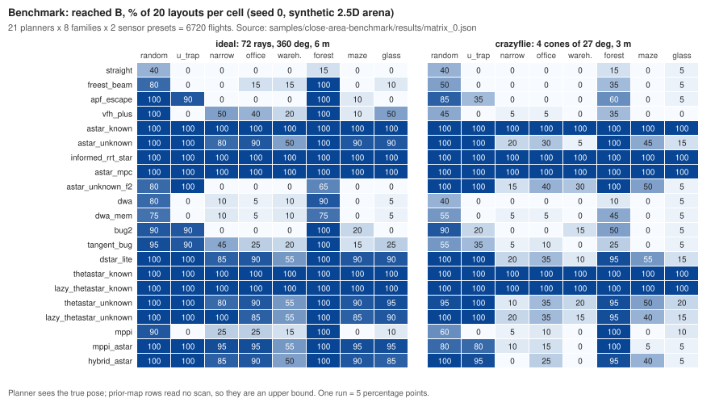
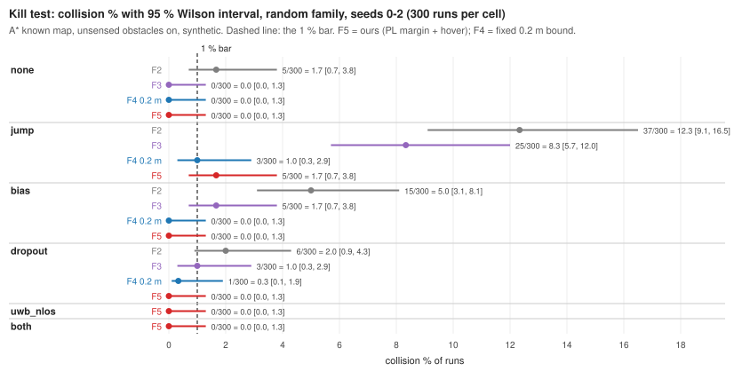

# How it was built: method, kill tests and fact-check error rates

This page describes how the hub's close-area toolkit was built and checked, which of its own
headline ideas failed, and how often the catalog's records were wrong when checked.

Every simulation number on this page is printed by [make_figures.py](how-it-was-built/make_figures.py)
into [figures/numbers.json](how-it-was-built/figures/numbers.json) (the key is given in brackets), or
links the file it comes from. Every simulation number is **synthetic**: a 2.5D point-mass arena,
scored on truth. None is SITL or flight. Where there is no number we write "not measured".

## Summary (2 minutes)

- **What was built.** Starting from a one-line task ("fly a drone from A to B in a close area,
  maybe with obstacles"), we built a shared simulated arena, flew 21 planners through 8 room
  families with 2 range sensors (6720 flights), ran two kill tests against our own headline ideas,
  and put the result in a browser page, the [Solver](https://navigation-index.pages.dev/site/solver/),
  that ranks planners for a given map.
  [`benchmark.planners`, `benchmark.families`, `benchmark.runs`]
- **How.** One reviewer session picked, briefed, reviewed and merged work items. Coding-agent
  workers did each item in its own git worktree, with a fixed list of paths it could touch. Every
  merge passed a gate of link, search, decoder and sample checks.
- **What failed.** Both headline ideas failed their own tests. Our integrity-aware safety filter
  collided in 1.7 % [0.7, 3.8] of jump-fault runs against a 1 % bar, while a hand-tuned fixed
  0.2 m bound stayed at 1.0 %. Relocalization after VIO loss worked with 72 beams and failed with
  the 4 beams of a Crazyflie-like sensor (best arm 66-89 % reached against a 90 % bar). Hybrid A*
  reached B less often than plain A*. [`kill_test`, `relocalize_4_beams`, `hybrid_astar`]
- **What the catalog got wrong.** Deep checks found at least one wrong or outdated claim in 8.3 %
  to 32.4 % of the repo records checked, depending on the round and lane; in one lane 65 % of repo
  records missed or misstated a licence restriction ([fact-check error rates](#fact-check-error-rates)).
- **What we recommend instead.** The measured toolkit, plus a narrow claim only if the real task fits
  it ([decision](research/README.md#decision-2026-11-09-evening-what-the-close-area-innovation-claim-is)).

Links: [live Solver](https://navigation-index.pages.dev/site/solver/),
[repository](https://github.com/tp9imka/navigation-index).

## The story

### Task => arena

The task left platform, sensors, indoor or outdoor, and sim or real open. So we did not pick a
drone. We defined one adapter contract (`pose()`, `ranges()`, `send_setpoint()`) and one
simulator every comparison would share: [close-area-arena](../samples/close-area-arena/README.md),
a 50 Hz double integrator with a ray-cast range fan. Driver stubs for PX4, ArduPilot, Crazyflie and
Tello speak the same contract and are unrun ([drone-adapter](../templates/drone-adapter/README.md)).

### 21 planners x 8 rooms

Each planner came in as its own sample and was then run through one matrix:
[close-area-benchmark](../samples/close-area-benchmark/README.md), 20 layouts per cell, seed 0,
true pose. [`benchmark.layouts_per_cell`, `benchmark.seed`]



What the matrix says:

- Five planners with a prior map reached B in every cell with 0 collisions on both sensors:
  `astar_known`, `informed_rrt_star`, `astar_mpc`, `thetastar_known`, `lazy_thetastar_known`. They
  never read the scan, so this is an upper bound. [`benchmark.planners_100_reached_0_collision_every_family`]
- Without a map, 4 beams break the rooms. A* on a map built from range hits reached 90 % of office
  layouts with 72 beams and 30 % with 4; warehouse 50 % and 5 %; glass office 90 % and 15 %.
  [`benchmark.astar_unknown_reached_pct`]

### Kill tests

We wrote each headline idea down with a pass line before building it, then tried to break it on
seeds it was not tuned on. The safety-filter test is in the figure below; the relocalization test
is under "What failed".



### Measured toolkit => Solver

After both headlines narrowed, we turned the shelf into tools a team can use in its first hours on
a task: a starter flight repo ([flight-repo](../templates/flight-repo/README.md)), a browser
[playground](../site/playground/README.md) that runs the same Python arena via Pyodide, and the
[Solver](../site/solver/README.md), which flies every offered planner on one map for N seeds and
ranks them with Wilson intervals. Its first Quick check ran 36 of 36 runs in 12.0 s on 4 workers
([Solver README](../site/solver/README.md)).

## The method

- **Reviewer loop.** One reviewer session picks up to 7 non-overlapping work items, writes a brief
  for each (goal, paths it may touch, gate commands, deliverable), launches them, reviews the
  results, merges and pushes. State lives in a backlog file and a journal, not in a chat
  transcript, so a new session resumes from files.
- **Coding-agent workers.** Each item runs as one job in its own git worktree, with a fixed list of
  paths it may touch. Shared files are edited by the reviewer only; workers list what they need
  under "edits needed".
- **Brainstorm partner.** At re-plan points the reviewer sent the gap scan, backlog and recent
  journal to a separate agent and asked for ranked new items. The reviewer decided what went in.
- **Merge gate.** Before a merge the reviewer read the full diff, checked 2 load-bearing claims
  itself, ran the sample's first command, then ran build, link, search-parity, decoder,
  sample-test, readiness and MCP checks. Two gate slips are on record in the build journal
  (broken links pushed once, a README pushed before its files once); both were fixed and turned
  into rules.
- **Honest labelling.** Each sample states `verified_status` (`ran` / `partial` / `sketch`) and the
  input type of every number. A FAIL against the stated threshold counts as a deliverable.

## What failed and why

### Integrity-aware safety filter (F5)

Pass line: collisions at or below 1 % in every fault case, and reach at least 90 % of the plain
range filter (F2). On the random family, seeds 0-2, 300 runs per cell:
[`kill_test.random_seeds_0_2`, `kill_test.reach_ratio_vs_F2_seeds_0_2`]

| arm | jump collisions | jump reach vs F2 |
|---|---|---|
| F2 range filter as shipped | 37/300 = 12.3 % [9.1, 16.5] | 1.00 |
| F4 fixed 0.2 m bound | 3/300 = 1.0 % [0.3, 2.9] | 0.96 |
| F5 ours | 5/300 = 1.7 % [0.7, 3.8] | 0.56 |

On the held-out seeds alone, F5 jump was 5/200 = 2.5 % [1.1, 5.7]. F5 failed on jump collisions and
on jump reach. The fixed bound was tuned on seed 0 and held on seeds 1-2. Why: in 4 of F5's 7 jump
collisions the run ended in hover, and the hover rule drops the map rows that guard obstacles the
range sensor cannot see ([safety-filter Part e](../samples/close-area-safety-filter/README.md#what-the-collisions-are)).
The script re-derives the four jump cells from the per-run JSON and finds each string in
[kill_e_tables.md](../samples/close-area-safety-filter/results/kill_e_tables.md). [`kill_test.cross_check`]

### Relocalization on 4 beams

The scan-to-map matcher needs at least 10 returns per scan (`MIN_RETURNS` in
[sparse_random_0.json](../samples/close-area-relocalize/results/sparse_random_0.json)); a 4-beam deck gives 4
([relocalize README](../samples/close-area-relocalize/README.md)). With 72 beams the
spin-and-move arm reached 98-100 % with 0 wrong commits. With 4 beams it reached 48 % (dropout) and
64 % (jump) on seed 0. [`relocalize_4_beams.spin_ig_seed0_random_100_layouts`]

A later arm kept a rolling submap of returns while flying. On held-out seed 2 with the Crazyflie-like
preset it reached 66-89 % with 0-6 wrong commits, against a bar of 90 % and 0. An AF-MCL-style
particle filter reached 0-15 % with 77-97 % collisions on the same cells.
[`relocalize_4_beams.submap_fwd_ig_seed2_crazyflie_100_layouts`, `relocalize_4_beams.mcl_seed2_crazyflie_100_layouts`]
The idea also narrowed in other ways (weaker in offices and warehouses, collisions with unmapped
obstacles, and prior art exists); those numbers are in the
[research decision](research/README.md#decision-2026-11-09-evening-what-the-close-area-innovation-claim-is).

### Hybrid A*

We expected heading-aware paths to help a turn-limited vehicle. Over 8 families x 20 layouts with the
ideal sensor, Hybrid A* reached 81.9 % against 91.2 % for A* on the turn-limited vehicle, and 86.2 %
against 91.2 % on the stock one, with 0 % collisions for both. [`hybrid_astar.ideal_totals`] The
sample attributes most of the gap to runs scored stuck while flying back over their own track
([hybrid-astar INTEGRATION](../samples/close-area-planner-hybrid-astar/INTEGRATION.md)). It is
our own untuned implementation, without path smoothing.

## Fact-check error rates

The catalog records were written fast and then checked against their sources in five rounds, all on
2026-11-06. The full reports, with every correction, are in [reports/](reports/README.md).

| Round | What was checked | Wrong or outdated |
|---|---|---|
| [1](reports/fact-check-2026-11-06.md) | Seeded sample of 60 repos, README deep check | 5/60 = 8.3 % of records |
| [3](reports/fact-check-round3.md) | All 106 gap-fill repos | 18.9 % |
| [3](reports/fact-check-round3.md) | 155 other high-fit repos | 9.0 % |
| [4](reports/fact-check-round4.md) | 49 repos of the round-3 lane: licence restriction missing or wrong | 65 % |
| [4](reports/fact-check-round4.md) | 12 round-3 integration cards, about 215 claims | about 3.7 % per claim |
| [4](reports/fact-check-round4.md) | Paper digests, about 300 headline numbers | 0 misquotes |
| [5](reports/fact-check-round5.md) | 364 medium- and low-fit repos | 118/364 = 32.4 % with at least one issue |

What the rounds show: install and packaging claims age fastest, licence terms were the most common
gap, and medium- and low-fit records written with less care had about three times the substantive
error rate of high-fit records in the same lanes (31.6 % against 9.0 %). Paper digests, which quote
numbers from the paper by section, had no misquotes in the sample.

## What it cost

| item | value |
|---|---|
| benchmark compute, wall seconds on 10 processes (one run, 2026-11-12) | 2963.7 [`cost.benchmark_wall_s`] |
| kill-test compute (seeds 0-2 + 2 families), wall seconds on 14 workers | 739.0 [`cost.kill_test_seeds_0_2_and_families_wall_s`] |
| total agent jobs, tokens or credits | not measured |
| human hours | not measured |

## Limits of this page

- Everything quoted from simulation is one 2.5D synthetic arena. Nothing here has flown.
- The fact-check rates are per round and per lane; they are not a single error rate for the whole
  catalog, and records added after 2026-11-06 were not part of these rounds.

## Rebuild

```sh
python3 docs/how-it-was-built/make_figures.py    # stdlib only, a few seconds; rewrites figures/
```
