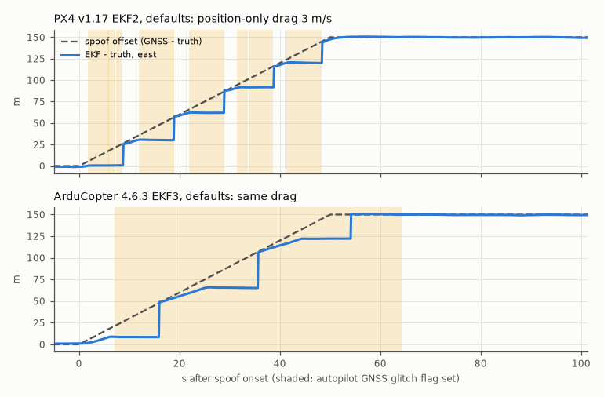
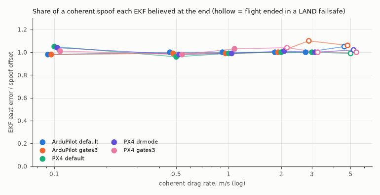

# How PX4 EKF2 and ArduPilot EKF3 react to a spoofed GNSS, measured

<!-- about: repo:px4/px4-autopilot, repo:ardupilot/ardupilot, repo:ardupilot/pymavlink, repo:mavlink/mavlink -->

`samples/golden-demo-px4` found that with a 3 m/s GNSS drag and no external monitor, PX4 v1.17
EKF2 raises `GPS_GLITCH` and still ends 108-152 m off. This sample explains why from the
source and measures it: 45 SITL flights, no external monitor acting, drag rate 0.1-5 m/s,
step offsets, default and tightened gates, on PX4 v1.17.0 SIH and ArduCopter 4.6.3 SITL.
The source walk-through with file and line citations is in
[docs/autopilot-gnss-fault-handling.md](../../docs/autopilot-gnss-fault-handling.md).

**Short answer.** Both EKFs gate GNSS with an innovation test (5 sigma by default) and reject
the measurements while they fail it. Both also stop rejecting after a fixed timeout. If no
other position source is fused, they reset their position onto the GNSS, so a rejected spoof
gets accepted after the timeout. EKF2 does that after 7 s (`reset_timeout_max`). EKF3 waits
10 s (`posRetryTimeUseVel_ms`) while GNSS velocity still passes, 7 s when it does not. A
drag that stays inside the gate needs no reset at all: the EKF fuses it. Either way every
config here ended on the spoofer's position. The only config that refused it (PX4
`EKF2_GPS_MODE 1`) lost its position and blind-landed instead.



Position-only drag at 3 m/s with default parameters. The flag (shaded) goes up when the
innovation test fails. The EKF holds its inertial estimate, and when the timeout expires it
jumps onto the GNSS. PX4: 5 jumps of 24-28 m, about 10 s apart (7 s timeout plus ~2-3 s to
fail the gate again). Each jump is one step of EKF2's `ODOMETRY.reset_counter`. ArduPilot:
3 jumps of 29-41 m, about 19 s apart (10 s timeout plus ~9 s to fail the gate again
through its 1 s / 10 s flag hysteresis). Both end at 150 m, the spoofer's cap.



Coherent drag (position and velocity dragged together) at 0.1-5 m/s: every config believed
96-110 % of the spoof offset at the end of the flight.

## Result (ran 2026-11-06, 45 flights, seed 7, one flight per cell)

PX4 v1.17.0 SIH (`nav-sitl-px4:v1.17.0`) with GNSS as MAVLink `HIL_GPS`. ArduCopter 4.6.3
SITL (`nav-sitl-ardupilot:copter-4.6.3`) with GNSS as `GPS_INPUT`. Both on linux/arm64 Docker
on Apple Silicon. Same survey, home, noise model and companion as golden-demo /
golden-demo-px4, in shadow mode (it logs, it never acts). Spoof onset is 25 s into the
mission, dragged east (cross-track on the long legs) and capped at 150 m. Configs:

- PX4 `default`.
- PX4 `gates3`: `EKF2_GPS_P_GATE 3`, `EKF2_GPS_V_GATE 3`.
- PX4 `drmode`: `EKF2_GPS_MODE 1`.
- ArduPilot `default`.
- ArduPilot `gates3`: `EK3_POS_I_GATE 300`, `EK3_VEL_I_GATE 300`.

Every override was echoed back by `PARAM_VALUE` before arming (checked by the test on
`data/sweep_summary.json`).

Columns: **flag** = s after onset until the autopilot's GNSS fault flag (PX4
`ESTIMATOR_STATUS` `GPS_GLITCH`, ArduPilot `EKF_STATUS_REPORT` `GPS_GLITCHING`). **Resets**
= jumps of >= 3 m in EKF-minus-truth within one 0.1 s sample (s after onset : size). **Believed** =
EKF east error / spoof offset at the end. **Dev** = max true cross-track deviation (the survey
geometry caps it at ~75 m on slow drags). **FS** = the flight left the mission in a LAND
failsafe, s after onset.

### Step offset (position jumps at onset, velocity untouched)

| Autopilot / config | Step | Flag | Reset (s : m) | Believed | Dev (m) | Outcome |
|---|---|---|---|---|---|---|
| PX4 default | 20 m / 100 m | 0.2 s | 7.3 : 19.7 / 7.3 : 100.3 | 1.05 / 1.01 | 22.5 / 100.6 | mission complete |
| PX4 gates3 | 20 / 100 | 0.2 | 7.3 : 21.3 / 7.3 : 99.2 | 1.04 / 0.99 | 22.2 / 102.6 | mission complete |
| PX4 drmode | 20 / 100 | 0.2 | none | 0.25 / 0.00 | 1.2 / 1.9 | **FS blind land at 12 s** |
| ArduPilot default | 20 / 100 | 1.1 | 10.1 : 19.8 / 10.1 : 99.8 | 0.98 / 0.99 | 21.1 / 101.1 | mission complete |
| ArduPilot gates3 | 20 / 100 | 1.1-1.2 | 10.1 : 20.1 / 10.1 : 99.8 | 0.95 / 0.99 | 21.2 / 101.1 | mission complete |

The flag was up from 0.2 to 7.2 s on PX4 and from 1.1 to 20.1 s on ArduPilot (it clears only
after 10 s of passing innovations). A 100 m step is rejected exactly like a 20 m one and then
accepted whole at the timeout. Tighter gates change nothing here: both steps are far outside
either gate.

### Position-only drag 3 m/s

| Autopilot / config | Flag | Resets (s : m) | Believed | Dev (m) | Outcome |
|---|---|---|---|---|---|
| PX4 default | 1.8 s | 8.9 : 25, 19.0 : 28, 29.0 : 26, 38.9 : 24, 48.5 : 25 | 1.01 | 151.3 | complete |
| PX4 gates3 | 1.6 | 6 resets, every 8.5-9 s, 19-24 m | 1.00 | 149.9 | complete |
| PX4 drmode | 2.4 | none | 0.04 | 3.2 | **FS blind land at 14 s** |
| ArduPilot default | 7.1 | 16.0 : 41, 35.7 : 41, 54.2 : 29 | 1.00 | 65.9 | complete |
| ArduPilot gates3 | 3.9 | 12.7 : 36, 27.3 : 36, 41.3 : 36, 56.1 : 19 | 1.00 | 75.9 | complete |

ArduPilot's smaller deviation is not better rejection: its EKF error also reached 150 m. The
truth path deviation depends on where along the survey the jumps landed.

### Coherent drag (position + velocity), rate sweep

| Rate m/s | PX4 default | PX4 gates3 | PX4 drmode | ArduPilot default | ArduPilot gates3 |
|---|---|---|---|---|---|
| 0.1 | no flag, 1.05 | no flag, 1.01 | no flag, 1.04 | no flag, 0.98 | no flag, 0.98 |
| 0.5 | no flag, 0.96 | no flag, 0.98 | no flag, 0.98 | no flag, 1.00 | no flag, 0.99 |
| 1 | no flag, 0.99 | flag 0.2-1.2 s, 1.03 | no flag, 0.99 | no flag, 1.00 | no flag, 0.99 |
| 2 | flag 0.2-1.2 s, 1.00 | flag 0.2-9.0 s, 1.04, **FS 7 s** | flag 0.2-1.2 s, 1.01 | no flag, 1.00 | flag 1.2-12.4 s, 1.00 |
| 3 | flag 0.2-1.4 s, 1.00 | flag 0.2-3.8 s (3 bursts), 1.00, **FS 57 s** | flag 0.2-1.2 s, 1.00 | flag only at the cap (51 s), 1.00 | flag 1.2-6.0 s, 1.10, **FS 1.1 s** |
| 5 | flag 0.2-1.8 s, 0.99, **FS 37 s** | flag 0.2-3.4 s, 1.00, **FS 37 s** | flag 0.2-10.2 s, 1.02, **FS 7 s** | flag 1.1-5.9 s, 1.05, **FS 1.1 s** | flag 1.2-5.8 s, 1.06, **FS 1.0 s** |

Cell = flag interval (s after onset), believed ratio, failsafe. Full per-flight data: reset
times, test ratios, reset-counter steps and STATUSTEXT are in
[`data/sweep_summary.json`](data/sweep_summary.json).

What the coherent rows show:

- **A coherent drag is not rejected; it is believed.** At <= 1 m/s (both autopilots, default
  gates) no flag ever went up and the EKF tracked the spoof to 96-105 %. The EKF never
  disagreed with the GNSS, so there was nothing to reject.
- **The onset is the only detectable moment.** A coherent drag starts with a velocity step
  equal to the drag rate. At >= 2 m/s on PX4 the velocity test failed for about 1 s. Then
  `ODOMETRY.reset_counter` stepped by 4 in one sample (quaternion + velNE + velD + posNE),
  and fusion resumed on the spoofed track. That pattern matches EKF2's EKF-GSF emergency yaw
  reset path, which resets velocity and position to GNSS (`gps_control.cpp` 105-118). I
  inferred the path from the counter step; the ulog was not read. In `drmode` the step was
  3 (no position reset), but the EKF still ended on the spoof: once velocity was reset onto
  the spoofed velocity, position fusion passed again.
- **The end of a drag is a second velocity step.** The spoof model stops moving at its 150 m
  cap, so GNSS velocity snaps back by the drag rate. PX4 flagged again at the cap (30, 50 or
  75 s) and three flights ended in `Failsafe: blind land` 7-8 s later. That is an artifact of
  the 150 m cap, but a real spoofer that stops dragging produces the same step.
- **ArduPilot's EKF failsafe fires on large velocity steps.** At 5 m/s (default) and >= 3 m/s
  (gates3): `EKF variance`, then `EKF Failsafe: changed to LAND Mode` 1.0-1.1 s after onset,
  then an emergency yaw reset on both IMU lanes. The failsafe cleared after about 1.5 s but
  Copter stays in LAND. Path deviation stayed 2.4-3.3 m, but the EKF kept following the spoof
  while it descended (ratio 1.05-1.10).
- **Tightening the gates did not reduce capture in any cell.** It flagged earlier, which
  helps an operator watching the flag. It also turned 2 m/s (PX4) and 3 m/s (ArduPilot)
  coherent drags into LAND failsafes that the default gates flew through. That is the
  availability cost, measured.
- **`EKF2_GPS_MODE 1` is the only setting that kept a rejected spoof out of the state.** With
  it, EKF2 may not reset onto GNSS while another horizontal aiding source exists, and GNSS
  velocity counts as one (`isGnssPosResetAllowed`, `estimator_interface.cpp` 596-605). The
  steps and the position drag were refused (EKF error <= 5 m at the end). With no other
  aiding the quad then ran out of position and blind-landed after 12-14 s. With optical flow,
  EV or airspeed fused this mode would keep flying on that source; not tested here. It did
  nothing against a coherent drag.

Wall time: 1812 s for 43 flights in 3 PX4 + 2 ArduPilot lanes, plus 287 s for the first
2 flights (smoke test). About 4.5 min per PX4 flight, about 3.5 min per ArduPilot flight.

## Run

```sh
cd samples/autopilot-spoof-response
python3 spoof_sweep.py --python /path/to/venv/bin/python   # 45 flights, ~35 min; skips flights already in runs/
python3 spoof_sweep.py --list                               # case names
python3 spoof_sweep.py --cases px4-drmode-step              # a subset (substring match)
python3 spoof_analyse.py runs/*.raw.jsonl --out data/sweep_summary.json
python3 spoof_analyse.py runs/px4-default-position-3.raw.jsonl --timeline data/timeline_px4-default-position-3.json
python spoof_plot.py                                        # needs matplotlib
python3 -m unittest -v test_spoof_response                  # 11 tests; 2 skip without pymavlink / matplotlib
```

Requirements: Docker with the `samples/sitl-docker` images (`nav-sitl-px4:v1.17.0`,
`nav-sitl-client:latest`, `nav-sitl-ardupilot:copter-4.6.3`; build them with
`golden-demo-px4/run.sh` and `golden-demo/run.sh` once). The PX4 companion runs in the client
container. The ArduPilot companion runs on the host and needs `pymavlink` (`--python`).
Containers are named `ekf2dbg-*`. ArduPilot lanes publish host ports 15820+.
Logs go to `runs/` (git-ignored, ~6 MB per flight).

## Files

| File | What |
|---|---|
| `spoof_fly.py` | one shadow flight: imports `golden-demo/companion.py` or `golden-demo-px4/companion_px4.py` unchanged, adds a step spoof, `--set NAME=VALUE` EKF overrides before arming, 5 Hz estimator status and (PX4) `ODOMETRY` with `reset_counter` |
| `spoof_sweep.py` | the 45-case matrix in parallel Docker lanes (same PX4 boot sequence as `golden-demo-px4/run.sh`) |
| `spoof_analyse.py` | per-flight metrics (stdlib): flag intervals, reset jumps, reset-counter steps, believed ratio, deviation, failsafe time |
| `spoof_plot.py` | the two PNGs |
| `test_spoof_response.py` | analysis on a synthetic log, the case matrix, param echoes in the committed data |
| `data/` | `sweep_summary.json` and four timelines (PX4 / ArduPilot position drag 3 m/s, PX4 step 100 m default and drmode) |

## Limits and honest caveats

- One seed per cell. Reset times are mechanism-driven and repeat to the 0.1 s sample in the
  step cases. Failsafe outcomes near a threshold (ArduPilot coherent 3 m/s: no failsafe with
  default gates, failsafe with gates3) may flip with another seed.
- SITL only. PX4 SIH and ArduPilot SITL have ideal-ish IMUs and no wind. A real IMU dead-reckons
  worse, so the timeout resets would matter more, not less.
- The injected GNSS claims good accuracy (PX4 `HIL_GPS` eph 0.8 m, fixed `s_variance` 0.25 m/s;
  ArduPilot `GPS_INPUT` hacc 1.5 m, sacc 0.3 m/s) and never sets a spoofing or jamming flag.
  `HIL_GPS` cannot carry one: `mavlink_receiver.cpp` hard-codes `spoofing_state = 0`. A real
  receiver with spoof detection would also trip EKF2's `spoofed` GNSS check (`gnss_checks.cpp`
  93, 102), which these flights could not exercise.
- The reset detector reads `GLOBAL_POSITION_INT` at 10 Hz. A jump under 3 m or a slow
  pull-in is not counted as a reset. On PX4 every detected jump matched one
  `ODOMETRY.reset_counter` step.
- "Yaw emergency reset" on PX4 coherent drags is inferred from a reset-counter step of 4. The
  EKF2 message for it is `ECL_WARN`, which compiles to `PX4_DEBUG` in PX4 and is not printed.
- Not tested: `EK3_GLITCH_RAD` (0 = clip instead of reject), EKF3 affinity with two GNSS
  receivers, PX4 `EKF2_GPS_MODE 1` with a second aiding source, PX4 `main`, Plane / fixed-wing
  (airspeed counts as an aiding source on both), real hardware.
