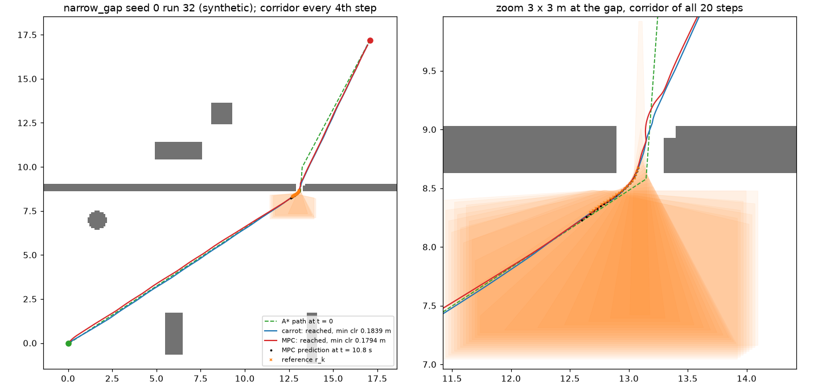

# close-area-planner-mpc: linear MPC in an ESDF half-plane corridor (OSQP) vs the A* carrot follower

Goal: have a measured MPC number for close-area A=>B, not just a slide. The arena A*
(`planners/astar_esdf.py`, known map) plans the path; this sample replaces its carrot follower
with a linear MPC that tracks the path inside a convex corridor of half-planes and is solved
with [OSQP](https://osqp.org/) every planner step. Both followers fly in the shared
[close-area-arena](../close-area-arena/README.md) and are scored there on truth.

- `mpc.py`: model, QP (`CorridorQP`), corridor builder and the `AStarMPC` planner; also
  `CarrotTracked`, the unchanged arena carrot follower plus the same logging.
- `bench.py`: the comparison and the plot.
- `arena.py`: loads the arena folder as package `close_area_arena` (CONTRACT.md "Import"); no
  arena file is edited.

## The MPC

| item | value | why |
|---|---|---|
| state | p = (px, py), v = (vx, vy) | the arena vehicle is a 2.5D double integrator, z held |
| input | velocity setpoint u = (vx_cmd, vy_cmd) | `send_setpoint()` takes a velocity, and the arena's first-order lag (tau 0.15 s) is linear, so the MPC output is sent as is with no inner loop |
| model | exact zero-order hold over dt: v+ = e v + (1 - e) u, p+ = p + tau (1 - e) v + (dt - tau (1 - e)) u, e = exp(-dt / tau) | matches vehicle.py; `test_smoke.py` checks it against the 50 Hz vehicle within 2 cm over 0.5 s |
| horizon | N = 20, DT = 0.1 s (2.0 s), one solve per planner step (10 Hz) | 2 s covers stopping from 1.4 m/s at 2.1 m/s^2 (about 0.5 m) with margin |
| velocity box | \|vx\|, \|vy\| <= 1.4 m/s on v_k and u_k | per-axis box inside the arena's 2.0 m/s norm limit (norm <= 1.98) |
| acceleration box | \|u_k - v_k\| <= tau x 2.1 m/s^2 per axis | the step's largest acceleration is at its start, a = (u - v) / tau; norm <= 2.97 < 3.0 |
| corridor | per step k, up to 8 obstacle half-planes around reference point r_k plus a 1.25 m box | see below |
| cost | 10 \|p - r\|^2 (50 at k = N) + 1 \|v - v_ref\|^2 + 2 \|u_k - u_k-1\|^2 + slack 1e4 (L1 and L2) | |
| warm start | previous primal solution shifted one step; OSQP keeps the previous duals | |
| solver | osqp 1.1.3, eps 1e-4, no polishing, sparsity fixed at setup, each step updates q, l, u and the corridor values of A | |

Corridor, from the same 0.1 m grid the A* ESDF is built on: candidate points are occupied
boundary cells within 2.0 m of r_k (none when the ESDF at r_k is above 2.0 m). Repeatedly take
the nearest remaining point o, add n.p <= n.o - min(0.20, |o - r_k|) with n towards o, and drop
the points behind that plane. This is the nearest-point step of safe flight corridors (Liu et
al., RA-L 2017, doi 10.1109/LRA.2017.2663526) without the ellipsoid. The offset 0.20 m is the
0.15 m radius plus 0.05 m for the grid (an occupied cell centre is within 0.05 m of a surface or
inside it). A 1.25 m box around r_k keeps the polytope inside the 2.0 m search radius
(1.25 x sqrt(2) + 0.20 <= 2.0). Corridor rows are soft (one slack per step), so the QP stays
feasible when the vehicle is already inside the offset band.

Reference: from the projection of the vehicle onto the current A* path, march along the path
with the carrot's speed rule (1.5 m/s scaled by the ESDF at the reference point, down to 20 %,
capped by 1.0/s x remaining length). The A* (same constants, replanned every 0.4 s) is shared.

Variants in the bench: `astar_mpc` (as above), `astar_mpc_cold` (OSQP warm start off),
`astar_mpc_nocorridor` (obstacle planes off, box only), `astar_mpc_fast` and
`astar_mpc_fast_nocorridor` (reference at a constant 1.4 m/s, no ESDF slow-down, with and
without the corridor).

## Run

```sh
cd samples/close-area-planner-mpc
uv venv .venv && uv pip install --python .venv -r requirements.txt   # arena deps + osqp
.venv/bin/python bench.py --layouts 50 --seed 0     # ~6.5 min, writes results/mpc_compare_0.*
.venv/bin/python -m unittest test_smoke -v          # ~1 s; skips without numpy
```

From another sample: `import arena, mpc` then `arena.run.evaluate(mpc.make, "narrow_gap", 50, 0)`.
The MPC needs the prior grid (known map); there is no unknown-map mode.

## Results (ran 2026-11-09, Apple M3 Max, CPython 3.11.15, numpy 2.4.6, scipy 1.17.1, osqp 1.1.3)

All inputs are **synthetic**: simulated layouts, vehicle and sensor, known map. Nothing here is
a flight or SITL result.

`python bench.py --layouts 50 --seed 0`, wall 381.9 s on an Apple M3 Max laptop under macOS 26.6.2
([results/mpc_compare_0.md](results/mpc_compare_0.md), per-run rows and constants in
`results/mpc_compare_0.json`, console in [results/bench_stdout.txt](results/bench_stdout.txt)).
Tracking error = distance from the vehicle to the current A* path at each 10 Hz planner step,
pooled over all runs.

| follower | family | layouts | reached % | collision % | median min clearance m | worst min clearance m | tracking err median / p95 m | median time to goal s |
|---|---|---|---|---|---|---|---|---|
| A* + carrot | random | 50 | 100.0 | 0.0 | 0.635 | 0.5447 | 0.018 / 0.053 | 18.81 |
| A* + MPC | random | 50 | 100.0 | 0.0 | 0.637 | 0.5506 | 0.017 / 0.054 | 18.12 |
| A* + carrot | narrow_gap | 50 | 100.0 | 0.0 | 0.276 | 0.1839 | 0.021 / 0.053 | 24.23 |
| A* + MPC | narrow_gap | 50 | 100.0 | 0.0 | 0.304 | 0.1794 | 0.019 / 0.053 | 21.97 |

Solve time per planner step (QP = wall time of OSQP update + solve, measured with
`time.perf_counter` in the planner):

| follower | family | steps | QP ms median / p95 | OSQP iterations median / p95 | corridor build ms median / p95 | steps with an active obstacle plane | not solved |
|---|---|---|---|---|---|---|---|
| A* + MPC, warm | random | 9113 | 0.213 / 0.448 | 25 / 75 | 0.454 / 0.856 | 0 | 0 |
| A* + MPC, cold | random | 9103 | 0.717 / 0.865 | 125 / 150 | 0.456 / 0.863 | 0 | 0 |
| A* + MPC, warm | narrow_gap | 11161 | 0.222 / 0.464 | 25 / 50 | 0.587 / 0.888 | 163 | 0 |
| A* + MPC, cold | narrow_gap | 11163 | 0.733 / 1.036 | 125 / 175 | 0.597 / 0.901 | 159 | 0 |

The straight baseline for scale (arena results, 20 layouts seed 0): 40 % reached on random,
0 % on narrow_gap ([straight_random_0.md](../close-area-arena/results/straight_random_0.md),
[straight_narrow_gap_0.md](../close-area-arena/results/straight_narrow_gap_0.md)).

What this says:

- **No outcome difference.** Both followers reach B in 100 % of 50 random and 50 narrow_gap
  layouts with 0 % collisions. Tracking error is the same (p95 0.053-0.054 m). The carrot's
  worst pass is 0.1839 m from a surface, the MPC's 0.1794 m (radius 0.15 m).
- **The MPC is faster through gaps:** median time to goal 21.97 s vs 24.23 s on narrow_gap,
  and its median min clearance is higher (0.304 vs 0.276 m). Both use the same speed rule; the
  carrot applies it to the minimum ESDF along the chord to the carrot, the MPC to the ESDF at
  each reference point, so the carrot slows earlier.
- **Solve time is not the problem:** 0.22 ms median, 0.46 ms p95 per QP on this laptop (144 variables, 464 constraints;
  QP p95 plus corridor p95 is 1.35 ms, 1.4 % of the 100 ms step). Warm start cuts iterations 5x
  (25 vs 125 median) and QP time about 3x. The A* replans dominate the step p95 for both
  followers (about 20 ms on narrow_gap, `step ms` column in the results file).
- **The corridor rarely binds.** With the clearance speed rule, no obstacle plane came within
  1 cm of the predicted path on random, and in 163 of 11161 steps on narrow_gap. Turning the
  planes off (`astar_mpc_nocorridor`) gave identical outcomes. With the reference at a
  constant 1.4 m/s, the one run that differed was narrow_gap run 32 (the tightest gap): without
  the corridor it collided (clearance 0.149 m, 98 % reached), with it it passed at 0.1727 m.
  One run is weak evidence; it is a hint, not a measured safety margin.

Plot: [results/mpc_narrow_gap_0_run32.png](results/mpc_narrow_gap_0_run32.png), narrow_gap run
32 (chosen as the run with the smallest carrot min clearance). Blue = carrot truth path,
red = MPC truth path, green dashed = A* path at t = 0, orange = the MPC corridor polytopes
of the step at t = 10.8 s (0.6 m before the gap), black dots = that step's MPC prediction.
Right panel: 3 x 3 m zoom at the gap.



Determinism: re-running `astar_mpc` on the 50 narrow_gap layouts gave identical outcome,
min clearance, path length and time to goal per run (checked by hand, not saved to a file).
Timings vary with load.

## Limits

- Known map only. The corridor is built from the prior grid; with the arena's unknown-map
  A* (log-odds from range returns) the corridor would have to use that map. Not done.
- Tracking error is measured against the current A* path, which is replanned from the
  vehicle every 0.4 s, so it restarts near zero; the distance to the t = 0 path (in the results
  file, p95 0.39-0.48 m) mostly measures replans changing the path, not tracking.
- Seed 0 only, 50 layouts per family; u_trap not run. Constants were set by hand and checked
  on 3-5 seed-0 layouts, so seed 0 is not held out.
- The corridor uses box limits, a 2.0 m search radius and at most 8 planes per step; no
  corridor was truncated in these runs (0 in every cell), but that is not guaranteed elsewhere.
- Timing is on an Apple M3 Max laptop in Python. It is not the solve time on a flight computer
  (see [guidance-planning.md](../../docs/guidance-planning.md) G5). OSQP has embedded C code
  generation for that step; it was not tried here.
- No estimator faults: pose is truth. `run.evaluate(..., make_pose_source=...)` with the
  arena's `faults.py` would test that; not run.

## License

osqp 1.1.3 from PyPI: `License-Expression: Apache-2.0` in the wheel metadata and an Apache
License 2.0 text in its `licenses/LICENSE` (checked in this venv). The hub's
[OSQP record](../../catalog/repos/osqp__osqp.md) also lists Apache-2.0 (gh api). numpy and scipy are
BSD-3-Clause. This sample's code is the hub's.

## Sources

- OSQP: Stellato et al., "OSQP: an operator splitting solver for quadratic programs",
  Math. Prog. Comp. 2020, doi 10.1007/s12532-020-00179-2; <https://osqp.org/>.
- Safe flight corridors: Liu, Watterson, Mohta, Sun, Bhattacharya, Taylor, Kumar, "Planning
  dynamically feasible trajectories for quadrotors using safe flight corridors in 3-D complex
  environments", RA-L 2017, doi 10.1109/LRA.2017.2663526.
- Arena, A* and carrot follower: [close-area-arena](../close-area-arena/README.md) and its
  CONTRACT.md.
