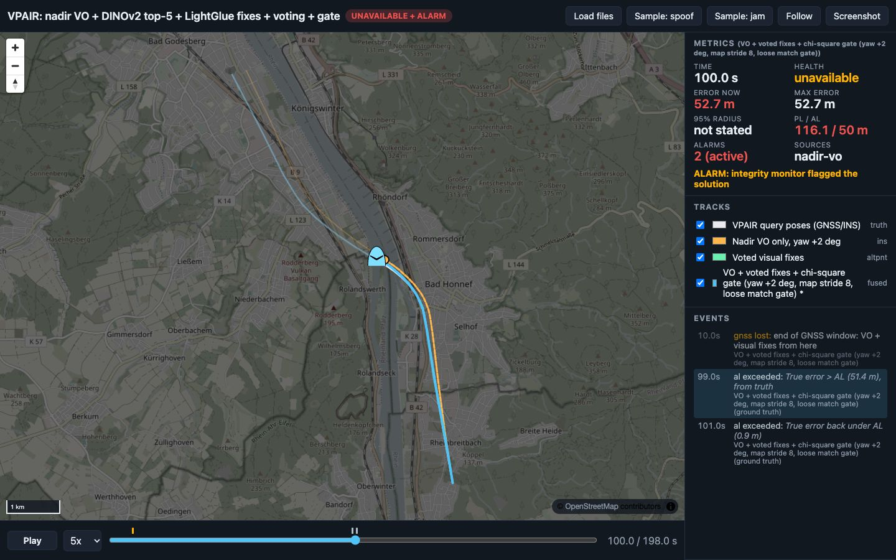

<!-- about: repo:aervisloc/vpair, res:vpair-dataset-2022, repo:cvg/lightglue, sample:relative-nav-benchmark, sample:vpr-large-area, sample:geoloc-license-clean, sample:altpnt-integrity -->
# End-to-end GNSS-denied visual navigation on one real flight (VPAIR)

The pieces from four sibling samples chained on the same real light-aircraft flight:

```
nadir VO (recorded attitude, optional +2 deg heading error)        ../relative-nav-benchmark/aerial
  => every frame: DINOv2 GeM top-5 over the reference map          ../vpr-large-area/vpr.py
  => ALIKED + LightGlue + MAGSAC on each candidate, inlier gate      ../geoloc-license-clean/geoloc.py
  => single-frame fix  |  multi-frame voting (VO carries old candidates forward)   nav_core.vote
  => altpnt-integrity v2 EKF (heading + scale error states) + chi-square gate / solution separation
                                                                     ../altpnt-integrity/altpnt_v2.py
  => error vs distance, fix availability, false fixes, runtime; navdash/1 for templates/demo-dashboard
```

All siblings are reused by import, not copied. Everything below was run on 2026-11-06 on an
Apple M2 Max (torch 2.15.0, MPS) with Python 3.12.14.

## Data

VPAIR **sample** only (Zenodo 6473989, 0.86 GB, see [dataset card](../../docs/dataset-cards/vpair.md)), the
copy that `../relative-nav-benchmark/fetch_data.sh` already downloads (`$DATA/vpair/vpair_sample/`):

- 199 consecutive nadir queries, 800x600, from a light aircraft at 360-403 m ellipsoid height, about 45 m
  apart, 8.98 km in total. Poses (ECEF + roll/pitch/yaw) are the GNSS/INS truth.
- One reference render per query: nadir, north-up (attitude 0 in `poses_reference_view.txt`), rendered from
  orthophoto + elevation at the query position, with a depth map. The orthophoto was captured at another
  time than the flight (different season and water level in the images), so matching is real-to-render
  across a time gap.
- 200 distractor renders from another area, file names in UTM 32N (they sit 60-80 km away).

**The map.** Reference renders with their georeference, plus all 200 distractors. A query never sees its
own render (leave-one-out), so the nearest tile is at least one frame (about 45 m) away. `map stride` keeps
only every s-th render: stride 1 = tiles about 45 m apart, stride 4 = 180 m, stride 8 = 360 m (wider than
the 336 x 252 m footprint, so many frames have no overlapping tile).

**GNSS window.** Frames 0-9 (455 m) are treated as GNSS-available: the VO model (same fit as
relative-nav-benchmark), the tile pixel => metre convention (focal 765 px, reflection, 1.4 deg) and the fix
noise are fitted there. GNSS is lost at frame 10; the scored part is the remaining 8.53 km.

## Run

```sh
python3.12 -m venv .venv && .venv/bin/pip install -r requirements.txt   # same pins as ../vpr-large-area
DATA=../relative-nav-benchmark/data/vpair                               # contains vpair_sample/
.venv/bin/python frontend.py --data $DATA --strides 1 4 8                         # ~4 min on M2 (MPS)
.venv/bin/python frontend.py --data $DATA --strides 1 4 8 --yaw-bias-deg 2 --out results/frontend_yaw2.json
.venv/bin/python run_fusion.py --data $DATA                                       # 16 s, all tables below
./screenshot.sh 100                                                               # Chrome + Node 22
python3 -m unittest test_e2e
```

`frontend.py` is the expensive part (VO, DINOv2, LightGlue); it caches every candidate match to
`results/frontend*.json` (committed), so `run_fusion.py` re-scores without a GPU. The `--yaw-bias-deg 2` pass
rotates each query north-up with the wrong heading too, so the +2 deg rows include its effect on retrieval
and matching, not only on VO.

## Results

Horizontal error against the GNSS/INS truth after GNSS loss (8.53 km, 188 frames). Fix attempted every frame
(1 s, ~45 m). "match gate": strict = 25 LightGlue inliers (geoloc-license-clean's gate) + homography scale
within 0.67-1.5; loose = 8 inliers, no scale check. "filter gate": none = every fix fused; gate = altpnt v2
chi-square innovation gate (99.9 %). False fix = more than 50 m from truth.

### Heading +2 deg (the realistic case: AHRS heading error)

| Config | map stride | match gate | filter gate | err @1/2/4/6/8 km (m) | RMS | max | fixes produced | false produced | false fused |
|---|---|---|---|---|---|---|---|---|---|
| VO only | - | - | - | 58 / 108 / 132 / 175 / 249 | 156 | 271 | - | - | - |
| VO + single-frame fixes | 1 | strict | none | 3.2 / 1.9 / 1.4 / 4.7 / 3.4 | 4.8 | 19 | 149/188 (79 %) | 0 | 0 |
| VO + voting | 1 | strict | none | 3.1 / 2.2 / 2.1 / 4.8 / 3.1 | 5.8 | 25 | 138 (73 %) | 0 | 0 |
| VO + single-frame fixes | 8 | strict | none | 3.1 / 1.8 / 1.4 / 6.4 / 2.4 | 9.7 | 41 | 89 (47 %) | 0 | 0 |
| VO + voting | 8 | strict | none | 3.9 / 1.8 / 51.5 / 6.2 / 2.4 | 15.9 | 53 | 67 (36 %) | 0 | 0 |
| VO + single-frame fixes | 8 | loose | **none** | 3.1 / 2649 / 20376 / 303 / 95 | 11997 | 64937 | 105 (56 %) | **15** | **15** |
| VO + single-frame fixes | 8 | loose | gate | 3.1 / 1.8 / 1.4 / 6.4 / 2.4 | 9.7 | 41 | 105 | 15 | 0 |
| VO + voting | 8 | loose | none | 3.9 / 1.8 / 51.5 / 6.3 / 2.4 | 15.9 | 53 | 69 (37 %) | 0 | 0 |
| VO + voting | 8 | loose | gate | same as above | 15.9 | 53 | 69 | 0 | 0 |

With the recorded heading (no bias) VO only ends at 57.7 m (0.68 % of 8.53 km; the relative-nav-benchmark
number was 58 m over the whole 8.98 km), and the fix rows stay close to the table above
(single-frame strict stride 1: RMS 5.2 m, max 20 m; voting stride 8: RMS 17.2 m, max 57 m). With fixes the filter's heading-error state ends at
-1.96 deg for the +2 deg run (the injected bias, in the filter's sign convention) and -0.09 deg without bias.

Plot of the same runs: [results/error_vs_distance.svg](results/error_vs_distance.svg); every run per frame:
[results/error_vs_distance.csv](results/error_vs_distance.csv); all 148 rows (both biases, strides 1/4/8,
fix period 1 and 5 frames, filter modes none/gate/full): [results/e2e_result.json](results/e2e_result.json).

### What the front end gives (heading 0, top-5, 188 frames after GNSS loss)

| map stride | top-1 retrieval gives a correct fix | frames with a correct candidate in top-5 | gated candidates false (strict / loose) | of those, distractors (loose) |
|---|---|---|---|---|
| 1 | 109 | 149 | 0 / 17 | 10 |
| 4 | 77 | 115-117 | 0 / 34 | 25 |
| 8 | 45 | 89-91 | 0 / 41 | 29 |

Accepted fix error: median 2.6-3.1 m, p95 5-8 m, max 15 m (relative to the same truth, see limits).
Correct matches have hundreds of inliers; wrong ones mostly under 15. Over all 3,598 matched pairs in both front-end passes, no wrong
candidate passed the strict gate.

### Integrity (altpnt v2 Monitor2, AL 50 m)

| Filter mode | PL median | PL < AL | HMI epochs |
|---|---|---|---|
| none, loose single-frame fixes, stride 8, +2 deg | 22 m (fault-free PL) | 94 % | **151 of 188** |
| gate, voting, stride 8, +2 deg (dashboard run) | 27 m (fault-free PL) | 78 % | 0 |
| gate, single-frame strict, stride 1 | 19.5 m (fault-free PL) | 99.5 % | 0 |
| full (gate + solution separation), any fix config | 1,252 m | 1.6 % | 0 |

- Without the filter gate the PL keeps saying "available" while the solution is tens of km off: the textbook
  HMI case. The chi-square gate removed every false fix in every configuration (0 false fused in all 48 gate-mode runs).
- **Solution separation is not usable with one absolute source.** The only fault hypothesis is "visual fixes
  are faulty"; the branch without them is VO alone, whose covariance grows to hundreds of metres, so the
  protection level does too (1.25 km median) and integrity is available 1.6 % of the time. The "gate" mode PL
  covers the fault-free case only. A usable protection level needs a second independent absolute source
  (TRN, a second camera/matcher, a magnetometer map) or per-fix fault hypotheses, which altpnt v2 does not have.

### Voting: when it earns its keep

- With the strict match gate, no wrong candidate survives, so voting only costs availability (79 => 73 %
  at stride 1, 47 => 36 % at stride 8) and accuracy (RMS 4.8 => 5.8 m, 9.7 => 15.9 m).
- With the loose gate it removes all false single-frame fixes (3-20 per run) before the filter sees them (0 false in every voting
  run, both match gates, every stride and period), the same result the chi-square gate gets after the fact.
  It is the filter-independent check: it works with a cold start or a filter that has already drifted.
- At a fix every 5 frames voting is too slow to agree (22-30 fixes over the flight; stride 8: 7 fixes, RMS
  101 m vs 17 m single-frame). Voting window = 5 fix epochs, 3 must agree within 30 m.

### Runtime per frame (M2 Max, MPS, median)

| Stage | s |
|---|---|
| SIFT VO pair (CPU) | 0.075 |
| north-up rotation + ALIKED on the query | 0.064 |
| DINOv2 ViT-S/14 descriptor | 0.022 |
| search over 399 tiles | 0.0002 |
| LightGlue on top-5 tiles (stride 1) | 0.57 |
| EKF + monitor step (pure Python) | 0.0003 |
| **total** | **0.73** |

So about 1.4 frames/s, enough at this frame spacing (1 frame per ~45 m). LightGlue on 5 candidates is 78 %
of the budget; the map's 399 DINOv2 descriptors take 6 s to build. The front end over 199 frames with all
three map strides (union of candidate pairs) took 231 s wall.

## Dashboard

```sh
python3 -m http.server 8000          # from the repo root
# http://localhost:8000/templates/demo-dashboard/?manifest=../../samples/e2e-visual-nav-vpair/results/navdash/manifest.json
```



Frame 100 of the +2 deg, stride 8, loose-match-gate, voting + chi-square gate run. After 25 frames (about 1.1 km) with
no voted fix the error reaches 52.7 m, just over the 50 m AL, but the PL (116 m) is over AL too, so the page shows
UNAVAILABLE + ALARM, not HMI; the next voted fix pulls it back to 0.9 m at frame 101. Orange is VO only
(271 m off at the end). Final frame: [e2e-t198.jpg](results/screenshots/e2e-t198.jpg). Tracks: truth, VO only,
fused (with `pl_m`, health, alarm), voted fixes (`role: altpnt`). Time is frame index (VPAIR has no timestamps).

## Files

| File | What |
|---|---|
| `frontend.py` | VO, map descriptors, retrieval, LightGlue; writes `results/frontend*.json` |
| `nav_core.py` | numpy geometry, `vote()`, error profile |
| `run_fusion.py` | tile calibration, fix producers, altpnt v2 filter runs, tables, CSV/SVG, navdash |
| `test_e2e.py` | voting / geometry / filter unit tests (need numpy, cv2) + checks on the committed results (stdlib) |
| `screenshot.sh` | headless capture through `../golden-demo/screenshot.mjs` |

Tests: venv 15 pass; plain `/opt/homebrew/bin/python3` (no numpy) 5 pass, 10 skip.

## Limits (read before quoting a number)

- **One short flight**: the 199-frame sample, not the 20.5 GB full set. One run, no seeds to average.
- **The map and the truth share a source.** VPAIR renders the references at the query GNSS/INS positions, so
  fix errors (median ~3 m) are relative to that truth; an orthophoto's own registration error (often a few m
  to 10+ m) is not in these numbers. The appearance gap (different capture time, render vs photo) is real.
- **Map tiles at the flight path.** Even at stride 8 every tile lies on the flown track. A real map is a grid
  over the area; the distractors (60-80 km away) are the only off-track tiles. Most loose-gate false fixes come
  from them (10-29 of 17-41) and a VO prior would discard them; the rest are on-track tiles at the wrong place.
- **No IMU.** VPAIR has none; the filter runs a constant-velocity model (white acceleration 3 m/s^2, assumed)
  with VO velocity. Recorded attitude stands in for an AHRS, as in relative-nav-benchmark.
- **In-sample tuning.** The VO error model in the filter (heading 2.77 deg, scale 3.3 %) comes from
  `../altpnt-integrity/calibration.json`, fitted on this same flight. Fix R uses the geoloc overbound (5.4 m)
  because the GNSS-window residual (0.5-1 m per axis, 37 pairs) is smaller.
- **Retrieval is weak and brittle**: DINOv2 GeM similarities are flat (0.93-0.97), and a 2 deg change in the
  north-up rotation changed about 1 of the 5 retrieved tiles per query. Fine matching hides this here because
  the true tile is usually in the top 5 when it exists.
- Not run: a learned aerial VPR model (a side check with vpr.py's hard VLAD, centred on the map mean, gave recall@5 within 150 m of
  0.86 vs 0.79 for GeM; not wired in), PnP with the reference depth, other datasets, a lost-start (no known position at GNSS loss).
