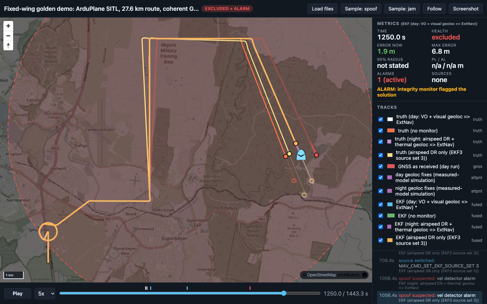

# Fixed-wing golden demo: ArduPlane SITL, 27.6 km route, coherent GPS drag

<!-- about: repo:ardupilot/ardupilot, repo:ardupilot/pymavlink, repo:maplibre/maplibre-gl-js, res:vpair-dataset-2022 -->

The multicopter demos (`samples/golden-demo`, `samples/golden-demo-px4`) end in a hover or a
LAND failsafe. Long-range GNSS-denied problems are usually fixed-wing: 20-30 km at 20-30 m/s,
no hover, and dead-reckoning error grows with distance. This sample flies ArduPlane 4.6.3 SITL
on a 27.6 km route at 300 m, drags its GPS east at 1 m/s (position and velocity together) from
t = 480 s, and compares four responses on the same attack:

| Scenario | Companion velocity reference | Absolute fixes | On alarm |
|---|---|---|---|
| `baseline` | VO (truth + errors) | day model | nothing (monitors run in shadow) |
| `day` | VO | visual geoloc, **VPAIR-measured** model | EK3 source set 2: ExternalNav = companion's GNSS-free reference |
| `night` | airspeed + own compass + calibrated wind | thermal geoloc, **Thermal-UAV-measured** model | source set 2, same |
| `dr` | airspeed + own compass + calibrated wind | none | EK3 source set 3: no position, no velocity source; EKF3 dead reckons on airspeed, synthetic sideslip, compass and its wind estimate |

The companion is the golden-demo monitor: `ss_fde.SolutionSeparation` and
`ss_fde.VelocityConsistency` are imported from `samples/golden-demo` unchanged.



t = 1250 s, last leg. White/blue: day truth and EKF (on ExternalNav since 485 s). Orange: the
no-monitor aircraft, about 800 m west of where it thinks it is (the GNSS is dragged east, the autopilot steers the false position back onto the line). Pale yellow: the dead-reckoning-only
aircraft. Red dots: the spoofed GNSS. Second capture: [t = 700 s](screenshots/fw-t700.jpg), on
the long north leg where the drag is cross-track.

## Results (ran 2026-11-06, seed 7 reference + seeds 1-3)

ArduPlane `Plane-4.6.3` SITL (`plane` model, `models/plane.parm` + `fw.parm`), linux/arm64
Docker on Apple Silicon, pymavlink 2.4.50, Python 3.12, `--speedup 5`, wind 6 m/s from 300 deg
with `SIM_WIND_TURB 1`. Cruise airspeed 22 m/s, ground speed 20-29 m/s depending on leg. Every
flight completed the route and the 120 s end loiter; no failsafe fired in any flight. Numbers
from `data/summary.json` (seed 7) and `data/sweep_summary.json` (seeds 1-3); truth is SITL
`SIMSTATE`.

| | baseline | day | night | dr |
|---|---|---|---|---|
| First alarm after onset, seed 7 (detector) | 4.4 s (vel), no action | **5.4 s** (vel) | **27.4 s** (SS) | 228.4 s (SS) |
| Same, seeds 1 / 2 / 3 | 9.4 / 7.4 / 7.4 s | 9.4 / 7.4 / 8.4 s | 19.4 / 31.4 / 29.4 s | 232 / 295 / 337 s |
| Max true cross-track error after onset, seed 7 | 749.7 m | 34.7 m (3.3 m on straights) | 37.9 m | 696.7 m |
| Same, seeds 1 / 2 / 3 | 750 / 749 / 751 m | 31 / 28 / 29 m | 33 / 50 / 43 m | 687 / 745 / 713 m |
| Cross-track at the last waypoint, seed 7 | 749.7 m | 2.4 m | 4.7 m | 696.7 m |
| Truth to final waypoint when the autopilot declared it reached | 831 m | 40 m | 9 m | 697 m |
| End loiter (120 s): circle centre to the commanded point | **873 m** | **14.8 m** | **20.6 m** | **807 m** |
| EKF horizontal error at the last waypoint | 815 m | 4.2 m | 31.6 m | 723 m |
| Companion reference error max after the switch | - | 6.0 m | 33.7 m | - |
| EKF3 `GPS_GLITCHING` reports after onset (all 16 coherent flights) | 0 | 0 | 0 | 0 |

No-spoof control flights (seed 7, same config, `runs/navdash-nospoof`, summary in
`data/nospoof_summary.json`): the end-loiter centre was 15.0-15.2 m from the commanded point and
the corner overshoot of the L1 controller was 30-32 m true cross-track, so the day row's 28-35 m
maxima are the autopilot's own turns, not navigation error (straight-leg max 2.3-8.8 m over the
four day flights). Velocity-test statistic max 12.6 / 13.0 / 20.9 / 21.2 (baseline / day /
night / dr) against a gate of 52.4; SS raised nothing in baseline, day and night. **The dr
monitor false-alarmed** at t = 758 s (358 s after the monitor started) and switched the EKF to
dead reckoning with no attack at all, see below.

Cross-track error of the real aircraft vs distance flown after onset (seed 7,
`data/xte_vs_distance.csv`, plot `data/xte_vs_distance.svg`):

| Flown after onset | baseline | day | night | dr |
|---|---|---|---|---|
| 1.5 km | 74 m | 0.4 m | 12.5 m | 75 m |
| 3.5 km | 174 m | 0.5 m | 6.4 m | 175 m |
| 5.5 km | 275 m | 1.2 m | 13.7 m | 273 m |
| 7.5 km | 376 m | 0.1 m | 15.5 m | 365 m |
| 9.5-11.5 km (east leg) | 0.8 m | 0.1-1.1 m | 0.8-0.9 m | 33-84 m |
| 13.5 km | 538 m | 0.6 m | 0.8 m | 340 m |
| 15.5 km | 603 m | 0.9 m | 0.0 m | 403 m |
| 17.5 km | 669 m | 1.3 m | 4.0 m | 458 m |
| 19.5 km | 734 m | 1.7 m | 1.9 m | 515 m |

The drag points east, so on the 5 km east leg it is along-track and the cross-track error of
the spoofed aircraft drops to ~1 m; it comes back as soon as the route turns.

### What this says

- **Day (VO + visual geoloc at the VPAIR rate) is a solved case here.** Detection in 5-9 s,
  ExternalNav holds the EKF within 7.2 m of truth for 20 km (seed 7), straight-leg cross-track under 9 m,
  end loiter within 0.2 m of the no-spoof flight. Caveat: VO is truth plus errors, not a real VO.
- **Night (thermal fixes at 15 %) still holds the route**, but detection is slower and the
  reference is looser. The velocity test did not fire for 576-601 s: an airspeed + compass
  reference after calibration was still 0.4-0.6 m/s off on the north leg, so the 1 m/s drag
  left a 0.6 m/s residual, inside the 0.6 m/s test sigma that no-spoof flights needed. SS
  caught it in 19-31 s through the sparse fixes. Max cross-track 33-50 m, reference error up to
  49 m between fixes, cross-track 2-5 m at the last waypoint.
- **Airspeed + compass dead reckoning alone does not hold a 20 km route.** EKF3 on source set 3
  (wind frozen at the switch, `windStateIsObservable` false) drifted about 1 m/s:
  - after a fast detection (`--ref vo`, alarm 4.4 s, `data/drvo_summary.json`): 844 m
    cross-track at the last waypoint, 955 m end-loiter offset, after 20.8 km;
  - after a false alarm with no spoof at all: EKF error 899 m at the end, 688 s after the switch;
  - in the `dr` scenario itself detection came at 228-337 s, so the result (687-745 m) is
    hardly better than no monitor (749-751 m).
  EKF3 reported `POS_HORIZ_ABS` in 5 of 682-954 status reports after the switch (it knows it is
  relative) while `pos_horiz_variance` stayed at 0.02-0.06: the normalized variance says nothing
  about 800 m of drift. The EKF's own wind estimate just before the switch was 6.1-6.2 m/s from
  290 deg (`WIND`) vs 6 m/s from 300 deg simulated, about 1.1 m/s of vector error, which matches
  the drift rate.
- **The dr monitor cannot tell drift from spoof.** With GNSS as the only absolute source, SS
  compares GNSS with dead reckoning; the dead-reckoning branch drifts ~2 % of distance (the
  companion's own airspeed reference was 118 m off after 6.6 km in a no-spoof flight) and the
  separation crosses the threshold after about 4-6 min either way. Its 228-337 s "detections"
  are the same order as its no-spoof false alarm (358 s after start).
- **The plane keeps flying whatever it believes.** Plane's EKF failsafe only acts in VTOL
  position modes (`ArduPlane/ekf_check.cpp`, 4.6.3), so fixed-wing AUTO continues on a drifting
  or spoofed solution with no mode change; every flight here flew the route shape to the end and
  loitered over its believed final point. What decides the outcome is the position source
  after the switch, not the switch.
- **EKF3 never flagged the coherent drag.** 0 `GPS_GLITCHING` reports in 16 flights, as in the
  copter demos: a 1 m/s coherent drag stays inside the innovation gates.

## Findings while building it (fixed in the code, worth knowing)

- **ExternalNav frame: 34 m error at 11 km.** The first ExternalNav runs put the EKF 12 m south
  of the reference at the switch (3.3 km north of home) and 37 m south at 11 km, while the
  reference was within 2 m of truth. Cause: the reference was converted to NED with a WGS84
  local-radius ENU (`navapp.geo`), but ArduPilot's `Location::offset_latlng` /
  `get_distance_NE` use a sphere of 6378137 m (`LATLON_TO_M`). At 35 deg S the meridian radius
  is 0.31 % shorter: 34 m at 11 km. `fw_core.ap_ne_from_ll` uses ArduPilot's formula; EKF error
  on ExternalNav dropped to 1-3 m (max 7.2 m in the seed 7 day flight). The copter demos use the same conversion over 400 m (about
  1 m), so it never showed there.
- **Velocity calibration has to stop learning when monitoring starts.** The companion fits
  scale, heading error and (airspeed only) a wind bias against GNSS while GNSS is trusted. With
  exponential forgetting it wound up on a straight leg (a 10 deg "heading error" absorbed the
  crosswind) and, kept running, it absorbed the coherent drag into its wind term in ~20 s, so
  night and dr never alarmed in a test flight. Now: random-walk Kalman calibration, one 400 m
  radius orbit in the warm-up for heading diversity, frozen at `--monitor-start` (400 s).
- **Heading source.** The airspeed reference first used the autopilot's `ATTITUDE.yaw`. In that
  flight it stayed within 0.1-0.3 m/s of the spoofed GNSS velocity after onset; the calibration
  was also still learning there, so the two effects were not separated. The final version uses
  its own compass model (truth yaw + 2 deg bias + 0.5 deg noise), as an independent companion
  magnetometer would.
- **Monitor timing.** Comparing a 1 Hz point sample of velocity with GNSS in a fixed-wing turn
  costs metres per epoch, and `GPS_RAW_INT` arrives up to one stream period late (4-6 m at 22-29
  m/s). The companion integrates its reference at 10 Hz and compares with the GNSS it injects,
  all on the same `SIMSTATE` tick. Before that, SS false-alarmed in no-spoof test flights (an
  ambiguity alert, and a GNSS exclusion 2 s after the bank started).
- **AHRS DCM fallback (from source, not exercised).** For fixed wing, `AP_AHRS` falls back to
  DCM when the EKF stops using GPS while GPS still has a 3D fix, and DCM navigates on GPS: the
  spoofed one. `AHRS_OPTIONS` bit 0 (`DisableDCMFallbackFW`) is set in `fw.parm`. Flights
  without it were not run. Even with it, `AHRS: DCM active` appeared for 0.2 s once in the dr
  flight (the separate "EKF has no attitude/height" path).
- **`EK3_SRC2_VELXY=6` needs VisualOdom to arm**, so the dr flights load `dr.parm`
  (`VISO_TYPE 0`, set 2 position and velocity none).

## Fix models (from measured results, `data/fix_models.json`)

| | Day | Night |
|---|---|---|
| Source | `samples/e2e-visual-nav-vpair/results/e2e_result.json`: VPAIR, 300-400 m AGL aerial, ALIKED + LightGlue, strict gate, map stride 1 | `samples/thermal-geolocalization/out/main_revised.jsonl`: Thermal-UAV, ALIKED + gradient preproc, revised gate |
| Availability per attempt | 149 / 188 = 79.3 % | 17 / 111 on-map frames = 15.3 % (night conditions only: 9 / 53) |
| Error | 2D Gaussian, sigma 2.21 m per axis (fitted to median 2.6 m; gives p95 5.4 m vs measured 5.5 m) | drawn from the 17 measured errors (median 2.6 m, max 4.8 m), random direction |
| False fixes | 0 measured, none modelled | 0 measured, none modelled |
| Attempt spacing | every 2 s (44 m at 22 m/s; VPAIR frames were 45 m apart) | same |

`derive_fix_models()` recomputes the JSON from those files (the thermal per-frame JSONL is
git-ignored in its sample; the test skips when it is absent). Not modelled: spatial structure
of failures (failures here are independent per attempt), map-registration bias, latency (0.73 s
per frame on VPAIR, 0.14 s on thermal; at 22 m/s that is dead-reckoning over under 1 s), and
whether a camera works at 300 m in this terrain at all.

## Run

```sh
cd samples/golden-demo-fixedwing
PYTHON=/path/to/venv/bin/python ./run.sh          # 4 flights in parallel, ~5 min wall at speedup 5
./run.sh day dr                                   # a subset
SPOOF=none TAG=nospoof ./run.sh                   # no-spoof control
TAG=drvo EXTRA="--ref vo" ./run.sh dr             # dr response after a fast (VO) detection
./run.sh --update-reference                       # refresh the committed data/
python3 sweep.py --seeds 1 2 3                    # 3 x 4 flights, ~15 min
./screenshot.sh 1250                              # optional, Chrome + Node 22+
python3 -m unittest discover                      # 14 tests, no SITL
```

`PYTHON` needs `pymavlink` (2.4.50 used). `run.sh` builds `plane-sitl-ardupilot:4.6.3` from
`Dockerfile.plane` on top of `nav-sitl-ardupilot:copter-4.6.3` (`samples/sitl-docker`, built
first if missing): it checks out the `Plane-4.6.3` tag in the same clone and runs `./waf plane`.
Here that took 40 s (waf reused most objects from the copter build); image 1.92 GB. Containers
are `plane-sitl-<tag>-<scenario>` on host ports `PORT0`.. (default 15841-15844), removed at the
end. Outputs go to `runs/` (git-ignored); `data/` changes only with `--update-reference`.

Replay: from the repo root `python3 -m http.server 8000`, then
`http://localhost:8000/templates/demo-dashboard/index.html?manifest=../../samples/golden-demo-fixedwing/data/manifest.json&t=700&follow=0`.

## How it works

1. **SITL**: `arduplane --model plane`, defaults `models/plane.parm` + `fw.parm` (+ `dr.parm`).
   GPS is `GPS1_TYPE 14`: the companion injects `GPS_INPUT` on every `SIMSTATE` (10 Hz): truth +
   0.5 m white + 1 m Gauss-Markov (30 s) per axis, 0.1 m/s velocity noise, plus the spoof.
2. **Mission**: takeoff, WP 1.5 km north, one 400 m-radius orbit, then (N, E) km (3, 2), (3, 5),
   (11, 5), (11, 10), (4, 13) at 300 m, then `LOITER_UNLIM` at the last point. AUTO at t = 0;
   the long north leg starts at ~461 s.
3. **Warm-up (t < 400 s)**: the reference follows GNSS; the velocity calibration (`fw_core.VelocityCalibration`)
   learns scale + heading (VO) or scale + heading + wind (airspeed). Frozen at 400 s.
4. **Attack** from t = 480 s: offset 1 m/s toward 090 deg, cap 5 km, added to `GPS_INPUT`
   position and velocity (coherent).
5. **Monitors** every 1 s from 400 s: SS bank on GNSS + fixes with the calibrated reference
   velocity (fix sigma 4 m, GNSS 2 m); velocity test GNSS vs reference, window 10, P_FA 1e-4,
   sigma 0.35 m/s (VO) or 0.6 m/s (airspeed), both set from no-spoof flights. First alarm of
   either acts.
6. **ExternalNav** (all but dr): the GNSS-free reference (navapp `DeadReckoningFilter` on the
   reference velocity + fixes) at 5 Hz as `VISION_POSITION_ESTIMATE` (ArduPilot NED, sigma as
   covariance) and `VISION_SPEED_ESTIMATE`; `EK3_SRC2_POSXY 6`, `EK3_SRC2_VELXY 6`. Sent from
   boot so the EKF has it before the switch.
7. **Response**: `MAV_CMD_SET_EKF_SOURCE_SET` 2 (day, night) or 3 (dr); ACK `MAV_RESULT_ACCEPTED`
   in every flight.
8. **Conversion**: `to_navdash_fw.py` => `navdash/1` tracks (truth + EKF per scenario, GNSS, fixes),
   `summary.json`, `xte_vs_distance.csv/.svg`.

## Limits

- One seed for the reference, three more for the sweep, one attack (coherent 1 m/s east). No
  slower drags, no position-only drag, no other wind. SITL wind is steady + turbulence; a real
  wind shift of 1 m/s after the calibration freeze would look like this spoof to the airspeed
  reference.
- VO is SITL truth velocity with a constant 2 deg heading and 3 % scale error plus 0.2 m/s noise;
  the compass is truth yaw + 2 deg + 0.5 deg noise. Neither is a sensor model fitted to data.
- The fixes are statistical draws from measured rates and errors, not matches of rendered frames
  (golden-demo v2 does that over 400 m; doing it over 27 km needs a 27 km orthophoto pair).
- The test sigmas (0.35 / 0.6 m/s) were set after looking at no-spoof flights of this setup, so
  the no-spoof false-alarm result for day and night is in-sample.
- Corner cross-track (30-35 m) is L1 overshoot with `NAVL1_PERIOD 15`; not tuned.
- Speedup 5 and up to 8 SITLs in parallel on one host; no GPS-unhealthy messages in any flight.
  amd64, Plane 4.7+, real hardware: not tested.

## Files

| File | What |
|---|---|
| `Dockerfile.plane`, `plane-entrypoint.sh` | ArduPlane 4.6.3 SITL image on top of the sitl-docker copter image |
| `fw.parm`, `dr.parm` | EK3 source sets 1/2/3, GPS_INPUT, VisualOdom, `AHRS_OPTIONS 1`, wind |
| `companion_fw.py` | MAVLink companion: mission, GPS injection + spoof, reference, monitors, response, logging |
| `fw_core.py` | stdlib: route geometry, measured fix models, spoof, velocity calibration, ArduPilot NE frame |
| `to_navdash_fw.py` | raw logs => navdash/1, summary, cross-track vs distance |
| `run.sh`, `sweep.py` | parallel flights per scenario; seed sweep + aggregate |
| `screenshot.sh`, `screenshot.mjs` | headless Chrome capture (golden-demo's script with its own debug port) |
| `test_fw.py` | 14 tests (plain python3: 12 run, 2 skip: pymavlink, git-ignored thermal JSONL) |
| `data/` | seed 7 reference (dashboard input), `sweep_summary.json`, `nospoof_summary.json`, `drvo_summary.json`, `fix_models.json` |
