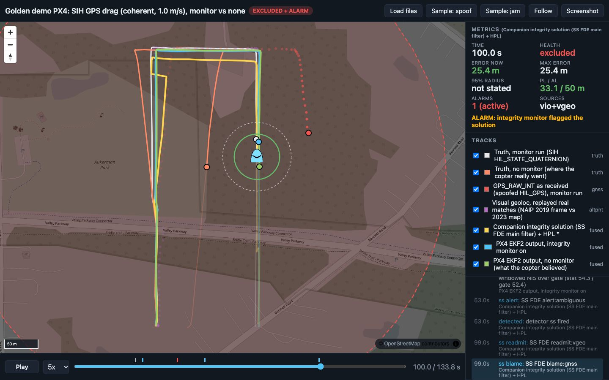

# Golden demo on PX4: GPS drag on a flying PX4 SIH quad, caught and survived

<!-- about: repo:px4/px4-autopilot, repo:ardupilot/pymavlink, repo:mavlink/mavlink, repo:maplibre/maplibre-gl-js -->

The `samples/golden-demo` v2 scenario ported to **PX4 v1.17.0 SIH** (`sihsim_quadx`, headless in
Docker), for teams whose hackathon stack is PX4. Same survey, same attack, same monitor: a
companion process feeds the quad a GPS that starts drifting east 25 s into the AUTO mission
(coherent: position and velocity dragged together at 1 m/s), checks GNSS against an
independent VIO + real-visual-geolocation reference, and on alarm takes GNSS out of EKF2 and
puts the companion's GNSS-free reference in as external vision. The contrast flight has the
same attack and no reaction.

The monitor is not copied: `companion_px4.py` subclasses `samples/golden-demo/companion.py`
and imports `ss_fde.py` (solution separation + PL, velocity test), `vgeo_replay.py` (real
ALIKED + LightGlue matches, `data/vgeo_table.json`) and navapp unchanged. Only the autopilot
plumbing is PX4-specific. `to_navdash_px4.py` reuses `golden-demo/to_navdash.py` the same way.



Yellow = companion integrity solution with its PL ring (AL 50 m), blue = PX4 EKF2 with the
monitor, white = where that quad really flew; green = EKF2 without the monitor (it believes it
is on the survey line), orange = where that quad really flew. Red dots = spoofed GPS, purple =
visual-geoloc fixes. Just after detection: [t = 30 s](screenshots/px4-t30.jpg).

## Result (ran 2026-11-06, one flight each, seed 7)

`./run.sh monitor`, `./run.sh baseline`, then `python3 to_navdash_px4.py runs/px4-monitor.raw.jsonl
runs/px4-baseline.raw.jsonl --out data` (the conversion `./run.sh --update-reference` runs after its two flights). PX4 `v1.17.0` SIH image
`nav-sitl-px4:v1.17.0` from `samples/sitl-docker`, linux/arm64 Docker on Apple Silicon, companion
in `nav-sitl-client:latest` (Python 3.12, pymavlink 2.4.50). Numbers from `data/summary.json` and
`data/compare.json`; ArduPilot columns are the committed `samples/golden-demo/data/v2/summary.json`
(same attack, same detector, same vgeo table, Copter-4.6.3).

| | PX4, monitor | PX4, no monitor | ArduPilot, monitor | ArduPilot, no monitor |
|---|---|---|---|---|
| First alarm (velocity test) after onset | **3.0 s** (offset 2.9 m) | 4.0 s, shadow | 3.0 s | 3.6 s, shadow |
| Other detectors (shadow) | chi2 +17 s, SS +28 s | chi2 +15 s, SS +22 s | chi2 +19 s, SS +27 s | chi2 +15.9 s, SS +22 s |
| Response | `PARAM_SET EKF2_GPS_CTRL 0`, `EKF2_EV_CTRL 5`, both echoed by `PARAM_VALUE` within 0.03 s | none | `MAV_CMD_SET_EKF_SOURCE_SET 2`, ACK accepted | none |
| Max cross-track deviation after onset (truth) | **7.8 m** | **75.0 m** | 6.8 m | 75.0 m |
| Cross-track deviation at mission end | 5.3 m | 44.0 m | 4.4 m | 56.4 m |
| Max EKF horizontal error vs truth | 8.2 m | **105.7 m** | 8.0 m | 93.7 m |
| Autopilot's own GNSS fault flag after onset | 0 `ESTIMATOR_STATUS` reports with `GPS_GLITCH` | 0 | 0 `GPS_GLITCHING` | 0 |
| EKF `pos_horiz_ratio` max after onset (test ratio, fails > 1) | 0.41 | 0.24 | - | - |
| EKF reported `eph` max after onset | 1.25 m | **0.22 m** | - | - |
| Mission (mission start to last WP + 5 s) | 133.9 s | 130.1 s | 119.6 s | 119.1 s |

What it says:

- **Same picture on both autopilots.** A 1 m/s coherent drag stays inside EKF2's innovation
  gates exactly as it stays inside EKF3's: no glitch flag, test ratio at most 0.24, and EKF2
  kept reporting `eph` 0.22 m while it was 106 m off. The 75 m cross-track number is the survey
  geometry capping the drift (as in the ArduPilot run).
- **Detection is autopilot-independent** (the companion sees the same GNSS-vs-VIO velocity
  disagreement): 3.0 s on both.
- **The response works on PX4 without a source-set concept.** EKF2 re-reads `EKF2_GPS_CTRL` /
  `EKF2_EV_CTRL` on every `parameter_update` (no reboot flag). With GNSS stopped first, EV
  horizontal position starts as the only position source and EKF2 resets its position to it
  (`ev_pos_control.cpp`, `resetHorizontalPositionTo` when `gnss_pos` is not active), so the
  spoof offset accumulated during the 3 s detection latency is dropped at once.
- **After the switch EKF2 is over-confident**: `eph` 0.4-1.25 m while the true error was
  5-8 m. That error is the reference's: replayed real geoloc carries a 3-5 m map-registration
  bias (see golden-demo "Real visual geoloc"), and the companion sends its own sigma (>= 1 m)
  as ODOMETRY covariance. EKF2 has no way to know the bias.
- PX4 missions took 10-14 s longer: PX4 finishes the climb to 150 m inside the mission (no
  horizontal motion for the first ~7 s, `Climb to 150.0 meters above home` in the console).

## Sweep (ran 2026-11-06, 20 flights)

`python3 sweep.py --update-reference`: drag position-only / coherent x 1 / 3 m/s x seeds 1, 2,
each flown with the monitor acting and in shadow, plus 2 no-spoof flights per mode. Same
settings as above (replayed real geoloc, `ss+vel` acts). **Wall 2012 s** with 3 parallel lanes
(PX4 + client container pairs `px4golden-l0..2-*`), about 4 min per flight. All 20 completed the
mission. Aggregate: `data/sweep_summary.json`; logs stay in `runs/sweep/`. Two seeds per cell
is a smoke test, not a statistic; ArduPilot medians are from its 4-seed Monte Carlo.

| Spoof | Rate m/s | TTD `ss+vel`, seed 1 / 2 (s) | Max cross-track dev, monitor (m) | Same, no monitor (m) | EKF2 `GPS_GLITCH` reports, no-monitor run | ArduPilot: TTD median / dev monitor median / dev no monitor median (m) |
|---|---|---|---|---|---|---|
| position | 1 | 24 / 22 | 22.0 / 21.8 | 75.0 / 75.0 | 5 / 0 | 22.5 / 17.4 / 75 |
| position | 3 | 6 / 6 | 7.7 / 7.3 | **151.4 / 152.0** | **70 / 72** | 6.2 / 7.4 / 64.6 |
| coherent | 1 | 3 / 6 | 7.5 / 7.5 | 75.0 / 75.0 | 0 / 0 | 2.8 / 7.4 / 75 |
| coherent | 3 | 1 / 1 | 7.7 / 8.7 | **124.2 / 107.8** | 23 / 10 | 1 / 5.8 / 84 |
| none | - | false alarm 0 / **1** | 2.2 / 11.0 | 4.5 / 2.6 | 0 / 0 | FA 0 of 4 |

Per detector: the velocity test fired only on coherent drags (as on ArduPilot), SS on every
spoofed flight; chi2 false-alarmed in all 4 no-spoof flights and once before onset in a
coherent flight, the same weakness the golden-demo Monte Carlo found with real geoloc.

What the sweep adds:

- **At 3 m/s PX4 ends up worse than ArduPilot without a monitor.** EKF2 did flag it
  (`GPS_GLITCH` in 70 of the position-drag reports, `pos_horiz_ratio` up to 2.0), yet the quad
  still flew the full 150 m spoof offset (EKF error 150 m). ArduPilot raised `GPS_GLITCHING` in
  the same cell and ended 61-67 m off. The pattern looks like EKF2 rejecting GNSS and then
  resetting onto it after its rejection timeout; I did not trace that in the v1.17 source.
- **One SS false alarm** (none, seed 2, monitor run, t = 27 s, together with chi2): the monitor
  switched EKF2 to external vision on a clean GNSS and the flight still completed with 11 m max
  deviation, which is the cost of a false alarm here. The ArduPilot Monte Carlo saw SS FA 0 of 4.
- With the monitor, max deviation stayed 7-9 m except position-only 1 m/s (22 m, SS needs
  22-24 s there), same ordering as ArduPilot.

## Run

```sh
cd samples/golden-demo-px4
./run.sh                                   # monitor + baseline flights, conversion, ~9 min
./run.sh monitor                           # one flight (no conversion)
SPOOF=position RATE=3 ./run.sh             # other attacks: SPOOF=position|coherent|none, RATE m/s
./run.sh --update-reference                # also refresh the committed data/
python3 sweep.py                           # 20 flights, 3 parallel lanes, ~35 min here
./screenshot.sh 100                        # headless Chrome capture; needs Chrome + Node 22+
python3 -m unittest -v test_golden_px4     # 6 tests, no SITL; 3 need pymavlink and skip without it
```

Requirements: Docker. The flights need nothing on the host but `sh` and `python3` (stdlib, for
the conversion): the companion runs in `nav-sitl-client:latest`. `run.sh` builds both images
from `samples/sitl-docker` if missing (PX4 ~26 min, client ~1 min here). Outputs go to `runs/`
(git-ignored): raw logs `runs/px4-{monitor,baseline}.raw.jsonl`, PX4 console `runs/*.px4.log`,
dashboard input `runs/navdash-px4/`, sweep `runs/sweep/`. The committed `data/` only changes
with `--update-reference` (or the converter with `--out data`).

Containers are named `px4golden-sitl` / `px4golden-client` (`NAME=` changes the prefix; the
sweep uses `px4golden-l<k>-*`) and removed at the end. No host ports are published.

Replay in the dashboard:

```sh
cd ../..                                   # repo root
python3 -m http.server 8000
# http://localhost:8000/templates/demo-dashboard/index.html?manifest=../../samples/golden-demo-px4/data/manifest.json
```

## How each piece maps from ArduPilot to PX4 v1.17

All PX4 statements below were read from the `v1.17.0` tag (file names given) and then
exercised in the flights above unless marked otherwise.

| Piece | ArduPilot (golden-demo v2) | PX4 v1.17 SIH (this sample) |
|---|---|---|
| Truth | `SIMSTATE` + `SIM_STATE` | `HIL_STATE_QUATERNION` (SIH ground truth), requested with `MAV_CMD_SET_MESSAGE_INTERVAL`; not in the onboard link's defaults |
| GNSS injection | `GPS_INPUT`, `GPS1_TYPE=14` | `HIL_GPS` at 10 Hz. v1.17 has no `GPS_INPUT` handler (`mavlink_receiver.cpp`). `HIL_GPS` is only accepted with `MAV_USEHILGPS=1` **and** the sender's sysid equal to PX4's own (`handle_message_hil_gps`), so the companion sends that one message as sysid 1 |
| Sim GPS off | n/a (`GPS1_TYPE` replaces it) | `SENS_EN_GPSSIM=0` + param save + container restart before the flight. The airframe `10040_sihsim_quadx` `set-default`s it to 1, and `PX4_PARAM_SENS_EN_GPSSIM=0` does nothing because 0 is the compiled default (seen: the env override was ignored). |
| Alt-PNT input | `VISION_POSITION_ESTIMATE` + `VISION_SPEED_ESTIMATE` | `ODOMETRY` (MAVLink 2): position in the EKF origin's `LOCAL_NED` frame, VIO velocity in NED, `estimator_type` VIO, covariance from the reference sigma => `vehicle_visual_odometry` |
| Alt-PNT rate | reference at 5 Hz | **10 Hz**: EKF2 starts EV only when samples are < 200 ms apart and stops it after 400 ms without data (`EV_MAX_INTERVAL` in `EKF/common.h`, `ev_control.cpp`). 5 Hz with jitter would sit on that edge |
| Before the alarm | source set 1 = GPS; ExternalNav not used | `EKF2_EV_CTRL 0`, `EKF2_GPS_CTRL 7`. EV is not fused before the alarm, so the no-monitor flight is GNSS-only like ArduPilot set 1 |
| Response | `MAV_CMD_SET_EKF_SOURCE_SET 2` | `EKF2_GPS_CTRL 0` then `EKF2_EV_CTRL 5` (horizontal position + velocity), INT32 params sent bytewise. The shared monitor logic still calls "source set 2"; `PX4Companion.command()` translates it |
| Flight | GUIDED takeoff, AUTO | `AUTO.TAKEOFF` (`MIS_TAKEOFF_ALT` 150), `AUTO.MISSION` via `MAV_CMD_DO_SET_MODE` (custom mode main 4, sub 2 / 4); `MPC_XY_CRUISE` 10 m/s |
| MAVLink link | TCP published to the host | UDP inside the PX4 container's network namespace (`udpin:0.0.0.0:14540`) |

### Why external vision and not aux global position

EKF2 v1.17 has an "aux global position" source (`EKF2_AGP_CTRL`, lat/lon + accuracy, absolute,
1 Hz is fine) that suits visual geolocalization better on paper. It is compiled into
`px4_sitl_default`, but nothing in v1.17's `mavlink_receiver.cpp` publishes the
`aux_global_position` topic: its inputs are uXRCE-DDS `/fmu/in/aux_global_position` (ROS 2)
and the `sensor_agp_sim` simulator. A MAVLink-only companion therefore has to use external
vision. Not tried here: the DDS path (needs a Micro XRCE-DDS agent and ROS 2 / px4_msgs), and
`GLOBAL_POSITION_SENSOR`, which only exists on PX4 `main` (see
`docs/integration-cards/px4__px4-autopilot.md`).

Things that follow from the EV choice (`ev_pos_control.cpp`, v1.17.0):

- While GNSS is fused, EV horizontal position goes through a position bias estimator: it acts
  as a relative source and cannot pull EKF2 off a spoofed GNSS. That is why EV stays off until
  the alarm here, and why GNSS has to be stopped, not just out-weighed.
- When GNSS stops and EV hpos is active, EKF2 resets its position to the EV measurement, so EV
  must be in the EKF's local origin frame. The companion reads that origin from
  `GPS_GLOBAL_ORIGIN` before it sends anything.
- EV in the NED frame needs EKF2's own heading alignment (from the simulated magnetometer); no
  EV yaw is sent.

## Pitfalls hit while building it

- **Host-side MAVLink did not work.** With the onboard port published (`-p 127.0.0.1:15800:14580/udp`)
  a host pymavlink got no packets back (two attempts, fresh container each). PX4 latches the
  first non-localhost sender (`mavlink_receiver.cpp`); behind Docker Desktop's UDP proxy that did
  not happen. Running the companion in the PX4 container's network namespace works. Mechanism
  not confirmed.
- **The first flight watched the wrong GPS.** With the SIH GPS left running and set to no fix
  (`SIM_GPS_USED 0`), PX4 picked the MAVLink receiver for EKF2 (`vehicle_gps_position` device
  `MAVLINK:1`), but `GPS_RAW_INT` reports `sensor_gps` instance 0, the no-fix sim receiver. The
  companion's velocity test then compared VIO against a stale zero GNSS velocity and
  false-alarmed at t = 9 s. Turning the sim GPS off at boot makes the MAVLink receiver instance
  0. If you need both, read `GPS2_RAW` for instance 1.
- **INT32 params**: PX4 expects them bytewise in `PARAM_SET.param_value`
  (`struct.pack("<i")` read as a float). Sending `7.0` sets `EKF2_GPS_CTRL` to 1088421888. The
  first attempt did this; that flight hit `Failsafe activated` right after arming and was
  auto-disarmed (not investigated further once the encoding was fixed).
- `PX4_PARAM_<name>` env overrides (rcS) work for parameters whose value differs from the
  compiled default (`MPC_XY_CRUISE` was set this way in a probe), not for ones an airframe
  `set-default`s away from a compiled default you want back.
- `docker cp` of a macOS `tar` stream fails on `com.apple.provenance` xattrs; `run.sh` uses
  `COPYFILE_DISABLE=1 tar --no-xattrs --no-mac-metadata`.

## Files

| File | What |
|---|---|
| `run.sh` | one command: PX4 SIH + client containers per flight, monitor and baseline, conversion (`--update-reference`) |
| `companion_px4.py` | `golden-demo/companion.py` subclass: HIL_GPS, HIL_STATE_QUATERNION truth, ODOMETRY at 10 Hz, EKF2 param response, PX4 mission/modes |
| `to_navdash_px4.py` | PX4 rows => golden-demo converter; PX4 fields (`ESTIMATOR_STATUS`, param echo); `compare.json` vs the ArduPilot reference |
| `sweep.py` | spoof x rate x seed sweep in parallel lanes, aggregate table |
| `test_golden_px4.py` | 6 tests: converter, PX4 summary fields, comparison, mode and param encoding (3 need pymavlink) |
| `screenshot.sh`, `screenshot.mjs` | headless Chrome capture (copy of the golden-demo one, debug port 15802, HTTP 15801) |
| `data/` | reference run (dashboard input, `summary.json`, `compare.json`, `sweep_summary.json`) |
| `screenshots/` | dashboard at t = 30 s and 100 s |

Reused unchanged: `samples/golden-demo` (`companion.py`, `ss_fde.py`, `vgeo_replay.py`,
`to_navdash.py`, `data/vgeo_table.json`), `samples/altpnt-integrity` (via `ss_fde.py`),
`templates/project-repo/src/navapp`, `templates/demo-dashboard`, `samples/sitl-docker` images.

## Limits and honest caveats

- Everything the golden-demo README lists for v2 applies: VIO is truth + noise + bias, visual
  geoloc is replayed real matching on rendered frames, the noise model of the injected GNSS is
  a guess, thresholds are the demo's own.
- SIH is PX4's simplest physics (no wind, no terrain); its IMU, baro and mag are simulated
  inside PX4. GPS is entirely the companion's.
- `HIL_GPS` timestamps are ignored for fusion: EKF2 uses arrival time. pymavlink does not answer
  `TIMESYNC`, so `ODOMETRY` is also stamped on arrival (`Timesync::sync_stamp`). `EKF2_EV_DELAY`
  stays 0.
- Not tested: speedup (`PX4_SIM_SPEED_FACTOR` exists in v1.17 SIH per `sih.cpp`, but the 10 Hz EV
  rate would have to scale with it), amd64, PX4 `main` / v1.18, the DDS aux-global-position
  path, `failure gps` injection (SIH does not implement it, see `samples/px4-sitl-gps-denial`),
  an RTL or hold response.

## Extending it in a hackathon

- Swap the response for a mode change (`AUTO.LOITER`, custom mode main 4 sub 3) next to the
  param switch, or for a ROS 2 external mode via px4-ros2-interface-lib.
- Feed the visual geoloc to EKF2 as aux global position over uXRCE-DDS instead of EV, and
  compare: AGP is absolute (no bias estimator), so it can run alongside GNSS and fight a spoof
  inside EKF2 without a companion decision.
- Replace the VIO oracle with `samples/vio-to-mavlink-bridge`.
