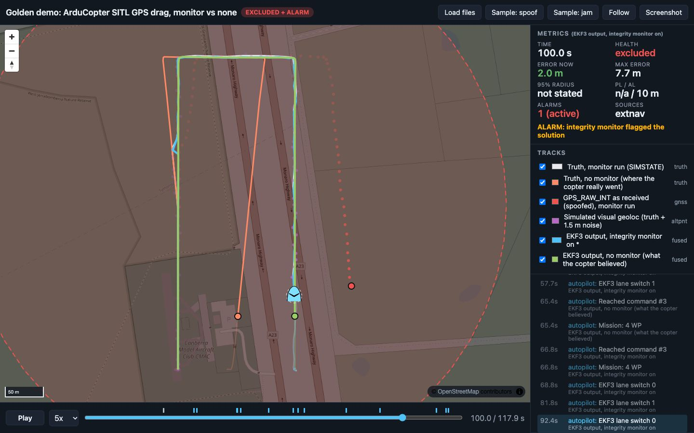

# Golden demo: GPS drag on a flying ArduCopter, caught and survived

<!-- about: repo:ardupilot/ardupilot, repo:ardupilot/pymavlink, repo:maplibre/maplibre-gl-js -->

The minute-one demo for judges. An ArduCopter SITL flies an AUTO survey; at t = 25 s its GPS
starts to drift east at 1 m/s. A companion process checks GNSS against an independent
dead-reckoning + visual-geolocation reference with a chi-square test, raises the alarm, and
switches EKF3 to a non-GPS source set. The contrast run has the same attack and no reaction:
the copter believes it is on the survey line while it really drifts 75 m off it.



Blue = EKF output with the monitor, white = where that copter really flew. Green = EKF output
without the monitor (it thinks it is on the line), orange = where that copter really flew.
Red dots = spoofed GPS fixes, purple = simulated visual-geoloc fixes. Detection moment:
[t = 36 s](screenshots/golden-t36.jpg).

## Results (ran 2026-11-06, one run each, seed 7)

ArduCopter `Copter-4.6.3` SITL in Docker (`nav-sitl-ardupilot:copter-4.6.3` from
`samples/sitl-docker`), linux/arm64 on Apple Silicon, pymavlink 2.4.50, Python 3.12. Numbers
from `data/summary.json`, produced by `to_navdash.py` from the raw logs.

| | Monitor on | No monitor |
|---|---|---|
| Alarm (windowed chi-square over gate) | t = 34.4 s | same test in shadow mode fired at 34.4 s, no action |
| Time to detect after attack onset | **9.4 s** (spoof offset 9.3 m) | - |
| Response | `MAV_CMD_SET_EKF_SOURCE_SET` 2 at 34.4 s, ACK `MAV_RESULT_ACCEPTED` | none |
| Max cross-track deviation from the planned path after onset (truth) | **7.6 m** | **75.0 m** |
| Cross-track deviation at mission end | 0.5 m | 62.4 m |
| Max EKF horizontal error vs truth | 7.7 m (at 34.3 s, just before the switch) | 88.3 m (at mission end) |
| EKF `GPS_GLITCHING` flag after onset | 0 reports | 0 reports |
| EKF `pos_horiz_variance` max after onset | 1.34 (on ExternalNav, see below) | 0.50 (3 of 181 reports > 0.5) |
| Mission (AUTO start to last WP + 5 s) | 117.9 s | 114.9 s |

The no-monitor row is the point: ArduPilot's own EKF never raised `GPS_GLITCHING` and its
normalized position variance touched 0.5 only three times while the vehicle ended 88 m from
where it believed it was. A slow drag stays inside the EKF's innovation gates.

Before the attack the monitor's windowed statistic stayed at 9.9 (monitor run) and 17.8
(baseline) against a gate of 52.4; no epoch was marked suspect before onset. That margin is
flattering: SITL's simulated GPS has no horizontal noise (see Limits).

## Run

```sh
cd samples/golden-demo
PYTHON=/path/to/venv/bin/python ./run.sh   # both flights + conversion, ~6 min (349 s here)
./run.sh monitor                            # one flight only (no conversion)
./screenshot.sh 100                         # optional, needs Chrome + Node 22+
python3 -m unittest -v test_to_navdash      # 6 tests, stdlib only
```

`PYTHON` needs `pymavlink` (`pip install pymavlink==2.4.50`). `run.sh` builds the SITL image
from `../sitl-docker` if it is missing, starts a fresh container `golden-sitl` per flight with
SERIAL1 on `127.0.0.1:15766` (`PORT=`, `NAME=` override), and removes it at the end.

Replay:

```sh
cd ../..                                   # repo root
python3 -m http.server 8000
# http://localhost:8000/templates/demo-dashboard/index.html?manifest=../../samples/golden-demo/data/manifest.json
```

Add `&t=34&follow=0` to open at the alarm. The dashboard is `templates/demo-dashboard`, unchanged.

## What happens, step by step

1. **SITL** boots with `copter.parm` plus `golden.parm` (`docker cp` + `--defaults a,b`, because
   macOS Docker Desktop does not share `/tmp`). Source set 1 = GPS + compass + baro; set 2 =
   ExternalNav position (`EK3_SRC2_POSXY=6`, `VELXY=0`, `POSZ=1` baro, `YAW=1` compass),
   `VISO_TYPE=1` (MAVLink), `VISO_POS_M_NSE=2.0`, `EK3_SRC_OPTIONS=0`, `WPNAV_SPEED=1000`.
2. **Companion** (`companion.py`, pymavlink) requests the streams it logs: `GPS_RAW_INT` 5 Hz,
   `GLOBAL_POSITION_INT`, `SIMSTATE`, `SIM_STATE`, `RAW_IMU` 10 Hz, `EKF_STATUS_REPORT` 2 Hz,
   plus `LOCAL_POSITION_NED`, `VFR_HUD`, `MISSION_CURRENT`, `STATUSTEXT`, `COMMAND_ACK`. It gets
   the EKF origin with `MAV_CMD_REQUEST_MESSAGE` (`GPS_GLOBAL_ORIGIN`) and uploads the mission.
3. **Alt-PNT stream from boot**: `VISION_POSITION_ESTIMATE` at 5 Hz = SITL truth (`SIMSTATE`)
   + 1.5 m Gaussian noise per axis, in the EKF origin's NED frame. It is sent from the start so
   ExternalNav is healthy and aligned before anyone needs it (switching to a cold source fails).
4. **Flight**: GUIDED, arm (retried until pre-arm passes; armed ~42 s after the companion connected here), takeoff to
   30 m, AUTO. Survey: 400 m north, 150 m east, 400 m south at 10 m/s. t = 0 is AUTO entry.
5. **Attack**: from t = 25 s the companion writes `SIM_GPS_GLITCH_X` / `_Y` every 0.5 s with a
   linearly growing offset, 1 m/s toward 090 deg, cap 150 m. In Copter-4.6.3
   (`libraries/SITL/SIM_GPS.cpp`) the glitch vector is added to latitude/longitude in degrees
   (and altitude in metres) after the lag model; velocity is not touched.
6. **Monitor**, every 1 s: navapp `DeadReckoningFilter` predicts with simulated VIO velocity
   (truth velocity from `SIM_STATE` + 0.1 m/s noise + (0.05, -0.03) m/s bias), updates with the
   latest visual-geoloc fix (assumed sigma 2.5 m), then navapp `ChiSquareMonitor` tests the
   GNSS innovation (assumed sigma 2.0 m). GNSS is tested, never fused, so the reference cannot
   be dragged along. The 10-epoch windowed NIS test (false-alarm 1e-4) is what fires; the
   single-epoch gate never tripped first.
7. **Response**: on the first `EXCLUDED` + alarm verdict, `MAV_CMD_SET_EKF_SOURCE_SET` (42007)
   param1 = 2. The EKF resets to the ExternalNav position and AUTO continues on it. In the
   baseline (`--mode baseline`) the same monitor runs in shadow mode and does nothing.
8. **Conversion**: `to_navdash.py` writes `navdash/1` tracks (2 Hz positions, 1 Hz fixes),
   events, a zone and `summary.json`.

## Files

| File | What |
|---|---|
| `run.sh` | one command: two flights, logs, conversion |
| `golden.parm` | EKF3 source sets, `VISO_TYPE=1`, survey speed |
| `companion.py` | MAVLink companion: logging, mission, attack, alt-PNT stream, monitor, response |
| `to_navdash.py` | raw logs => `data/*.jsonl` (navdash/1), `manifest.json`, `zones.geojson`, `summary.json` |
| `test_to_navdash.py` | 6 tests on geometry, metrics and the converter (synthetic logs) |
| `screenshot.sh`, `screenshot.mjs` | headless Chrome capture over the DevTools protocol |
| `data/` | the run above as dashboard input, 96 KB |
| `runs/` | raw logs, git-ignored (monitor run 11 513 lines / 3.9 MB) |

Reused unchanged: `templates/project-repo/src/navapp` (`DeadReckoningFilter`,
`ChiSquareMonitor`, `geo`, `interfaces`), `templates/demo-dashboard` (replay, schema),
`samples/sitl-docker` (image). `samples/altpnt-integrity` was not imported: its monitor and
EKF are coupled to its own simulator's epoch format; its solution-separation and
protection-level logic is the next step if the demo needs a PL (see Extending).

## Dashboard tracks

| Track | Role | Source |
|---|---|---|
| `truth.jsonl` | truth | monitor run `SIMSTATE`; carries the ground-truth `attack_onset` event |
| `truth-baseline.jsonl` | truth (2nd) | baseline run `SIMSTATE` |
| `ekf-monitor.jsonl` | fused, primary | monitor run `GLOBAL_POSITION_INT`; `health` / `alarm` from the companion verdict, `sources` = active EKF source set; events `spoof_suspected`, `source_switched`, autopilot `STATUSTEXT` |
| `ekf-baseline.jsonl` | fused | baseline run `GLOBAL_POSITION_INT` |
| `gnss.jsonl` | gnss | monitor run `GPS_RAW_INT` (spoofed) |
| `vgeo.jsonl` | altpnt | the simulated visual-geoloc fixes that were sent as `VISION_POSITION_ESTIMATE` |

The panel shows **95% radius "not stated" and PL "n/a"** on purpose: ArduPilot reports no
horizontal accuracy in metres for its fused solution (`EKF_STATUS_REPORT` variances are
normalized test ratios), and inventing one would be the misleading number the dashboard is
built to expose. The spoofing zone is a circle around the flight area, not an emitter footprint.

## Limits and honest caveats

- **The alt-PNT and VIO inputs are oracles with noise.** Visual geoloc = truth + white 1.5 m
  noise, VIO = truth velocity + noise + constant bias. No camera, no map, no outliers. Swap in
  `samples/visual-geolocalization-lightglue` or a real VIO and expect a slower, noisier detector.
  This is also why the shadow-mode detection in the baseline fired at exactly the same time:
  same seed, same reference, same spoof schedule.
- **SITL GPS has no horizontal noise** (`SIM_GPS_NOISE` only moves altitude in 4.6.3), so the
  pre-attack chi-square margin is larger than a real receiver would give. The assumed 2.0 m
  GNSS sigma is a receiver-spec guess, not tuned to SITL.
- **Position-only spoof.** `SIM_GPS_GLITCH` moves position, not velocity; `SIM_GPS_VERR` adds
  random (not coherent) velocity error. A coherent spoofer would also drag velocity. ArduPilot
  still followed this one completely.
- **After the switch the EKF is not quiet**: `pos_horiz_variance` sat around 0.5-1.3 and EKF3
  alternated primary lanes (`EKF3 lane switch 0/1`, about every 10-20 s) while on ExternalNav.
  The EKF error vs truth stayed 0.1-3.4 m from t = 36 s to the end. Likely cause: 1.5 m white noise at 5 Hz vs the declared
  2.0 m; not investigated further.
- **One run per mode.** Time-to-detect depends on drag rate, sigmas and the window length; no
  Monte Carlo or rate sweep was run. At 1 m/s an earlier version that fused trusted GNSS into the
  reference detected at 16.5 s; keeping the reference independent cut that to 9.4 s.
- The source switch is latched: no automatic return to GPS when the spoof ends.
- Timing: the companion runs on host wall clock against SITL at speedup 1; event times are
  host receive times relative to AUTO entry, so they carry TCP and loop jitter (tens of ms).
- Not tested: amd64, `--speedup` > 1, `ODOMETRY` instead of `VISION_POSITION_ESTIMATE`, the
  LOITER / RTL response, ArduPilot 4.7+ (there the glitch param is `SIM_GPS1_GLTCH`, per
  `samples/ardupilot-ekf3-source-switch`; this script uses the 4.6 names).

## Extending it in a hackathon

- Replace `send_vgeo()` with real visual geolocalization output (same message, same frame).
- Add a protection level: port the solution-separation bank from `samples/altpnt-integrity`
  and write `pl_m` into `ekf-monitor.jsonl`; the dashboard already draws PL vs AL.
- Response variants: `self.set_mode("RTL")` or `"LOITER"` next to the source switch; or move the
  decision onboard with the Lua examples named in `samples/ardupilot-ekf3-source-switch`.
- Harder attacks: a coherent spoof (offset + matching velocity), a step, or `SIM_GPS_JAM=1`.

## Pitfalls hit while building it

- Host ports 15760-15763 were taken by another SITL on this machine; the default is 15766.
- Cross-track deviation hides drag along the current leg. The first mission had the drag along
  a leg and showed only 4.8 m deviation despite 14.7 m EKF error; the survey now runs
  north/south so the eastward drag is cross-track on the long legs. Report both metrics.
- `chrome --headless --screenshot --virtual-time-budget` hung on the MapLibre page for over
  2 min; driving Chrome over the DevTools protocol (`screenshot.mjs`) takes 13 s.
