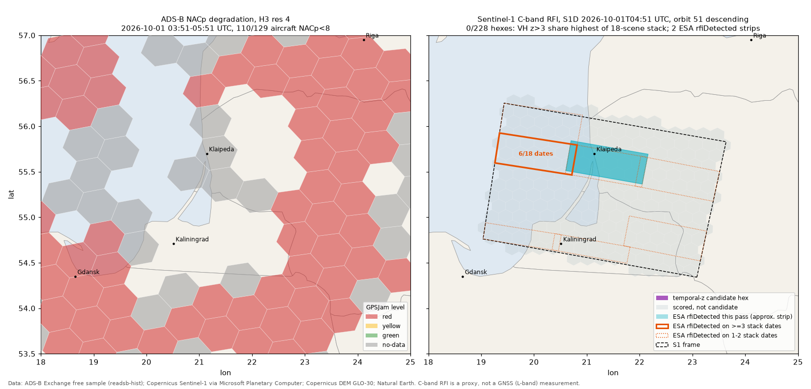

<!-- about: repo:zephr-xyz/sentinel1-rfi-detection, res:gpsjam-org, repo:wiedehopf/readsb, repo:stac-utils/pystac-client -->
# OSINT interference map: ADS-B NACp + Sentinel-1 RFI

Two free, no-login data sources mapped over the same area and morning: the SE Baltic around
Kaliningrad on 2026-10-01. Everything below came from running the code against live public data
on 2026-11-06.



| Layer | What it measures | Source |
|---|---|---|
| ADS-B NACp hexes | How many aircraft *report* that their own GNSS position is degraded (NACp < 8). Indirect: L-band GNSS effect seen through avionics | ADS-B Exchange free `readsb-hist` sample (1st of each month) |
| ESA RFI annotation | Whether ESA's processor detected RF interference in Sentinel-1's own C-band receive window, per swath and noise-sensing pulse | `annotation/rfi/rfi-iw-*.xml` in each GRD product, via Planetary Computer |
| Temporal z-score | VH backscatter pixels much brighter than their own 18-pass history (port of zephr-xyz/sentinel1-rfi-detection) | Sentinel-1 GRD COGs, Planetary Computer |

## Why this region and date

- **Region.** EASA SIB 2022-02 (March 2022) names "Kaliningrad region, surrounding Baltic sea and
  neighbouring States" as one of the GNSS outage areas. EASA's live list
  (<https://www.easa.europa.eu/en/domains/air-operations/global-navigation-satellite-system-outages-and-alterations>,
  read 2026-11-06, SIB now at revision 2022-02R4) still lists Vilnius EYVL, Riga EVRR, Tallinn
  EETT and Helsinki EFIN. The index also has Spire's Kaliningrad/Baltic report
  (`res:spire-gnss-interference-russia-kaliningrad`).
- **Date.** ADS-B Exchange publishes its complete feed free only for the 1st of each month
  (<https://www.adsbexchange.com/data-products/sample-data/>). A Sentinel-1D pass (relative orbit
  51, descending) crossed Kaliningrad on 2026-10-01 at 04:51:16 UTC. The ADS-B window is +-1 h
  around it.

## Run

```sh
uv venv .venv && uv pip install --python .venv/bin/python -r requirements.txt
.venv/bin/python adsb_hexmap.py           # ~600-750 MB download (121 global snapshots), cached filtered to the bbox
.venv/bin/python s1_rfi.py                # 18 scenes, VH read at 1/8 via COG overviews; ~440 MB cache; ~8 min here
.venv/bin/python make_map.py              # out/zones.geojson, out/manifest.json, out/map.png
.venv/bin/python -m unittest test_osint   # 8 offline tests
```

Defaults reproduce the run below. `--date`, `--start/--end/--step`, `--bbox` (ADS-B) and
`--date`, `--orbit`, `--point`, `--stack-from/--stack-to`, `--no-dem` (S1) move it elsewhere. Find
an orbit over your area with a STAC search on `sentinel-1-grd` (see `find_stack`). For the
Eastern Mediterranean or Black Sea, change both bboxes and pick a 1st-of-month pass.

No login anywhere: Planetary Computer signs blob URLs anonymously (`planetary_computer.sign`),
the ADS-B Exchange samples and the Copernicus DEM bucket are open HTTP. The zephr repo itself
downloads full SAFE zips from Copernicus Data Space, which needs a free CDSE account
(`CDSE_USER`/`CDSE_PASS` in `.env`); this port does not need it.

### Dashboard

```sh
cd ../../templates/demo-dashboard && python3 -m http.server 8000
# http://localhost:8000/?manifest=../../samples/osint-jamming-map/out/manifest.json&t=3617
```

`zones.geojson` uses the dashboard's zone format: polygons with `kind` (`jamming` = ADS-B red or
yellow hex, amber; `c-band-rfi` = Sentinel-1 flag, purple), `label`, `t_start`/`t_end` on the
ADS-B window clock (s since 03:51:00 UTC). The Sentinel-1 zones are active for +-30 s around the
overpass (t = 3617 s). Aircraft reports load as two `navdash/1` point tracks (`adsb-bad`,
`adsb-good`, role `gnss`) so the replay shows them fading in and out. There is no fused track, so
the metrics panel reads "NO DATA"; that is expected. Headless Chrome capture:
[out/dashboard.png](out/dashboard.png).

## Results (2026-10-01)

### ADS-B (`out/adsb_summary.json`)

| | SE Baltic, 18-25 E 53.5-57 N | Control: NL/DE, 4-10 E 50-54 N |
|---|---|---|
| Snapshots | 121 (60 s step) | 13 (600 s step) |
| Aircraft with a usable quality field | 129 | 879 |
| Aircraft with NACp < 8 (or `gpsOkBefore`) | **110** | 19 |
| H3 res 4 hexes red / yellow / green / no-data | **64** / 0 / 0 / 30 | 1 / 3 / 108 / 20 |

Of the 110 degraded aircraft, 105 were at some point positioned by MLAT rather than by their own
ADS-B position (the aircraft keeps transmitting but has no GNSS position to send, so ground
receivers multilaterate it), 53 carried readsb's `gpsOkBefore` marker, and almost every degraded
report has NACp = 0. Hexes over Kaliningrad itself are no-data: almost no traffic and few
receivers. The control region was sampled 10x more sparsely, so compare the ratios, not the
counts.

### Sentinel-1 (`out/s1_summary.json`)

Stack: relative orbit 51 descending, S1C and S1D alternating every 6 days, 2026-07-15 to
2026-10-31 (2026-10-13 is missing on Planetary Computer), one frame covering 19.0-23.6 E,
54.3-56.3 N.

| date | VH px z>3 % (leave-one-out) | ESA rfiDetected VH / VV (of 18 reports) | ESA mitigation |
|---|---|---|---|
| 2026-07-15 | 0.775 | 0 / 0 | None |
| 2026-07-21 | 0.133 | 0 / 0 | None |
| 2026-07-27 | 0.179 | 0 / 0 | None |
| 2026-08-02 | 0.095 | 1 / 1 | TimeFrequency |
| 2026-08-08 | 0.25 | 0 / 0 | None |
| 2026-08-14 | 3.635 | 2 / 1 | TimeFrequency |
| 2026-08-20 | 0.124 | 0 / 0 | None |
| 2026-08-26 | 0.07 | 2 / 0 | TimeFrequency |
| 2026-09-01 | 0.264 | 2 / 1 | TimeFrequency |
| 2026-09-07 | 0.044 | 0 / 0 | None |
| 2026-09-13 | 0.634 | 0 / 0 | None |
| 2026-09-19 | 0.048 | 1 / 0 | TimeFrequency |
| 2026-09-25 | 0.068 | 2 / 0 | TimeFrequency |
| **2026-10-01** | **0.128** | **1 / 1** | TimeFrequency |
| 2026-10-07 | 0.135 | 1 / 0 | TimeFrequency |
| 2026-10-19 | 1.249 | 0 / 0 | None |
| 2026-10-25 | 0.344 | 0 / 0 | None |
| 2026-10-31 | 0.143 | 1 / 1 | TimeFrequency |

- **Temporal z-score, target date:** 0.128% of pixels over z = 3, about what a Gaussian gives by
  chance (0.135%). 0 of 228 H3 res 5 hexes are candidates (target date has the highest z>3 share of
  the whole stack and at least 1%). Nothing bright in VH on 2026-10-01.
- **Temporal z-score, 2026-08-14** (rerun with `--date 2026-08-14 --out <dir>`): 38 candidate
  hexes, the strongest with ~90-100% of pixels over z = 3 and max z ~20, around the Gulf of Gdansk and the Vistula Spit.
  25 of the 38 hex centres are over water (Natural Earth 50m), including 8 of the 10 strongest.
  Whole-hex brightening over sea is what a wind change does to VH backscatter; this method cannot
  tell that apart from RFI. Read it as "unusual pass", not "jammer".
- **ESA annotation:** RFI detected on 9 of 18 passes, with time-frequency mitigation applied on
  exactly those passes. One IW3 noise-sensing slot (about 19.3-20.7 E, 55.6-55.9 N, the sea NW of
  the Sambia peninsula) is flagged on 6 dates (08-02, 09-01, 09-19, 09-25, 10-07, 10-31); every
  other slot on at most 2. On 2026-10-01 the flag was in IW2 around Klaipeda / the Curonian Spit
  (cyan strip in the map). These are C-band emitters active during the pass, location approximate
  (see below).

So on this morning the two layers do not agree in any useful way: ADS-B says the whole region was
degraded, and Sentinel-1 saw a weak, intermittent C-band source that does not track the GNSS
picture. That is the honest result, and it matches what the physics predicts.

## What Sentinel-1 does and does not measure

- Sentinel-1 receives at 5.405 GHz (C-band). GNSS is L-band: L1 1575.42, L2 1227.60,
  L5 1176.45 MHz. A GNSS jammer's intended emission is >3.8 GHz below the SAR's receive band.
  Low harmonics do not land in it either (3 x L1 = 4.73 GHz, 4 x L1 = 6.30 GHz, 5 x L5 = 5.88 GHz).
- What it can see: any emitter inside its receive band while the antenna footprint passes - C-band
  radars (military, maritime, some air-defence), 5 GHz RLAN, or broadband spurious emissions from
  high-power transmitters. zephr's own README calls the L-band to C-band link an open question and
  explains its Jammertest result as amplifier warm-up, not jamming.
- So the S1 layer is a proxy for *RF activity at C-band in the area*, useful as EW situational
  context next to the GNSS layer, not as a GNSS-jamming detector. A clean S1 pass over a jammed
  area (as on 2026-10-01) is expected, not a contradiction.
- One snapshot per pass (~25 s for this frame), every 6 days on this orbit. A jammer that is off
  during that window is invisible.
- ESA noise-sensing reports are receive-only measurements through the whole antenna pattern
  (main lobe plus sidelobes), one per swath every ~5.5 s. The strips drawn here are the swath x
  time footprint on the ground, using an approximate IW1/IW2/IW3 split of the GRD range width
  (the product annotation with the exact swath merge is not on Planetary Computer). The emitter is
  somewhere in or near the strip; this is not a fix.

## What the ADS-B layer does and does not measure

- NACp is the aircraft's own estimate of its position accuracy. NACp < 8 (EPU >= 92.6 m) means the
  navigation system says GNSS is degraded or absent. It does not say why: jamming, spoofing,
  avionics fault, or an old transponder. The GPSJam formula `(bad - 1) / total` and the 3-aircraft
  minimum damp single-aircraft faults; the NL/DE control shows the background rate.
- Only areas with aircraft and receivers are measured; no-data is not "clean". Russian airspace
  over Kaliningrad has almost no tracked traffic in this sample.
- Under spoofing, an aircraft's ADS-B position is itself false, so it lands in the wrong hex. MLAT
  positions (most degraded aircraft here) are independent of the aircraft's GNSS and are kept.
- `nic` is reported per hex (`n_nic_bad`) but not used for the level; when readsb marks `nic` as
  MLAT-derived it is ignored.
- H3 res 4 (edge ~22 km) and a 2 h window are this sample's choices. GPSJam uses 24 h; its hex
  resolution and NACp cut-off were not checked here.

## Deviations from zephr-xyz/sentinel1-rfi-detection

Ported from `temporal_rfi.py` / `rfi_pipeline.py` (MIT): same SUBSAMPLE 8, 0.01 deg grid,
MIN_OBS 3, z > 3, 0.5 dB std floor, 15 deg slope mask, `10*log10(DN)` with scene-median
normalisation. Differences:

- Data from Planetary Computer COGs (VH read through overviews; geolocation from the COG's GCPs,
  which are the annotation's geolocation grid) instead of CDSE SAFE zips.
- The scored scene is left out of its own baseline. zephr includes it, which pulls z down.
- Per-scene points and the 0-100 "score" are replaced with H3 res 5 hex shares and a rank test
  against the rest of the stack (`rank_hexes`). The 1% floor is this sample's choice.
- The ESA RFI annotation layer is new; zephr does not read it. On Planetary Computer it is the
  asset named `schema-product-vh` / `schema-product-vv` (the href ends in `annotation/rfi/rfi-iw-vh.xml`).
- Not verified: zephr's README reference list includes "Meyer et al. (2013) Mapping GPS
  interference in Alaska using Sentinel-1", which predates Sentinel-1's 2014 launch; treat its
  citations as unchecked.

## Files

| File | |
|---|---|
| `adsb_hexmap.py` | fetch + bbox filter + H3 GPSJam percentage => `adsb_cells.geojson`, `adsb_summary.json`, `adsb-bad.jsonl`, `adsb-good.jsonl` |
| `s1_rfi.py` | STAC stack search, ESA RFI XML parse, temporal z-score => `s1_cells.geojson` (footprint, scored hexes, ESA strips, ESA recurrence strips), `s1_summary.json` |
| `make_map.py` | `zones.geojson` + `manifest.json` + `s1-overpass.jsonl` (event) for the dashboard, `map.png` |
| `test_osint.py` | 8 unit tests: GPSJam formula and levels, classification incl. MLAT, one-count-per-aircraft, RFI XML parse, z-score flags only the planted anomaly, rank test |
| `out/` | outputs of the run above (1.1 MB), plus `control_adsb_summary.json` and `dashboard.png` |
| `cache/` | git-ignored: filtered ADS-B snapshots, S1 VH arrays (npz), RFI XMLs, DEM tiles, Natural Earth |

## Data licenses

- **Sentinel-1:** Copernicus Sentinel data, free and open under the Copernicus data policy;
  credit "Contains modified Copernicus Sentinel data 2026". Hosted by Microsoft Planetary Computer
  (its terms of use apply to the hosting).
- **Copernicus DEM GLO-30** (AWS open data bucket, `res:copernicus-dem-aws`): free under the
  Copernicus DEM licence; use the attribution text given at <https://registry.opendata.aws/copernicus-dem/>.
- **ADS-B Exchange samples:** "Complete data from the 1st of each month are made available free of
  charge". The sample page names no open licence and the site footer says all rights reserved;
  their Terms of Use and Acceptable Use Policy apply. This sample commits only derived aggregates
  and ~2300 position reports (`out/adsb-*.jsonl`); check the terms before redistributing raw
  snapshots or using them commercially.
- **Natural Earth** (map background): public domain.
- **zephr-xyz/sentinel1-rfi-detection:** MIT.

Other ADS-B routes checked: OpenSky's historical database (with NACp/NIC) needs an approved
research account, and its public state-vector dumps carry no NACp/NIC field, so neither drives this
method without approval (from OpenSky's documentation as known when writing; not re-checked in
this run). airplanes.live and the ADS-B Exchange API are live-only, so they cannot give a past
window that matches a Sentinel-1 pass.
