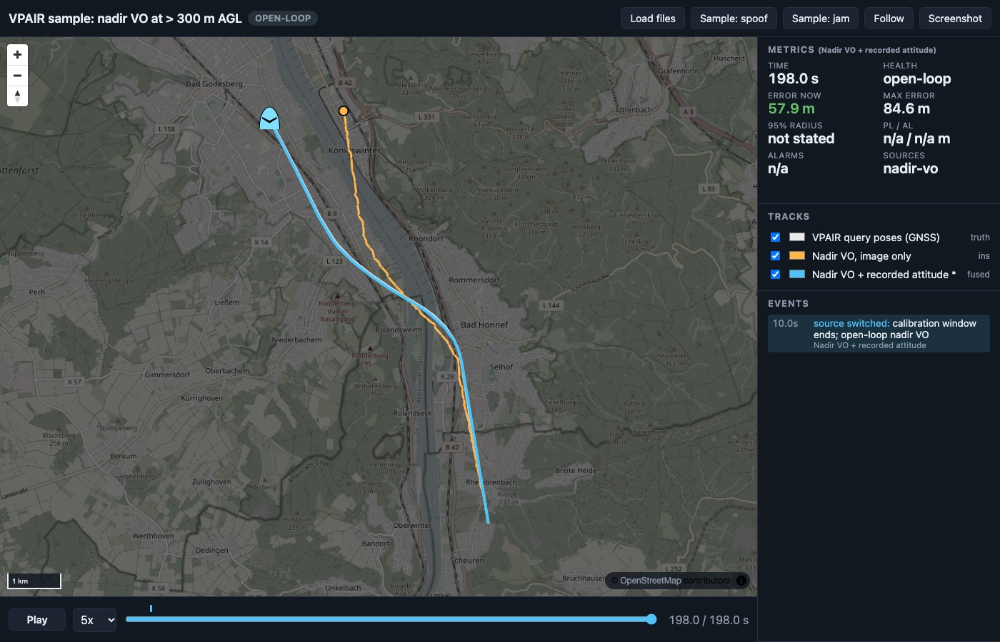

<!-- about: repo:prbonn/kiss-icp, repo:rpng/open_vins, repo:michaelgrupp/evo, res:kitti-odometry-benchmark, res:uzh-fpv-drone-racing-dataset, repo:aervisloc/vpair -->
# Relative navigation benchmark (LiDAR odometry, VIO, VO) on real data

Every GNSS-denied stack carries a relative source between absolute fixes. This sample runs
three of them on public recordings with ground truth, scores them the same way with
[evo](../../catalog/repos/michaelgrupp__evo.md), exports the tracks for
[templates/demo-dashboard](../../templates/demo-dashboard/), and feeds the measured error into
[altpnt-integrity](../altpnt-integrity/) as its relative source.

Everything below was run on 2026-11-06 unless marked otherwise. Numbers are copied from
`results/*.json`, which the scripts write.

## Results

| Part | Method | Data | Path | ATE RMSE (SE3 aligned) | Final error, origin-anchored | Other |
|---|---|---|---|---|---|---|
| 1 LiDAR | [KISS-ICP](../../catalog/repos/prbonn__kiss-icp.md) 1.3.0, default config (100 m range, 1 m voxel, deskew on) | KITTI odometry 04 (raw drive 2011_09_30_drive_0016), 271 scans, 28.1 s | 393.6 m | 0.23 m | 0.48 m = **0.12 %** of distance | KITTI t_rel 0.41 % (100-300 m segments; 04 is too short for 400-800 m), r_rel 0.19 deg/100 m; RPE over 100 m 0.43 % |
| 2 VIO | [OpenVINS](../../catalog/repos/rpng__open_vins.md) v2.7 MSCKF, stereo + IMU, config `uzhfpv_indoor` | UZH-FPV indoor_forward_3 Snapdragon bag; GT covers 49.5 s of the 92 s bag | 278.3 m | 0.36 m | 0.73 m = **0.26 %**; max 1.57 m (0.56 %) | RPE over 10 m 1.5 % |
| 2 VO baseline | OpenCV mono VO (KLT + essential matrix, keyframes at 12 px parallax), **GT step length as scale oracle** | same bag, left camera | 278.0 m | 0.80 m | 1.90 m = 0.68 %; max 1.08 % | RPE over 10 m 1.4 %; not a fair competitor, scale is given |
| 3 Aerial, image only | SIFT + RANSAC 2D similarity frame to frame, rotations chained, constant GSD | VPAIR sample, 199 nadir frames, light aircraft, 360-403 m ellipsoid height (fitted effective AGL 324 m, see below) | 8980 m | 229 m | 1390 m = **15.5 %** | per-step direction error std 15.6 deg |
| 3 Aerial, attitude-aided | same image steps, rotated by recorded yaw, roll/pitch image shift removed | same | 8980 m | 27 m | 58 m = **0.65 %**; max 85 m | +2 deg yaw bias => 3.2 %, +5 deg => 8.1 % |

Aerial calibration: VPAIR ships no intrinsics, AGL or timestamps, so heading, metres per pixel,
mount axes and one effective AGL are fitted on the first 10 steps (454 m) against GT, then the
VO runs open loop for the remaining 8.5 km. The fitted effective AGL is 324 m and the scale
0.42 m/px. The "GSD from image scale" variant (chain the per-pair similarity scale to follow
terrain / altitude) drifted worse, 30.5 %: the chained scale shrinks steps by a median 28 %.

### What the aerial run says about altitude

- Image-only nadir VO at ~320 m AGL is dominated by attitude, not by matching. Matching was
  never the problem: 0 failed pairs, median 727 RANSAC inliers. But roll varies with a 3.6 deg
  std over the run, and a 1 deg roll change moves the image centre AGL x tan(1 deg) = ~5.7 m on
  the ground, against 45 m steps. Per-step direction error std was 15.6 deg image-only and
  0.65 deg attitude-aided.
- With attitude the drift is set by the heading reference. Error grows with distance x sin(yaw
  bias): 2 deg costs about 3.5 % of distance, which matches the measured 3.2 %. At altitude the
  error budget is the AHRS heading, not the camera.
- The attitude used is the recorded 6-DoF pose (GNSS/INS-derived per the VPAIR README), so the
  attitude-aided figure is an idealised AHRS. The yaw-bias rows are the honest range for a
  magnetometer-grade heading.

## altpnt-integrity with a measured relative source

[altpnt-integrity](../altpnt-integrity/) simulates VIO as 1 Hz velocity whose error is
`scale x v + yaw x (v rotated 90 deg) + white`. Its defaults are 0.5 % scale, 0.004 rad yaw and
0.08 m/s white noise, with the filter tuned to match. `integrate/vo_to_altpnt.py` fits those
three numbers from each (GT, estimate) pair. It anchors the estimate on the first 10 % of the path,
as if GNSS was there at the start, carries white noise across platforms as a fraction of speed,
and reruns that sample's monitor with GNSS off (alt-PNT only, AL 50 m, 600 s at 30 m/s, mean of
seeds 1-5). The other sample's code is imported, not modified. Its 15 tests still pass.

| Relative source | Fitted scale / yaw / white | HPE RMS, max (as tuned) | MI epochs (as tuned) | HPE RMS, max (filter retuned) | HPL median, availability (retuned) |
|---|---|---|---|---|---|
| altpnt default model | 0.5 % / 0.004 rad / 0.08 m/s | 16.2 m, 44.3 m | 0 | - | 511 m, 5.0 % |
| KISS-ICP, KITTI 04 | 0.08 % / -0.0023 rad / 0.12 m/s at 14 m/s | 19.5 m, 52.8 m | 0 | 18.6 m, 51.6 m | 519 m, 4.9 % |
| OpenVINS, UZH-FPV | -0.04 % / 0.063 rad / 0.16 m/s at 5.6 m/s | **495 m, 842 m** | **358 of 600** (seed mean) | 16.9 m, 50.1 m | 2726 m, 2.6 % |
| Nadir VO + attitude, VPAIR | -0.6 % / -0.0005 rad / 1.16 m/s at 45 m/s | 40.0 m, 94.8 m | 0 | 17.7 m, 50.8 m | 539 m, 4.2 % |

"Retuned" means the filter's VIO white-noise R and VIO velocity-bias prior are inflated
to 1.25x the fitted error. That is the only change.

How to read it:
- The OpenVINS row is the useful failure. A 3.6 deg heading error fitted from a 50 s indoor loop,
  replayed for 600 s at 30 m/s, is a 1.9 m/s velocity bias. The filter's VIO bias prior is 0.3 m/s.
  HPE grows to 842 m while the median HPL stays at 382 m, so 60 % of epochs are misleading
  information. Which fixes the innovation gate rejected along the way was not inspected. Inflating
  the bias prior brings HPE back to 17 m RMS, but the median HPL becomes 2.7 km and availability
  drops from 5 % to 2.6 %. Integrity numbers mean little until the VIO error model comes from
  data like this.
- Extrapolation caveat: the constant-yaw model turns heading drift, which grows with time, into a
  fixed angle. A 50 s indoor run and a 28 s KITTI run are short. The fits show which way the
  error goes. They do not characterise long flights.
- The OpenVINS yaw comes from positions. Comparing OpenVINS orientation with the GT orientation
  shows the heading difference moving over about 10 deg during the run, origin-anchored. How
  UZH-FPV derives its GT orientation was not checked, so that number is not used.

## Run it

```sh
uv venv --python 3.12 .venv && uv pip install --python .venv/bin/python -r requirements.txt
export PY=$PWD/.venv/bin/python RELNAV_DATA=$PWD/data   # data/ is git-ignored
./run.sh lidar       # KITTI 04: downloads 1.13 GB, 12-20 s compute
./run.sh vio         # UZH-FPV: downloads 1.61 GB, builds the OpenVINS image once (~20 min), runs it + mono VO
./run.sh aerial      # VPAIR sample: downloads 0.86 GB, ~30 s compute
./run.sh integrate   # altpnt-integrity rerun with the fitted error models, ~10 s
$PY -m unittest test_relnav_benchmark
KITTI_SEQS="04 07" ./run.sh lidar   # optional, adds the 4.42 GB seq 07 drive (not run here)
```

Dashboard (serve the repo root so the page can reach `samples/`):

```sh
python3 -m http.server 8000      # from the repo root
# http://localhost:8000/templates/demo-dashboard/?manifest=../../samples/relative-nav-benchmark/results/navdash/vpair/manifest.json
#   ... /navdash/kitti04/manifest.json, /navdash/uzhfpv_indoor_forward_3/manifest.json
```



Headless Chrome capture of `navdash/vpair` at the last frame. Blue is attitude-aided nadir VO, 58 m
off after 9 km. Orange is image-only, 1.4 km off. The white truth sits under blue. Other captures:
[KITTI 04](results/screenshots/kitti04.jpg), [UZH-FPV](results/screenshots/uzhfpv_indoor_forward_3.jpg)
(the indoor loop drawn on a placeholder origin; the street map under it means nothing).

### navdash/1 export notes

- KITTI 04: truth is the OXTS GPS/INS lat/lon. KISS-ICP is placed at the first OXTS pose and its
  IMU-frame position is exported, so both start at the same point. No later fixes.
- UZH-FPV is indoors with no geodetic frame. Tracks sit on an arbitrary placeholder origin
  (47.397 N, 8.549 E), in the GT frame's x/y as east/north. OpenVINS is origin-anchored at the
  first GT pose, not SE3-aligned, so the drift shows.
- VPAIR has no timestamps. `t` is the frame index, 1 s per frame, said in the header `run_meta`.
  The calibration window is `health: calibrating`, and a `source_switched` event marks the start of open loop.
- No `r95_m` / `pl_m`: none of these odometries reports a calibrated covariance here, so the
  panel reads "not stated", as it should.

## Cost

| Part | Data downloaded | Wall | CPU | Notes |
|---|---|---|---|---|
| 1 KISS-ICP | 1.13 GB zip (`2011_09_30_drive_0016_sync`), + calib 4 KB + odometry poses 1.3 MB | 12.3 s and 19.7 s for 271 scans in two runs (22 and 14 fps; host shared with other jobs) | 22.1-22.6 s, peak RSS 159-167 MB | M2 Max native, 125,717 points per scan |
| 2 OpenVINS build | `ros:noetic-perception` base + apt + catkin | ~20 min (apt 145 s, catkin build 754 s with `-j2`, export 232 s) | - | image 1.7 GB, arm64 |
| 2 OpenVINS run | 1.61 GB bag | 28.7 s and 81.0 s for the 92 s bag in two runs (other jobs were sharing the host in the second); same ATE to 1 mm | user 18.7 / 29.3 s, sys 5.2 / 9.5 s | colima VM, 4 vCPU, 7.7 GB; `docker cp` of the bag adds ~10 s |
| 2 mono VO + eval | same bag | 9.6 s VO (bag decode excluded) | 15.8 s, peak RSS 940 MB (all 2552 frames held in memory) | 730 keyframes |
| 3 nadir VO | 0.86 GB zip (queries 175 MB, reference renders 553 MB, distractors 185 MB unzipped) | 28 s | 99 s (SIFT on 800x600) | 198 pairs |
| 4 integrate | - | ~10 s | - | 4 sources x 5 seeds x 3 tunings |

Download rate seen here: 1-2 MB/s per file from S3 (KITTI), UZH and Zenodo. Zenodo stalled
once for more than 2 minutes, so `fetch_data.sh` resumes with `curl -C -`.

## Licences

| Item | Licence | Source |
|---|---|---|
| KITTI raw / odometry | CC BY-NC-SA 3.0 | [dataset card](../../docs/dataset-cards/kitti.md) |
| UZH-FPV | CC BY-NC-SA 3.0 (data) | [dataset card](../../docs/dataset-cards/uzh-fpv.md) |
| VPAIR | README: academic use only, commercial use prohibited. The Zenodo sample record is tagged CC-BY-4.0. Follow the stricter one | [dataset card](../../docs/dataset-cards/vpair.md) |
| KISS-ICP | MIT | GitHub API |
| OpenVINS | GPL-3.0 | GitHub API |
| evo | GPL-3.0 | GitHub API |
| rosbags | Apache-2.0 | package metadata |

All three datasets are non-commercial. Fine for a hackathon demo, not for a product. evo and
OpenVINS are GPL. Keep them as separate tools, not linked into shipped code.

## Not run, and why

- **EuRoC MH_01** (the brief's first choice): the old `robotics.ethz.ch/~asl-datasets` URL did not
  connect, and the ETH Research Collection answered HTTP 429. MH_01 only ships inside
  `machine_hall.zip` (12.68 GB per the [card](../../docs/dataset-cards/euroc-mav.md)). UZH-FPV
  was used instead. OpenVINS has a `euroc_mav` config if the data turns up.
- **ORB-SLAM3, cuVSLAM, DPVO**: not attempted. DPVO and cuVSLAM need CUDA, and there is no NVIDIA
  GPU here. One working VIO was the goal and OpenVINS was it. ORB-SLAM3 in Docker is the obvious
  next comparison on the same bag.
- **KITTI 07** (urban loop, 4.42 GB): the download ran at about 1 MB/s and had reached 2.5 GB
  after 40 min, so it was stopped. `KITTI_SEQS="04 07" ./run.sh lidar` handles it (mapping and
  `--seq` are in place, but the 07 path itself was never run). Seq 04 is a short, almost straight
  road, an easy case for lidar odometry. Treat 0.12 % as a best case.
- **TartanAir, UAV-VisLoc**: VPAIR covered the aerial nadir case with consecutive frames and
  attitude in 0.86 GB. UAV-VisLoc is sparse stills without attitude. TartanAir is synthetic and
  not nadir.

## Gotchas met

- **colima shares only `$HOME` with containers.** A bind mount from `/private/tmp` showed up empty,
  and OpenVINS failed with `BagIOException`. `run_openvins.sh` uses `docker cp` in and out.
- **OpenVINS ROS 1 serial mode aborts at exit** with `class_loader::LibraryUnloadException`
  (`libcompressed_depth_image_transport.so`). It happens after the last state is written: the
  estimate ends at 4970.84 s and the bag at 4970.89 s. Harmless, but the exit code is non-zero.
- **OpenVINS state file**: `save_total_state` writes `t, q(JPL q_GtoI), p, v, ...`. JPL `q_GtoI`
  has the same x, y, z, w numbers as the Hamilton `q_ItoG` that TUM expects. The upstream
  `Dockerfile_ros1_20_04` is `osrf/ros:noetic-desktop-full` plus an sshd/CLion layer. The slim
  `vio/Dockerfile.openvins` builds only `ov_core ov_init ov_msckf`.
- **KITTI GT frames**: odometry poses are in the rectified cam0 frame. KISS-ICP runs in the
  velodyne frame. The script conjugates with `T_cam0_velo` (`inv(Tr) P Tr`). Against OXTS the
  numbers agree to within 2 cm, which is a useful cross-check.
- **evo's Umeyama alignment fails on a perfectly straight synthetic line** (degenerate covariance).
  The unit test uses a wiggly path.
- **UZH-FPV GT has no geodetic frame**, and it covers only 49.5 s of the 92 s bag. OpenVINS needs
  ~9.5 s to initialise. Metrics use the overlap.

## Files

| Path | What |
|---|---|
| `run.sh`, `fetch_data.sh` | one command per part; downloads with resume |
| `common.py` | TUM IO, evo metrics (SE3 ATE, origin-anchored drift, RPE), KITTI segment errors, navdash/1 writer |
| `lidar/run_kiss_icp_kitti.py` | part 1 |
| `vio/Dockerfile.openvins`, `vio/run_openvins.sh` | OpenVINS v2.7 build and serial run |
| `vio/mono_vo.py`, `vio/eval_uzhfpv.py` | mono VO baseline, bag GT extraction, OpenVINS conversion, scoring |
| `aerial/run_nadir_vo.py` | part 3 |
| `integrate/vo_to_altpnt.py` | part 4 |
| `results/` | TUM trajectories, `*_result.json`, `altpnt_from_vo.json`, `navdash/*/manifest.json` + JSONL, screenshots |
| `test_relnav_benchmark.py` | 5 unit tests on metrics, error-model fit and navdash export |
