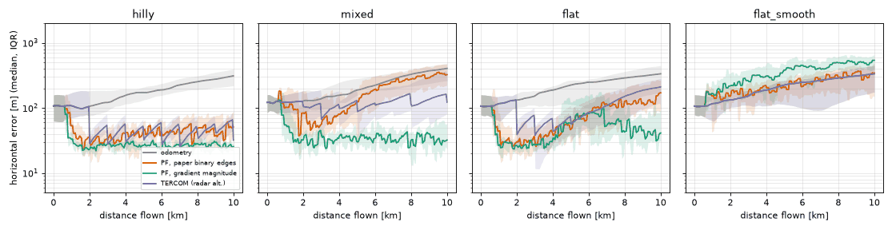
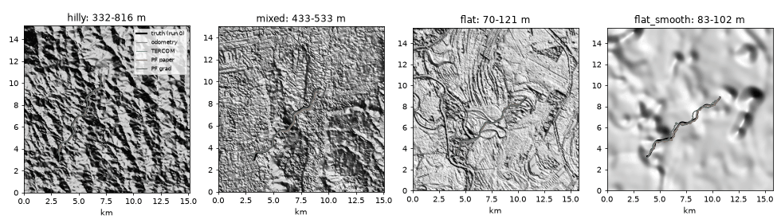
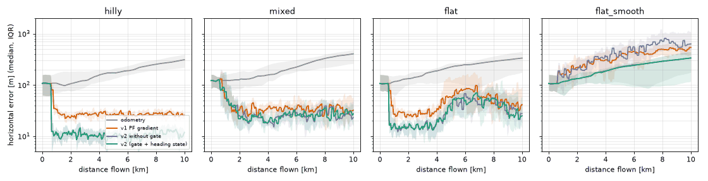
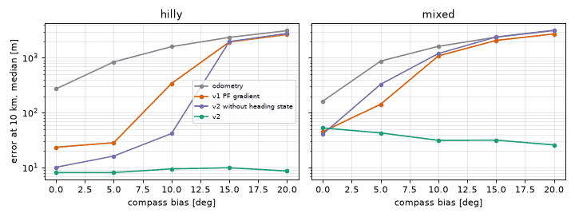
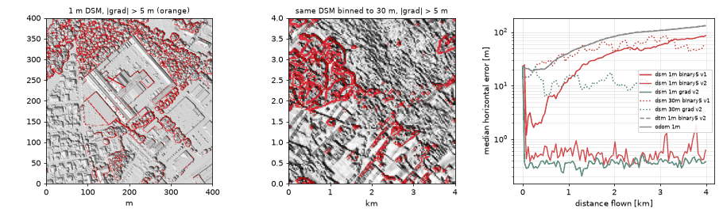
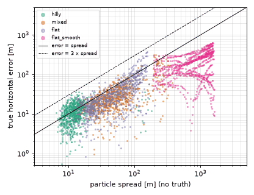

# Heightmap-gradient particle filter on real DEM (SPRIN-D CTU method) vs TERCOM

## Goal

The CTU MRS team won the SPRIN-D Fully Autonomous Flight challenge (9 km course, below
25 m AGL, no GNSS) with a localization module that matches gradients of a local LiDAR
heightmap against a prior elevation map and fuses the similarity with odometry in a
clustered particle filter ([arXiv 2510.01348](https://arxiv.org/abs/2510.01348), digest:
[ctu-sprind-terrain-nav](../../docs/paper-digests/ctu-sprind-terrain-nav.md)). They
published no code. This sample re-implements that pipeline as closely as the paper
allows, runs it on real Copernicus GLO-30 terrain with simulated flights, and compares
it against a classic radar-altimeter TERCOM baseline on the same flights.

Everything about the vehicle is simulated: truth trajectory, odometry drift, the local
heightmap sensor, the radar altimeter. The terrain is real.

v1 (sections up to Findings) is the paper re-implementation; its numbers are unchanged
and still reproduce exactly. [v2](#v2-information-gate-heading-state-confidence-1-m-lidar)
adds an information gate, compass bias as a particle state, a no-truth confidence output,
and a test on real 1 m airborne LiDAR.

## What the paper specifies and what this sample does

| Paper (Sec. III) | Here | Faithful? |
|---|---|---|
| Prior map: north-aligned heightmap, max height per 1 m bin, from LiDAR point clouds turned into height above ground with LAStools | Copernicus GLO-30 DSM reprojected to UTM at 30 m. Optional `prep="ndsm"`: DSM minus a 150 m morphological opening as a crude height-above-ground | Deviation: 30x coarser grid, radar DSM not LiDAR |
| Local heightmap from the onboard occupancy map, 30-60 m square, compass-rotated to north | Simulated noisy local DEM patch, 41x41 cells (1.23 km), only cells within a 600 m swath of the last 1.23 km of track are observed, rotated by the simulated compass error | Same structure, scaled to the 30 m grid |
| Gradients, binarized at abs > 5 m (strong edges = buildings, trees) | `feature="binary", grad_thr=5` (m per cell, central differences) => variant `pf_paper` | Faithful in form; at 30 m the 5 m threshold means a 9.5 deg slope, not a building edge |
| - | `feature="grad"`: continuous gradient magnitude => variant `pf_grad` | Deviation, added because binary edges fail at 30 m (see results) |
| Template matching with Eq. (1), non-normalized correlation coefficient (TM_CCOEFF) | `core.match_ccoeff` via FFT, checked against a direct loop over Eq. (1) incl. the patch-mean term; masked cells excluded | Faithful |
| Gaussian blur on the similarity map | `blur_cells=1` | Faithful (sigma not stated in paper) |
| Translational PF, heading from compass; particles shifted by odometry | `core.HeightmapPF`, state (east, north) only | Faithful |
| Weight = normalized similarity at particle; resample after every 10 m of odometry; jitter from empirical odometry covariance | Min-max normalized similarity, systematic resampling every 150 m (5 cells), jitter sigma = max(3 m, k * distance moved) with k = 0.05 (`pf_paper`) or 0.1 (`pf_grad`) | Paper-normalization not specified; `pf_grad` also raises weights to the power 3 (deviation) |
| K-means, centroid of largest cluster as estimate | `kmeans2`, k = 4 | k not stated in paper |
| Particle count, blur sigma, k, normalization | 2000, 1 cell, 4, min-max | Not stated in paper - our choices |

Not reproduced: VIO itself, LiDAR occupancy mapping, the waypoint planner, the 1 m
grid, building/tree edges (GLO-30 does not resolve single buildings), and compass bias
correction (the paper says its system corrected up to 30 deg compass bias when features
were present; this PF does not estimate heading at all).

## Simulation model (`sim.py`)

- Terrain: three 15 x 15 km GLO-30 windows (`fetch_dem.py`), see table below. The
  "world" the sensors see is the DEM plus correlated error (sigma 2 m, 60 m correlation),
  so the reference map is not the truth.
- Flight: 10 km at 20 m/s, 1 Hz, weaving path (two sinusoidal heading terms, +-55 deg).
- Odometry (VIO-like, compass-aligned): per-run scale error N(0, 2%), compass bias
  N(0, 3 deg) plus 0.05 deg/sqrt(s) random walk, 0.3 m/s white velocity noise. The same
  compass error rotates the local heightmap. Initial position guess error N(0, 100 m).
- Local heightmap sensor (stand-in for downward stereo/LiDAR/SfM): sampled at
  `obs_res_m` (30 m), white height noise 2 m, horizontal and vertical scale error 1%,
  random vertical offset N(0, 50 m) (gradients ignore it), 5% cell dropout, swath mask.
- Radar altimeter TERCOM: terrain height = baro (bias N(0, 20 m), noise 0.5 m) minus
  radar AGL (noise 1 m). Every 1 km, a 2 km profile is matched by mean-removed MAD over a
  +-600 m, 15 m grid of translations; the fix is accepted only if the best MAD is below
  0.9x the best MAD more than 3 cells away and not on the search border.

## Files

| File | What |
|---|---|
| `fetch_dem.py` | Reads only the needed windows of the public GLO-30 COGs over HTTPS (no login), reprojects to UTM 30 m, caches `data/*.npz` (~0.8 MB each, git-ignored) |
| `core.py` | Bilinear lookup, nDSM, gradient features, Eq. (1) matcher (FFT + reference loop), similarity map, systematic resampling, K-means estimate, `HeightmapPF`, `tercom_fix` |
| `sim.py` | World, trajectory, odometry, heightmap sensor, radar altimeter, one Monte Carlo run |
| `run_eval.py` | 20 runs per region x 3 navigators, convergence test, sensor-error sweep, plots, `out/results.json` |
| `test_core.py` | 14 unit tests of the core math |
| `nav2.py` | v2 navigator: NCC likelihood, CRB information gate, heading-state PF loop, per-update confidence record |
| `run_eval_v2.py` | v2 on the four GLO-30 regions (same flights), compass bias 0-20 deg test, confidence vs error, `out/v2_*` |
| `fetch_lidar.py` | Downloads 32 Geobasis NRW 1 m DOM1/DGM1 tiles (~80 MB, dl-de/zero-2.0) and mosaics `data/duelmen.npz` |
| `run_lidar.py` | 1 m vs 30 m reference, binary edges vs gradient magnitude, v1 vs v2 filter, `out/lidar*` |
| `test_v2.py` | 8 tests: NCC vs loop, rotation sign, CRB singular cases, ESS tempering, heading predict, 20 deg bias recovery, gate falls back to odometry |
| `out/` | v1: `results.json`, `eval_output.txt`, `error_vs_distance.png`, `tracks.png`; v2: `v2_results.json`, `v2_output.txt`, `v2_errors.png`, `v2_bias.png`, `v2_confidence.png`, `lidar_results.json`, `lidar_output.txt`, `lidar.png` |

## Run

```bash
python3 -m venv .venv && .venv/bin/pip install -r requirements.txt
.venv/bin/python fetch_dem.py          # ~25 s, three windows
.venv/bin/python -m pytest -q test_core.py
.venv/bin/python run_eval.py           # ~105 s on an M2 Max; --no-sweep to skip the sweep
# v2
.venv/bin/python -m pytest -q test_v2.py   # ~10 s
# or both files via unittest: .venv/bin/python -m unittest discover (22 tests;
# plain python3 without the venv skips them all, which is what CI runs)
.venv/bin/python run_eval_v2.py        # ~6 min; checks v1 pf_grad against out/results.json
.venv/bin/python fetch_lidar.py        # ~100 s, 80 MB of NRW tiles into data/nrw_tiles/
.venv/bin/python run_lidar.py          # ~3 min
```

## Results (ran 2026-11-06, CPython 3.13.15, Apple M2 Max, single Python process)

Seeds: PF knobs for `pf_grad` (weight power 3, jitter 0.1) were picked on seeds 100-111;
the tables use seeds 0-19 (main) and 200-211 (sweep). Two full runs gave identical error
numbers; timings vary by tens of percent with machine load.

Terrain windows (from `terrain_stats`; local relief = std of DEM minus a 1 km low-pass):

| region | where | height range | local relief std | cells with gradient > 2 m/cell |
|---|---|---|---|---|
| hilly | Bavarian Forest foothills near Grafenau, DE | 332-816 m | 37.8 m | 88% |
| mixed | Erding, DE (the SPRIN-D area): town, airbase, forest patches | 433-533 m | 4.5 m | 10% |
| flat | Great Hungarian Plain, HU: farmland, villages, tree belts, river | 70-121 m | 3.0 m | 8% |
| flat_smooth | control: `flat` blurred with a 300 m Gaussian, i.e. bare gently rolling farmland | 83-102 m | 1.3 m | 0% |



Horizontal error, median / 90th percentile over 20 runs, in metres:

| region | navigator | @1 km | @2 km | @5 km | @10 km | RMSE (median) |
|---|---|---|---|---|---|---|
| hilly | odometry | 108/197 | 105/218 | 173/303 | 311/462 | 193 |
| hilly | PF paper (binary edges) | 53/114 | 36/81 | 45/79 | 51/119 | 58 |
| hilly | PF gradient magnitude | 33/54 | 23/31 | 27/39 | 26/37 | 41 |
| hilly | TERCOM | 108/197 | 32/64 | 33/46 | 32/53 | 74 |
| mixed | odometry | 122/177 | 127/213 | 188/308 | 404/643 | 240 |
| mixed | PF paper | 101/223 | 84/282 | 121/275 | 324/525 | 201 |
| mixed | PF gradient magnitude | 55/194 | 32/76 | 30/45 | 32/84 | 63 |
| mixed | TERCOM | 122/177 | 105/217 | 87/235 | 123/385 | 143 |
| flat | odometry | 116/242 | 132/269 | 224/299 | 334/557 | 236 |
| flat | PF paper | 44/227 | 30/122 | 47/97 | 171/319 | 108 |
| flat | PF gradient magnitude | 27/136 | 26/37 | 58/182 | 41/156 | 84 |
| flat | TERCOM | 116/242 | 42/103 | 56/134 | 210/342 | 123 |
| flat_smooth | odometry | 116/242 | 132/269 | 224/299 | 334/557 | 236 |
| flat_smooth | PF paper | 154/275 | 152/230 | 207/288 | 344/547 | 265 |
| flat_smooth | PF gradient magnitude | 166/337 | 218/476 | 381/647 | 539/808 | 387 |
| flat_smooth | TERCOM | 116/242 | 132/269 | 224/299 | 334/557 | 236 |

TERCOM fix acceptance rate: 99% hilly, 34% mixed, 33% flat, 0% flat_smooth.

### Convergence from a 300 m initial offset

Initial guess 300 m off in a random direction (plus the N(0, 100 m) draw), particle
cloud sigma 250 m. "Converged" = error stays below 75 m for the rest of the 10 km
flight; distance is the median over converged runs.

| region | PF paper | PF gradient magnitude | TERCOM |
|---|---|---|---|
| hilly | 75% runs, 3020 m (151 s) | 100%, 700 m (35 s) | 100%, 6000 m |
| mixed | 10%, 7260 m | 85%, 6540 m | 30%, 9000 m |
| flat | 25%, 8940 m | 75%, 8140 m | 25%, 10000 m |
| flat_smooth | 0% | 0% | 0% |

The "stays below 75 m" rule is strict: in mixed terrain `pf_grad` is at 35 m median by
2 km, but late excursions above 75 m in some runs push the converged distance out.
Medians at 2 km are in `out/eval_output.txt`.

### Sensor-error sweep (mixed region, `pf_grad`, 12 runs each, one parameter at a time)

| parameter | values => err@10 km median (p90) | odometry @10 km |
|---|---|---|
| height noise sigma | 0.5 m => 35 (151); 2 m => 56 (105); 5 m => 126 (224); 10 m => 266 (653) | 382 |
| horizontal+vertical scale error | 0 => 46 (92); 2% => 32 (125); 5% => 43 (95); 10% => 53 (131) | 382 |
| compass bias sigma | 0 => 45 (103); 3 deg => 56 (105); 10 deg => 83 (1463); 20 deg => 373 (3924) | 162 / 382 / 699 / 1332 |
| native heightmap resolution | 30 m => 56 (105); 60 m => 45 (120); 120 m => 91 (220) | 382 |
| patch size | 21 cells => 49 (203); 41 => 56 (105); 61 => 52 (136) | 382 |
| swath width | 300 m => 73 (144); 600 m => 56 (105); 1200 m => 35 (75) | 382 |

### Compute time per update (measured)

| step | median | p95 |
|---|---|---|
| PF update: template features + Eq. (1) over the search box + blur + weights + resample + K-means, 2000 particles, 41x41 template | 1.1 ms | 1.5-2.4 ms |
| TERCOM fix: 4489 candidate offsets x 100 profile samples | 20 ms | 29-41 ms |

Apple M2 Max, one Python process, numpy 2.5.4 / scipy 1.18.1, other agents' jobs
running on the same machine. The paper reports real-time on an Intel NUC i7 CPU but no
per-update timing.



## Findings

1. **Binary edges at 5 m do not transfer to a 30 m DEM.** `pf_paper` beats odometry in
   hilly terrain (51 vs 311 m at 10 km) but only marginally in mixed (324 vs 404 m).
   On tuning seeds 100-111, cutting heightmap noise and DEM error from 2 m to 0.3 m (no
   scale error) brought binary edges in hilly terrain to 55 m median final error with the
   paper's linear weights and 25 m with weight power 3, so the main failure is noise
   flipping cells across the threshold, not the PF. The paper's threshold works because at 1 m bins a building or
   tree edge is a 5-20 m step, far above LiDAR noise. On a 30 m grid, continuous gradient
   magnitude is the robust choice (26-41 m at 10 km in the three real regions).
2. **Gradient PF beats TERCOM where relief is low.** In hilly terrain both bound the error
   (26 vs 32 m median at 10 km). At Erding, TERCOM accepts a third of its fixes and ends at
   123 m median; the gradient PF stays at 32 m because a 2D patch carries more structure
   than a 1D profile.
3. **"Flat" real DSM is not featureless.** The Hungarian plain window has villages, tree
   belts and a river in GLO-30 (a radar DSM), and both methods still help there. Failure
   only appears once that is blurred away (`flat_smooth`).
4. **On truly flat terrain the PF fails worse than odometry; TERCOM fails safe.**
   `pf_grad` on `flat_smooth` reaches 539 m median at 10 km vs 334 m for raw odometry:
   min-max normalization stretches pure noise into a confident similarity map. TERCOM's
   ambiguity gate rejected every fix and left odometry untouched. A PF port needs an
   equivalent gate (e.g. skip updates when the similarity peak is not distinct, or use an
   absolute rather than min-max normalization). The paper notes the same regime
   qualitatively: "In open field areas, the system mostly relied on the odometry".
   Done in v2, see below.
5. **Compass bias is the weak spot.** Above ~10 deg the translational PF diverges in some
   runs (p90 1.5 km at 10 deg) because the patch is rotated and the drift outruns the
   jitter. Adding heading to the state or a small rotation search in the matcher is the
   obvious next step. Done in v2, see below.
6. **Wider swath helps more than a bigger patch.** 1200 m swath => 35 m at 10 km vs 73 m
   at 300 m; patch size 21-61 cells moves the median little once the swath is fixed,
   though 21 cells doubles the p90 (203 vs 105 m).
7. **Cheap.** About 1 ms per PF update on a laptop CPU, 20x cheaper than the brute-force
   TERCOM search used here.

Eq. (1) is unnormalized: a high-contrast region outscores an exact but low-contrast
match (`test_ccoeff_is_not_normalized_so_high_contrast_wins`). The paper argues the
binary maps are already normalized; with continuous gradients this bias is real and is
one reason for the weight power and blur.

## v2: information gate, heading state, confidence, 1 m LiDAR

Ran 2026-11-06, same machine and package versions as v1. `run_eval_v2.py` flies the
identical v1 flights (same seeds, same RNG draw order) and re-runs v1 `pf_grad` as a
control: it reproduced `out/results.json` exactly in all four regions. Two `run_lidar.py`
runs gave identical error numbers. Full tables: `out/v2_output.txt`, `out/lidar_output.txt`.

### What changed (`core.py` v2 block, `nav2.py`)

| Piece | v1 | v2 |
|---|---|---|
| Similarity => weight | Eq. (1) CCOEFF, min-max to [0, 1], power 3 | Masked NCC rho; gain-fitted Gaussian residual E_T (1 - rho+^2); noise variance self-calibrated from the best residual of this update; log-lik = -(n / 2 kappa) (res / res_min - 1), kappa = 9 cells per independent residual; Gaussian blur 1 cell; tempered so ESS >= 10% |
| Information gate | none | Cramer-Rao bound of the template position from the reference map window at the current estimate: J = (n / kappa) SNR sum grad I grad I^T / E_I, with SNR = (rho^2 - rho0^2) / (1 - rho^2) and rho0 = 0.3 x the NCC maximum pure noise reaches over the search box (extreme-value approximation). Update skipped when the worst-axis CRB std > 2 cells |
| Between updates | estimate = K-means centroid, moved by odometry | same, but the estimate is only re-centred on the particles when an update was applied, so a gated filter is dead reckoning with the mean bias |
| Heading | compass taken as truth | particle state (east, north, compass bias); prior N(0, 10 deg) clipped to +-36 deg, 0.3 deg random walk per update; odometry rotated per particle; one NCC map per 3 deg heading bin spanning the particles' bias range, template rotated per bin, linear interpolation between bins |
| Process noise | jitter only after resampling | jitter every update cycle whether applied or not, so the spread keeps growing honestly while gated |

Why NCC and not Eq. (1): with continuous gradients, the gradient magnitude of a noisy patch
is inflated by rectified noise, so a residual-based likelihood needs a free gain, and the
gain-fitted residual is a function of NCC only. In a single-update check on mixed terrain
a first try with plain SSD on the same features put the best match about 510 m off,
where CCOEFF was 41 m off.

Gate thresholds were picked on tuning seeds 100-111. Without the noise-only correction
(rho0 = 0) and with a 3-cell gate, 4% of `flat_smooth` updates got through and those few
took the filter to 468 m median at 10 km vs 328 m for odometry. The CRB alone is
gain-invariant, so it cannot see that a map is nearly flat in absolute terms: on the
0.01 m-amplitude synthetic map in `test_v2.py` it let updates through until rho0 was
added. With rho0 = 0.3 x noise maximum and a 2-cell gate, `flat_smooth` was gated in every
tuning run while mixed and flat kept 93% and 73% of updates.



### 1. Information gate: never worse than odometry on flat terrain

Horizontal error, median / p90 over 20 runs (seeds 0-19), metres:

| region | navigator | @1 km | @2 km | @5 km | @10 km | RMSE med | updates applied | ms/update med |
|---|---|---|---|---|---|---|---|---|
| hilly | odometry | 108/197 | 105/218 | 173/303 | 311/462 | 193 | - | - |
| hilly | v1 PF gradient | 33/54 | 23/31 | 27/39 | 26/37 | 41 | all | 1.1 |
| hilly | v2 | 12/15 | 12/14 | 10/20 | 12/14 | 29 | 100% | 3.3 |
| mixed | odometry | 122/177 | 127/213 | 188/308 | 404/643 | 240 | - | - |
| mixed | v1 PF gradient | 55/194 | 32/76 | 30/45 | 32/84 | 63 | all | 1.1 |
| mixed | v2 | 73/241 | 22/100 | 25/40 | 27/59 | 59 | 93% | 5.0 |
| mixed | v2, gate off | 73/241 | 25/99 | 24/39 | 23/64 | 53 | 100% | 5.0 |
| flat | odometry | 116/242 | 132/269 | 224/299 | 334/557 | 236 | - | - |
| flat | v1 PF gradient | 27/136 | 26/37 | 58/182 | 41/156 | 84 | all | 1.1 |
| flat | v2 | 18/45 | 15/24 | 32/72 | 25/130 | 56 | 73% | 4.1 |
| flat | v2, gate off | 17/31 | 15/24 | 44/72 | 28/162 | 57 | 100% | 4.6 |
| flat_smooth | odometry | 116/242 | 132/269 | 224/299 | 334/557 | 236 | - | - |
| flat_smooth | v1 PF gradient | 166/337 | 218/476 | 381/647 | 539/808 | 387 | all | 1.1 |
| flat_smooth | v2 | 116/242 | 132/269 | 220/299 | 336/557 | 229 | 0.08% (1 of ~1300) | 51 |
| flat_smooth | v2, gate off | 142/311 | 197/388 | 454/963 | 632/1373 | 511 | 100% | 49 |

- On `flat_smooth` the gate closed on all but one update in 20 runs. Per run, the largest
  gap between the v2 error and the odometry error over the whole flight was 1.8 m
  (median); those few metres come from the mean of the heading particles not being
  exactly zero. The one applied update (seed 1, CRB 54 m) pulled that run from 222 m
  to 14 m at 10 km. `out/v2_output.txt` counts 45% of `flat_smooth` runs as "worse than
  odometry" at 10 km; those are the metre-level differences above, not divergence.
- Without the gate, the NCC likelihood fails the same way v1 did (632 m vs 334 m): the
  self-calibrated noise makes the likelihood flat on flat terrain, but not flat enough.
- The gate costs little where terrain is informative (mixed 27 vs 23 m with the gate off).
  On tuning seeds, before the rho0 correction, the worst-axis CRB median was 6 m hilly,
  24 m mixed, 27 m flat and 250 m `flat_smooth`.
- On `flat_smooth` the update costs 51 ms because the search box grows to its 2 km cap and
  every heading bin is matched before the gate decides. Gating on the mean heading first
  would cut that; not done.

### 2. Compass bias as a particle state, 0-20 deg

Fixed compass bias (no random part, 0.05 deg/sqrt(s) random walk still on), 12 runs each,
seeds 200-211; error at 10 km, median / p90, metres:

| region | bias | odometry | v1 PF gradient | v2, heading state off | v2 | v2 bias error at 10 km, median abs |
|---|---|---|---|---|---|---|
| hilly | 0 deg | 271 | 24/35 | 10/16 | 8/19 | 1.8 deg |
| hilly | 5 deg | 841 | 28/58 | 16/25 | 8/15 | 0.7 deg |
| hilly | 10 deg | 1594 | 340/707 | 42/64 | 9/16 | 0.3 deg |
| hilly | 15 deg | 2354 | 1938/2247 | 1971/2275 | 10/16 | 0.6 deg |
| hilly | 20 deg | 3112 | 2649/2967 | 2776/3294 | 9/15 | 0.7 deg |
| mixed | 0 deg | 162 | 45/103 | 41/79 | 53/223 | 2.0 deg |
| mixed | 5 deg | 870 | 142/378 | 329/629 | 43/76 | 0.6 deg |
| mixed | 10 deg | 1614 | 1081/1866 | 1194/1429 | 31/102 | 0.4 deg |
| mixed | 15 deg | 2375 | 2070/2637 | 2389/2605 | 32/64 | 0.5 deg |
| mixed | 20 deg | 3131 | 2715/3129 | 3163/3339 | 26/73 | 0.3 deg |



The translational filters (v1, and v2 with the heading state off) lose lock above about
10 deg because the drift per update (150 m x sin(bias)) outruns the jitter and the patch
is rotated against the map. With heading in the state, v2 stays at 8-10 m (hilly) and
26-53 m (mixed) across 0-20 deg and estimates the bias to within 0.3-2 deg. The cost: at
0 deg bias in mixed terrain, the heading state widens the early cloud (prior 10 deg) and
the p90 is 223 m, vs 103 m for v1 and 79 m with the heading state off. The paper reports its system corrected compass bias up
to 30 deg when features were present; it does not say how. 20 deg is the largest bias
tested here; the prior is clipped at 36 deg.

### 3. Real 1 m airborne LiDAR: binary edges vs gradients, 1 m vs 30 m

Data: Geobasis NRW open data, DOM1 (1 m surface model, first-return LiDAR incl.
buildings and trees) and DGM1 (1 m terrain model), 4 x 4 km around Duelmen,
Muensterland (ETRS89 / UTM 32N, E 379-383 km, N 5741-5745 km): small town, farmland with
hedgerows, forest. DSM 45-136 m, DTM 40-93 m. The metadata rows checked are dated March
2024. Licence: Datenlizenz Deutschland - Zero - Version 2.0, per the Bezirksregierung
Koeln open data terms PDF (read 2026-11-06). Bavaria's DGM1 is also downloadable
without login (`download1.bayernwolke.de/a/dgm/dgm1/<E>_<N>.tif` answered) but it is
terrain only; the paper's edges are buildings and trees, so NRW's surface model was used.

Simulation: 4 km wobbly loop at 10 m/s around the area centre, compass bias N(0, 3 deg),
odometry as in v1. 1 m config follows the paper: local map 51 x 51 m (paper: 30-60 m),
50 m swath, update every 10 m, LiDAR noise 0.3 m, map-vs-world error 0.3 m correlated,
initial sigma 15 m. 30 m config: the same DSM block-averaged to 30 m for both the map and
the onboard local map, local map 21 x 21 cells (630 m, a 51 m patch is under 2 cells),
update every 150 m. "binary5" = the paper's literal |gradient| > 5 m per cell (central
differences); "v1" filter = paper normalization (min-max, power 1 for binary, 3 for
gradient); "v2" = section 1-2 filter. 10 runs per config, seeds 300-309.

| map | ref. resolution | feature | filter | final error med/p90 [m] | RMSE med [m] | odometry final med [m] | updates applied | ms/update |
|---|---|---|---|---|---|---|---|---|
| DSM | 1 m | binary5 (paper) | v1 | 85.7/227.8 | 48.3 | 131 | all | 1.2 |
| DSM | 1 m | binary5 (paper) | v2 | 0.6/2.0 | 3.2 | 131 | 65% | 4.1 |
| DSM | 1 m | gradient | v1 | 1.8/3.2 | 3.2 | 131 | all | 1.2 |
| DSM | 1 m | gradient | v2 | 0.4/1.7 | 2.2 | 131 | 97% | 4.6 |
| DSM | 30 m | binary5 (paper) | v1 | 57.2/141.5 | 61.5 | 137 | all | 1.0 |
| DSM | 30 m | binary5 (paper) | v2 | 19.9/113.0 | 26.9 | 137 | 56% | 2.7 |
| DSM | 30 m | gradient | v1 | 37.3/51.1 | 30.4 | 137 | all | 1.0 |
| DSM | 30 m | gradient | v2 | 13.9/19.4 | 13.7 | 137 | 100% | 2.8 |
| DTM | 1 m | binary5 (paper) | v1 | 131.8/262.2 | 85.6 | 131 | all | 1.5 |
| DTM | 1 m | binary5 (paper) | v2 | 132.8/253.0 | 84.8 | 131 | 0% | 0.4 |
| DTM | 1 m | gradient | v1 | 23.0/234.7 | 14.2 | 131 | all | 1.3 |
| DTM | 1 m | gradient | v2 | 6.5/38.6 | 7.2 | 131 | 88% | 6.9 |

Cells above the 5 m threshold: 5.7% of the 1 m DSM (building and tree outlines), 13.1% of
the 30 m DSM (mostly forest edges and slopes of block means), 0.0% of the 1 m DTM.



- **The paper's binary edges work at 1 m on a LiDAR surface model**: 0.6 m median final
  error after 4 km with the v2 filter, vs 131 m for odometry. That confirms the v1
  explanation: at 1 m a building or tree edge is far above the 0.3 m noise, at 30 m it is
  not (19.9 m median, 113 m p90).
- **With the paper-style filter, binary edges at 1 m still lost lock** (85.7 m median):
  the v1 curve in the plot reaches about 2 m in the first few hundred metres, then drifts
  off. Same features with the v2 weights and gate: 0.6 m. Not diagnosed further. The v2 gate
  rejected 35% of the 1 m binary patches (presumably those over open fields with few
  edges), which points at min-max normalization of weak similarity maps, the same
  mechanism as v1's flat-terrain failure.
- **Continuous gradients beat binary edges at both resolutions** (0.4 vs 0.6 m at 1 m,
  13.9 vs 19.9 m at 30 m) and are less sensitive to the filter (1.8 m with v1 weights).
- **On a bare-earth DTM the binary method has nothing to match** (0.0% edges): v2's gate
  closed on every update and returned odometry; the v1 filter also ended at odometry level.
  Continuous gradients on the 1 m DTM still gave 6.5 m: ditches, road embankments and
  field edges carry sub-metre relief. The sensor in this simulation sees the same DTM plus
  0.3 m noise; a real LiDAR has to classify ground first, so treat this as an upper bound.

### 4. No-truth confidence output

Every v2 update records (`rec_*` in the run output): particle spread (sqrt of the trace of
the position covariance, metres), pre-resampling ESS fraction, worst-axis CRB (metres),
NCC significance (best rho / noise-only maximum), whether the update was applied, and the
bias estimate. None of them uses truth. Against the true error at the same instant,
4720 updates from the main runs:

| signal | Spearman rho, pooled | hilly | mixed | flat | flat_smooth |
|---|---|---|---|---|---|
| spread | +0.84 | +0.35 | +0.59 | +0.72 | +0.30 |
| ESS fraction | +0.79 | +0.24 | +0.43 | +0.59 | +0.02 |
| CRB | +0.81 | +0.24 | +0.46 | +0.62 | -0.06 |
| NCC significance | -0.78 | -0.22 | -0.53 | -0.62 | +0.04 |

The pooled numbers are inflated by the between-region contrast (flat_smooth spreads are
large); the per-region columns are the honest ones. Spread is the best single signal.
Read as a 1-sigma radius it is conservative: the true error was below 1x spread on 82%
of updates (61% hilly to 99% flat_smooth), below 2x on 99% (97% hilly), below 3x on
100%. When spread <= 50 m (51% of updates) the true error had median 14 m and p95 34 m;
on the other updates the median was 90 m. ESS, CRB and significance carry information
but add little on top of spread. 4720 updates from 80 runs is not enough to claim an
integrity risk at aviation levels (1e-5 and below); this is a correlation check, not a
protection-level validation.



## Limitations

- The flights, odometry and heightmap sensor are synthetic. The patch is built from the
  same DEM family as the map (with added correlated error), which is optimistic compared
  with real LiDAR/SfM vs a 30 m radar DSM: vegetation season, buildings, radar
  penetration in forest and SfM distortion are not modelled.
- The local map is assumed undistorted by odometry drift inside the patch (the paper makes
  the same assumption).
- Each navigator was tuned lightly on separate seeds; `pf_paper` uses the paper's
  literal threshold, not a threshold tuned for 30 m.
- TERCOM here is translation-only batch MAD, no recursive filter; the stdlib PF with a
  point radar altimeter is in [terrain-relative-nav-pf](../terrain-relative-nav-pf/).
- v2: the gate thresholds (`null_frac` 0.3, CRB <= 2 cells) and `kappa` = 9 were picked
  on tuning seeds 100-111 of the same regions, not on held-out terrain. The noise-only
  NCC maximum uses a Gaussian extreme-value approximation, which is why it needs the
  0.3 factor.
- v2 1 m test: the onboard local map is the same NRW DSM plus 0.3 m white and 0.3 m
  correlated noise, so map and sensor share acquisition date, vegetation state and
  processing. Seasonal change, moved vehicles and new buildings would cut the
  binary-edge advantage. 10 runs of 4 km per config, one 4 x 4 km area.
- The Russian 2026 TERCOM hackathon solutions mentioned in the round brief were not found
  in `data/resources/ua-ru-sources.json` and were not compared.

## Related

- `res:sprind-heightmap-gradients-2025` - the paper this sample re-implements.
- `res:copernicus-dem-aws` - GLO-30 source, public COGs.
- `repo:rasterio/rasterio` - windowed COG read and reprojection.
- `repo:alti3/python-tercom` - another batch TERCOM implementation to cross-check against.
- [terrain-relative-nav-pf](../terrain-relative-nav-pf/) - stdlib radar-altimeter PF on a synthetic DEM.
- `sample:altpnt-integrity` - integrity-monitor sample; the v2 confidence record is the kind of input it would take.
- Geobasis NRW open data, DOM1 / DGM1 1 m tiles: https://www.opengeodata.nrw.de/produkte/geobasis/hm/ (dl-de/zero-2.0).
