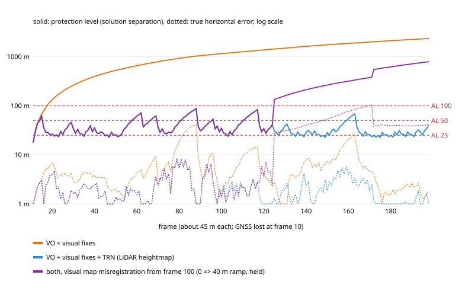
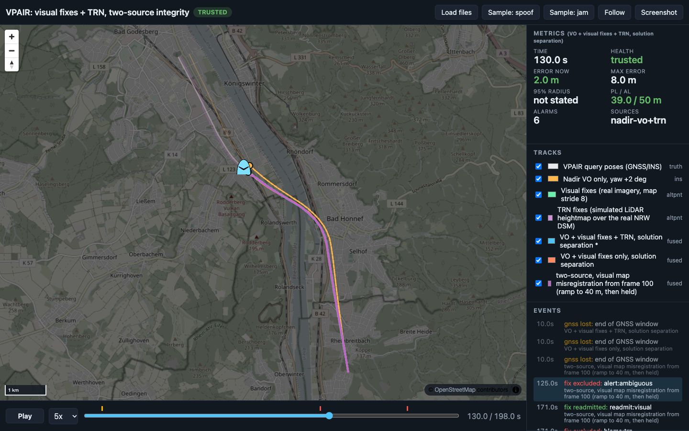

<!-- about: sample:e2e-visual-nav-vpair, sample:altpnt-integrity, sample:terrain-heightmap-pf, sample:blind-flight-bench, res:vpair-dataset-2022, repo:aervisloc/vpair, res:geobasis-nrw-dom1-dgm1, res:copernicus-dem-aws -->
# Two absolute sources on one real flight: visual fixes + TRN, solution-separation integrity (VPAIR)

[e2e-visual-nav-vpair](../e2e-visual-nav-vpair/README.md) flew the full visual chain on the real VPAIR
flight: 4.8 m RMS, 0 false fixes, but with one absolute source the solution-separation protection level
(PL) sat at ~1.25 km and was below a 50 m alert limit (AL) 1.6 % of the time. This sample adds
terrain-relative navigation (TRN) as a second, independent absolute source on the **same flight** and
measures what that does to integrity, and what happens when either source fails.

```
nadir VO + real visual fixes (cached front end)          ../e2e-visual-nav-vpair  results/frontend*.json, run_fusion.py
TRN: simulated sensor over real terrain at real poses     trn.py
   downward heightmap => v2 particle filter                ../terrain-heightmap-pf  sim.observe_patch, nav2.measure, core.HeadingPF
   radar altimeter (beam, noise, dropouts) => TERCOM       ../blind-flight-bench    sim.radar_range, navs.beam_map
fusion + integrity: EKF, chi-square gate, solution        ../altpnt-integrity      altpnt_v2.Ekf2, Monitor2
   separation, PL; TRN in the 'magnav' slot, R = TRN sigma
```

Everything is reused by import. **What is real and what is simulated:**

| Piece | Real or simulated |
|---|---|
| Flight path, heights, attitude | Real: VPAIR sample query poses (GNSS/INS), 199 frames, 360-403 m ellipsoid height |
| VO and visual fixes | Real imagery: the e2e front end (nadir VO, DINOv2 top-5, ALIKED + LightGlue), re-scored from its cache |
| Terrain | Real: Geobasis NRW DOM1 1 m LiDAR surface model (46 tiles, file names `..._nw_2021`) and Copernicus GLO-30 |
| Altimeter, heightmap sensor | **Simulated** from that real terrain at the real VPAIR position and height. No altimeter or LiDAR data was recorded on this flight |

## Where the flight is

Verified from the poses: lat 50.612-50.680, lon 7.171-7.228, UTM 32N E 370.8-374.6 km, N 5608.2-5615.8 km.
That is the Rhine valley east of Bonn, flying north from Bad Honnef past Koenigswinter (see the dashboard
map). Ground under the track (NRW DSM, incl. buildings and trees) 48-96 m; height above mean sea level
312-355 m (ellipsoid height minus the file's 47.8 m undulation), so 237-287 m above the surface, median 269 m.
The valley floor is flat; the relief is buildings, trees, embankments and the Siebengebirge slope to the east.

The first ~200 m of track lie near the Rhineland-Palatinate border: tiles south of N 5608 km are not in the
NRW index (7 tiles 404). Missing cells are filled with the nearest valid value (flat, no features); 42.5 % of
the 8 x 10 km mosaic rectangle is fill, none of it under the track. GLO-30 minus the NRW DSM (both at 30 m)
along the track: mean -1.3 m, std 1.6 m.

## TRN, as simulated here

| Variant | Sensor (simulated) | Map | Matcher |
|---|---|---|---|
| `lidar5` | Downward heightmap, 300 x 300 m local map at 5 m from the 1 m DSM (block mean) at the true pose, 300 m swath (~58 deg cross-track at 270 m), 0.5 m noise, 1 % scale error, 5 % dropout, rotated by the 2 deg AHRS error; world = map + 1 m correlated error (assumed) | NRW DSM at 5 m | terrain-heightmap-pf v2: NCC likelihood, CRB information gate, compass-bias state, 2000 particles, update every 2 frames (~90 m) |
| `glo30` | The same sensor binned to 30 m, 21 x 21 cells | Copernicus GLO-30 (independent source, other epoch) | same filter, update every 4 frames |
| `radalt` | Radar altimeter at 10 Hz: leading edge in a 40 deg cone over the 1 m DSM, noise 0.5 m + 0.5 %, 2 % dropouts, loss-of-lock bursts, outliers (blind-flight-bench `RadarModel`), baro with 25 m bias and drift | Leading-edge beam map of the 5 m DSM at the mean flight level | Batch TERCOM, 1.8 km profile every 0.9 km, +-300 m search growing 10 % with distance, terrain-heightmap-pf's MAD metric and 0.9 ambiguity ratio |

Each TRN dead-reckons with the same VO (heading +2 deg) and nothing else, so it is independent of the
visual fixes but not of VO. Fix sigma is the TRN's own no-truth confidence: `lidar5`/`glo30` = particle
spread / sqrt(2) (floor 3 m, inflation 1.0); `radalt` = spread of the MAD surface read as a likelihood
with self-calibrated noise (floor 5 m).

TRN fix quality, 10 seeds (`results/two_source_result.json`, `trn_fixes`):

| Variant | fixes per flight | error median (range over seeds) | error max | sigma median | radial error > 3 sqrt(2) sigma | CPU per flight |
|---|---|---|---|---|---|---|
| lidar5 | 93 of 93 updates | 1.5-1.7 m | 6.1 m | 3.0 m (floor) | 0 | 0.57 s |
| glo30 | 44.8 of 46 | 16.2-24.1 m | 80.7 m | 20.8 m | 0 | 0.2 s |
| radalt | 3.2 of 8 attempts | 33-45 m | 53 m | 11 m | 6 of 32 | 0.28 s (+ 16.6 s beam map) |

The radar's leading edge returned a range 11 m shorter than nadir (median), from trees and buildings
inside the footprint, so TERCOM matches against the beam map.
Side checks, not in the tables: a plain nadir map accepted 0 of 8 in each of 5 seeds; a laser variant
(point footprint, nadir map) accepted 3 of 8 in one seed (19-46 m).
The `lidar5` numbers are best case: map and sensor come from the same DSM.

## Run

```sh
python3 -m venv .venv && .venv/bin/pip install -r requirements.txt
DATA=../relative-nav-benchmark/data/vpair                # contains vpair_sample/ (../relative-nav-benchmark/fetch_data.sh aerial)
.venv/bin/python fetch_terrain.py --data $DATA           # 46 NRW tiles (~120 MB) + GLO-30 window, ~2 min, into data/ (git-ignored)
.venv/bin/python run_two_source.py --data $DATA          # 107 s on M2 Max, 10 TRN seeds
./screenshot.sh 130                                      # Chrome + Node 22, via ../golden-demo/screenshot.mjs
python3 -m unittest test_two_source
```

Needs the e2e sample's committed `results/frontend.json` and `results/frontend_yaw2.json` (read by import).

## Results

188 frames after GNSS loss (8.53 km), heading +2 deg, frame = 1 s (~45 m). Visual fixes at map stride 8
(reference tiles 360 m apart; 89 fixes on 188 frames, median 2.7 m, max 8.7 m, 0 false) unless noted.
`full` = altpnt v2 Monitor2: chi-square gate + solution separation; PL with per-source fault priors
(visual 1.0e-2, TRN 6.3e-4 per epoch from `../altpnt-integrity/calibration.json`, illustrative).
Availability = PL < AL and no alert. HMI = error >= AL while PL < AL. MI = PL <= error < AL.
TRN rows pool 10 seeds (availability averaged, HMI/MI summed); visual-only and VO-only are deterministic.

| Sources (mode `full`) | HPE RMS | HPE max | PL median | avail AL 25 | AL 50 | AL 100 | HMI | MI | detections (fault-free) |
|---|---|---|---|---|---|---|---|---|---|
| VO only (no gate) | 144 m | 249 m | 847 m | 1.1 % | 2.7 % | 5.3 % | 0 | 0 | - |
| VO + visual fixes | 9.7 m | 40.7 m | 1,197 m | 0.5 % | **1.6 %** | 3.7 % | 0 | 0 | 0 |
| VO + TRN lidar5 | 2.8 m | 9.3 m | 1,044 m | 1.1 % | 2.7 % | 4.3 % | 0 | 0 | 0 |
| **VO + visual + TRN lidar5** | **2.6 m** | 8.9 m | **30.5 m** | 14.4 % | **84.4 %** | 100 % | 0 | 0 | 0 |
| VO + TRN glo30 | 22.9 m | 55.0 m | 1,042 m | 1.1 % | 2.7 % | 6.3 % | 0 | 0 | 0 |
| VO + visual + TRN glo30 | 9.6 m | 38.1 m | 96.7 m | 0.5 % | 1.6 % | 55.6 % | 0 | 0 | 0 |
| VO + TRN radalt | 72.3 m | 139 m | 1,040 m | 1.1 % | 2.7 % | 5.3 % | 0 | 0 | 0 |
| VO + visual + TRN radalt | 26.4 m | 120 m | 309 m | 0.5 % | 1.6 % | 10.9 % | 0 | 0 | **6** |
| VO + visual + lidar5 + glo30 (three) | 2.7 m | 8.9 m | 30.9 m | 10.9 % | 84.7 % | 100 % | 0 | 0 | 0 |

Map stride 1 (tiles 45 m apart, 149 visual fixes): visual alone 4.8 m RMS, still 1.6 % at AL 50; with
`lidar5` 2.5 m RMS, PL median 24.3 m, **60.6 / 95.6 / 100 %** at AL 25 / 50 / 100; with `glo30` 51.3 % at AL
100; with `radalt` 9.4 % at AL 100.

Mode `gate` (chi-square gate, PL from the fault-free covariance only, no fault hypotheses) reads 95-100 %
available at AL 50 for every two-source pair, PL median 16-24 m. That PL does not protect against a faulted
source; it is the number e2e quoted as "fault-free PL".



- **One absolute source cannot be protected; two can.** With either source alone the "fault in the only
  absolute source" branch is VO alone, so the PL grows to ~1 km. With both, each fault branch still has
  one absolute source, the PL median drops from 1.2 km to 30.5 m and AL 50 is available 84 % of the time,
  with 0 HMI and 0 MI over 10 seeds.
- **The second source has to be good, not just present.** The PL is set by the weaker branch: with the
  GLO-30 TRN (20 m sigma) the "visual faulted" branch is VO + GLO-30 TRN, PL median 97 m, so only AL 100
  becomes available. AL 25 is not reachable with the sparse visual map: the "TRN faulted" branch is VO +
  visual fixes at 47 % of frames. Dense map (stride 1) => 60.6 % at AL 25.
- **The radar altimeter over this valley is close to useless and a little harmful.** 3 of 8 TERCOM fixes
  accepted per flight; its sigma was too small for 6 of 32 fixes, and solution separation tripped 6 times
  in 10 fault-free flights. A trip either excludes one source or drops both and rewinds to VO (see below);
  that is the likely reason its HPE RMS (26 m) is worse than visual-only (9.7 m), not traced per event. Flat terrain plus a 200 m beam footprint, as
  terrain-heightmap-pf found for TERCOM in its mixed/flat regions.

## Fault injection

Headline config (map stride 8), 10 seeds each, fault-free runs above as the baseline.

- **Visual map misregistration**: from frame 100 every visual fix is offset along 45 deg, ramping 0 => 40 m
  over 40 frames (1.8 km), then held to the end (`persistent`) or removed at frame 140 (`transient`).
  A georeferencing error of a reference-map area; slow so the chi-square gate does not catch it at once.
- **TRN ambiguity**: in frames 60-99 each TRN fix is replaced by the secondary peak of its own match
  surface (>= 30 m from the best for the PF, >= 3 grid steps for TERCOM), with the nominal sigma: the TRN
  locks onto a similar-looking place and is confident about it. Injected at the output only, the PF
  itself keeps tracking. `lidar5` offsets 27-67 m (mostly ~30 m), 20 per flight; `glo30` 5-233 m, 9-10 per
  flight; `radalt` 0-1 per flight (few accepted fixes in that window).
- Monitor order: altpnt's two-source logic raises `alert:ambiguous`, drops both sources, rewinds to
  VO from 30 s back, and readmits whichever source passes 45 s of probation first; the other is blamed. As a
  control the same runs were repeated with the monitored order swapped (`vis_first` / `trn_first`).

| TRN | Fault | detected | latency (frames) | first attribution | HPE max | avail AL 50 | HMI 25/50/100 |
|---|---|---|---|---|---|---|---|
| lidar5 | misregistration, persistent, `vis_first` | 10/10 (ambiguous alert) | 25 | TRN (wrong) 10/10 | 116 m | 47.1 % | 0/0/0 |
| lidar5 | misregistration, persistent, `trn_first` | 10/10 | 25 | visual (right) 10/10 | 116 m | 47.1 % | 0/0/0 |
| lidar5 | misregistration, transient, either order | 10/10 | 25 | same as persistent | 116 m | 47.1 % | 0/0/0 |
| lidar5 | TRN ambiguity, either order | 10/10 | 10-12 | TRN (right) 10/10 | 151 m | 44.2 % | 0/0/0 |
| lidar5, three sources | misregistration, persistent | 10/10 (`exclude`) | 25 | TRN (wrong) 10/10 | 174 m | 51.2 % | 0/0/0 |
| lidar5, three sources | TRN ambiguity | 10/10 (`exclude`) | 8-12 | visual (wrong) 8, TRN 1, GLO-30 TRN 1 | 252 m | 43.5 % | **0/19/3** |
| glo30 | misregistration, persistent | 6/10 | 34-42 | TRN (wrong) 6, none 4 | 139 m | 1.6 % | 0/0/0 |
| glo30 | TRN ambiguity, `vis_first` | 4/10 | 2-29 | TRN 4, none 6 | 185 m | 1.6 % | 0/0/0 |
| radalt | misregistration, persistent | 4/10 | 32-94 | visual 1, TRN 1, none 8 | 150 m | 1.6 % | 0/0/0 |
| radalt | TRN ambiguity | 6/10 | 13-72 | visual 4, TRN 2, none 4 | 143 m | 1.6 % | 0/0/0 |

What this shows:

- **Detection works with two sources.** Both faults were detected in every `lidar5` run, the misregistration
  when it had grown to ~26 m (frame 125), the TRN ambiguity within 10-12 frames (the chi-square gate also
  rejected 66 of the 200 faulty TRN fixes). No HMI at any AL. With the weaker TRNs detection is partial,
  but those configurations were never available at AL 50 anyway, so missed detections did not become HMI.
  The `radalt` detection counts include its fault-free false alarms (6 per 10 flights), so they are not
  evidence of detecting the injected fault.
- **Attribution with two sources is not real here.** For the misregistration the "blamed" source flips
  with the monitor order: after the rewind, the VO-only solution's uncertainty is driven by the heading state
  (2.8 deg prior: ~130 m after 2.7 km, one minute), so a slow 40 m bias passes probation as easily as the good TRN, and the first
  source checked is readmitted. For the TRN ambiguity attribution is right in both orders because the
  faulty fixes kept failing probation while they lasted. This is the textbook limit (two sources: detect,
  not identify), shown here with the monitor's own events.
- **The two-source response costs accuracy.** Dropping both sources and rewinding to VO took the error to
  100-150 m while the system correctly reported itself unavailable. In the same misregistration run
  (seed 0) with the gate only and no solution separation, the gate rejected 44 visual fixes and the error
  never exceeded 8 m, but that configuration has no protection level against a faulted source.
- **Three sources did not fix it.** altpnt's exclusion picks the branch with the largest normalised
  separation. When the faulty source is the weak one (sparse visual fixes) or the second TRN is the noisy
  one, the largest separation is in the wrong branch: wrong exclusions in 19 of 20 runs and 19 HMI epochs at
  AL 50 under TRN ambiguity. The two TRNs also share VO, the heightmap sensor and the terrain, so a real
  common-mode terrain ambiguity would hit both; the third source here is only a mechanism test.

## Dashboard

```sh
python3 -m http.server 8000          # from the repo root
# http://localhost:8000/templates/demo-dashboard/?manifest=../../samples/two-source-integrity-vpair/results/navdash/manifest.json
```



Frame 130: the two-source solution (blue, primary) is 2.0 m off with PL 39 m < AL 50; the misregistration
run (purple) has raised `alert:ambiguous` at frame 125 and runs on VO alone; the event list shows it
later readmitting the visual fixes and blaming the TRN at frame 171 (the wrong attribution discussed
above). Final frame: [two-source-t198.jpg](results/screenshots/two-source-t198.jpg). Tracks: truth, VO only,
visual fixes, TRN fixes (`r95_m` = 2.45 sigma), fused two-source / visual-only / misregistration (with
`pl_m`, health, alarm at AL 50, monitor events). Time is the frame index.

## Files

| File | What |
|---|---|
| `fetch_terrain.py` | NRW DOM1 tiles within 1.5 km of the track via `../terrain-heightmap-pf/fetch_lidar.tile`, GLO-30 on the same grid |
| `terrain.py` | VPAIR poses => UTM 32N / MSL, DSM mosaic, GLO-30 reprojection, local-EN <=> grid (UTM grid convergence here is -1.35 deg) |
| `trn.py` | Altimeter simulation, TERCOM with secondary peak and no-truth sigma, heightmap PF loop on the VPAIR track, fault hook |
| `run_two_source.py` | Visual fixes from the e2e cache, TRN fixes, altpnt v2 filter runs, fault injection, `results/two_source_result.json` |
| `report.py` | `results/pl_vs_frame.svg`, `results/navdash/` |
| `test_two_source.py` | 7 unit tests (numpy, scipy) + 7 checks on the committed results (stdlib) |
| `screenshot.sh` | Headless dashboard capture through `../golden-demo/screenshot.mjs` |
| `results/run_output.txt` | Console output of the run above |

Tests: venv (CPython 3.12.14) 14 pass; plain `/opt/homebrew/bin/python3` without packages 7 pass, 7 skip.

## Limits (read before quoting a number)

- **Simulated TRN sensors.** Real terrain, real poses, simulated altimeter and heightmap. No sensor timing,
  lever arm, attitude coupling (roll/pitch are ignored for the beam and the patch), or LiDAR point density
  model. The `lidar5` map and sensor are the same DSM plus 1 m correlated error and 0.5 m noise: best case,
  same caveat as terrain-heightmap-pf's 1 m test. GLO-30 is the realistic-map variant.
- **Map epoch.** NRW tiles carry 2021 in the file name; the VPAIR flight date is not stated here. Real
  changes between the two (vegetation, construction) are not in the simulation.
- **TRN fixes are filter outputs fed to another filter.** The PF uses the same VO as the EKF and its
  outputs are correlated in time; the EKF treats them as independent. R from the PF spread (inflation 1.0)
  was not overbounded on this flight; `radalt` sigma was demonstrably too small (6 of 32 fixes with radial error > 3 sqrt(2) sigma).
- **One flight, 188 epochs.** 10 seeds vary only the TRN sensor noise and particles; the visual fixes and
  the trajectory are one realisation. 0 HMI over ~1,900 epochs says nothing about 1e-5 or 1e-7 risk levels.
  Fault priors and the integrity budget are altpnt's illustrative values, not certified.
- **Monitor is reused as is.** Constant-velocity EKF with no IMU (VPAIR has none), altpnt v2's exclusion
  and probation rules unchanged. The attribution and three-source failures above are properties of those
  rules on this data, not of solution separation in general.
- **Faults are injected, not observed.** The misregistration is a synthetic offset on real fixes; the TRN
  ambiguity uses the real secondary peak of each match but is forced onto the output.
- Not run: a TRN on the 1 m DTM (bare earth), a lost start, IMU, other flights, ARAIM-style subset
  exclusion (check each candidate subset's own consistency) in place of max-separation exclusion.
