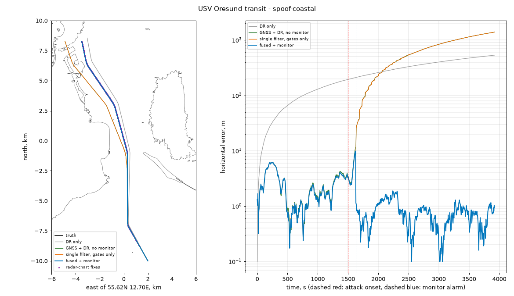
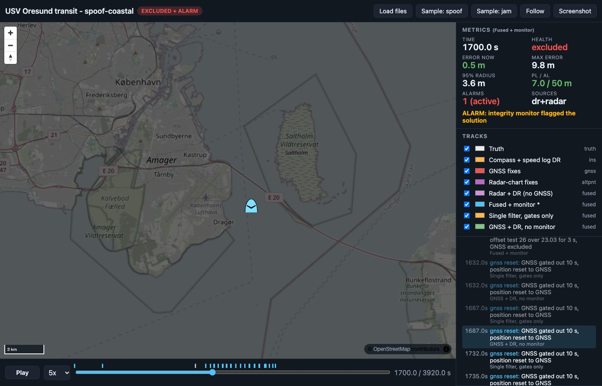

# USV own-ship navigation under GNSS spoofing: radar-to-chart fixes and an integrity monitor, Oresund

<!-- about: repo:opencpn/opencpn, repo:opencpn-radar-pi/radar_pi, repo:signalk/signalk-server, repo:ntnu-itk-autonomous-ship-lab/colav-simulator, repo:moos-ivp/moos-ivp -->

A small uncrewed surface vessel (USV) runs a 19.6 km transit from the Lillgrund wind farm, through
the Drogden channel between Amager and Saltholm, past Kastrup and up Kongedybet to the Copenhagen
harbour approach. On the way its GNSS receiver gets spoofed: the reported position is dragged
slowly west, towards Amager. This sample answers one question: can the USV keep a correct position
with only what is on board?

On board means a compass and a bottom-tracking speed log for dead reckoning (DR), a marine radar,
and an electronic chart. Radar returns are matched against the charted coastline to get absolute
fixes that do not use GNSS. An integrity monitor then compares GNSS against the radar-chart + DR
solution and excludes GNSS when the two disagree.

Companion to [maritime-ais-spoofing](../maritime-ais-spoofing/). That sample watches *other*
ships' AIS from shore; this one is the own-ship side.

Geography and traffic are real: OpenStreetMap coastline, the Oresund bridge, wind turbines and
seamarks, plus 75 minutes of real Danish Maritime Authority AIS traffic, used as radar targets.
Sensors, attacks and the radar itself are simulated. Core code is stdlib Python and runs offline
from the committed fixtures. `plot.py` is the only file that needs matplotlib.

Defensive scope: this is navigation and integrity monitoring. Nothing here generates GNSS signals.
The spoofer is a position offset added to simulated fixes.



*Seed 1, spoof starts at t = 1500 s in the Drogden channel. Left: tracks over the OSM coastline.
The baselines (green and orange, on top of each other) follow the spoofer west across Amager. The
DR-only track (grey) drifts east because of compass bias. Right: horizontal error on a log scale.
The monitor (blue) excludes GNSS 130 s after onset, at a 25 m spoof offset.*

## Results (5 seeds, real outputs)

`python3 run.py --no-export --seeds 1 2 3 4 5`. The full table is in
[example_output/summary_5seeds.md](example_output/summary_5seeds.md) and the per-run JSON is in
`summary_5seeds.json`. Ranges below are min-max over the 5 seeds. Errors are horizontal, against
simulated truth, over the whole 3920 s transit.

| Scenario | DR only, max | GNSS + DR, no monitor, max | Single filter (GNSS + radar + DR, gates only), max | **Fused + monitor**, max / RMS | Alarm after onset | GNSS excluded after onset | Spoof offset at alarm |
|---|---|---|---|---|---|---|---|
| clean (no attack) | 510-539 m | 5-9 m | 5-9 m | 5-9 m / 2.4-3.0 m | 0 false alarms | 0 false exclusions | - |
| spoof-coastal: drag starts in Drogden, t = 1500 s | same | 1391-1395 m | 1391-1395 m | **10-25 m / 1.8-2.7 m** | 125-131 s | 125-131 s | 23-26 m |
| spoof-open: drag starts in open water by Lillgrund, t = 60 s | same | 2255-2261 m | 2255-2261 m | **71-102 m / 7.6-12.5 m** | 202-250 s | 235-285 s | 61-90 m |
| jam: no GNSS from t = 1200 s to the end | same | 20-44 m | 3-6 m | 3-6 m / 1.4-2.1 m | - | - | - |
| spoof-coastal-1500m: as spoof-coastal, radar on the 1.5 km range scale | same | 1391-1395 m | 1391-1395 m | **175-1024 m / 28-392 m** | 397-602 s | 410-1810 s | 178-301 m |

The drag accelerates at 0.003 m/s^2 up to 0.6 m/s, which is 60 m after 200 s, and then grows
linearly. Across all 25 runs there were no alarms or exclusions before the attack started.

What the numbers say:

- **Adding radar to the same filter does not help on its own.** The "single" configuration has
  radar-chart fixes but only per-measurement chi-square gates, and it ends up exactly as far off
  as GNSS + DR. The slow drag passes the GNSS gate. When GNSS finally gets gated out, the
  autopilot-style recovery (reset to GNSS after 10 s of rejected fixes) pulls the filter onto the
  spoofer. From then on the radar fixes are the ones failing the gate. What fixes it is a separate
  GNSS-free reference filter plus a test between the two.
- **Near the coast the monitor catches the drag at about 25 m of offset.** That is roughly where a
  30 s mean of GNSS minus the radar/DR solution clears the noise of a radar fix (median accepted
  fix error 1.1-3.7 m per leg, see below), plus a 2 m allowance for correlated GNSS error and a
  3 m model-mismatch floor. Peak error during that window is 10-25 m.
- **In open water, detection waits for the coast.** By Lillgrund the radar sees about 48 turbines
  and little else. 42 of 139 scans there have too few returns for a fix. The monitor first raises
  an alarm without exclusion ("cannot isolate": fewer than 3 radar fixes in the last 60 s) and
  excludes GNSS 30-45 s later. Peak error is 71-102 m.
- **Jamming is the easy case.** Before the jam starts, the filter has calibrated compass bias and
  speed-log scale against GNSS. Plain GNSS + DR then coasts the remaining 2700 s with 20-44 m of
  error, and radar-chart fixes keep it under 6 m.
- **A short radar range breaks it.** On the 1.5 km scale, most of the transit has too few returns
  or a degenerate geometry. Some fixes are wrong locks: accepted-fix p95 error is 110 m off Kastrup
  and 149 m in Kongedybet. Detection comes 400-600 s after onset. In seed 1 the alarm fires at
  592 s, but isolation is refused until 1810 s, and the monitored solution peaks at 1024 m. That
  is still better than the 1392 m baseline, but it is not a navigation solution.

### Radar-chart matching by route leg (seed 1, default 6 km range)

From [example_output/summary.md](example_output/summary.md). Outcomes are per 5 s scan.
Fix error is against truth.

| Leg | Scans | Outcomes | Accepted-fix error median / p95 |
|---|---|---|---|
| open water by Lillgrund | 139 | ok 75, few_returns 42, few_inliers 13, no_chart_match 8, degenerate 1 | 3.7 / 8.6 m |
| Drogden south | 240 | ok 238, ambiguous 2 | 1.8 / 4.8 m |
| Drogden channel | 166 | ok 166 | 2.0 / 4.7 m |
| off Kastrup | 164 | ok 164 | 1.7 / 3.6 m |
| Kongedybet / Middelgrunden | 77 | ok 77 | 1.1 / 3.1 m |

Treat these fix errors as optimistic. The simulated radar sees the same OSM coastline the matcher
uses; only the buoys are displaced (15 m watch circle). See "What is not modelled" for the real
gap.

## Failure modes found, and what the code does about each

| Failure mode | Where it showed up | Handling |
|---|---|---|
| Open water: too few returns | Lillgrund leg, 30 % of scans; the whole first leg at 1.5 km range | Fix refused (`few_returns`, `no_chart_match`). The filter coasts on DR and the monitor cannot isolate GNSS faults: alarm only |
| Featureless or one-sided geometry: position slides along a straight shore | 1.5 km range in the channel (37 of 166 scans); unit test with a straight 12 km coast | `degenerate`: fix refused when the marginal 1-sigma along the weakest direction is over 30 m. **Found in development:** with the full 3x3 (x, y, heading) covariance, a fix that was useless in position was still read as a position fix through its heading correlation. A wrong 483 m fix then went into the reference filter and caused a false GNSS exclusion |
| Multi-modal match: repeating structure (piers, turbine rows) | 2 to 13 scans per leg | `ambiguous`: refused when a second local maximum of the likelihood-field score reaches 90 % of the best and is more than 4 sigma (Mahalanobis) from the ICP solution |
| Wrong lock that stays self-consistent | 1.5 km range, off Kastrup / Kongedybet (p95 110-149 m) | Not caught by the matcher. The monitor only excludes GNSS when the GNSS-free filter has had at least 3 radar fixes in 60 s, so a wrong lock produces an alarm, not an exclusion of good GNSS |
| Ships and sea clutter in the scan | Every scan: 10.7 k ship returns from real AIS traffic and 9.5 k clutter returns over 785 scans in seed 1 | Huber-weighted point-to-line ICP with a shrinking 50 => 25 m gate. Ships moored at quays are the harder case, because they sit on the chart line |
| Gate lockout exploited by the spoofer | GNSS + DR and single filter, every spoof run | Monitor: the reset jump is exactly what the solution-separation test catches |

## How it works

```
fixtures/ (OSM chart, DMA AIS window)
  chart.py   segments in local metres, grid index, lazy distance field
  sim.py     truth route, compass + speed log, GNSS (spoof drag, jam), radar ray-cast + clutter, AIS targets
  matcher.py likelihood-field grid search => point-to-line ICP (x, y, heading) => covariance and validity checks
  nav.py     4-state EKF [x, y, compass bias, speed scale]; Navigator configs; monitor
  run.py     scenarios x configs, metrics, multiprocessing
  export.py  navdash/1 JSONL, zones, manifest, own-ship CoT, summary tables
```

- **Chart.** 298 OSM `natural=coastline` ways (15.4 k vertices), the Oresund bridge outline,
  88 wind turbines and 419 radar-relevant seamarks (lateral, cardinal and special buoys, beacons,
  lights), all inside 55.45-55.78 N, 12.45-13.05 E. Point objects become small octagons
  (turbine 3 m, buoy 1.5 m). In the simulated world each buoy is moved up to 15 m from its
  charted position.
- **Radar.** 720 azimuths, first return per azimuth out to 6 km. Range sigma is 7.5 m and bearing
  sigma 0.4 deg. Detection probability falls from 0.9 near to 0.4 at max range and is scaled by
  incidence angle, so a shore seen edge-on returns weakly. Sea clutter averages 12 returns per scan
  inside about 800 m. AIS ships are discs of half their reported length and occlude the coast
  behind them. One scan every 5 s. These are illustrative values, not taken from a datasheet.
- **Matching.** A coarse search on a 5 m distance-field lattice, plus or minus 2 deg in heading,
  over a window of 3 sigma of the GNSS-free filter (40 to 800 m), then Gauss-Newton ICP. The
  covariance is s^2 (J'WJ)^-1, inflated 10x for correlated neighbouring azimuths, plus a 5 m
  chart-error floor. The prior only places the search window and does not enter the estimate, so
  the fix stays independent of GNSS.
- **DR.** Compass bias is +/-1.5 deg plus a random walk, with 0.5 deg noise. Speed-log scale error
  is 0.7 % with 0.05 m/s noise. A radar fix also observes compass bias, because the matched
  heading minus the compass reading equals the bias, so radar calibrates the compass as well.
- **GNSS.** 1.5 m white noise plus a 2 m Gauss-Markov term (tau 120 s). The filter assumes 3 m
  white noise.
- **Monitor.** The main filter uses GNSS + radar + DR. The sub filter uses radar + DR only. Every
  second the monitor runs two tests at chi-square 2 dof, P_fa 1e-5 (threshold 23.03), and needs
  3 s of persistence:
  - solution separation, main vs sub;
  - the 30 s mean of GNSS minus the sub filter.

  Isolation needs at least 3 radar fixes in the sub filter in the last 60 s. On isolation, main
  is replaced by sub and GNSS is excluded. Without isolation the monitor raises an alarm and keeps
  GNSS. GNSS is readmitted after 120 s of fixes consistent with the main filter. `pl_m` is
  4.80 x sigma, the Gaussian tail of the filter's own covariance. It is not a certified
  protection level.

## Run

```sh
python3 -m unittest test_core                         # 15 tests, about 1 s, stdlib
python3 run.py                                        # 5 scenarios, seed 1, writes out/ (about 2 min on 11 processes)
python3 run.py --seeds 1 2 3 4 5 --no-export          # the table above (several minutes)
python3 run.py --scenarios spoof-open --jobs 1        # one scenario, single process
python3 plot.py out/spoof-coastal out/spoof-coastal.png   # needs matplotlib
```

Rebuild the fixtures from public sources (stdlib):

```sh
python3 fetch_data.py chart                           # Overpass API, tries 3 public endpoints with backoff
python3 fetch_data.py ais --dma-csv aisdk-2026-10-20.head100mb.csv
python3 fetch_data.py ais                             # without a local CSV: 100 MB range download via ../maritime-ais-spoofing/dma.py
```

Change `BBOX` in `fetch_data.py` and `ROUTE_XY` / `ORIGIN` in `sim.py` / `chart.py` to use another
harbour. `test_route_stays_in_water` checks that the route does not cross the chart. It caught the
first version of this route, which ran over a buoy and ended on Refshaleoen.

## Outputs

`out/<scenario>/` (two scenarios are committed in `example_output/`):

| File | Content |
|---|---|
| `truth.jsonl`, `ins.jsonl`, `gnss.jsonl`, `radar.jsonl` | navdash/1 tracks: truth, DR only (`ins`), GNSS fixes (`gnss`), accepted radar-chart fixes (`altpnt`, with r95 from the fix covariance) |
| `fused-monitor.jsonl` (primary), `fused-single.jsonl`, `fused-gnss_dr.jsonl`, `fused-radar-dr.jsonl` | Fused tracks with `r95_m`, `pl_m`, `health`, `alarm`, `sources` and events (`attack_onset` marked `ground_truth`, `spoof_suspected`, `alarm_raised`, `gnss_reset`, `radar_fix_lost`, `source_switched`, `gnss_lost`) |
| `zones.geojson`, `manifest.json` | A 1.5 km circle at the attack onset position (synthetic, not an emitter footprint), and the dashboard manifest. Alert limit is 50 m (illustrative) |
| `ownship_cot.xml` | One CoT event per line every 10 s from the monitored solution. Built with `../mavlink-to-tak-cot/cot.py`. Type `a-f-S` (friendly sea-surface track), `how="m-f"` (fused): both values come from the CoT type table in [dB-SPL/cot-types](https://github.com/dB-SPL/cot-types) `CoTtypes.xml`. `ce` is the filter's 1-sigma, and course/speed come from the estimated track. Timestamps start at the AIS window, 2026-10-20 02:00 UTC. For a simulation, `m-s` would be the more honest `how` |

Replay in the dashboard template, from the repo root:

```sh
python3 -m http.server 8000
# http://localhost:8000/templates/demo-dashboard/index.html?manifest=../../samples/usv-gnss-denied-nav/example_output/spoof-coastal/manifest.json&t=1700
```



Captured with headless Chrome (SwiftShader) from the committed files. At t = 1700 s the metrics
panel reads health excluded, error 0.5 m, max error 9.8 m, PL / AL 7.0 / 50 m and one active
alarm. Note that the template's vehicle symbol is hard-coded to a UAV (`SFAPMFQ`). At this zoom
the fused tracks sit on top of truth, so separate lines are not visible.

## Moving this onto real maritime stacks

| Stack | What it gives you | Where this sample plugs in |
|---|---|---|
| [OpenCPN](https://github.com/OpenCPN/OpenCPN) (`repo:opencpn/opencpn`) | Chartplotter with S-57/S-63 ENCs, NMEA 0183 inputs, AIS display | Emit the monitored solution as NMEA 0183 `$GPRMC`/`$GPGGA` over UDP/TCP so the chartplotter shows the protected position, not the raw receiver. ENC coastline (`COALNE`/`LNDARE`) and `BOY*`/`BCN*`/`LIGHTS` objects can replace the OSM fixture in `chart.build` (needs GDAL/ogr to read S-57; not done here) |
| [radar_pi](https://github.com/opencpn-radar-pi/radar_pi) (`repo:opencpn-radar-pi/radar_pi`) | Plugin that talks to Navico and some Garmin / Raymarine radars and overlays radar imagery and ARPA targets on the chart | The real counterpart of `sim.Radar`: spokes would need a threshold / CFAR step to give the first-return-per-azimuth list that `matcher.match(chart, returns, ...)` takes, as (range m, bearing rad relative to bow). I have not checked whether radar_pi exposes spokes to other processes; read its source before planning on that |
| [Signal K server](https://github.com/SignalK/signalk-server) (`repo:signalk/signalk-server`) | Vessel data bus. NMEA 0183/2000 in, JSON over WebSocket/REST out, plugins | Subscribe to `navigation.position` (GNSS), `navigation.headingMagnetic` and `navigation.speedThroughWater` (or a DVL path), and publish the monitored solution as a separate source on `navigation.position`. Monitor state goes under a custom path, for example `navigation.integrity.*` (not a standard path). `signalk-to-nmea0183` (`repo:signalk/signalk-to-nmea0183`) feeds legacy displays and autopilots |
| [NTNU colav-simulator](https://github.com/ntnu-itk-autonomous-ship-lab/colav-simulator) (`repo:ntnu-itk-autonomous-ship-lab/colav-simulator`) | Python ship simulator with ENC maps via `seacharts`, configurable estimators and sensors, a Radar sensor class, AIS-based scenarios (from its README) | Replace its own-ship estimator with `nav.Navigator("monitor", ...)` and drive `matcher.match` from its radar or ENC, to close the loop: here the truth path is fixed (open loop), so the spoofed baselines report a wrong position but do not steer onto Amager. Its seacharts data is Norwegian ENC (`.gdb` from kartkatalog.geonorge.no, UTM 32/33), so an Oslofjord or Trondheimsfjord port of this sample fits it best |
| [MOOS-IvP](https://github.com/moos-ivp/moos-ivp) (`repo:moos-ivp/moos-ivp`) | Autonomy middleware and IvP Helm used on many USVs; `uSimMarine` simulator, `pMarineViewer` | Run the filter as a MOOS app that subscribes to the GNSS and compass/speed variables and publishes `NAV_X`, `NAV_Y`, `NAV_HEADING`, which the helm consumes. Add a monitor flag the helm behaviours can condition on, for example slowing or holding station when an alarm is up but GNSS cannot be isolated. The tree also has `uFldBeaconRangeSensor` (range to beacons, analogous to charted-landmark ranges) and `pSpoofNode`. Those are directory names only: I have not read their code |

Other indexed resources:

- `res:pohang-canal-dataset-2023` is a real marine-radar + RTK dataset (canal, port, coast) for
  testing `matcher.py` on real spokes.
- `res:dlr-r-mode-baltic` covers R-Mode, the terrestrial ranging backup in the same sea area.
- The radar-odometry repos (`repo:dan11003/cfear_radarodometry`, `repo:dan11003/tbv_slam_public`)
  give scan-to-scan odometry, which would complement scan-to-chart matching in open water.

## What is not modelled

- **Real radar physics.** No antenna height, no radar horizon or terrain height: low Saltholm and
  a quay wall reflect the same way. No multipath, no side lobes, no rain, no second-trace echoes,
  no ship motion, no blind sector.
- **Chart vs reality.** The simulated world *is* the OSM chart, apart from the buoys. Real
  mismatches will make accepted-fix errors larger than the 1-4 m medians above: OSM digitising
  error (not measured here), water level, beaches vs vertical structure, uncharted moored ships
  and new construction. `CHART_SIGMA_M = 5` is an assumption.
- **The vessel.** No current, leeway or sideslip, and no speed-log dropouts. The trajectory is
  open loop: guidance does not act on the estimated position.
- **The spoofer.** Only a horizontal position offset. No clock, velocity or C/N0 signature, no
  simultaneous radar or AIS deception. A smarter spoofer that keeps the drag below the
  radar-reference noise (about 20 m here) would stay undetected while the radar sees the coast.
- **Tuning.** The thresholds are mine, picked to give zero false alarms over 25 runs of 3920 s.
  That is not a certified integrity risk.
- **The data.** The chart fixture came from the `overpass.private.coffee` mirror, and its OSM base
  timestamp is 2026-07-15, older than the live database. Seamarks came from overpass-api.de.

## Data and licences

- OpenStreetMap data, (c) OpenStreetMap contributors, ODbL 1.0. Queries are in `fetch_data.py`.
  `fixtures/oresund_chart.json.gz` is 100 KB.
- AIS: contains data from the Danish Maritime Authority that is used in accordance with the
  conditions for the use of Danish public data. 2026-10-20, 02:00-03:15 UTC, cut to the chart bbox,
  one fix per MMSI per 10 s: 10,650 rows, 148 vessels (`fixtures/oresund_ais_window.csv.gz`,
  91 KB).

## Verification

Ran on 2026-11-06, macOS.

- 15 unit tests pass (`python3 -m unittest test_core`, Python 3.14.7, stdlib). They are capable of
  failing. Each change below was made in a scratch copy and made exactly the targeted test fail:
  - disabling the GNSS tests (threshold set to 1e18) fails `test_drag_detected_and_excluded`;
  - removing the degenerate-geometry check fails `test_straight_coast_is_degenerate`;
  - removing the isolation rule fails `test_no_reference_means_alarm_without_exclusion`.
- `run.py` with 5 seeds x 5 scenarios x 4 configurations (Python 3.14.7). The seed-1 rows of the
  5-seed run and of the exported run are identical.
- `plot.py` ran with matplotlib 3.11.2 on Python 3.13.15.
- Dashboard: the template loaded `example_output/spoof-coastal` in headless Chrome. Metrics are
  quoted above. Not tried: other browsers, playback to the end.
- **Not done:**
  - CoT shown in an ATAK/WinTAK client;
  - any of the five stacks above actually run with this code;
  - real radar data;
  - S-57 ENC input.
