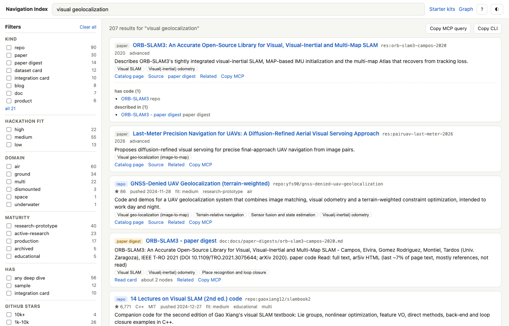

# Web UI

Static search and browse UI for the hub. No build step, no npm: `index.html`, `app.js`,
`style.css`, plus `data/index.json` generated by `tools/build.py` (`write_site`).



## Run

```sh
python3 tools/build.py          # writes site/data/index.json with everything else
python3 -m http.server 8000     # from the repo root, not from site/
# open http://localhost:8000/site/
```

Serve the repo root: the page fetches catalog and doc markdown from `../`. `file://` does not
work (fetch is blocked).

GitHub Pages: publish from the repo root and add an empty `.nojekyll` at the root, otherwise
Jekyll turns the `.md` files into HTML and the in-app page view cannot fetch them. Not tried on
Pages yet.

## What it does

- **Search** over every node (repos, resources, concepts, samples) and every deep-dive doc
  (integration cards, dataset cards, paper digests, landscape). Ranking is the same as
  `tools/query.py`: substring counts weighted name 5, tags 3, summary 2, why / hackathon notes /
  takeaways 1, ties broken by GitHub stars. Deep-dive docs are scored on their title (5), lead
  paragraph (2) and the first 1500 characters of plain text (1), so they rank next to the nodes.
  Empty query lists everything, high hackathon fit first.
- **Facets** with live counts (each facet counted with the other filters applied): kind, hackathon
  fit, domain, maturity, has (sample / integration card / any deep dive), GitHub stars range,
  language, license. OR within a facet, AND across facets. Docs inherit the concepts of the nodes
  they are about, so the concept filter finds them too.
- **Concept tree** in the sidebar; picking a concept includes its sub-concepts.
- **Result cards**: summary, stars / language / license / last push / maturity / fit, concept
  chips, links to the catalog page, source, sample README and deep dives, a **Related** panel from
  the graph edges (outgoing, incoming "(from)", deep dives that describe the node).
- **Page view**: catalog pages, deep-dive docs and sample READMEs rendered in-app with marked
  12.0.2 + DOMPurify 3.1.6 (cdnjs, pinned with SRI). Relative `.md` links stay in-app, directory
  links open their `README.md`, other files open raw. If the CDN is unreachable the markdown is
  shown as plain text. The right column shows the node's metadata and related panel.
- **Starter kits** (`#view=kits`): the samples with a verification badge and the full `verified`
  text from each `sample.json`. The badge is a keyword heuristic (`ran`, `sketch / not run`,
  `placeholder`) in `site_verify_status`; the text is the source of truth.
- **Copy MCP query** copies the current search as a `tools/mcp_server.py` call, e.g.
  `{"tool":"search","arguments":{"query":"visual geolocalization satellite","kind":"repo","fit":"high"}}`.
  Only single-valued kind / fit / domain and the concept map onto MCP arguments; a toast says
  which facets were dropped. **Copy CLI** gives the matching `tools/query.py` command. Per card,
  "Copy MCP" copies `{"tool":"show","arguments":{"id":...}}`.
- State lives in the URL hash (`#q=...&kind=repo&fit=high&concept=concept:vio`,
  `#page=<path>`, `#view=kits`), so links are shareable and back / forward work.
- Dark / light theme (follows the OS until toggled; the choice is kept in localStorage).
- Phone width: filters move into a drawer, the page view stacks.
- [Graph viewer](../graph/index.html) is linked from the header.

## Keyboard

| Key | Action |
|---|---|
| `/` | focus search |
| `j` `k` or arrows | move between results (Down / Enter in the search box jumps to the first) |
| `Enter` | open the selected result's page |
| `o` | open source URL |
| `r` | toggle the related panel |
| `c` | copy MCP `show` call |
| `s` | starter kits |
| `t` | toggle theme |
| `Esc` | close drawer / back to results / clear the search box |
| `?` | help |

## Data

`data/index.json` (about 1.3 MB for 1287 nodes + 189 docs) holds only what search, facets and
cards need: short keys (`i` id, `k` kind, `n` name, `s` summary, `w`/`h`/`kt` text fields, `g`
tags, `c` concepts, `d` domains, `f` fit, `m` maturity, `l` license, `lg` language, `st` stars,
`pu` last push, `u` url, `p` page path, `dd` deep dives, `r` outgoing edges as
`[node index, rel]`, `hs`/`hi` has-sample / has-integration-card, `v`/`vs`/`sd` sample
verification and dir; docs add `b` body excerpt and `ab` about-node indexes). Generated; do not
edit by hand.

## Verification

Done 2026-11-06 on macOS, Chrome headless (`--headless=new`) driven over the DevTools protocol
from Node 24, page served with `python3 -m http.server` from the repo root:

- `node --check app.js` passes. No console errors or exceptions during the run.
- `data/index.json` was produced by calling `write_site` on the current `index/records.jsonl` and
  `graph/graph.json` through a small harness, not by a full `tools/build.py` run.
- Ranking parity: `visual geolocalization satellite` with kind=repo, fit=high gives 32 results
  with the same top 5 in the same order as `python3 tools/query.py search ... --kind repo --fit high`.
- Five queries (top results as shown, docs interleaved with nodes):

| Query | Results | Top 3 |
|---|---|---|
| `lightglue` | 23 | LightGlue-ONNX integration card; repo fabio-sim/lightglue-onnx; sample geoloc-license-clean |
| `magnetic anomaly navigation` | 367 | SandboxAQ AQNav (product); MagNav challenge paper; Q-CTRL quantum-assured MagNav paper (concept magnetic-nav is 4th) |
| `gnss spoofing detection` | 531 | Rados 2024 review digest; the review paper; Psiaki-Humphreys digest |
| `uwb` | 22 | UTIL UWB TDoA dataset; MILUV dataset card; UWB Software Library repo |
| `terrain relative navigation particle filter` | 499 | sample terrain-relative-nav-pf; repo rhymesg/particle_filter; repo TERCOM via particle filter |

  Broad multi-word queries return many hits because, like `query.py`, any single term match
  counts; the ranking puts the specific items first.
- Facets: concept magnetic-nav + has integration card => 1 result (MagNav.jl).
- Keyboard: `j j r` selected the second card and opened its related panel (7 items); `Enter`
  opened its catalog page, whose relative links were rewritten to in-app routes; following the
  deep-dive link rendered the integration card with its side panel. `t` switched to dark.
- Starter kits view lists 16 samples (15 badged ran, 1 placeholder).
- 390 px viewport: `scrollWidth` 390, no horizontal scroll ([phone screenshot](screenshots/phone.png)).

Not tested: Firefox / Safari, GitHub Pages hosting, the CDN-offline fallback, clipboard writes
(headless has no clipboard to read back; the copied strings were checked by calling the same
functions).
