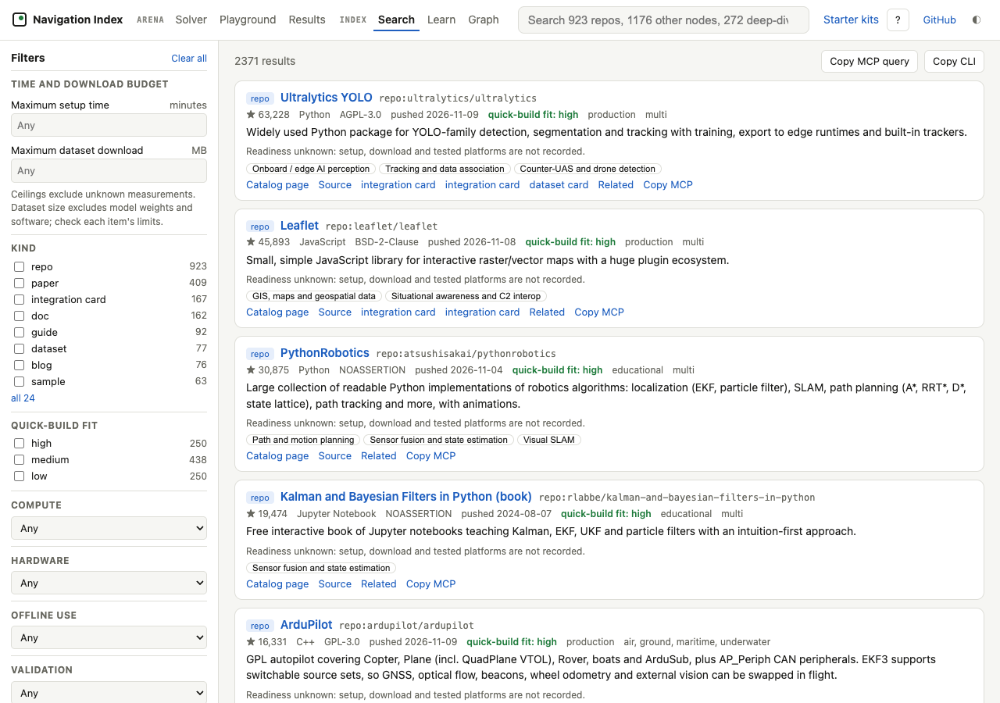

# Web UI

Static search and browse UI for the hub. No build step, no npm: `index.html`, `app.js`,
`style.css`, plus `data/index.json` generated by `tools/build.py` (`write_site`).



## Run

```sh
python3 tools/build.py          # writes site/data/index.json with everything else
python3 -m http.server 8000     # from the repo root, not from site/
# open http://localhost:8000/site/
```

Serve the repo root: the page fetches catalog and doc markdown from `../`. `file://` does not
work (fetch is blocked).

GitHub Pages: publish from the repo root and add an empty `.nojekyll` at the root, otherwise
Jekyll turns the `.md` files into HTML and the in-app page view cannot fetch them. Not tried on
Pages yet.

## Showcase page

`showcase.html` (+ `showcase.js`, `showcase.css`) is a one-page tour for people, not agents:
live counts from `data/index.json`, the arena replay, cards for every sample with a key result
(status and input type from its `sample.json`), and an SVG of the brief => decode => row =>
sample => repo flow.

Arena replay (all runs **synthetic**):

- **Arena picker**: 8 families from `data/showcase/replays_v2/index.json`
  (`close-area-replay-index/2`, written by `samples/close-area-benchmark/export_replays.py`),
  each tile a thumbnail drawn from the world JSON embedded in the replay (`close-area-world/1`).
  A ninth tile, "Pose faults (v1)", keeps the four older runs in `data/showcase/replays/`
  (`samples/close-area-arena/export_replay.py`), because v2 flies every run on the true pose and
  only v1 has the drifting EKF and 0.5 m jump.
- **Algorithm picker**: every planner on that arena (9 in v2), outcome dot and time to goal.
  The canvas draws boxes, walls and cylinders, glass in its own colour, the truth path, and for v1
  the estimated path and dark zones. Play / pause / speed / scrub, clearance sparkline, outcome badge.
- **Compare**: "Compare with" a second planner on the same layout; overlay on one canvas or side
  by side (two columns on desktop, stacked under 640 px). Both badges, both clearance lines and a
  two-column stats table.
- **Results grid**: planner x family, reached % / collision %, parsed at load time from
  `samples/close-area-benchmark/results/matrix_0.md` (20 layouts, seed 0), tabs for the `ideal`
  and `crazyflie` presets. A cell click replays layout 0 of that family and planner.
- **Try it yourself** links to `playground/index.html`.

URL state (read on load, rewritten with `history.replaceState` on every pick):

- `?family=office&planner=astar_known&vs=vfh_plus&view=side` preselects arena, planner, the
  compared planner and the side-by-side view. Unknown values fall back to `office` /
  `astar_known` with a note under the arena picker.
- `?run=` accepts a v1 name (`random_freest_jump`), a v1 index (`?run=2`), a file name with or
  without `.json`, or `<family>__<planner>` for v2. Before this change `?run=<name>` always opened
  run 0 (it was read with `parseInt`), and auto-advance moved on after 2.5 s. Any URL selection now
  stops the auto-advance.

Regenerate the v2 replays with `.venv/bin/python export_replays.py` in
`samples/close-area-benchmark`. The replays now live on the Results page (`site/showcase.html`
redirects there). Screenshots (headless Chrome, 2026-11-11, `node site/screenshots/capture_public.mjs`):
[desktop light](screenshots/public-results-1280-light.png),
[desktop dark](screenshots/public-results-1280-dark.png),
[phone 390 px light](screenshots/public-results-390-light.png),
[phone 390 px dark](screenshots/public-results-390-dark.png).

## What it does

- **Search** over every node (repos, resources, concepts, samples) and every deep-dive doc
  (integration cards, dataset cards, paper digests, landscape). Ranking is the same as
  `tools/query.py`: substring counts weighted name 5, tags 3, summary 2, why / build notes /
  takeaways 1, ties broken by GitHub stars. Deep-dive docs are scored on their title (5), lead
  paragraph (2) and the first 1500 characters of plain text (1), so they rank next to the nodes.
  Empty query lists everything, high quick-build fit first.
- **Facets** with live counts (each facet counted with the other filters applied): kind, quick-build
  fit, domain, maturity, has (sample / integration card / any deep dive), GitHub stars range,
  language, license. OR within a facet, AND across facets. Docs inherit the concepts of the nodes
  they are about, so the concept filter finds them too.
- **Practical constraints**: single-choice compute, hardware, offline use, validation and tested
  platform filters, plus maximum setup minutes and dataset download MB. Platform labels match
  exactly (for example `macos-arm64`). A ceiling excludes unknown measurements, including when
  the ceiling is zero. Dataset download size excludes software and model weights; check the
  documented limitations before choosing a stack. Invalid ceilings show no results and must be
  corrected before copying a query.
- **Concept tree** in the sidebar; picking a concept includes its sub-concepts.
- **Result cards**: summary, stars / language / license / last push / maturity / fit, concept
  chips, links to the catalog page, source, sample README and deep dives, a **Related** panel from
  the graph edges (outgoing, incoming "(from)", deep dives that describe the node).
  Readiness shows compute, hardware, offline use, setup and dataset download measurements,
  validation, tested platforms, limits and source links. Missing evidence remains unknown.
- **Page view**: catalog pages, deep-dive docs and sample READMEs rendered in-app with marked
  12.0.2 + DOMPurify 3.1.6 (cdnjs, pinned with SRI). Relative `.md` links stay in-app, directory
  links open their `README.md`, other files open raw. If the CDN is unreachable the markdown is
  shown as plain text. The right column shows the node's metadata and related panel.
- **Starter kits** (`#view=kits`): all samples with a reported verification badge, the full
  `verified` text from each `sample.json`, readiness and limitations. Read the text for what ran,
  which inputs were used, and whether the entire workflow or individual components were tested.
  Readiness applies to the documented demo path.
- **Copy MCP query** copies the current search as a `tools/mcp_server.py` call, e.g.
  `{"tool":"search","arguments":{"query":"visual geolocalization satellite","kind":"repo","fit":"high"}}`.
  Single-valued kind / fit / domain, the concept and all practical constraints map onto MCP
  arguments; a toast says which other facets were dropped. **Copy CLI** gives the matching
  `tools/query.py` command, with query text quoted for a shell. Constraints can be copied without
  a text query. Per card,
  "Copy MCP" copies `{"tool":"show","arguments":{"id":...}}`.
- State lives in the URL hash (`#q=...&kind=repo&fit=high&concept=concept:vio`,
  `#page=<path>`, `#view=kits`), so links are shareable and back / forward work.
  For example, `#kind=sample&compute=cpu&offline=verified&max_download_mb=0` finds CPU
  samples with verified offline use and a measured zero dataset download.
- Dark / light theme (follows the OS until toggled; the choice is kept in localStorage).
- Phone width: filters move into a drawer, the page view stacks.
- [Graph viewer](../graph/index.html) is linked from the header.

## Keyboard

| Key | Action |
|---|---|
| `/` | focus search |
| `j` `k` or arrows | move between results (Down / Enter in the search box jumps to the first) |
| `Enter` | open the selected result's page |
| `o` | open source URL |
| `r` | toggle the related panel |
| `c` | copy MCP `show` call |
| `s` | starter kits |
| `t` | toggle theme |
| `Esc` | close drawer / back to results / clear the search box |
| `?` | help |

## Data

`data/index.json` (about 1.3 MB for 1287 nodes + 189 docs) holds only what search, facets and
cards need: short keys (`i` id, `k` kind, `n` name, `s` summary, `w`/`h`/`kt` text fields, `g`
tags, `c` concepts, `d` domains, `f` fit, `m` maturity, `l` license, `lg` language, `st` stars,
`pu` last push, `u` url, `p` page path, `dd` deep dives, `r` outgoing edges as
`[node index, rel]`, `hs`/`hi` has-sample / has-integration-card, `v`/`vs`/`sd` sample
  verification and dir; `rd` readiness uses the shared contract in [SCHEMA](../docs/SCHEMA.md);
  docs add `b` body excerpt and `ab` about-node indexes). Generated; do not
edit by hand.

## Verification

After a deploy: `python3 tools/check_deploy.py` checks the live site (missing path => 404, pages
and scripts with the right content type, worker versions agree, deployed js equals the checkout,
Pyodide CDN answers). For a local server: `python3 tools/check_deploy.py http://127.0.0.1:8000/`.
CI runs it about 3 minutes after every push to main (`.github/workflows/deploy-smoke.yml`).

Constraint checks (2026-11-07): `node --test site/test_constraints.js` runs the actual browser
filtering, hash parsing and copy functions against replay, cached visual-localization and
unknown-readiness fixtures. It covers exact platform labels, zero and inclusive ceilings,
unknown/malformed measurements, combined filters, saved-link round trips, matching CLI/MCP
arguments, shell-sensitive query text and readiness/limits on results and starter kits.
`python3 tools/search_eval.py --parity` checks that browser and Python search ranking agree.

Done 2026-11-06 on macOS, Chrome headless (`--headless=new`) driven over the DevTools protocol
from Node 24, page served with `python3 -m http.server` from the repo root:

- `node --check app.js` passes. No console errors or exceptions during the run.
- `data/index.json` was produced by calling `write_site` on the current `index/records.jsonl` and
  `graph/graph.json` through a small harness, not by a full `tools/build.py` run.
- Ranking parity: `visual geolocalization satellite` with kind=repo, fit=high gives 32 results
  with the same top 5 in the same order as `python3 tools/query.py search ... --kind repo --fit high`.
- Five queries (top results as shown, docs interleaved with nodes):

| Query | Results | Top 3 |
|---|---|---|
| `lightglue` | 23 | LightGlue-ONNX integration card; repo fabio-sim/lightglue-onnx; sample geoloc-license-clean |
| `magnetic anomaly navigation` | 367 | SandboxAQ AQNav (product); MagNav challenge paper; Q-CTRL quantum-assured MagNav paper (concept magnetic-nav is 4th) |
| `gnss spoofing detection` | 531 | Rados 2024 review digest; the review paper; Psiaki-Humphreys digest |
| `uwb` | 22 | UTIL UWB TDoA dataset; MILUV dataset card; UWB Software Library repo |
| `terrain relative navigation particle filter` | 499 | sample terrain-relative-nav-pf; repo rhymesg/particle_filter; repo TERCOM via particle filter |

  Broad multi-word queries return many hits because, like `query.py`, any single term match
  counts; the ranking puts the specific items first.
- Facets: concept magnetic-nav + has integration card => 1 result (MagNav.jl).
- Keyboard: `j j r` selected the second card and opened its related panel (7 items); `Enter`
  opened its catalog page, whose relative links were rewritten to in-app routes; following the
  deep-dive link rendered the integration card with its side panel. `t` switched to dark.
- Starter kits view lists 16 samples (15 badged ran, 1 placeholder).
- 390 px viewport: `scrollWidth` 390, no horizontal scroll (current [phone screenshot](screenshots/public-search-390-light.png), retaken 2026-11-11 after the nav redesign; `public-check.json` records scrollWidth 390 there too).

Not tested: Firefox / Safari, GitHub Pages hosting, the CDN-offline fallback, clipboard writes
(headless has no clipboard to read back; the copied strings were checked by calling the same
functions).
