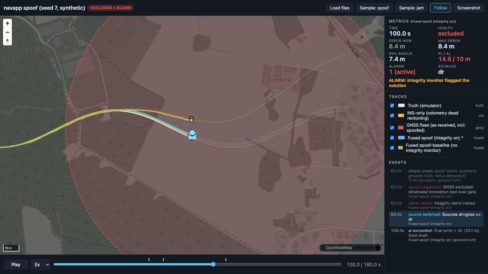

<!-- about: repo:maplibre/maplibre-gl-js, repo:spatialillusions/milsymbol, repo:protomaps/pmtiles -->
# Demo dashboard

Judge-facing replay of a navigation run: truth, INS-only, fused, GNSS fixes and alt-PNT fixes on
a dark map, with the error circle, protection level vs alert limit, alarms, interference zones
and a clickable event timeline. Static files, no build step. Companion to
[project-repo/](../project-repo/) (its `src/navapp` writes the runs this page replays).



Captured headless (Chrome + SwiftShader) from the shipped sample: `sample/spoof`, t = 100 s. The
fused track (blue) has excluded GNSS since 69 s; the baseline without an integrity monitor
(green) follows the spoofed fixes (red dots) north. Second capture: [jam at t=90 s](screenshots/jam-t90.jpg).

## Run

```sh
cd templates/demo-dashboard
python3 -m http.server 8000
# open http://localhost:8000/?manifest=sample/spoof/manifest.json
```

`file://` does not work (the page fetches its data). Any static server does.

From your own navapp runs:

```sh
make -C ../project-repo sim                       # writes ../project-repo/runs/*.jsonl
python3 convert_navapp.py ../project-repo/runs/spoof.jsonl ../project-repo/runs/spoof-baseline.jsonl \
  --out runs/spoof --alert-limit 10
# open http://localhost:8000/?manifest=runs/spoof/manifest.json
```

The first input becomes the primary fused track (the one the metrics, rings and vehicle symbol
follow). `python3 -m unittest test_convert` checks the converter against a fresh navapp run.

## Controls

| Input | Effect |
|---|---|
| Load files / drag and drop | Add `.jsonl` tracks and a `.geojson` zone file; a track with the same `track` id is replaced |
| Space, Play | Play / pause; speed 0.5x to 20x |
| Left / Right (Shift: x10), Home | Step 1 s / 10 s, rewind |
| Scrub bar, event list, event ticks | Seek; ticks above the bar are colour coded like the event list |
| Track checkbox / colour swatch | Show or hide a track (its events too); recolour it |
| F, Follow | Keep the vehicle centred; dragging the map turns it off |
| S, Screenshot | PNG of the map + vehicle symbol + a metrics box, named `navdemo-t<time>.png` |

URL parameters: `manifest=`, `src=` (repeatable) with `zones=`, `t=` start time, `speed=`,
`autoplay=1`, `follow=0`, `al=` alert limit override (m), `basemap=osm|none|pmtiles`,
`pmtiles=<url>`, `tiles=<xyz template>` for another raster tile server.

## What the panel shows

| Field | Source | When it reads "not measured" / "n/a" |
|---|---|---|
| Error now, max error | distance primary fused => truth, interpolated at the replay time | no `truth` track loaded |
| 95% radius (filled circle) | `r95_m` | field absent |
| PL / AL (solid ring / dashed ring) | `pl_m`; AL from `al=` or the primary header `alert_limit_m` | field absent |
| Alarms | count of rising edges of `alarm` up to now | field absent |
| Flag line | `HAZARDOUSLY MISLEADING` (error > AL, no alarm), `MISLEADING` (error > PL, no alarm), `ALARM`, `PL > AL` (integrity not available), in that priority | |

`al_exceeded` events are derived in the page from truth, marked "ground truth", and are not
something the system under test detected.

## JSONL schema `navdash/1`

One file per track. Line 1 is a header; then position lines and optional event lines, any order
(the page sorts by `t`).

```json
{"header":{"schema":"navdash/1","track":"fused-spoof","role":"fused","label":"Fused spoof","color":"#4fc3f7","primary":true,"alert_limit_m":10}}
{"t":68.0,"lat":59.0010534,"lon":10.0071064,"r95_m":2.32,"pl_m":4.548,"health":"trusted","alarm":false,"sources":["dr","gnss"]}
{"t":69.0,"event":"spoof_suspected","text":"GNSS excluded: windowed innovation test over gate"}
```

Header fields:

| Field | Required | Meaning |
|---|---|---|
| `schema` | yes | `navdash/1` |
| `track` | yes | unique id; also used for layer ids |
| `role` | yes | `truth`, `ins`, `fused` (drawn as lines) or `gnss`, `altpnt` (drawn as fading fix dots) |
| `label`, `color` | no | legend text, CSS colour; defaults per role |
| `primary` | no | the fused track the metrics follow; else the first `fused` |
| `alert_limit_m` | no | horizontal alert limit, read from the primary track |
| anything else | no | carried along (the converter adds `pl_method`, `r95_method`, `run_meta`) |

Position line: `t` (s, any epoch, same clock across files), `lat`, `lon` (WGS84 degrees) are
required. Optional: `r95_m`, `pl_m` (m), `health` (`trusted|suspect|excluded|unavailable` or any
string), `alarm` (bool), `sources` (list of strings). Lines interpolate between samples unless the
gap is over 5 median periods; a fix dot counts as "current" for 3 median periods.

Event line: `t`, `event`, optional `text`, optional `ground_truth: true` (scenario label, not a
detection). Known `event` values get colours: `attack_onset`, `gnss_lost`, `gnss_restored`,
`spoof_suspected`, `fix_excluded`, `fix_readmitted`, `alarm_raised`, `alarm_cleared`,
`source_switched`, `al_exceeded`. Others render in the default colour.

Zones: a GeoJSON FeatureCollection of polygons with properties `kind` (`jamming`, `spoofing`,
anything else), `label`, optional `t_start` / `t_end` (s, same clock). A zone is highlighted while
the replay time is inside its window.

Manifest: `{"title": "...", "tracks": ["truth.jsonl", ...], "zones": "zones.geojson"}`, paths
relative to the manifest.

## What the converter does and does not derive

From each navapp run it writes `fused-<run>.jsonl` (position, `r95_m` = 2.45 x `sigma_h`,
`pl_m`, health, alarm, sources, events from health / alarm / source transitions) and, from the
first run, `truth.jsonl` and an `attack_onset` event from the scenario header.

- **PL is not a certified protection level.** `pl_m` = k x `sigma_h`, k = sqrt(-2 ln 1e-5) = 4.80
  (isotropic 2D Gaussian tail of the filter's own sigma; `--integrity-risk` changes it). The header
  says so in `pl_method`. In the spoof sample the true error exceeds this PL before the alarm
  fires (the dashboard flags MISLEADING at 66 to 68 s, error 5.6 to 7.1 m vs PL 4.5 m), which is the
  optimistic-uncertainty gap the project-repo README describes.
- **GNSS fixes and the INS-only track are regenerated, not logged.** navapp's JSONL has no raw
  fixes, so the converter re-runs `navapp.sim.SyntheticSource` with the scenario in the run
  header (same seed) and refuses if the regenerated truth differs from the logged truth by more
  than 1 mm. INS-only = odometry integrated from the first fix, as the filter does. For a real
  log or SITL, write `gnss.jsonl` / `ins.jsonl` from the recorded data instead (`--no-sensors`).
- **Zones are synthetic.** A circle around the truth track during the attack window, padded
  150 m. It is not an emitter footprint. Replace it with your own GeoJSON.
- **No alt-PNT sample.** The schema supports `role: "altpnt"` (visual geolocation, TRN, etc.);
  navapp produces none, so no sample file exists.
- `fix_excluded` vs `spoof_suspected`: the chi-square monitor cannot tell spoofing from any
  other fault; the converter names the exclusion `spoof_suspected` because that is the demo
  narrative. Rename it if your monitor says something more specific.

## Offline

- Libraries: `sh fetch-vendor.sh` copies the pinned files (maplibre-gl 4.7.1, milsymbol 3.0.4,
  pmtiles 4.4.1, all from unpkg) into `vendor/`. `index.html` loads the CDN copy and falls back to
  `vendor/` when it fails. `vendor/` is git-ignored.
- Basemap: `basemap=none` gives a plain dark background. For a real offline map, extract an area
  from a Protomaps basemap build with the `pmtiles` CLI (`pmtiles extract <build url> area.pmtiles
  --bbox=<minlon,minlat,maxlon,maxlat>`, see the [PMTiles docs](https://docs.protomaps.com/pmtiles/cli)),
  put it next to the page and open `?pmtiles=area.pmtiles`. Raster archives (PNG/JPEG/WebP tiles)
  are drawn as-is; vector archives get a minimal unlabeled dark style for the Protomaps layer
  names (`earth`, `landuse`, `water`, `buildings`, `roads`).
- OSM tiles are the default for convenience. Their [tile usage policy](https://operations.osmfoundation.org/policies/tiles/)
  forbids bulk download (scripted fetches get a 403 "Access blocked" tile), so do not try to
  pre-seed a cache from `tile.openstreetmap.org`.

## Symbol

The vehicle is `SFAPMFQ--------` (MIL-STD-2525C letter SIDC: friend, air, military fixed-wing
UAV), the same function as the CoT type `a-f-A-M-F-Q` that project-repo's `CotPublisher` emits,
rendered by milsymbol. Other tracks get plain dots so only one symbol is on screen.

## Verification

Done on this template (macOS, Chrome headless with SwiftShader WebGL, Node 24):

- `node --check app.js` passes; `python3 -m unittest test_convert` passes (2 tests).
- Page served with `python3 -m http.server`, loaded headless via the Chrome DevTools protocol:
  spoof and jam samples render; metrics at spoof t = 110 s read error 10.2 m, 95% radius 8.4 m,
  PL 16.5 / AL 10 m, health excluded, 1 alarm; the derived `al_exceeded` event lands at 108 s.
  Jam max error over the run reads 4.4 m. Both agree with the project-repo README table (ATE max
  4.44 m jam; 10.1 m error at 108 s, alarm at 69 s spoof).
- Autoplay at 20x ran to the end without console errors; the Screenshot button produced a
  660 KB PNG (OSM tiles are CORS-enabled, so the canvas was not tainted).
- CDN blocked (`--host-resolver-rules`) with `vendor/` present: all three libraries loaded from
  `vendor/` and the page rendered.
- Raster PMTiles path: rendered a locally generated synthetic PNG-tile archive. The **vector**
  PMTiles style was not tested (no Protomaps extract was downloaded).
- 390 px wide viewport: no horizontal scroll; panels stack under the map.
- Not tested: Firefox / Safari, a real projector, large logs (the page re-slices each line track
  every frame; fine at 181 points, untested at 100k).
