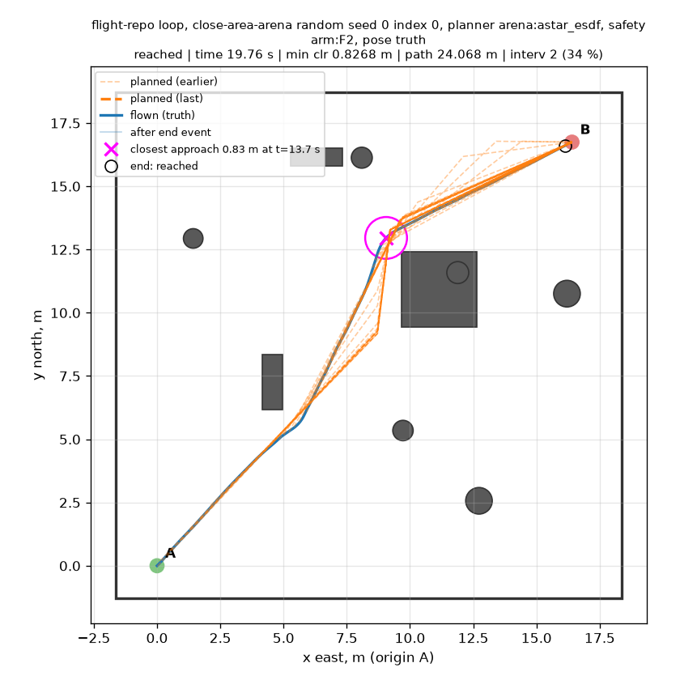
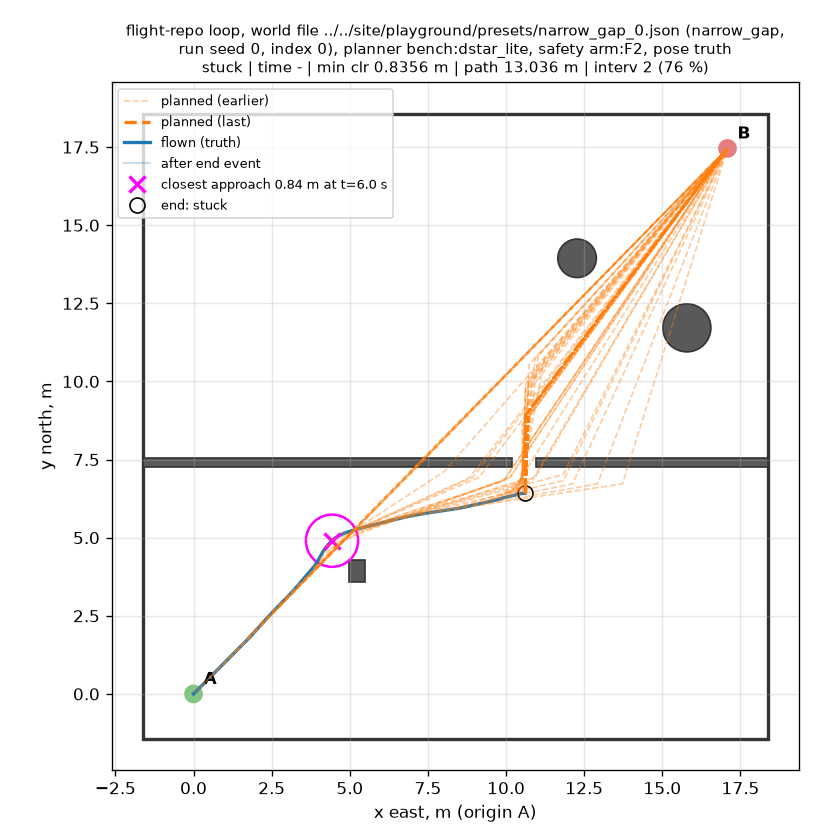

# flight-repo: close-area A=>B flight loop starter

Use this when the task is "fly from A to B in a close area, maybe with obstacles": clone it in the first hour
as your team's repo. Platform drivers: [../drone-adapter/drivers/](../drone-adapter/drivers/README.md).
Planners and measured baselines (synthetic): [close-area-arena](../../samples/close-area-arena/README.md).
For a GNSS / PNT-integrity brief use [../project-repo/](../project-repo/README.md) instead.

It is the loop skeleton, runnable today on a mock with no dependencies:

```
Adapter.pose() + ranges() => NavHealth => Planner.step() => SafetyFilter.filter() => Adapter.send_setpoint()   at 20 Hz
```

Stdlib Python only (runs below on 3.14.6; unit tests also pass on 3.12). Nothing here has touched a real vehicle or a SITL.
Status: quick-build starter, not flight-tested, not for operational use.

## Run it

```sh
make test    # 11 unit tests on the mock, bench: loading test under ./.venv, stdlib import check, 3 s arena smoke flight (venv parts skip without .venv or the hub)
make sim     # 4 mock flights, one score line each, JSONL logs in runs/
make arena   # the hub's arena "straight" planner flown through this loop (needs the hub checkout)
python3 main.py --mock          # A=(0,0,1) => B=(5,3,1), one-line score
make first-flight   # arena world + A* planner + F2 safety arm, scored => results/first_flight.png
make first-flight-reloc   # jump fault + relocalization, scored, plus an ODOMETRY dry-run JSONL
make first-flight PLANNER=bench:dstar_lite WORLD=../../site/playground/presets/narrow_gap_0.json   # any Solver pick, any world file
make bench-list     # the PLANNER=bench:<id> ids
```

Copied out of the hub (the usual first-hour case), every target that needs the hub takes its path:

```sh
make first-flight HUB=/path/to/navigation-index        # sets ARENA, SAFETY, RELOC and BENCH below it
make first-flight HUB=/path/to/navigation-index PLANNER=bench:dstar_lite WORLD=/path/to/navigation-index/site/playground/presets/narrow_gap_0.json
make first-flight ARENA=/path/to/hub/samples/close-area-arena SAFETY=/path/to/hub/samples/close-area-safety-filter
```

Without them, `make first-flight` stops before creating anything and prints the line above
(rc 2, 0.02 s). The venv is always `./.venv` in this folder (`VENV=` to change it), never in the hub.
Both forms were run on a copy in a temp dir: [results/copied_out_dry_run.txt](results/copied_out_dry_run.txt)
(script [copied_out_dry_run.sh](results/copied_out_dry_run.sh)).

## Brief to first flight

First hour of the task: clone, plug in a planner, fly, score. This chain runs as one command, in
the hub's shared [close-area-arena](../../samples/close-area-arena/README.md) world. All
numbers below are **synthetic** (simulated layout, vehicle, range sensor and estimator).

```sh
cd templates/flight-repo     # or your copy, adding HUB=/path/to/navigation-index to each make call
make first-flight        # builds ./.venv with uv on first use, flies, scores
make first-flight-jump   # same flight on the arena estimator with its "jump" fault
make first-flight-reloc  # jump fault + relocalization after VIO loss
```

`make first-flight` runs these, in order:

```sh
uv venv .venv && uv pip install --python .venv -r ../../samples/close-area-arena/requirements.txt   # only if missing
.venv/bin/python main.py --adapter arena:random:0 --planner arena:astar_esdf --safety arm:F2 --arena ../../samples/close-area-arena --safety-dir ../../samples/close-area-safety-filter --log results/first_flight.jsonl
.venv/bin/python ../../samples/close-area-arena/score_log.py results/first_flight.jsonl --plot results/first_flight.png --json results/first_flight_score.json
```

What each piece is:

| Flag | Code | What it does |
|---|---|---|
| `--adapter arena:<family>:<seed>[:<index>]` | `flightloop/arena_adapter.py: ArenaAdapter` | Arena `SimAdapter` on layout (family, seed, index), same world, sensor seed and start yaw as the arena's `run.run_one`. Lockstep: each `send_setpoint()` runs the 50 Hz physics to the next 20 Hz tick (2 or 3 steps, so `pose.t` steps 0.04 / 0.06 s). Truth clearance under 0.15 m freezes the vehicle |
| `--fault none\|jump\|bias\|dropout\|overconfident` | same | Pose from the arena `estimator.make_pose_source_factory(fault, dark=True)`. Omit => truth pose |
| `--planner arena:astar_esdf` | `main.load_arena_planner` | Arena A* + ESDF, known prior map (`uses_grid = True`, gets the layout grid) |
| `--planner bench:<id>` | `flightloop/bench_planner.py` | Any [close-area-benchmark](../../samples/close-area-benchmark/README.md) row, built by its `bench.PLANNERS[id]` factory with the World (section "Fly what the Solver picks") |
| `--adapter world:<file.json>[:<seed>]` | `arena_adapter.ArenaAdapter.from_world_json` | Same SimAdapter on a close-area-world/1 file (`world_json.from_json`), e.g. a playground preset. Seed = run seed for sensor noise and estimator (default 0, as the playground) |
| `--safety arm:F0\|F1\|F2` | `flightloop/safety_shim.py: ArmShim` | Kill-test arm from [close-area-safety-filter](../../samples/close-area-safety-filter/README.md) `filters.py`, called with the arena World, a health dict and dt 0.05 s |
| `--log` | `arena_adapter.CloseAreaLog` | Turns each loop line into [close-area-log/1](../../samples/close-area-arena/log_format.md), adding `truth` (sim truth at the same `pose()` call) and `planned` (A* `path_xy`, when it changes). Loop fields kept as extras: `loop_mode`, `health`, `source`, `reasons`, `plan_ms` |

### Arrival rule (flightloop/loop.py)

The loop declares `arrived` only on a confirmed estimate:

| Situation, estimate within `GOAL_TOL_M` (0.2 m) of B | What happens |
|---|---|
| Health `ok` for `ARRIVE_DWELL_S` (1.0 s) in a row | Hover meanwhile (`mode=arrive_dwell`), then `mode=arrived`, `run()` returns `outcome=arrived` |
| Health `degraded` or `lost` | Hover and wait (`mode=arrive_wait`) |
| `ARRIVE_WAIT_S` (10.0 s) after first entering the tolerance, still not confirmed | `mode=unconfirmed`, `run()` returns `arrived=False`, `outcome=unconfirmed` |

`ArmShim` passes the loop's `HealthReport` to arms whose `filter()` has a `nav_health`
parameter. F0-F2 have none and get the unchanged kill-test call.

### Result (2026-11-09, synthetic, macOS arm64, uv picked CPython 3.11.15, numpy 2.4.6)

Score line from `main.py` (truth, 50 Hz physics) and `score_log.py` (truth from the 20 Hz log),
with the arrival rule, from [results/first_flight_health_gate.txt](results/first_flight_health_gate.txt):

```
score input=synthetic adapter=arena:random:0 fault=truth planner=arena:astar_esdf safety=arm:F2 reached=True final_dist_m=0.165 t_s=21.10 collided=False min_clearance_m=0.827 max_pose_error_m=0.000 ticks=423 intervened=136 keepalive=0 planner_errors=0 modes=arrive_dwell:20,arrived:1,nominal:402 health=ok:423 log=results/first_flight.jsonl
input            synthetic (positions from truth)
outcome          reached
time to goal     19.76 s   (run ends at 19.76 s, 0.299 m from B)
min clearance    0.8268 m   at [9.055, 12.959, 13.66] (x, y, t)
path length      24.068 m   (straight A=>B 23.442 m)
interventions    2   fraction 0.3434 of logged steps
```

The 1.0 s dwell adds 20 ticks and moves the run end from 20.10 s to 21.10 s. Before the
rule: `reached=True final_dist_m=0.185 t_s=20.10 ticks=403`
([results/first_flight.txt](results/first_flight.txt)).



Log [results/first_flight.jsonl](results/first_flight.jsonl), metrics
[results/first_flight_score.json](results/first_flight_score.json).

Wall time, `make first-flight` from cold (no arena venv, empty uv cache, so all 12 wheels
download; measured when the venv lived in the arena folder, before it moved to `./.venv` on 2026-11-09):

| Run | Wall s | Source |
|---|---|---|
| Cold, whole target | 205.89 (user CPU 2.77) | [results/first_flight.txt](results/first_flight.txt) |
| Cold, split: `make venv` + first `make first-flight` | 14.68 + 20.89 | [results/first_flight_split.txt](results/first_flight_split.txt) |
| Warm (venv built) | 4.94, 2.48 | [first_flight_warm.txt](results/first_flight_warm.txt), [first_flight_split.txt](results/first_flight_split.txt) |

The flight itself is a few seconds; the first Python start on a fresh venv took 20.89 s and
the 205.89 s run spent almost all its time waiting, not computing (2.77 s CPU). Cause not
found: network or first-launch file checks are guesses. Budget 4 minutes for the cold step.
In the copied-out dry run (fresh `./.venv`, uv cache warm) `make first-flight` took 99.74 s wall,
2.19 s user CPU ([copied_out_dry_run.txt](results/copied_out_dry_run.txt)): the same waiting.

Cross-check, same layout, from [results/first_flight_arms.txt](results/first_flight_arms.txt):
with `--safety arm:F0` (no filter) this loop gives reached, 19.46 s, min clearance 0.5643 m,
path 23.84 m. The arena's own 10 Hz harness gives reached, 19.38 s, 0.5647 m, 23.838 m for
`astar_esdf known_map` run 0 ([astar_esdf_random_0.json](../../samples/close-area-arena/results/astar_esdf_random_0.json)).
So the 20 Hz loop reproduces the arena within 0.08 s and 0.0004 m. F2 adds 0.26 m of clearance
(0.8268 m) and 0.30 s.

### With the estimator jump fault: not reached, loop says `unconfirmed`

`make first-flight-jump` ([score JSON](results/first_flight_jump_score.json), [plot](results/first_flight_jump.png),
lines in [results/first_flight_health_gate.txt](results/first_flight_health_gate.txt)):

```
score input=synthetic adapter=arena:random:0 fault=jump planner=arena:astar_esdf safety=arm:F2 reached=False final_dist_m=0.640 t_s=44.60 collided=False min_clearance_m=0.401 max_pose_error_m=0.741 ticks=893 intervened=172 keepalive=0 planner_errors=0 modes=arrive_wait:200,capped:345,nominal:347,unconfirmed:1 health=degraded:546,ok:347 log=results/first_flight_jump.jsonl
outcome          stuck
```

- The truth still ends 0.640 m from B, outside the 0.3 m goal disc: the gate does not fix the
  estimate, it stops the loop from lying about it. The loop now ends `mode=unconfirmed`, not
  `arrived`.
- The estimate entered `GOAL_TOL_M` at t=34.6 s with health `degraded` (`sigma_xy=0.40`, above
  `SIGMA_DEGRADED_M` 0.30). The vehicle hovered 200 ticks (10 s, `ARRIVE_WAIT_S`); sigma never
  dropped, so no confirmation. The scorer calls the hover-to-end `stuck`.
- Before the rule the same flight ended `modes=arrived:1`, `final_dist_m=0.634`, `t_s=34.60`
  ([results/first_flight_warm.txt](results/first_flight_warm.txt)).
- Health was `degraded` on 346 of 693 flying ticks before the wait (speed capped at 0.3 m/s);
  the 200 wait ticks are degraded too (546 total).
- Without a filter (`arm:F0`, same fault) min clearance was 0.1848 m against the 0.15 m radius;
  with F2 0.402 m ([first_flight_arms.txt](results/first_flight_arms.txt)). One layout, one seed:
  this is a first flight, not a rate. Rates are in the kill test
  ([close-area-safety-filter](../../samples/close-area-safety-filter/README.md)).
- The fix is a map-based re-anchor: next section.

### With relocalization: `make first-flight-reloc` reaches B, `arrived`

Same layout, planner, F2 arm and jump fault, plus `--reloc`: when VIO is lost the loop hovers,
the hub's relocalizer matches the range scan against the prior map and re-anchors the estimate.
Raw output: [results/first_flight_reloc.txt](results/first_flight_reloc.txt) (all three
first-flight targets, 2026-11-09, uv CPython 3.11.15, numpy 2.4.6, scipy 1.17.1, synthetic).

```
score input=synthetic adapter=arena:random:0 fault=jump planner=arena:astar_esdf safety=arm:F2 reached=True final_dist_m=0.120 t_s=31.06 collided=False min_clearance_m=0.477 max_pose_error_m=0.488 ticks=622 intervened=154 keepalive=0 planner_errors=0 outcome=arrived modes=arrive_dwell:20,arrived:1,capped:207,nominal:362,reloc_hover:32 health=degraded:207,lost:32,ok:383 log=results/first_flight_reloc.jsonl
reloc arm=multi_ig events=4 reanchors=4 wrong_commits=0 open_at_end=0 moves=0 reasons=innovation,reset_counter,innovation,innovation odometry_reset_counter=4 increments_t=[2.1, 6.3, 22.2, 25.8] odometry_lines=622 odom=results/first_flight_reloc_odometry.jsonl
outcome          reached
time to goal     29.6 s   (run ends at 29.6 s, 0.293 m from B)
```

| | jump, no reloc | jump + reloc |
|---|---|---|
| Loop outcome | `unconfirmed` | `arrived` |
| Truth distance to B at the end | 0.640 m | 0.120 m |
| Scorer outcome, time to goal | stuck, - | reached, 29.6 s |
| Max pose error (estimate vs truth) | 0.741 m | 0.488 m |
| Min clearance | 0.401 m | 0.477 m |
| Hover while relocalizing | - | 32 ticks (1.6 s) over 4 events |

- 4 loss events: the jump fault's `reset_counter` change (t 5.9 s) and 3 innovation-test triggers
  (scan no longer fits the map at the estimate). All 4 accepted after 0.4 s, 0 wrong commits
  (> 0.5 m from truth at accept), 0 disambiguating moves needed on this open layout.
- The ODOMETRY stream ([results/first_flight_reloc_odometry.jsonl](results/first_flight_reloc_odometry.jsonl),
  one line per tick) follows the contract in hub doc 10 section 4: quality 0 while relocalizing,
  then one `reset_counter` increment sent with quality back up. Transitions from that file:

| time_usec | reset_counter | quality |
|---|---|---|
| 1700000 | 0 | 90 => 0 |
| 2100000 | 0 => 1 | 0 => 90 |
| 5900000 | 1 | 90 => 0 |
| 6300000 | 1 => 2 | 0 => 90 |
| 21800000 | 2 | 25 => 0 |
| 22200000 | 2 => 3 | 0 => 25 |
| 25400000 | 3 | 25 => 0 |
| 25800000 | 3 => 4 | 0 => 25 |

  PX4 EKF2 at v1.17.0 treats a changed counter as a reset (`ev_control.cpp:52`) and snaps the
  horizontal position to the new pose (`ev_pos_control.cpp:246`), per
  [doc 10 section 4](../../docs/research/close-area-nav/10-relocalization-prior-art.md#4-what-the-autopilots-do-with-reset_counter).
  Not sent to PX4 here. Quality 25 after the last two events is the estimator's dark-zone
  quality; PX4 fuses it only if `EKF2_EV_QMIN` is 25 or lower (not checked).

How it is wired:

- `flightloop/reloc_shim.py: RelocShim` builds `DisambPoseSource(kind="infogain")`, the arm
  (f) `multi_ig` of [close-area-relocalize](../../samples/close-area-relocalize/README.md), loaded by
  path from `RELOC` (`--reloc-dir`), and installs it as the arena SimAdapter's pose source. It
  runs at 10 Hz (`RELOC_HZ`, the rate it was measured at); 20 Hz ticks in between get raw + anchor.
- `loop.run(..., reloc=shim)`: while `shim.relocalizing`, `mode=reloc_hover` (zero velocity) or
  `mode=reloc_move` (the info-gain move `shim.cmd`), always through the safety filter. The goal
  check is off while relocalizing; on resume the planner replans at once.
- The loop's NavHealth sees the estimator's own `reset_counter`; the re-anchor count goes only to
  the ODOMETRY stream.
- Map-consistency rule, this file's own (not in the sample's measurements): when the 10 Hz scan
  scores >= 0.5 at the reported pose, `sigma_xy` is reported as at most `MAP_SIGMA_M` = 0.10 m
  (the matcher's likelihood width, assumed, not fitted). Without it the dark-zone sigma
  (0.40 m at B) would keep health `degraded` and the arrival rule would never confirm.

Limits of this result: one layout, one seed, one fault, synthetic. The relocalizer's rates come
from the sample's held-out matrix: arm (f) passed (>= 95 % reached, 0 wrong commits) only on the
open layouts, random and u_trap (100 % each, 180 runs); it failed on narrow_gap, office,
warehouse, maze and glass_office ([sample README](../../samples/close-area-relocalize/README.md#held-out-matrix-seeds-2-4-7-families-harder-faults)).
It needs a prior map and a dense range fan (72 beams, 6 m); yaw is truth in the sim.

## Fly what the Solver picks: `bench:<id>` in a `world:` file

The playground Solver ranks the [close-area-benchmark](../../samples/close-area-benchmark/README.md)
rows. Any of them flies in this loop:

```sh
make first-flight PLANNER=bench:dstar_lite WORLD=../../site/playground/presets/narrow_gap_0.json
# = .venv/bin/python main.py --adapter world:<WORLD> --planner bench:dstar_lite --safety arm:F2 ... --bench-dir ../../samples/close-area-benchmark
#   then score_log.py => results/first_flight_bench_dstar_lite_narrow_gap_0.{jsonl,png} and _score.json
make first-flight PLANNER=bench:mppi_astar WORLD=my_world.json ARM=F0 OUT=my_run   # no filter, own file names
```

- `flightloop/bench_planner.py` imports `samples/close-area-benchmark/bench.py` by path
  (`spec_from_file_location`), the way `site/playground/worker.js` loads sample folders. bench.py
  then loads the arena and every planner sample from its own folder, so nothing in the hub is
  edited. Copied out, pass `HUB=` (or `BENCH=`): [results/copied_out_bench.txt](results/copied_out_bench.txt)
  ran it from a copy with `HUB=` (same score line) and without (rc 2, the path hint).
- Every factory gets the World. `needs_world` below = the factory reads the area bounds
  (geofence for the unknown-map log-odds map); the others ignore it.
- The 120 s limit of bench.py `LONG_FAMILIES` (maze, warehouse) now applies to both adapters
  when `--timeout` is not given; other families keep 60 s.

### Result (2026-11-10, synthetic, ./.venv uv CPython 3.11.15, numpy 2.4.6, scipy 1.17.1)

`make first-flight PLANNER=bench:dstar_lite WORLD=../../site/playground/presets/narrow_gap_0.json`,
from [results/first_flight_bench.txt](results/first_flight_bench.txt):

```
score input=synthetic adapter=world:../../site/playground/presets/narrow_gap_0.json fault=truth planner=bench:dstar_lite safety=arm:F2 reached=False final_dist_m=12.804 t_s=60.00 collided=False min_clearance_m=0.835 max_pose_error_m=0.000 ticks=1201 intervened=1088 keepalive=1 planner_errors=0 outcome=timeout modes=nominal:1200,timeout:1 health=ok:1201 log=results/first_flight_bench_dstar_lite_narrow_gap_0.jsonl
outcome          stuck
time to goal     -   (run ends at 23.0 s, 12.8 m from B)
min clearance    0.8356 m   at [4.432, 4.903, 6.0] (x, y, t)
```



**Check against the playground parity row: FAIL with F2 (the default arm), same outcome with F0.**
The row, from [site/playground/README.md](../../site/playground/README.md) (seed 0, ideal sensor,
truth pose, no filter, browser = native):

```
| narrow_gap_0 | dstar_lite | reached / 24.52 / 0.3288 / 25.187 | 1.28 | 0.824 |
```

| Run (all synthetic, narrow_gap_0, seed 0, truth pose) | Outcome | Time to goal s | Min clearance m | Path m | Source |
|---|---|---|---|---|---|
| Playground parity row (worker driver, 10 Hz planner) | reached | 24.52 | 0.3288 | 25.187 | site/playground/README.md |
| Arena `run.run_one` + `bench.PLANNERS["dstar_lite"]`, this checkout | reached | 24.52 | 0.3288 | 25.187 | [bench_parity.txt](results/bench_parity.txt) |
| This loop, 20 Hz, `arm:F0` (no filter) | reached | 24.96 | 0.293 | 25.195 | [first_flight_bench.txt](results/first_flight_bench.txt), [score JSON](results/first_flight_bench_dstar_lite_narrow_gap_0_F0_score.json), [plot](results/first_flight_bench_dstar_lite_narrow_gap_0_F0.png) |
| This loop, 20 Hz, `arm:F2` (`make first-flight` default) | stuck (timeout at 60 s) | - | 0.8356 | 13.036 | [score JSON](results/first_flight_bench_dstar_lite_narrow_gap_0_score.json) |

Times, clearance and path for this loop are `score_log.py` on the 20 Hz log.

What the F2 filter changes: the vehicle stops at about (10.6, 6.45), in front of the gap in the
wall at y = 7.41. From the preset's two wall boxes the gap is 0.764 m wide (x 10.197 to 10.961).
F2 (eps = 0.7 m) holds the centre 0.7 m from every return, which closes passages narrower than
about 1.4 m ([close-area-safety-filter README](../../samples/close-area-safety-filter/README.md):
F0 reaches 10 of 10 narrow_gap layouts with truth pose, F2 0 of 10). The planner keeps planning
through the gap (orange lines); the filter changed the setpoint on 1088 of 1201 ticks. The
benchmark row `astar_unknown_f2` shows the same thing: 0 % reached on narrow_gap, 100 % stuck
([matrix_0.md](../../samples/close-area-benchmark/results/matrix_0.md)). For a Solver pick on a
narrow-gap world, fly `ARM=F0` or tune F2's eps; do not read this as a D* Lite failure.

What the 20 Hz loop changes (F0 vs the parity row): same outcome; reached 0.44 s later (24.96 vs
24.52 s), min clearance 0.036 m lower (0.293 vs 0.3288 m, closest point in the gap at (10.39, 7.04)),
path 0.008 m longer. Mechanisms, not separated one by one:

- The planner runs every 0.05 s with `dt` = 0.05 s instead of every 0.1 s with 0.1 s, so D* Lite
  updates its map from scans at different instants and follows a slightly different line through
  the gap.
- Lockstep: ticks alternate 2 and 3 physics steps (0.04 / 0.06 s), so the logged rate is 16.67 Hz
  median and the scorer sees the 0.3 m disc up to 0.06 s late. `main.py`'s own line
  (50 Hz truth) says `t_s=26.26`: that includes the 1.0 s arrival dwell.
- 30 ms planner budget: one D* Lite replan overran it (`keepalive=1`; the arena reference logged a
  51.5 ms maximum step, [bench_parity.txt](results/bench_parity.txt)), so one tick reused the
  previous setpoint. Planners with many keep-alive ticks are wall-clock dependent and can differ
  between runs and machines. An earlier sweep (not kept) gave different run ends for some of them.

### All ids on narrow_gap_0 (`results/bench_parity.py`)

Every id was flown once with F0 and once with F2 through this loop, 6 processes in parallel
([results/bench_parity.txt](results/bench_parity.txt), synthetic, truth pose, seed 0). Keep-alive
counts are inflated by the parallel load. 21 of 22 ids flew; `astar_mpc` did not load (osqp is not
in the arena requirements: install the benchmark's `requirements.txt` into `./.venv` to get it).

| id | needs_world | F0: reached / t_s | F2: reached |
|---|---|---|---|
| straight, freest_beam, apf_escape, bug2, dwa, dwa_mem | False | False / 60.00 (timeout) | False |
| vfh_plus | False | True / 28.50 | False |
| astar_known, informed_rrt_star, thetastar_known, lazy_thetastar_known | False | True / 26.06, 30.60, 23.96, 23.96 | False |
| tangent_bug, astar_unknown_prior | False | True / 29.90, 25.86 | False |
| astar_mpc | False | not loaded (osqp) | - |
| astar_unknown, astar_unknown_f2, dstar_lite | True | True / 26.40, 26.30, 26.26 | False |
| thetastar_unknown, lazy_thetastar_unknown | True | True / 26.66, 24.40 | False |
| mppi, mppi_astar, hybrid_astar | True | True / 23.50, 23.26, 25.10 | False |

`t_s` is `main.py`'s run end (50 Hz truth, includes the 1.0 s dwell). With F2 no id passes the
0.764 m gap: all end 11.2-16.8 m from B. Collisions are not in the sweep file (only the dstar_lite
lines are kept whole, both `collided=False`). `astar_unknown_f2` is the benchmark's
A* unknown map with its F2 at 50 Hz; here `bench:` builds only the planner and prints a note to
add `--safety arm:F2`. `astar_unknown_prior` is a diagnostic row, not in bench.py's default list.
`make bench-list` prints the same ids, which need the world and which loaded.

### `make test` after this change

From [results/first_flight_bench.txt](results/first_flight_bench.txt) (the system `python3` skips
the bench test, the `./.venv` run passes it):

```
Ran 11 tests in 1.748s
OK (skipped=1)
test_bench_straight_flies_in_a_world_file (test_flightloop.BenchPlanner.test_bench_straight_flies_in_a_world_file) ... ok
Ran 1 test in 0.718s
OK
arena_adapter, safety_shim, reloc_shim, bench_planner import without numpy: ok
arena smoke (3 s flight, scored): ok
```

The default `make first-flight` flight is unchanged by this change: `reached=True final_dist_m=0.165
t_s=21.10 min_clearance_m=0.827 ticks=423` (same file), as in the result above. `make sim` printed
its 4 score lines.

## Files

| Path | What |
|---|---|
| `flightloop/adapter.py` | `Pose`, `RangeScan`, `Setpoint`, `Adapter` Protocol, frame helpers. Copied from the hub's `templates/drone-adapter/adapter.py` |
| `flightloop/mock.py` | `MockAdapter`: kinematic point mass, one wall from (4, -1) to (4, 1), 8 beams, 4 m range, lockstep 0.05 s per `send_setpoint()`. Copied from `templates/drone-adapter/mock.py` |
| `flightloop/health.py` | `NavHealth.update(pose)` => `ok` / `degraded` / `lost` from `quality`, `reset_counter` jumps, `sigma_xy`, stale pose. Thresholds are named constants at the top |
| `flightloop/planner.py` | `Planner` Protocol (`step(pose, scan, goal, grid, dt) -> Setpoint`, same as the arena) and `GoToGoal` (stops if a return ahead is closer than `STOP_DIST_M` = 0.6 m) |
| `flightloop/safety.py` | `SafetyFilter` Protocol (`filter(setpoint, pose, scan, health) -> (setpoint, intervened)`), `PassThrough`, `RangeStop` |
| `flightloop/loop.py` | `run()`: 20 Hz loop, planner in a worker thread with a 30 ms budget, keep-alive, degraded => 0.3 m/s cap, lost => hover, one JSONL line per tick |
| `flightloop/arena_adapter.py` | `ArenaAdapter` (arena world as a loop adapter, optional estimator fault), `CloseAreaLog` (loop log => close-area-log/1). Stdlib at import; numpy when built |
| `flightloop/safety_shim.py` | `ArmShim`: a close-area-safety-filter arm (F0, F1, F2) as this loop's `SafetyFilter`. Stdlib at import |
| `flightloop/bench_planner.py` | `make(id, bench_dir, world)`, `describe()`: close-area-benchmark `bench.PLANNERS` loaded by path. Stdlib at import |
| `flightloop/reloc_shim.py` | `RelocShim`: close-area-relocalize arm (f) `multi_ig` as the arena pose source, plus `relocalizing` / `cmd` for the loop; `OdometryStream`: ODOMETRY-like dry-run JSONL. Stdlib at import |
| `main.py` | CLI: `--mock` or `--adapter arena:<family>:<seed>[:<index>]`, `--fault`, `--reloc`, `--reloc-dir`, `--odom`, `--scenario open|blocked`, `--planner go_to_goal|blind|arena:<module>|bench:<id>|bench:list`, `--adapter world:<file.json>`, `--bench-dir`, `--safety range_stop|pass_through|arm:F0|F1|F2`, `--realtime` |
| `test_flightloop.py` | Protocols, reach, filter vs blind planner, keep-alive, degraded cap, lost hover, reset counting, arrival gate, shim, reloc hover / move / resume, ODOMETRY counter; `BenchPlanner` (venv only): `bench:straight` built and flown 2 s in a `world:` file, `needs_world` flags |
| `results/2026-11-09-mock-run.txt` | Raw output quoted below |
| `results/first_flight*` | Arena first flight: raw output, log, score JSON, PNG (section "Brief to first flight"); `first_flight_reloc*` adds the ODOMETRY JSONL |
| `results/copied_out_dry_run.*` | Template copied to a temp dir, `make` without and with the hub paths |
| `results/first_flight_bench*`, `results/bench_parity.*`, `results/copied_out_bench.txt` | `bench:` / `world:` first flight (F2 and F0), every id on narrow_gap_0, arena reference loop, copied-out run (section "Fly what the Solver picks") |

## Loop rules (flightloop/loop.py)

| Situation | What is sent |
|---|---|
| Health `ok`, planner answered within `PLAN_BUDGET_S` (30 ms) | Planner setpoint, then safety filter. `mode=nominal` |
| Planner still running at the budget | Last planner setpoint again, re-filtered on the fresh scan. `source=keepalive`. The overrunning result is used on the tick it arrives (`source=late`) |
| Health `degraded` | Planner setpoint capped to `DEGRADED_SPEED_CAP_MS` (0.3 m/s horizontal). `mode=capped`. `RangeStop` adds 0.2 m margin |
| Health `lost` | Zero velocity (hover), planner not called. `mode=hover` |
| `reloc=` given and relocalizing | Planner not called, goal not checked. Zero velocity (`mode=reloc_hover`) or the relocalizer's move (`mode=reloc_move`), through the safety filter. Replan on resume |
| Planner raised | Hover for that tick, `mode=planner_error`, next tick tries again |
| Estimate within `GOAL_TOL_M` (0.2 m) with health ok for `ARRIVE_DWELL_S`, or `timeout_s` | One hover setpoint, then `run()` returns. `mode=arrived` / `timeout`; degraded near B => hover, then `unconfirmed` after `ARRIVE_WAIT_S` (see the arrival rule above) |

Each JSONL line has `t`, `pose`, `setpoint` (the one actually sent), `intervened`, `health`,
`mode`, plus `source`, `reasons` (why health is not ok) and `plan_ms`.

## Results (2026-11-09, synthetic: mock with perfect pose, no noise)

From [results/2026-11-09-mock-run.txt](results/2026-11-09-mock-run.txt), Python 3.14.6, macOS arm64:

```
$ make test
python3 -m unittest -v test_flightloop
test_degraded_caps_speed_and_lost_hovers (test_flightloop.FlightLoop.test_degraded_caps_speed_and_lost_hovers) ... ok
test_health_reset_jumps (test_flightloop.FlightLoop.test_health_reset_jumps) ... ok
test_keepalive_when_planner_overruns (test_flightloop.FlightLoop.test_keepalive_when_planner_overruns) ... ok
test_open_reaches_and_logs_every_tick (test_flightloop.FlightLoop.test_open_reaches_and_logs_every_tick) ... ok
test_protocols (test_flightloop.FlightLoop.test_protocols) ... ok
test_safety_filter_catches_blind_planner (test_flightloop.FlightLoop.test_safety_filter_catches_blind_planner) ... ok

----------------------------------------------------------------------
Ran 6 tests in 1.661s

OK
$ make sim
python3 main.py --mock --scenario open --log runs/open.jsonl
score scenario=open planner=go_to_goal safety=range_stop reached=True final_dist_m=0.194 t_s=8.05 collided=False min_wall_dist_m=1.20 ticks=162 intervened=0 keepalive=0 overruns=0 modes=arrive_dwell:21,arrived:1,nominal:140 (rerun after the arrival rule; was t_s=7.00, 141 ticks)
python3 main.py --mock --scenario blocked --timeout 10 --log runs/blocked.jsonl
score scenario=blocked planner=go_to_goal safety=range_stop reached=False final_dist_m=2.450 t_s=10.00 collided=False min_wall_dist_m=0.45 ticks=201 intervened=0 keepalive=0 overruns=0 modes=nominal:200,timeout:1 log=runs/blocked.jsonl
python3 main.py --mock --scenario blocked --timeout 10 --planner blind --log runs/blocked-blind.jsonl
score scenario=blocked planner=blind safety=range_stop reached=False final_dist_m=2.450 t_s=10.00 collided=False min_wall_dist_m=0.45 ticks=201 intervened=129 keepalive=0 overruns=0 modes=nominal:200,timeout:1 log=runs/blocked-blind.jsonl
python3 main.py --mock --scenario blocked --timeout 10 --planner blind --safety pass_through --log runs/blocked-blind-nofilter.jsonl
score scenario=blocked planner=blind safety=pass_through reached=False final_dist_m=2.143 t_s=10.00 collided=True min_wall_dist_m=0.14 ticks=201 intervened=0 keepalive=0 overruns=0 modes=nominal:200,timeout:1 log=runs/blocked-blind-nofilter.jsonl
```

What it shows:

- **open:** A=>B reached, 0.194 m from B at 7.00 s simulated time, 1.20 m from the wall at closest.
- **blocked** (B behind the wall): `GoToGoal` stops 0.45 m from the wall and times out. It does not
  go around: that is the planner's job, not this skeleton's.
- **blind planner** (never stops): with `RangeStop` it stops 0.45 m from the wall, filter active on
  129 of 201 ticks. With `PassThrough` it hits the wall (0.14 m, under the 0.15 m radius). This is
  the one run where the safety filter is the only thing between the planner and a crash.
- **arena planner:** `make arena` flew the arena's `straight` planner, unchanged, through this loop:
  reached B, 0.192 m, 5.10 s. Same results file.
- **realtime:** `python3 main.py --mock --realtime` paced 141 ticks in 7.40 s wall time with 0
  overruns (same results file). On the mock that only proves the scheduler, not a driver.
- **keep-alive and health** are covered by unit tests only (a 100 ms planner against the 30 ms
  budget; quality forced to 40 and 5 after 1 s; reset_counter jumps). No mock flight injects them.

## Swap the mock for a real driver

1. Write `drivers/<platform>.py` with a class that has `pose()`, `ranges()`, `send_setpoint(sp)`.
   Do every frame and unit conversion inside it (local ENU, origin at A; body FLU; yaw CCW from
   +x). Conventions per platform: hub [templates/drone-adapter/frames.md](../drone-adapter/frames.md).
2. Map the estimator flags into `Pose`: `quality` (PX4 / ArduPilot `ODOMETRY.quality`),
   `reset_counter`, `sigma_xy`. If the platform has no quality field it stays -1, which
   `NavHealth` treats as `degraded` (0.3 m/s cap) until you change `UNKNOWN_QUALITY_STATE`.
3. In `main.py`, build the driver instead of `MockAdapter` and call
   `run(driver, planner, safety, goal, realtime=True)`. Lockstep mode is for the mock only.
4. The driver owns arming, mode changes (PX4 Offboard, ArduPilot GUIDED), takeoff to the start
   altitude, and what happens after `run()` returns: the loop sends one hover setpoint, then
   stops streaming. Land or switch to a hold mode right after, or the autopilot fails safe.
5. Fly it first with `--safety range_stop` and a low `V_MAX_MS` in `flightloop/planner.py`.

## Where the arena planners plug in

The hub's [close-area-arena](../../samples/close-area-arena/CONTRACT.md) planners have the same
`step(pose, scan, goal, grid, dt)` signature and return a `Setpoint` with the same fields, so
they pass straight to `run()`:

```sh
python3 main.py --mock --planner arena:straight --arena /path/to/navigation-index/samples/close-area-arena
```

- `main.load_arena_planner()` loads the arena as package `close_area_arena`, the recipe in its
  CONTRACT.md, then calls `planners/<name>.py: make()`.
- Planners with `uses_grid = True` get `run(..., grid=...)`. The mock has no grid; build an
  `OccGrid` from the arena (numpy) or your own map.
- Arena planners that import numpy or scipy need the arena's venv:
  `.venv/bin/python main.py ...` from a venv with the arena's `requirements.txt`. `straight` is stdlib.
- The arena plans at 10 Hz (`dt` = 0.1 s); this loop calls the planner every tick with
  `dt` = 0.05 s. A planner that integrates over `dt` sees half the step.
- Or write your own: a class with `name`, `uses_grid`, `reset()`, `step(...)` in `flightloop/`.
  The integrity-aware safety filter from the hub research goes in `flightloop/safety.py`.

## Limits

- The mock is kinematic with perfect pose: no attitude, drag, latency, noise or estimator drift.
  Health faults reach the loop only through the test wrapper `FaultyPose`.
- 8 beams at 45 degree spacing: thin obstacles between beams are invisible to both `GoToGoal`
  and `RangeStop`. A blind spot is not a pass.
- `RangeStop` removes velocity toward close returns using an assumed 2.0 m/s^2 braking rate and
  0.35 m margin. Not tuned, not a CBF, no guarantee between beams or for moving obstacles.
- `NavHealth` thresholds (quality 50 / 20, sigma 0.30 / 1.00 m, 3 resets in 10 s) are guesses,
  not fitted to any estimator. The stale-pose check only runs with `realtime=True`.
- The planner thread cannot be killed: a planner that hangs forever keeps the keep-alive going
  (correct) but also keeps the process alive on exit.
- Arena first flight: one layout (random, seed 0, index 0), lockstep. In lockstep the planner
  still gets a 30 ms wall-clock budget, so a slow machine shows keep-alive ticks a fast one
  does not (0 here). The F2 arm runs at 20 Hz on a fresh scan; the kill test runs it at 50 Hz
  on a 16.7 Hz scan. Health-aware arms get `nav_health` through the shim; F0-F2 ignore it.
- Links to `../drone-adapter/`, `../../samples/` and `../../docs/` work inside the hub only. After
  copying the folder into a project repo, use the hub paths in `AGENTS.md`, and pass `HUB=` (or
  `ARENA=`, `SAFETY=`, `RELOC=`) to `make`.
- Relocalization: one synthetic layout here; held-out pass only on open layouts (section above).
  The ODOMETRY stream is a file, not a MAVLink link; frame ids (LOCAL_NED 1, BODY_FRD 12) and
  estimator type (VIO 3) are written from memory of MAVLink common.xml, not checked.
